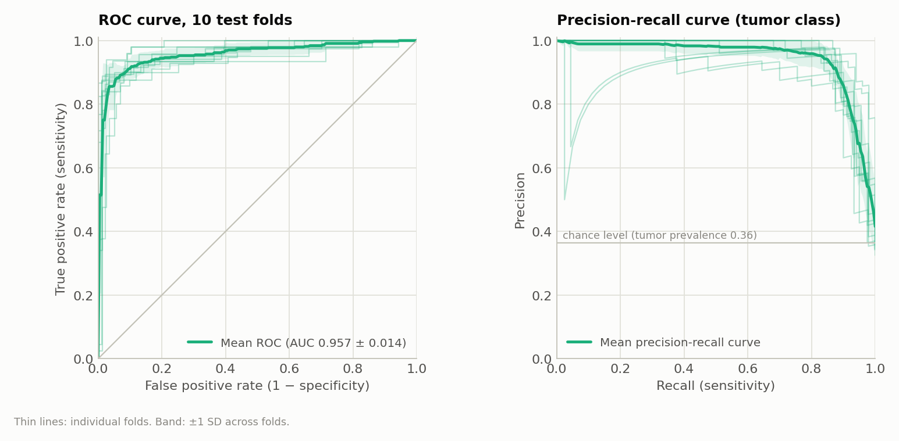
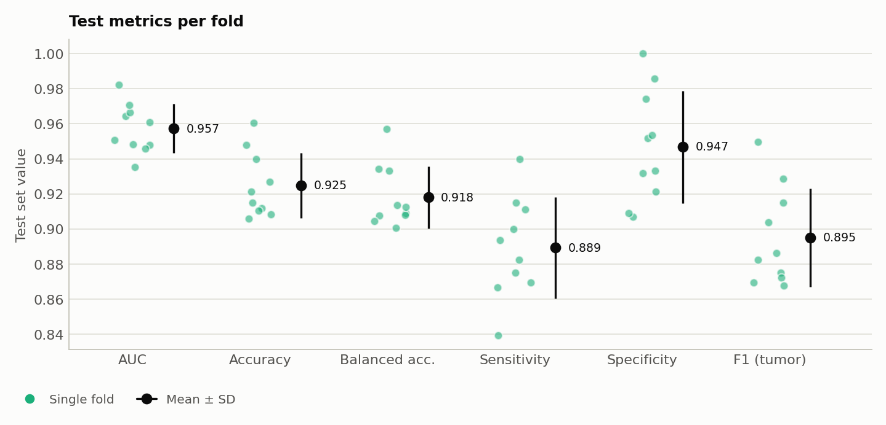
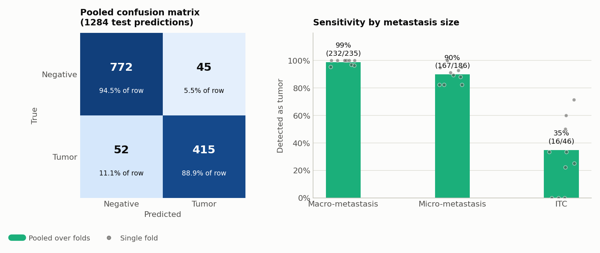
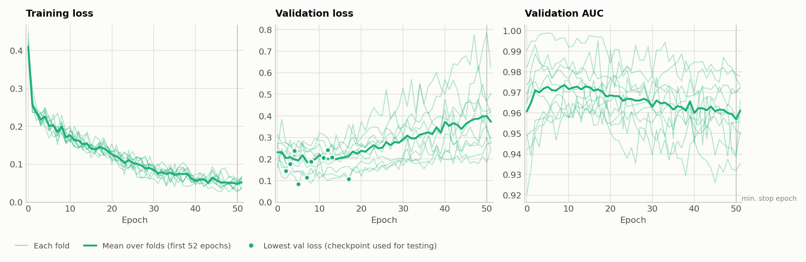
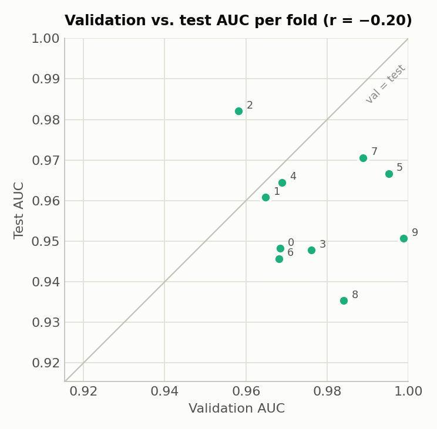

# CLAM on Camelyon+ (2-class, CONCH features, B = 32): Experiment Report

**Experiment code:** `camelyon_plus_2cls_conch_CLAM_B32_s1`
**Run date:** 2026-10-01, 10:15–11:53 (1 h 38 min for all 10 folds; see [Section 6](#6-training-time))
**Hardware:** 1 × NVIDIA GeForce RTX 3090 (24 GB)

## 1. Summary

CLAM-SB was trained on the Camelyon+ 2-class task (negative vs. tumor) with pre-extracted CONCH features, using 10-fold Monte Carlo cross-validation (80 / 10 / 10 train / val / test). All hyperparameters, splits and the seed are the same as in the ResNet-50 and UNI B = 32 runs. The only change needed for CONCH is the input dimension: 512 instead of 1024.

| Metric (test set, 10 folds) | Mean ± SD | Min | Max |
|---|---|---|---|
| **AUC** | **0.9572 ± 0.0140** | 0.9354 | 0.9821 |
| **Accuracy** | **0.9248 ± 0.0187** | 0.9060 | 0.9606 |
| Balanced accuracy | 0.9180 ± 0.0178 | 0.9007 | 0.9570 |
| Sensitivity (tumor recall) | 0.8892 ± 0.0288 | 0.8393 | 0.9400 |
| Specificity (negative recall) | 0.9468 ± 0.0320 | 0.9070 | 1.0000 |
| Precision (tumor) | 0.9034 ± 0.0586 | 0.8367 | 1.0000 |
| F1 (tumor) | 0.8950 ± 0.0281 | 0.8675 | 0.9495 |

SD is the sample standard deviation (ddof = 1) across the 10 folds. The positive class is `tumor`. Threshold-based metrics use argmax, which for two classes is a 0.5 probability threshold.

## 2. Data

| Item | Value |
|---|---|
| Dataset | Camelyon+ (cleaned CAMELYON16 + CAMELYON17), downloaded from ScienceDB |
| Labels | `slide-lables/Camelyon+(2-classes).xlsx` |
| Slides | 1350 (negative 871, tumor 479) |
| Tumor subtypes (from the 4-class labels) | macro 251, micro 174, ITC 54 |
| Cases | 586. CAMELYON17 slides are grouped by patient (`patient_XXX`); each CAMELYON16 slide is its own case |
| Features | Provided `CONCH.zip` (NAS: `/mnt/nas/Camelyon+/feature-files/`): one `[N_patches, 512]` float32 tensor per slide |
| Feature location | `/var/tmp/shouteng_data/CLAM_DATA/camelyon_plus_conch/pt_files/` (1350 files, 21 GB) |
| Dataset CSV | `dataset_csv/camelyon_plus_2cls.csv` (`case_id, slide_id, label`) |

- The features were used as provided with the Camelyon+ dataset and were not re-extracted. The 512-dimensional output matches CONCH v1. The dataset also contains a separate `CONCH-V1.5.zip`, which was not used.
- After extraction, the 1350 file names were checked against the slide IDs in the dataset CSV: none missing, none extra.
- The spot-checked slides have exactly the same number of patches as the ResNet-50 and UNI features, so the features cover the same patches.
- The 4-class labels (`slide-lables/Camelyon+(4-classes).xlsx`) were not used for training. They are used only in [Section 5](#5-per-fold-test-results) to break down sensitivity by metastasis size.

## 3. Data Splits: 10-fold Monte Carlo Cross-Validation

The splits are the same files used by the ResNet-50 and UNI runs, so all runs are evaluated on identical train / val / test sets in every fold.

```bash
python create_splits_seq.py --task camelyon_plus_2cls --seed 1 --k 10
```

- Each fold independently samples 10% validation and 10% test cases per class. The remaining 80% of cases are used for training.
- Test sets of different folds may overlap, which is expected for Monte Carlo CV. The 10 test sets contain 1284 slide predictions covering 853 unique slides.
- Sampling is done at the patient level (`patient_strat=True`), so no patient appears in more than one of train / val / test within a fold. The patient label is `max` over its slides, meaning a patient is tumor if any of its slides is tumor.
- Because CAMELYON17 patients contribute up to 5 slides, the 80/10/10 ratio holds for cases, not exactly for slides.
- Split files: `splits/camelyon_plus_2cls_100/splits_{0..9}.csv`.

| Fold | Train slides | Val slides | Test slides | Test negative | Test tumor (macro / micro / ITC) |
|---|---|---|---|---|---|
| 0 | 1091 | 136 | 123 | 83 | 40 (12 / 25 / 3) |
| 1 | 1064 | 150 | 136 | 89 | 47 (28 / 17 / 2) |
| 2 | 1085 | 138 | 127 | 77 | 50 (25 / 20 / 5) |
| 3 | 1080 | 139 | 131 | 86 | 45 (22 / 19 / 4) |
| 4 | 1087 | 122 | 141 | 90 | 51 (33 / 14 / 4) |
| 5 | 1065 | 151 | 134 | 88 | 46 (27 / 17 / 2) |
| 6 | 1093 | 142 | 115 | 70 | 45 (24 / 17 / 4) |
| 7 | 1095 | 122 | 133 | 86 | 47 (21 / 19 / 7) |
| 8 | 1114 | 119 | 117 | 77 | 40 (19 / 15 / 6) |
| 9 | 1098 | 125 | 127 | 71 | 56 (24 / 23 / 9) |

## 4. Training Configuration

```bash
CUDA_VISIBLE_DEVICES=0 python main.py --drop_out 0.25 --early_stopping --lr 2e-4 --k 10 \
  --exp_code camelyon_plus_2cls_conch_CLAM_B32 --weighted_sample --bag_loss ce --inst_loss svm \
  --task camelyon_plus_2cls --model_type clam_sb --log_data \
  --data_root_dir /var/tmp/shouteng_data/CLAM_DATA --feature_dir camelyon_plus_conch --embed_dim 512 --B 32
```

| Setting | Value |
|---|---|
| Model | CLAM-SB (single attention branch), `model_size = small` (layer widths **512** → 512 → 256) |
| Input embedding dim | **512** |
| Dropout | 0.25 |
| Optimizer | Adam, lr = 2e-4, weight decay = 1e-5 |
| Bag-level loss | Cross-entropy |
| Instance-level loss | Smooth top-1 SVM, B = 32 |
| Loss weighting | 0.7 × bag loss + 0.3 × instance loss |
| Class imbalance | `--weighted_sample`: sampling weight per slide = N / N_class, i.e. inversely proportional to class size |
| Max epochs | 200 |
| Early stopping | Monitors validation loss, patience 20, not before epoch 50. The checkpoint with the lowest validation loss is used for testing |
| Seed | 1 |

Compared with the ResNet-50 and UNI B = 32 runs, two flags changed: `--feature_dir camelyon_plus_conch` and `--embed_dim 512`. Changing `embed_dim` changes only the first fully connected layer of CLAM, from `Linear(1024, 512)` to `Linear(512, 512)`, which has about half as many parameters (262,656 instead of 524,800). All later layers (attention network, classifiers, instance classifiers) are identical.

## 5. Per-Fold Test Results

| Fold | Epochs run | Best val-loss epoch | Val AUC | Val Acc | **Test AUC** | **Test Acc** | Sens. | Spec. | F1 |
|---|---|---|---|---|---|---|---|---|---|
| 0 | 52 | 12 | 0.9684 | 0.9191 | 0.9482 | 0.9268 | 0.8750 | 0.9518 | 0.8861 |
| 1 | 52 | 11 | 0.9649 | 0.9400 | 0.9608 | 0.9118 | 0.8936 | 0.9213 | 0.8750 |
| 2 | 52 | 4 | 0.9582 | 0.9203 | 0.9821 | 0.9606 | 0.9400 | 0.9740 | 0.9495 |
| 3 | 52 | 13 | 0.9761 | 0.9424 | 0.9478 | 0.9084 | 0.9111 | 0.9070 | 0.8723 |
| 4 | 52 | 8 | 0.9689 | 0.9426 | 0.9645 | 0.9149 | 0.8824 | 0.9333 | 0.8824 |
| 5 | 52 | 17 | 0.9951 | 0.9536 | 0.9667 | 0.9104 | 0.8696 | 0.9318 | 0.8696 |
| 6 | 52 | 3 | 0.9681 | 0.9437 | 0.9457 | 0.9478 | 0.8667 | 1.0000 | 0.9286 |
| 7 | 52 | 2 | 0.9889 | 0.9508 | 0.9706 | 0.9398 | 0.9149 | 0.9535 | 0.9149 |
| 8 | 52 | 7 | 0.9841 | 0.9748 | 0.9354 | 0.9060 | 0.9000 | 0.9091 | 0.8675 |
| 9 | 52 | 5 | 0.9989 | 0.9600 | 0.9507 | 0.9213 | 0.8393 | 0.9859 | 0.9038 |
| **Mean** | | | 0.9771 | 0.9447 | **0.9572** | **0.9248** | 0.8892 | 0.9468 | 0.8950 |
| **SD** | | | 0.0138 | 0.0168 | 0.0140 | 0.0187 | 0.0288 | 0.0320 | 0.0281 |

"Epochs run" and "Best val-loss epoch" (0-indexed) are read from the TensorBoard logs.



*Figure 1. ROC curve (left) and precision-recall curve for the tumor class (right). Thin lines are the 10 test folds; the thick line is the mean over folds and the band is ±1 SD.*



*Figure 2. Test metrics of each fold (colored dots) with the mean ± SD (black). Sensitivity varies the most between folds.*

### Pooled confusion matrix (all 10 test folds, 1284 slide predictions)

Test sets overlap across folds, so some slides are counted more than once.

| | Predicted negative | Predicted tumor |
|---|---|---|
| **True negative** | 772 | 45 |
| **True tumor** | 52 | 415 |

The AUC computed on the pooled predictions is 0.9563, close to the mean per-fold AUC (0.9572). The fold models' scores are therefore more consistently calibrated than with ResNet-50 (pooled 0.8988 vs. per-fold mean 0.9029) or UNI (0.9539 vs. 0.9593).

### Sensitivity by metastasis size

Tumor slides were split by their 4-class label. "Pooled" counts all 1284 test predictions together. "Per-fold mean ± SD" averages the per-fold detection rate. Per-fold counts are small (2–9 ITC slides per fold), so the pooled value is the more stable estimate.

| Subtype | Detected / total (pooled) | Sensitivity (pooled) | Per-fold mean ± SD |
|---|---|---|---|
| Macro-metastasis | 232 / 235 | 0.987 | 0.989 ± 0.019 |
| Micro-metastasis | 167 / 186 | 0.898 | 0.898 ± 0.061 |
| ITC | 16 / 46 | 0.348 | 0.295 ± 0.254 |
| Negative (false-positive rate) | 45 / 817 | 0.055 | |



*Figure 3. Pooled confusion matrix over all test folds (left; cell color is the share of the true-class row) and sensitivity by metastasis size (right; bars are pooled rates, dots are single folds). Macro- and micro-metastases are detected well; ITCs remain the hardest class, and their per-fold detection rate varies widely.*

## 6. Training Time

Folds were run sequentially on a single RTX 3090. The times below are taken from the TensorBoard event timestamps. Each time runs from the moment a fold's log writer was created to the fold's last logged event, so it includes training, per-epoch validation and the final test evaluation.

| Fold | Start | End | Duration | Epochs run | Time / epoch |
|---|---|---|---|---|---|
| 0 | 10:15:09 | 10:24:58 | 9.8 min | 52 | 11.3 s |
| 1 | 10:24:58 | 10:34:40 | 9.7 min | 52 | 11.2 s |
| 2 | 10:34:40 | 10:44:28 | 9.8 min | 52 | 11.3 s |
| 3 | 10:44:28 | 10:54:26 | 10.0 min | 52 | 11.5 s |
| 4 | 10:54:26 | 11:04:10 | 9.7 min | 52 | 11.2 s |
| 5 | 11:04:10 | 11:13:56 | 9.8 min | 52 | 11.3 s |
| 6 | 11:13:56 | 11:23:50 | 9.9 min | 52 | 11.4 s |
| 7 | 11:23:50 | 11:33:43 | 9.9 min | 52 | 11.4 s |
| 8 | 11:33:43 | 11:43:29 | 9.8 min | 52 | 11.3 s |
| 9 | 11:43:29 | 11:53:28 | 10.0 min | 52 | 11.5 s |
| **Total** | 10:15:09 | 11:53:28 | **98.3 min (1 h 38 min)** | 520 | **11.3 s (mean)** |

All times are on 2026-10-01.

- One epoch takes about 11.3 s, about 35% less than ResNet-50 (17.5 s) and UNI (17.7 s). The features are half as large (21 GB vs. 42 GB), which suggests that training time is limited mainly by loading the feature files rather than by GPU compute.
- All 10 folds stopped at the earliest allowed point (52 epochs), so every fold took about 10 min.

## 7. Observations



*Figure 4. Training loss, validation loss and validation AUC per epoch. Thin lines are folds, the thick line is the mean over the first 52 epochs (all folds ran at least 52), and dots mark the epoch with the lowest validation loss, whose checkpoint is used for testing. The vertical line marks epoch 50, the earliest epoch at which early stopping may trigger. The validation loss is lowest between epochs 2 and 17 and then rises slowly; the training loss stays above 0.03, so overfitting is milder than with UNI.*

- **Sensitivity is much higher than with ResNet-50.** Macro-metastases are detected 99% of the time and micro-metastases 90%. ITCs are still the hardest class: 16 of 46 (35%) are detected.
- **Specificity is the lowest of the three encoders, but only slightly.** CONCH has 45 pooled false positives (5.5%), compared with 37 for ResNet-50 and 31 for UNI. The difference from the other two is not significant over 10 folds (see [Section 8](#8-comparison-with-resnet-50-and-uni-b--32)).
- **Results are the most stable across folds of the three encoders.** CONCH has the smallest test AUC SD (0.014, compared with 0.019 for UNI and 0.028 for ResNet-50), and its worst fold (0.935) is better than the worst UNI fold (0.927).
- **The model converges within a few epochs and then overfits, but more mildly than UNI.** The lowest validation loss is reached between epochs 2 and 17 (mean 8.2), and all folds stop at epoch 52. At the last epoch, the training loss is 0.034–0.068 (UNI: 0.003 or less in 9 of 10 folds) and the validation loss is 0.24–0.62 (UNI: 0.25–1.18). The hyperparameters were kept identical to the ResNet-50 run for a fair comparison. They may not be optimal for CONCH features, but this was not tested.
- **Validation AUC is close to saturation and does not predict test AUC.** Mean val AUC is 0.977, and the correlation between val AUC and test AUC across folds is r = −0.20.



*Figure 5. Validation AUC vs. test AUC for each fold (numbers are fold indices). Points far from the diagonal show that validation AUC does not predict test AUC.*

## 8. Comparison with ResNet-50 and UNI (B = 32)

Three runs used identical splits, seeds and hyperparameters. The only differences are the feature files and, for CONCH, the input dimension (512 instead of 1024). Per-fold results of the other runs are in their own reports:

- ResNet-50: `results/camelyon_plus_2cls_resnet50_CLAM_B32_s1/experiment_report.md`
- UNI: `results/camelyon_plus_2cls_uni_CLAM_B32_s1/experiment_report.md`

ResNet-50 here means our own ResNet-50 B = 32 run, not the number reported in the original CLAM paper.

### Final performance (test set, mean ± SD over 10 folds)

| Metric | ResNet-50 | UNI | **CONCH (this run)** |
|---|---|---|---|
| AUC | 0.9029 ± 0.0280 | 0.9593 ± 0.0190 | **0.9572 ± 0.0140** |
| Accuracy | 0.8771 ± 0.0320 | 0.9376 ± 0.0208 | **0.9248 ± 0.0187** |
| Balanced accuracy | 0.8489 ± 0.0325 | 0.9289 ± 0.0214 | **0.9180 ± 0.0178** |
| Sensitivity | 0.7438 ± 0.0524 | 0.8954 ± 0.0347 | **0.8892 ± 0.0288** |
| Specificity | 0.9539 ± 0.0359 | 0.9625 ± 0.0231 | **0.9468 ± 0.0320** |
| Precision | 0.9056 ± 0.0695 | 0.9317 ± 0.0409 | **0.9034 ± 0.0586** |
| F1 (tumor) | 0.8148 ± 0.0449 | 0.9125 ± 0.0270 | **0.8950 ± 0.0281** |
| F1 (macro) | 0.8612 ± 0.0343 | 0.9318 ± 0.0219 | **0.9181 ± 0.0209** |
| mAP (macro) | 0.8977 ± 0.0393 | 0.9539 ± 0.0269 | **0.9532 ± 0.0204** |
| Pooled AUC (1284 predictions) | 0.8988 | 0.9539 | **0.9563** |
| Mean val AUC | 0.9234 | 0.9763 | **0.9771** |


*Figure 6. Test metrics of the three encoders, mean ± SD over 10 folds. The y-axis starts at 0.6.*


*Figure 7. Test AUC of each encoder in each fold. Within a fold, all encoders are evaluated on the same test set, and the gray line connects them.*

### Paired difference of CONCH from each other encoder (same splits in every fold)

The p-values are from the two-sided Wilcoxon signed-rank test over the 10 folds (exact test, smallest possible p = 0.002).

| Metric | CONCH − ResNet-50 | Folds CONCH better | p | CONCH − UNI | Folds CONCH better | p |
|---|---|---|---|---|---|---|
| AUC | +0.0543 ± 0.0199 | 10 / 10 | 0.002 | −0.0021 ± 0.0173 | 5 / 10 | 0.92 |
| Accuracy | +0.0476 ± 0.0340 | 8 / 10 (1 tie) | 0.008 | −0.0128 ± 0.0190 | 1 / 10 (2 ties) | 0.078 |
| Balanced accuracy | +0.0691 ± 0.0335 | 10 / 10 | 0.002 | −0.0109 ± 0.0184 | 2 / 10 (1 tie) | 0.13 |
| Sensitivity | +0.1454 ± 0.0491 | 10 / 10 | 0.002 | −0.0061 ± 0.0184 | 1 / 10 (6 ties) | 0.63 |
| Specificity | −0.0071 ± 0.0381 | 4 / 10 | 0.63 | −0.0157 ± 0.0252 | 1 / 10 (1 tie) | 0.090 |
| F1 (tumor) | +0.0801 ± 0.0463 | 10 / 10 | 0.002 | −0.0175 ± 0.0251 | 2 / 10 (1 tie) | 0.055 |
| mAP (macro) | +0.0555 ± 0.0271 | 10 / 10 | 0.002 | −0.0007 ± 0.0191 | 5 / 10 | 1.0 |

### Sensitivity by metastasis size (pooled over all test folds)

| Subtype | ResNet-50 | UNI | **CONCH (this run)** |
|---|---|---|---|
| Macro (235) | 0.970 (228) | 0.987 (232) | **0.987** (232) |
| Micro (186) | 0.640 (119) | 0.892 (166) | **0.898** (167) |
| ITC (46) | 0.022 (1) | 0.435 (20) | **0.348** (16) |
| False-positive rate on negatives (817) | 0.045 (37) | 0.038 (31) | **0.055** (45) |


*Figure 8. Share of tumor slides detected, by metastasis size, pooled over all test folds.*

### Interpretation

- **CONCH vs. ResNet-50: a large, consistent improvement.** CONCH is better on AUC in all 10 folds (+0.054). The gain comes from sensitivity (+0.15): micro-metastasis detection rises from 0.64 to 0.90, and ITC detection from almost zero to 0.35. Specificity is about the same (−0.007, not significant).
- **CONCH vs. UNI: essentially tied on ranking metrics.** AUC and mAP differ by 0.002 or less, and each encoder wins 5 of 10 folds. CONCH has the best pooled AUC (0.9563) and the smallest fold variance. At the default 0.5 threshold, CONCH is slightly behind UNI: accuracy −0.013, F1 −0.018, specificity −0.016, and 14 more false positives pooled. None of these differences is significant (all p ≥ 0.055).
- **CONCH is the cheapest of the three.** With half the feature dimension, the features take half the disk space (21 GB) and training is about 36% faster (1 h 38 min vs. 2 h 34 min for UNI), for practically the same AUC as UNI.

## 9. Code Changes to the CLAM Repository

| File | Change |
|---|---|
| `main.py`, `eval.py` | Added task `camelyon_plus_2cls` (labels `negative: 0`, `tumor: 1`). Added `--feature_dir` to select the feature folder under `--data_root_dir` (default `camelyon_plus_resnet50`). `main.py` also writes `embed_dim` and `feature_dir` to the settings file |
| `create_splits_seq.py` | Added task `camelyon_plus_2cls` (`patient_strat=True`) |
| `utils/core_utils.py` | Replaced `np.Inf` with `np.inf` for NumPy 2.x compatibility |
| `dataset_csv/camelyon_plus_2cls.csv` | Dataset CSV built from the Camelyon+ 2-class label file |

## 10. Output Files

All files are under `results/camelyon_plus_2cls_conch_CLAM_B32_s1/`:

- `summary.csv`: per-fold test / val AUC and accuracy
- `s_{k}_checkpoint.pt`: model checkpoint with the lowest validation loss for fold k
- `split_{k}_results.pkl`: per-slide test predictions (`slide_id`, class probabilities, label)
- `splits_{k}.csv`: copy of the split used for fold k
- `{k}/events.out.tfevents.*`: TensorBoard logs
- `figures/`: figures for this run. The comparison figures are in `results/figures/`. All figures are generated by `results/make_report_figures.py`
- `experiment_camelyon_plus_2cls_conch_CLAM_B32.txt`: full settings dictionary, including `embed_dim` and `feature_dir`

To re-evaluate the saved checkpoints (`--embed_dim 512` is required to load the CONCH checkpoints):

```bash
CUDA_VISIBLE_DEVICES=0 python eval.py --k 10 --models_exp_code camelyon_plus_2cls_conch_CLAM_B32_s1 \
  --save_exp_code camelyon_plus_2cls_conch_CLAM_B32_s1_cv --task camelyon_plus_2cls --model_type clam_sb \
  --results_dir results --data_root_dir /var/tmp/shouteng_data/CLAM_DATA \
  --feature_dir camelyon_plus_conch --embed_dim 512
```
