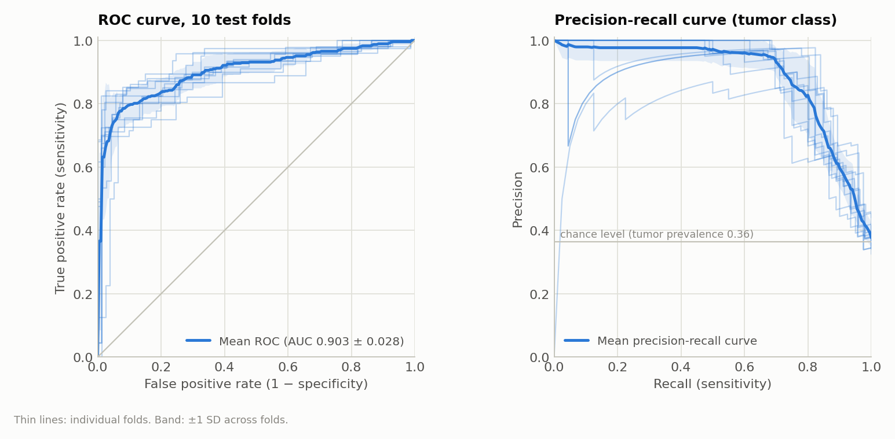
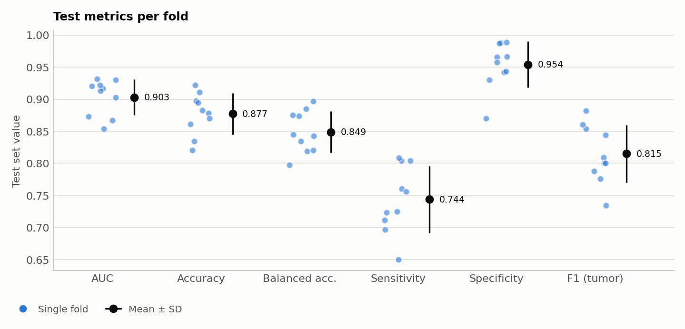
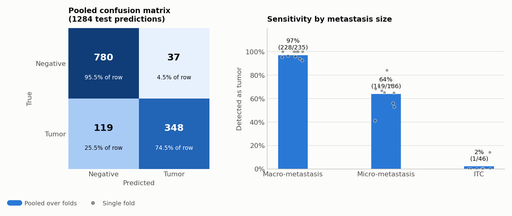
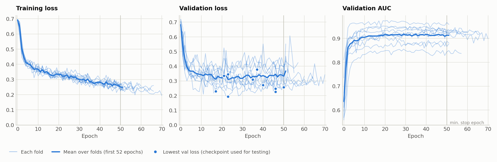
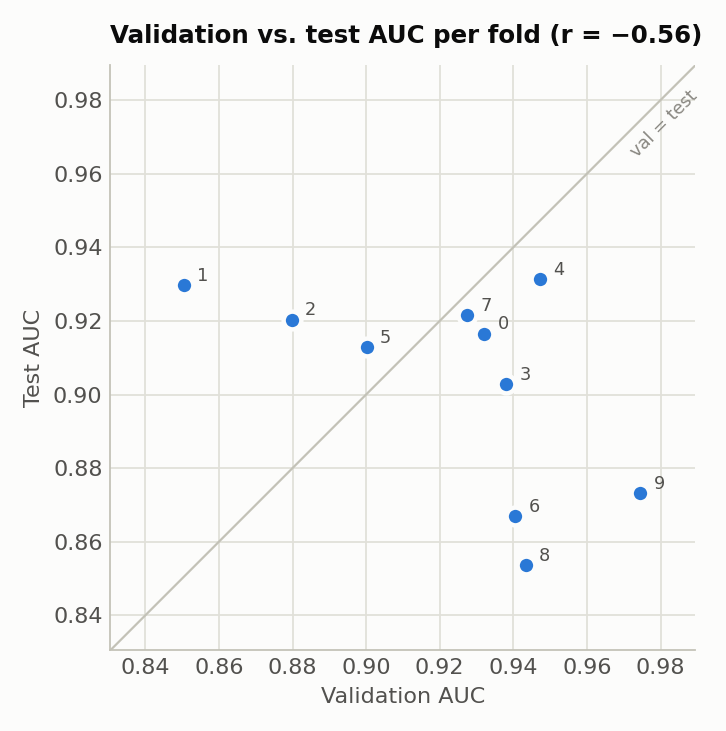
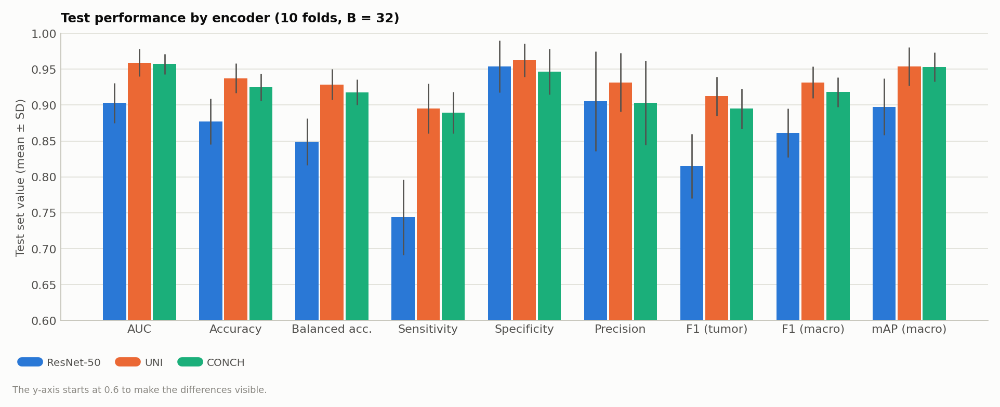
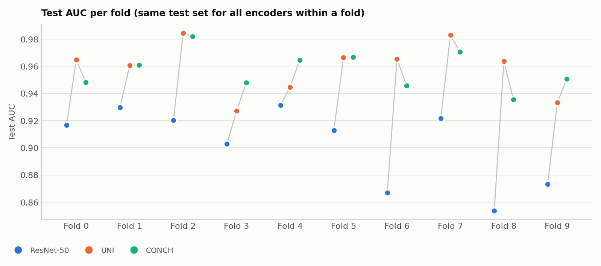
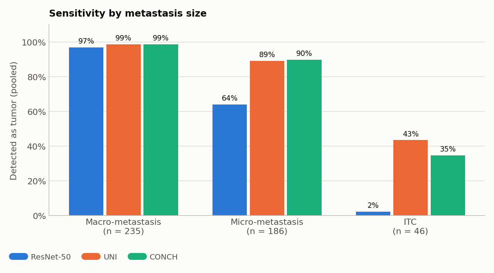

# CLAM on Camelyon+ (2-class, ResNet-50 features, B = 32): Experiment Report

**Experiment code:** `camelyon_plus_2cls_resnet50_CLAM_B32_s1`
**Run date:** 2026-09-29, 11:21–14:13 (2 h 51 min for all 10 folds; see [Section 6](#6-training-time))
**Hardware:** 1 × NVIDIA GeForce RTX 3090 (24 GB)

## 1. Summary

CLAM-SB was trained on the Camelyon+ 2-class task (negative vs. tumor) with pre-extracted ResNet-50 features, using 10-fold Monte Carlo cross-validation (80 / 10 / 10 train / val / test). The number of sampled instances per class for the instance-level loss was set to B = 32, the value used in the original CLAM paper. All other settings are the same as the earlier B = 8 run (`camelyon_plus_2cls_resnet50_CLAM_s1`).

| Metric (test set, 10 folds) | Mean ± SD | Min | Max |
|---|---|---|---|
| **AUC** | **0.9029 ± 0.0280** | 0.8536 | 0.9314 |
| **Accuracy** | **0.8771 ± 0.0320** | 0.8205 | 0.9220 |
| Balanced accuracy | 0.8489 ± 0.0325 | 0.7976 | 0.8964 |
| Sensitivity (tumor recall) | 0.7438 ± 0.0524 | 0.6500 | 0.8085 |
| Specificity (negative recall) | 0.9539 ± 0.0359 | 0.8701 | 0.9889 |
| Precision (tumor) | 0.9056 ± 0.0695 | 0.7436 | 0.9762 |
| F1 (tumor) | 0.8148 ± 0.0449 | 0.7342 | 0.8817 |

SD is the sample standard deviation (ddof = 1) across the 10 folds. The positive class is `tumor`. Threshold-based metrics use argmax, which for two classes is a 0.5 probability threshold.

## 2. Data

| Item | Value |
|---|---|
| Dataset | Camelyon+ (cleaned CAMELYON16 + CAMELYON17), downloaded from ScienceDB |
| Labels | `slide-lables/Camelyon+(2-classes).xlsx` |
| Slides | 1350 (negative 871, tumor 479) |
| Tumor subtypes (from the 4-class labels) | macro 251, micro 174, ITC 54 |
| Cases | 586. CAMELYON17 slides are grouped by patient (`patient_XXX`); each CAMELYON16 slide is its own case |
| Features | Provided `ResNet-50.zip` (NAS: `/mnt/nas/Camelyon+/feature-files/`): one `[N_patches, 1024]` float32 tensor per slide |
| Feature location | `/var/tmp/shouteng_data/CLAM_DATA/camelyon_plus_resnet50/pt_files/` |
| Dataset CSV | `dataset_csv/camelyon_plus_2cls.csv` (`case_id, slide_id, label`) |

The features were used as provided and were not re-extracted with CLAM's `extract_features_fp.py`. The 4-class labels (`slide-lables/Camelyon+(4-classes).xlsx`) were not used for training. They are used only in [Section 5](#5-per-fold-test-results) to break down sensitivity by metastasis size.

## 3. Data Splits: 10-fold Monte Carlo Cross-Validation

The splits are the same files used by the B = 8 run and by the UNI and CONCH runs, so all of these experiments are evaluated on identical train / val / test sets in every fold.

```bash
python create_splits_seq.py --task camelyon_plus_2cls --seed 1 --k 10
```

- Each fold independently samples 10% validation and 10% test cases per class. The remaining 80% of cases are used for training.
- Test sets of different folds may overlap, which is expected for Monte Carlo CV. The 10 test sets contain 1284 slide predictions covering 853 unique slides.
- Sampling is done at the patient level (`patient_strat=True`), so no patient appears in more than one of train / val / test within a fold. The patient label is `max` over its slides, meaning a patient is tumor if any of its slides is tumor.
- Because CAMELYON17 patients contribute up to 5 slides, the 80/10/10 ratio holds for cases, not exactly for slides.
- Split files: `splits/camelyon_plus_2cls_100/splits_{0..9}.csv`.

| Fold | Train slides | Val slides | Test slides | Test negative | Test tumor (macro / micro / ITC) |
|---|---|---|---|---|---|
| 0 | 1091 | 136 | 123 | 83 | 40 (12 / 25 / 3) |
| 1 | 1064 | 150 | 136 | 89 | 47 (28 / 17 / 2) |
| 2 | 1085 | 138 | 127 | 77 | 50 (25 / 20 / 5) |
| 3 | 1080 | 139 | 131 | 86 | 45 (22 / 19 / 4) |
| 4 | 1087 | 122 | 141 | 90 | 51 (33 / 14 / 4) |
| 5 | 1065 | 151 | 134 | 88 | 46 (27 / 17 / 2) |
| 6 | 1093 | 142 | 115 | 70 | 45 (24 / 17 / 4) |
| 7 | 1095 | 122 | 133 | 86 | 47 (21 / 19 / 7) |
| 8 | 1114 | 119 | 117 | 77 | 40 (19 / 15 / 6) |
| 9 | 1098 | 125 | 127 | 71 | 56 (24 / 23 / 9) |

## 4. Training Configuration

```bash
CUDA_VISIBLE_DEVICES=0 python main.py --drop_out 0.25 --early_stopping --lr 2e-4 --k 10 \
  --exp_code camelyon_plus_2cls_resnet50_CLAM_B32 --weighted_sample --bag_loss ce --inst_loss svm \
  --task camelyon_plus_2cls --model_type clam_sb --log_data \
  --data_root_dir /var/tmp/shouteng_data/CLAM_DATA --embed_dim 1024 --B 32
```

| Setting | Value |
|---|---|
| Model | CLAM-SB (single attention branch), `model_size = small` (layer widths 1024 → 512 → 256) |
| Input embedding dim | 1024 |
| Dropout | 0.25 |
| Optimizer | Adam, lr = 2e-4, weight decay = 1e-5 |
| Bag-level loss | Cross-entropy |
| Instance-level loss | Smooth top-1 SVM, **B = 32** |
| Loss weighting | 0.7 × bag loss + 0.3 × instance loss |
| Class imbalance | `--weighted_sample`: sampling weight per slide = N / N_class, i.e. inversely proportional to class size |
| Max epochs | 200 |
| Early stopping | Monitors validation loss, patience 20, not before epoch 50. The checkpoint with the lowest validation loss is used for testing |
| Seed | 1 |

The only difference from the B = 8 run is `--B 32`.

## 5. Per-Fold Test Results

| Fold | Epochs run | Best val-loss epoch | Val AUC | Val Acc | **Test AUC** | **Test Acc** | Sens. | Spec. | F1 |
|---|---|---|---|---|---|---|---|---|---|
| 0 | 61 | 40 | 0.9321 | 0.9265 | 0.9166 | 0.8780 | 0.6500 | 0.9880 | 0.7761 |
| 1 | 58 | 37 | 0.8505 | 0.8667 | 0.9297 | 0.8824 | 0.7234 | 0.9663 | 0.8095 |
| 2 | 52 | 23 | 0.8798 | 0.8841 | 0.9203 | 0.8976 | 0.7600 | 0.9870 | 0.8539 |
| 3 | 56 | 35 | 0.9381 | 0.9065 | 0.9028 | 0.8702 | 0.7556 | 0.9302 | 0.8000 |
| 4 | 67 | 46 | 0.9472 | 0.9344 | 0.9314 | 0.9220 | 0.8039 | 0.9889 | 0.8817 |
| 5 | 52 | 21 | 0.9002 | 0.8808 | 0.9128 | 0.9104 | 0.8043 | 0.9659 | 0.8605 |
| 6 | 52 | 17 | 0.9404 | 0.9296 | 0.8670 | 0.8609 | 0.7111 | 0.9571 | 0.8000 |
| 7 | 71 | 50 | 0.9274 | 0.9180 | 0.9216 | 0.8947 | 0.8085 | 0.9419 | 0.8444 |
| 8 | 67 | 46 | 0.9434 | 0.9160 | 0.8536 | 0.8205 | 0.7250 | 0.8701 | 0.7342 |
| 9 | 52 | 23 | 0.9745 | 0.9360 | 0.8732 | 0.8346 | 0.6964 | 0.9437 | 0.7879 |
| **Mean** | | | 0.9234 | 0.9098 | **0.9029** | **0.8771** | 0.7438 | 0.9539 | 0.8148 |
| **SD** | | | 0.0364 | 0.0246 | 0.0280 | 0.0320 | 0.0524 | 0.0359 | 0.0449 |

"Epochs run" and "Best val-loss epoch" (0-indexed) are read from the TensorBoard logs.



*Figure 1. ROC curve (left) and precision-recall curve for the tumor class (right). Thin lines are the 10 test folds; the thick line is the mean over folds and the band is ±1 SD.*



*Figure 2. Test metrics of each fold (colored dots) with the mean ± SD (black). Sensitivity varies the most between folds.*

### Pooled confusion matrix (all 10 test folds, 1284 slide predictions)

Test sets overlap across folds, so some slides are counted more than once.

| | Predicted negative | Predicted tumor |
|---|---|---|
| **True negative** | 780 | 37 |
| **True tumor** | 119 | 348 |

The AUC computed on the pooled predictions is 0.8988. It is lower than the mean per-fold AUC because the score calibration differs between fold models.

### Sensitivity by metastasis size

Tumor slides were split by their 4-class label. "Pooled" counts all 1284 test predictions together. "Per-fold mean ± SD" averages the per-fold detection rate. Per-fold counts are small (2–9 ITC slides per fold), so the pooled value is the more stable estimate.

| Subtype | Detected / total (pooled) | Sensitivity (pooled) | Per-fold mean ± SD |
|---|---|---|---|
| Macro-metastasis | 228 / 235 | 0.970 | 0.974 ± 0.029 |
| Micro-metastasis | 119 / 186 | 0.640 | 0.642 ± 0.118 |
| ITC | 1 / 46 | 0.022 | 0.014 ± 0.045 |
| Negative (false-positive rate) | 37 / 817 | 0.045 | |



*Figure 3. Pooled confusion matrix over all test folds (left; cell color is the share of the true-class row) and sensitivity by metastasis size (right; bars are pooled rates, dots are single folds). Macro-metastases are almost always detected, micro-metastases in about two thirds of cases, and ITCs almost never.*

## 6. Training Time

Folds were run sequentially on a single RTX 3090. The times below are taken from the TensorBoard event timestamps. Each time runs from the moment a fold's log writer was created to the fold's last logged event, so it includes training, per-epoch validation and the final test evaluation.

| Fold | Start | End | Duration | Epochs run | Time / epoch |
|---|---|---|---|---|---|
| 0 | 11:21:25 | 11:39:10 | 17.7 min | 61 | 17.5 s |
| 1 | 11:39:10 | 11:55:43 | 16.6 min | 58 | 17.1 s |
| 2 | 11:55:43 | 12:10:54 | 15.2 min | 52 | 17.5 s |
| 3 | 12:10:54 | 12:27:27 | 16.6 min | 56 | 17.7 s |
| 4 | 12:27:27 | 12:46:44 | 19.3 min | 67 | 17.3 s |
| 5 | 12:46:44 | 13:01:57 | 15.2 min | 52 | 17.5 s |
| 6 | 13:01:57 | 13:17:13 | 15.3 min | 52 | 17.6 s |
| 7 | 13:17:13 | 13:37:58 | 20.8 min | 71 | 17.5 s |
| 8 | 13:37:58 | 13:57:26 | 19.5 min | 67 | 17.4 s |
| 9 | 13:57:26 | 14:12:45 | 15.3 min | 52 | 17.7 s |
| **Total** | 11:21:25 | 14:12:45 | **171.3 min (2 h 51 min)** | 588 | **17.5 s (mean)** |

All times are on 2026-09-29.

- One epoch takes about 17.5 s, the same as with B = 8. Increasing B from 8 to 32 has no measurable effect on speed.
- The run took 9 min longer than the B = 8 run only because more folds trained past epoch 52 (588 vs. 556 epochs in total).

## 7. Observations



*Figure 4. Training loss, validation loss and validation AUC per epoch. Thin lines are folds, the thick line is the mean over the first 52 epochs (all folds ran at least 52), and dots mark the epoch with the lowest validation loss, whose checkpoint is used for testing. The vertical line marks epoch 50, the earliest epoch at which early stopping may trigger. The validation loss starts near ln 2 ≈ 0.69 and reaches its minimum between epochs 17 and 50. The training loss is still about 0.25 at the end, so the model does not strongly overfit.*

- **Low sensitivity remains the main weakness, and it comes from small metastases.** Specificity is high (0.95), but about 26% of tumor slides are missed. The breakdown by subtype shows where: macro-metastases are detected 97% of the time, micro-metastases 64%, and ITCs almost never (1 of 46). This confirms the hypothesis in the B = 8 report that small metastases, which occupy very few patches, are what the model misses.
- **Fold variance is moderate.** Test AUC ranges from 0.854 to 0.931. Validation AUC does not predict test AUC: across folds the correlation is negative (r = −0.57). For example, fold 9 has the highest val AUC (0.975) but one of the lowest test AUCs (0.873). Validation sets are small (about 120–150 slides), so model selection is noisy.
- **Training converges slowly but steadily.** The first-epoch validation loss is close to ln 2 ≈ 0.69 in every fold, and the lowest validation loss is reached between epochs 17 and 50 (mean 33.8). 6 of 10 folds trained beyond the minimum of 52 epochs. The training loss at the end is still around 0.19–0.27, so the model does not strongly overfit the ResNet-50 features.



*Figure 5. Validation AUC vs. test AUC for each fold (numbers are fold indices). Points far from the diagonal show that validation AUC does not predict test AUC.*

## 8. Comparison with UNI and CONCH (B = 32)

Three runs used identical splits, seeds and hyperparameters. The only differences are the feature files and, for CONCH, the input dimension (512 instead of 1024). Per-fold results of the UNI and CONCH runs are in their own reports:

- UNI: `results/camelyon_plus_2cls_uni_CLAM_B32_s1/experiment_report.md`
- CONCH: `results/camelyon_plus_2cls_conch_CLAM_B32_s1/experiment_report.md`

### Final performance (test set, mean ± SD over 10 folds)

| Metric | **ResNet-50 (this run)** | UNI | CONCH |
|---|---|---|---|
| AUC | **0.9029 ± 0.0280** | 0.9593 ± 0.0190 | 0.9572 ± 0.0140 |
| Accuracy | **0.8771 ± 0.0320** | 0.9376 ± 0.0208 | 0.9248 ± 0.0187 |
| Balanced accuracy | **0.8489 ± 0.0325** | 0.9289 ± 0.0214 | 0.9180 ± 0.0178 |
| Sensitivity | **0.7438 ± 0.0524** | 0.8954 ± 0.0347 | 0.8892 ± 0.0288 |
| Specificity | **0.9539 ± 0.0359** | 0.9625 ± 0.0231 | 0.9468 ± 0.0320 |
| Precision | **0.9056 ± 0.0695** | 0.9317 ± 0.0409 | 0.9034 ± 0.0586 |
| F1 (tumor) | **0.8148 ± 0.0449** | 0.9125 ± 0.0270 | 0.8950 ± 0.0281 |
| F1 (macro) | **0.8612 ± 0.0343** | 0.9318 ± 0.0219 | 0.9181 ± 0.0209 |
| mAP (macro) | **0.8977 ± 0.0393** | 0.9539 ± 0.0269 | 0.9532 ± 0.0204 |
| Pooled AUC (1284 predictions) | **0.8988** | 0.9539 | 0.9563 |
| Mean val AUC | **0.9234** | 0.9763 | 0.9771 |



*Figure 6. Test metrics of the three encoders, mean ± SD over 10 folds. The y-axis starts at 0.6.*



*Figure 7. Test AUC of each encoder in each fold. Within a fold, all encoders are evaluated on the same test set, and the gray line connects them.*

### Paired difference from ResNet-50 (same splits in every fold)

Because the three runs share the same test set in each fold, the per-fold difference can be tested directly. The p-values are from the two-sided Wilcoxon signed-rank test over the 10 folds (exact test, smallest possible p = 0.002).

| Metric | UNI − ResNet-50 | Folds UNI better | p | CONCH − ResNet-50 | Folds CONCH better | p |
|---|---|---|---|---|---|---|
| AUC | +0.0564 ± 0.0305 | 10 / 10 | 0.002 | +0.0543 ± 0.0199 | 10 / 10 | 0.002 |
| Accuracy | +0.0604 ± 0.0261 | 10 / 10 | 0.002 | +0.0476 ± 0.0340 | 8 / 10 (1 tie) | 0.008 |
| Balanced accuracy | +0.0801 ± 0.0259 | 10 / 10 | 0.002 | +0.0691 ± 0.0335 | 10 / 10 | 0.002 |
| Sensitivity | +0.1515 ± 0.0382 | 10 / 10 | 0.002 | +0.1454 ± 0.0491 | 10 / 10 | 0.002 |
| Specificity | +0.0086 ± 0.0319 | 4 / 10 (2 ties) | 0.64 | −0.0071 ± 0.0381 | 4 / 10 | 0.63 |
| F1 (tumor) | +0.0976 ± 0.0361 | 10 / 10 | 0.002 | +0.0801 ± 0.0463 | 10 / 10 | 0.002 |

### Sensitivity by metastasis size (pooled over all test folds)

| Subtype | **ResNet-50 (this run)** | UNI | CONCH |
|---|---|---|---|
| Macro (235) | **0.970** (228) | 0.987 (232) | 0.987 (232) |
| Micro (186) | **0.640** (119) | 0.892 (166) | 0.898 (167) |
| ITC (46) | **0.022** (1) | 0.435 (20) | 0.348 (16) |
| False-positive rate on negatives (817) | **0.045** (37) | 0.038 (31) | 0.055 (45) |



*Figure 8. Share of tumor slides detected, by metastasis size, pooled over all test folds.*

### Interpretation

- **ResNet-50 is clearly the weakest of the three encoders.** Both foundation-model encoders beat it on AUC in all 10 folds, by about 0.055 on average. This gap is about twice the fold-to-fold SD and is statistically significant (p = 0.002).
- **The gap is almost entirely in sensitivity.** Specificity is about the same for all three encoders (0.95–0.96, no significant difference), but sensitivity rises from 0.74 to about 0.89. The subtype breakdown shows that the gain comes from small metastases. Micro-metastasis detection rises from 0.64 to about 0.90, and ITC detection from almost zero to 0.35–0.44. Macro-metastases are already detected well with ResNet-50.
- **Training behavior differs.** The ResNet-50 model reaches its lowest validation loss at epoch 17–50. UNI and CONCH reach theirs within the first few epochs (mean 4.8 and 8.2) and then overfit. With identical hyperparameters, the foundation-model features are much easier to separate.
- **Training time per epoch is the same for ResNet-50 and UNI (17.5 vs. 17.7 s), and lower for CONCH (11.3 s).** Both ResNet-50 and UNI features have 1024 dimensions, so the data loaded per epoch is the same. CONCH features have half as many dimensions.

## 9. Code Changes to the CLAM Repository

| File | Change |
|---|---|
| `main.py`, `eval.py` | Added task `camelyon_plus_2cls` (labels `negative: 0`, `tumor: 1`). Added `--feature_dir` (default `camelyon_plus_resnet50`), so this run uses the same feature folder as before. `main.py` also writes `embed_dim` and `feature_dir` to the settings file (added after this run, so this run's settings file does not contain them) |
| `create_splits_seq.py` | Added task `camelyon_plus_2cls` (`patient_strat=True`) |
| `utils/core_utils.py` | Replaced `np.Inf` with `np.inf` for NumPy 2.x compatibility |
| `dataset_csv/camelyon_plus_2cls.csv` | Dataset CSV built from the Camelyon+ 2-class label file |
| `create_splits_camelyon_plus.py` | Script for the official CAMELYON16/17 train/test splits (`splits/camelyon_plus_2cls_official/`). Not used in this experiment |

## 10. Output Files

All files are under `results/camelyon_plus_2cls_resnet50_CLAM_B32_s1/`:

- `summary.csv`: per-fold test / val AUC and accuracy
- `s_{k}_checkpoint.pt`: model checkpoint with the lowest validation loss for fold k
- `split_{k}_results.pkl`: per-slide test predictions (`slide_id`, class probabilities, label)
- `splits_{k}.csv`: copy of the split used for fold k
- `{k}/events.out.tfevents.*`: TensorBoard logs
- `figures/`: figures for this run. The comparison figures are in `results/figures/`. All figures are generated by `results/make_report_figures.py`
- `experiment_camelyon_plus_2cls_resnet50_CLAM_B32.txt`: full settings dictionary
- `paper_comparison_report.md`: comparison with the original CLAM paper and with the B = 8 run

To re-evaluate the saved checkpoints:

```bash
CUDA_VISIBLE_DEVICES=0 python eval.py --k 10 --models_exp_code camelyon_plus_2cls_resnet50_CLAM_B32_s1 \
  --save_exp_code camelyon_plus_2cls_resnet50_CLAM_B32_s1_cv --task camelyon_plus_2cls --model_type clam_sb \
  --results_dir results --data_root_dir /var/tmp/shouteng_data/CLAM_DATA \
  --feature_dir camelyon_plus_resnet50 --embed_dim 1024
```
