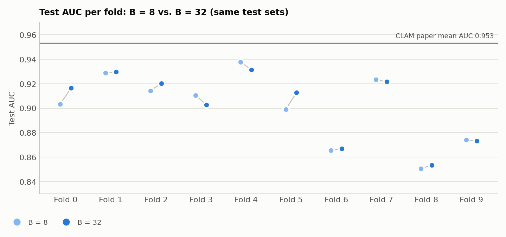
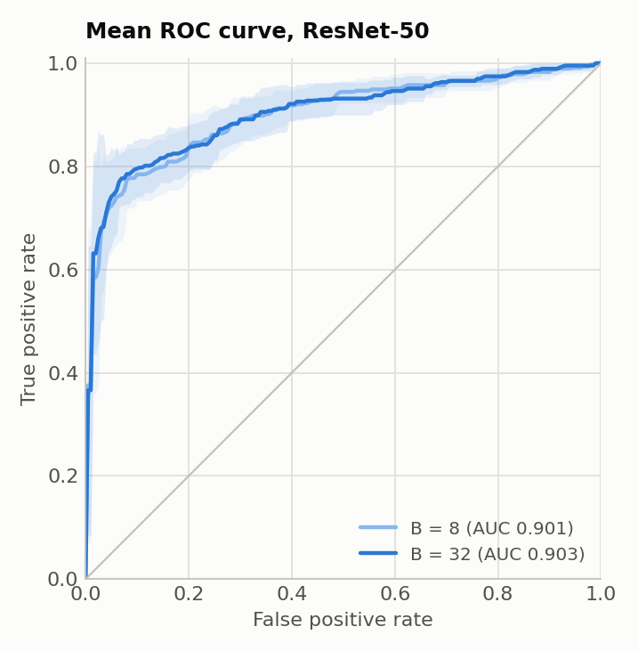
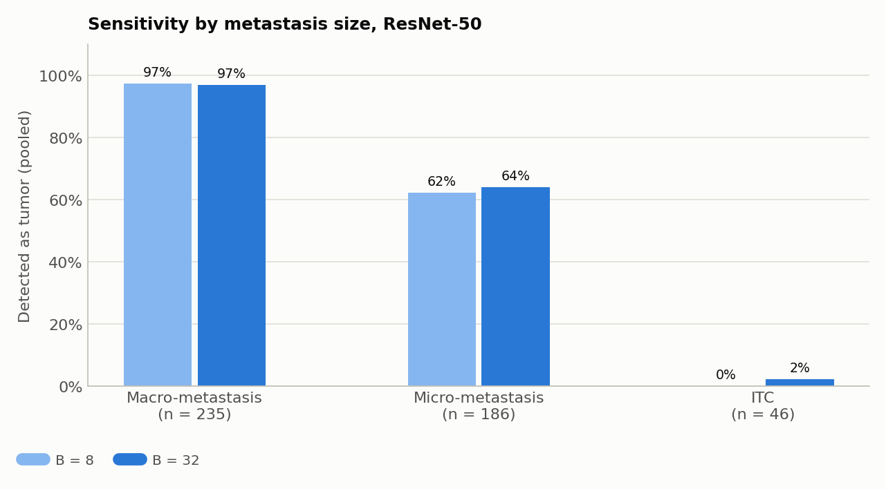
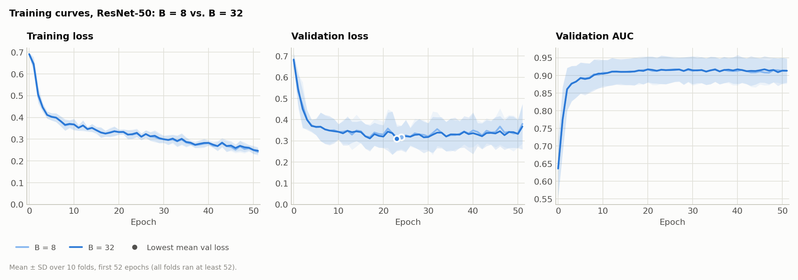
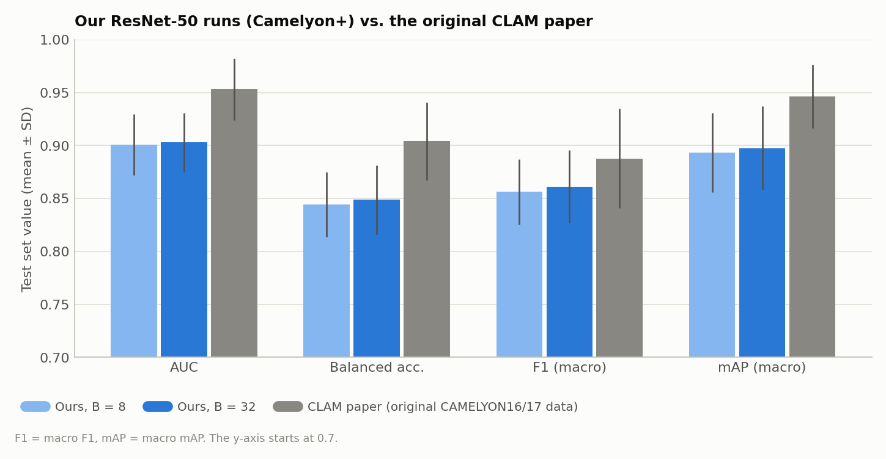

# CLAM-SB with ResNet-50 on Camelyon+: Comparison with the Original CLAM Paper and Effect of B

**Runs compared:**

| Label | Experiment code | B | Run date |
|---|---|---|---|
| ResNet-50, B = 8 | `camelyon_plus_2cls_resnet50_CLAM_s1` | 8 (CLAM default) | 2026-09-24 |
| ResNet-50, B = 32 | `camelyon_plus_2cls_resnet50_CLAM_B32_s1` | 32 (value used in the original CLAM paper) | 2026-09-29 |
| CLAM paper | CLAM-SB with ResNet-50, as reported in the original CLAM paper (Lu et al., 2021) | 32 | |

"CLAM paper" (or "the paper") in this report means the CLAM-SB / ResNet-50 result reported in the original CLAM paper. These are the same numbers used in the B = 8 report (`results/camelyon_plus_2cls_resnet50_CLAM_s1/experiment_report.md`, Section 8). The Camelyon+ project provided only the dataset used in our runs (slides, labels and pre-extracted features), not the reference numbers.

**The comparison is not like-for-like.** The CLAM paper predates Camelyon+, so its results were obtained on different data (the original CAMELYON16/17 slides and labels) and with features the CLAM authors extracted themselves. Our runs use the Camelyon+ slide set, its cleaned labels and its provided ResNet-50 features. The paper's numbers are therefore a reference point, not a target that an exact replication should hit.

## 1. Summary

- **ResNet-50, B = 32 is still clearly below the CLAM paper.** AUC is 0.9029 vs. 0.9532 (−0.050). bACC and mAP are also about 0.05 lower, and F1 is about 0.03 lower.
- **B was the only known training-configuration difference from the CLAM paper, and it explains almost none of the gap.** Going from B = 8 to B = 32 improves every metric by a small amount (AUC +0.002, bACC +0.005), but none of these changes is statistically significant. The two models agree on 97% of test predictions. B = 32 closes only about 4% of the AUC gap and 8% of the bACC gap.
- The most likely explanation for the remaining gap is that the data differ: Camelyon+ instead of the original CAMELYON16/17, and different feature files. Other candidates are listed in [Section 5](#what-could-explain-the-remaining-gap).

Both runs use identical splits (`splits/camelyon_plus_2cls_100`, 10-fold Monte Carlo CV, 80 / 10 / 10), seed 1, the provided ResNet-50 features and the same hyperparameters (see [Section 2](#2-setup)). All metrics are computed per fold from `split_{k}_results.pkl` and reported as mean ± SD (sample SD, ddof = 1) over the 10 folds.

## 2. Setup

| Setting | ResNet-50, B = 8 | ResNet-50, B = 32 |
|---|---|---|
| Model | CLAM-SB, `small`, 1024 → 512 → 256 | same |
| Features | Provided `ResNet-50.zip`, 1024-d | same |
| Optimizer | Adam, lr 2e-4, weight decay 1e-5 | same |
| Dropout | 0.25 | same |
| Loss | 0.7 × CE (bag) + 0.3 × smooth top-1 SVM (instance) | same |
| **B (instances sampled per class for the instance loss)** | **8** | **32** |
| Class imbalance | `--weighted_sample` | same |
| Early stopping | val loss, patience 20, min. 50 epochs, max. 200 | same |
| Splits / seed | `splits/camelyon_plus_2cls_100` / 1 | same |

Training command for B = 32 (the B = 8 command is the same without `--B 32` and with `--exp_code camelyon_plus_2cls_resnet50_CLAM`):

```bash
CUDA_VISIBLE_DEVICES=0 python main.py --drop_out 0.25 --early_stopping --lr 2e-4 --k 10 \
  --exp_code camelyon_plus_2cls_resnet50_CLAM_B32 --weighted_sample --bag_loss ce --inst_loss svm \
  --task camelyon_plus_2cls --model_type clam_sb --log_data \
  --data_root_dir /var/tmp/shouteng_data/CLAM_DATA --embed_dim 1024 --B 32
```

### Metric definitions

The paper does not state its metric definitions in the numbers provided, so the same assumptions as in the B = 8 report are used:

- **bACC**: mean of per-class recall, i.e. (sensitivity + specificity) / 2, at the argmax threshold.
- **F1**: macro-averaged F1 over the two classes.
- **mAP**: average precision computed for each class (one-vs-rest) and then averaged over the two classes.

Values under alternative definitions are given in [Section 3](#3-resnet-50-b--32-vs-clam-paper).

## 3. ResNet-50, B = 32 vs. CLAM Paper

| Method | Features | Protocol | AUC | bACC | F1 | mAP |
|---|---|---|---|---|---|---|
| CLAM-SB (CLAM paper; original CAMELYON16/17 data) | ResNet-50 | 10-fold MCCV, 80/10/10 | 0.9532 ± 0.0292 | 0.9042 ± 0.0365 | 0.8878 ± 0.0471 | 0.9464 ± 0.0302 |
| CLAM-SB (this run, B = 32; Camelyon+ data) | ResNet-50 | 10-fold MCCV, 80/10/10 | 0.9029 ± 0.0280 | 0.8489 ± 0.0325 | 0.8612 ± 0.0343 | 0.8977 ± 0.0393 |
| Difference (this run − paper) | | | −0.0503 | −0.0553 | −0.0266 | −0.0487 |

Values under alternative definitions, in case the paper uses them:

| Metric | Alternative definition | This run (B = 32) |
|---|---|---|
| F1 | F1 of the tumor class only | 0.8148 ± 0.0449 |
| F1 | Class-frequency-weighted F1 | 0.8742 ± 0.0321 |
| mAP | AP of the tumor class only | 0.8769 ± 0.0600 |

None of the alternative definitions brings F1 or mAP up to the paper's value.

Per-fold values:

| Fold | AUC | bACC | F1 (macro) | mAP (macro) |
|---|---|---|---|---|
| 0 | 0.9166 | 0.8190 | 0.8462 | 0.9158 |
| 1 | 0.9297 | 0.8448 | 0.8622 | 0.9299 |
| 2 | 0.9203 | 0.8735 | 0.8876 | 0.9157 |
| 3 | 0.9028 | 0.8429 | 0.8520 | 0.8917 |
| 4 | 0.9314 | 0.8964 | 0.9118 | 0.9340 |
| 5 | 0.9128 | 0.8851 | 0.8973 | 0.9183 |
| 6 | 0.8670 | 0.8341 | 0.8467 | 0.8622 |
| 7 | 0.9216 | 0.8752 | 0.8824 | 0.9277 |
| 8 | 0.8536 | 0.7976 | 0.7993 | 0.8112 |
| 9 | 0.8732 | 0.8200 | 0.8262 | 0.8699 |

**Interpretation.**

- The AUC, bACC and mAP gaps (0.049–0.055) are larger than 1 SD of either result (about 0.03), so they are unlikely to be explained by split randomness alone. Because the two results come from different datasets, the gap does not by itself show that our training is wrong.
- The best fold of this run reaches AUC 0.9314. This is below the paper's mean (0.9532), even though fold-to-fold variation is similar in both (SD about 0.03).
- The F1 gap (0.027) is smaller, at about 1 SD.

## 4. ResNet-50, B = 8 vs. ResNet-50, B = 32

### Test performance

The two runs share the same test set in every fold, so the per-fold difference can be tested directly. The p-values are from the two-sided Wilcoxon signed-rank test over the 10 folds (exact test, smallest possible p = 0.002).

| Metric | B = 8 | B = 32 | Difference (B32 − B8), paired | Folds B32 better | p |
|---|---|---|---|---|---|
| AUC | 0.9007 ± 0.0287 | 0.9029 ± 0.0280 | +0.0022 ± 0.0072 | 6 / 10 | 0.49 |
| Accuracy | 0.8732 ± 0.0274 | 0.8771 ± 0.0320 | +0.0039 ± 0.0121 | 5 / 10 (2 ties) | 0.31 |
| Balanced accuracy | 0.8442 ± 0.0306 | 0.8489 ± 0.0325 | +0.0046 ± 0.0151 | 6 / 10 (1 tie) | 0.36 |
| Sensitivity | 0.7367 ± 0.0561 | 0.7438 ± 0.0524 | +0.0071 ± 0.0413 | 3 / 10 (5 ties) | 1.0 |
| Specificity | 0.9517 ± 0.0308 | 0.9539 ± 0.0359 | +0.0022 ± 0.0267 | 4 / 10 (2 ties) | 1.0 |
| Precision (tumor) | 0.8989 ± 0.0617 | 0.9056 ± 0.0695 | +0.0067 ± 0.0455 | 5 / 10 (1 tie) | 0.73 |
| F1 (tumor) | 0.8078 ± 0.0428 | 0.8148 ± 0.0449 | +0.0070 ± 0.0187 | 6 / 10 (1 tie) | 0.43 |
| F1 (macro) | 0.8563 ± 0.0308 | 0.8612 ± 0.0343 | +0.0048 ± 0.0136 | 6 / 10 (1 tie) | 0.36 |
| mAP (macro) | 0.8933 ± 0.0377 | 0.8977 ± 0.0393 | +0.0044 ± 0.0068 | 7 / 10 | 0.084 |
| AP (tumor) | 0.8711 ± 0.0595 | 0.8769 ± 0.0600 | +0.0058 ± 0.0120 | 6 / 10 | 0.19 |
| Pooled AUC (1284 predictions) | 0.8883 | 0.8988 | +0.0105 | | |
| Val AUC | 0.9232 ± 0.0364 | 0.9234 ± 0.0364 | +0.0002 ± 0.0077 | 6 / 10 | 0.92 |

Per-fold test AUC:

| Fold | 0 | 1 | 2 | 3 | 4 | 5 | 6 | 7 | 8 | 9 |
|---|---|---|---|---|---|---|---|---|---|---|
| B = 8 | 0.9033 | 0.9288 | 0.9143 | 0.9106 | 0.9377 | 0.8990 | 0.8654 | 0.9233 | 0.8506 | 0.8740 |
| B = 32 | 0.9166 | 0.9297 | 0.9203 | 0.9028 | 0.9314 | 0.9128 | 0.8670 | 0.9216 | 0.8536 | 0.8732 |



*Figure 1. Test AUC of each fold with B = 8 (light) and B = 32 (dark); the gray line connects the two runs on the same test set. The horizontal line is the mean AUC reported in the original CLAM paper. The change from B = 8 to B = 32 goes in both directions and is small compared with the gap to the paper.*

### Agreement of predictions

The two models give the same predicted class for 1247 of 1284 test predictions (97.1%). The predicted tumor probabilities correlate at r = 0.975.

| | B = 32 predicts negative | B = 32 predicts tumor |
|---|---|---|
| **B = 8 predicts negative** | 881 | 19 |
| **B = 8 predicts tumor** | 18 | 366 |



*Figure 2. Mean ROC curve over the 10 test folds (band: ±1 SD). The two curves almost coincide.*

### Pooled confusion matrices

| | B = 8 | B = 32 |
|---|---|---|
| True negative → predicted negative | 778 | 780 |
| True negative → predicted tumor (FP) | 39 | 37 |
| True tumor → predicted negative (FN) | 122 | 119 |
| True tumor → predicted tumor | 345 | 348 |

### Sensitivity by metastasis size (pooled over all test folds)

| Subtype | B = 8 | B = 32 |
|---|---|---|
| Macro (235) | 0.974 (229) | 0.970 (228) |
| Micro (186) | 0.624 (116) | 0.640 (119) |
| ITC (46) | 0.000 (0) | 0.022 (1) |



*Figure 3. Share of tumor slides detected, by metastasis size, pooled over all test folds. B = 32 does not improve the detection of small metastases in a meaningful way.*

### Training behavior and time

| | B = 8 | B = 32 |
|---|---|---|
| Best val-loss epoch (mean ± SD) | 27.6 ± 12.8 | 33.8 ± 12.0 |
| Folds that trained beyond 52 epochs | 2 / 10 | 6 / 10 |
| Total epochs (10 folds) | 556 | 588 |
| Time per epoch | 17.5 s | 17.5 s |
| Total time (10 folds) | 2 h 42 min | 2 h 51 min |



*Figure 4. Mean ± SD over 10 folds of the training loss, validation loss and validation AUC (first 52 epochs). The curves of the two runs lie almost on top of each other.*

**Interpretation.**

- **B = 32 is slightly better on every test metric, but the effect is within noise.** All mean differences are below 0.01 and smaller than their own fold-to-fold SD. No difference is significant (smallest p = 0.084, for mAP). The predictions are almost identical: only 37 of 1284 change class, in both directions about equally (19 vs. 18).
- **B does not address the main weakness.** Most of the errors are missed micro-metastases and ITCs. B = 32 detects 3 more micro-metastases and 1 more ITC in total, out of 186 and 46.
- **B = 32 makes training slightly slower to converge.** The lowest validation loss comes about 6 epochs later on average, and more folds train past the minimum of 52 epochs. The cost per epoch is unchanged, so the total time grows only through the extra epochs (+9 min).

## 5. ResNet-50, B = 8 vs. ResNet-50, B = 32 vs. CLAM Paper

| Method | AUC | bACC | F1 | mAP |
|---|---|---|---|---|
| CLAM-SB (CLAM paper), B = 32 | **0.9532 ± 0.0292** | **0.9042 ± 0.0365** | **0.8878 ± 0.0471** | **0.9464 ± 0.0302** |
| CLAM-SB (this work), B = 32 | 0.9029 ± 0.0280 | 0.8489 ± 0.0325 | 0.8612 ± 0.0343 | 0.8977 ± 0.0393 |
| CLAM-SB (this work), B = 8 | 0.9007 ± 0.0287 | 0.8442 ± 0.0306 | 0.8563 ± 0.0308 | 0.8933 ± 0.0377 |
| Gap to CLAM paper, B = 8 | −0.0525 | −0.0600 | −0.0315 | −0.0531 |
| Gap to CLAM paper, B = 32 | −0.0503 | −0.0553 | −0.0266 | −0.0487 |
| Gap closed by B = 32 (paired improvement / B = 8 gap) | 4% | 8% | 15% | 8% |



*Figure 5. AUC, balanced accuracy, macro F1 and macro mAP (mean ± SD) of our two ResNet-50 runs on Camelyon+ and of CLAM-SB in the original CLAM paper, which used the original CAMELYON16/17 data. The y-axis starts at 0.7.*

F1 is macro-F1 and mAP is macro-mAP (see [Section 2](#metric-definitions)). The "gap closed" row uses the paired mean improvement from [Section 4](#4-resnet-50-b--8-vs-resnet-50-b--32).

**Interpretation.** B was the one training-configuration difference identified between our setup and the CLAM paper, and setting it to the paper's value reduces the gap by only 4–15% depending on the metric. Both of our runs are about 0.05 AUC below the paper, while differing from each other by 0.002. The difference from the paper therefore does not come from B.

### What could explain the remaining gap

None of the following has been checked yet. They are listed roughly from most to least likely to matter.

- **Different dataset.** The CLAM paper used the original CAMELYON16/17 data. Camelyon+ is a re-curated version with a different slide set and cleaned labels, so the test population differs. This alone can shift every metric, in either direction, and cannot be removed by changing our training settings.
- **Different features.** We used the ResNet-50 features provided with Camelyon+. The CLAM paper extracted its own features with CLAM's pipeline (truncated ResNet-50, ImageNet weights). Differences in magnification, patch size, tissue segmentation, color normalization or the network cut-off would change the input to CLAM. Re-extracting features from the WSIs with CLAM's `extract_features_fp.py` would test this.
- **Split randomness and protocol details.** The paper's split seeds are not known, so the test sets differ from ours. A gap of 0.05 AUC is larger than 1 SD (about 0.03) of either result, so randomness alone is unlikely to explain it. The paper may also split differently, for example at the slide level instead of the patient level (our splits are patient-stratified). This would allow slides of the same CAMELYON17 patient in both train and test, which can make test results higher.
- **Metric definitions and thresholding.** If the paper reports the AUC of a different averaging, or chooses the threshold on the validation set rather than using 0.5, bACC and F1 would differ. AUC and mAP do not depend on the threshold, though, and they show the same 0.05 gap.
- **Model selection.** We test the checkpoint with the lowest validation loss. If the paper selects by validation AUC, or uses the last epoch, results may differ. For ResNet-50 features, training converges slowly (best epoch 17–50), so the selected epoch could matter.
- **Hyperparameters other than B.** Our check found B as the only difference from the CLAM paper's stated settings. Settings that the paper does not state (for example the early-stopping rule, `--weighted_sample` or the instance-loss type) could still differ.
- **Software and hardware nondeterminism.** Library versions (we use NumPy 2.x, which required the `np.Inf` fix) and GPU nondeterminism usually change results by much less than 0.05 AUC.

Because the dataset differs, an exact match with the CLAM paper is not expected. To isolate the effect of the features, re-extract ResNet-50 features from the Camelyon+ WSIs with CLAM's own pipeline and rerun with the same splits. To check the effect of the protocol, rerun with the official CAMELYON16/17 train/test split (`splits/camelyon_plus_2cls_official/`, already prepared) or with slide-level instead of patient-level splitting.

## 6. Files

- B = 8 run: `results/camelyon_plus_2cls_resnet50_CLAM_s1/` (report: `experiment_report.md`)
- B = 32 run: `results/camelyon_plus_2cls_resnet50_CLAM_B32_s1/` (report: `experiment_report.md`)
- All metrics in this report are recomputed from `split_{k}_results.pkl` in these folders. Epoch counts and times are read from the TensorBoard logs `{k}/events.out.tfevents.*`.
- Figures are in `results/figures/` and are generated by `results/make_report_figures.py`.
