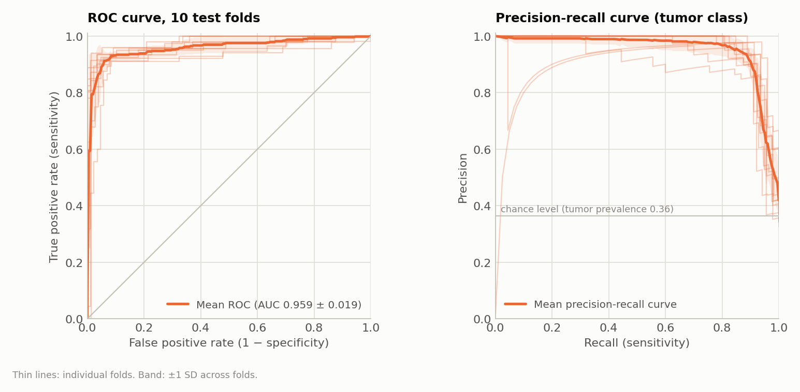
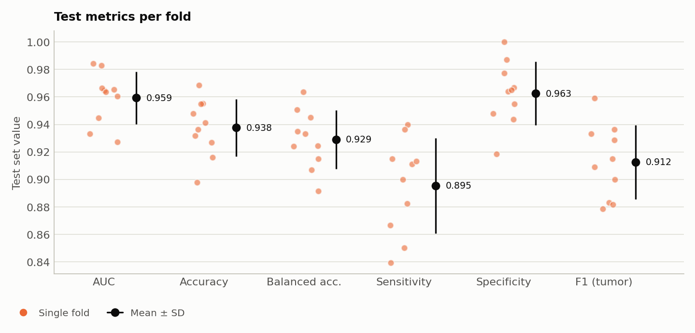
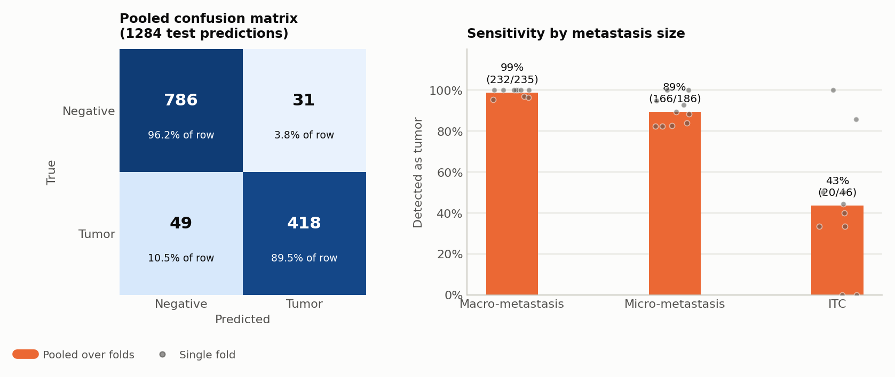
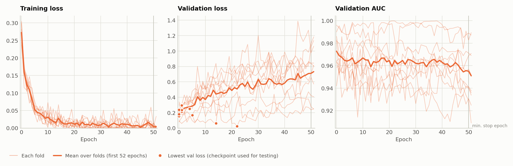
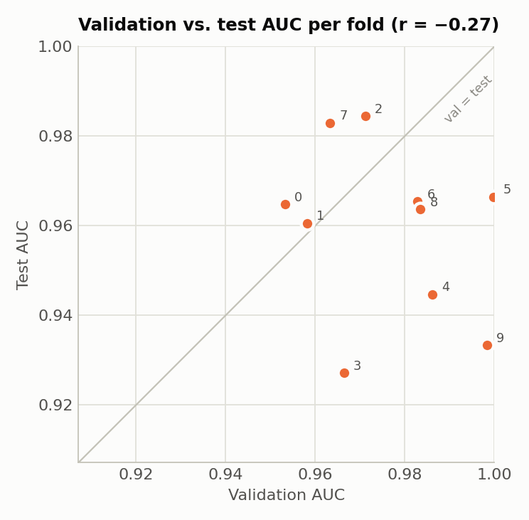

# CLAM on Camelyon+ (2-class, UNI features, B = 32): Experiment Report

**Experiment code:** `camelyon_plus_2cls_uni_CLAM_B32_s1`
**Run date:** 2026-09-30, 12:58–15:32 (2 h 34 min for all 10 folds; see [Section 6](#6-training-time))
**Hardware:** 1 × NVIDIA GeForce RTX 3090 (24 GB)

## 1. Summary

CLAM-SB was trained on the Camelyon+ 2-class task (negative vs. tumor) with pre-extracted UNI features, using 10-fold Monte Carlo cross-validation (80 / 10 / 10 train / val / test). All hyperparameters, splits and the seed are the same as in the ResNet-50 B = 32 run (`camelyon_plus_2cls_resnet50_CLAM_B32_s1`), so the two runs differ only in the feature encoder.

| Metric (test set, 10 folds) | Mean ± SD | Min | Max |
|---|---|---|---|
| **AUC** | **0.9593 ± 0.0190** | 0.9271 | 0.9844 |
| **Accuracy** | **0.9376 ± 0.0208** | 0.8976 | 0.9685 |
| Balanced accuracy | 0.9289 ± 0.0214 | 0.8915 | 0.9635 |
| Sensitivity (tumor recall) | 0.8954 ± 0.0347 | 0.8393 | 0.9400 |
| Specificity (negative recall) | 0.9625 ± 0.0231 | 0.9186 | 1.0000 |
| Precision (tumor) | 0.9317 ± 0.0409 | 0.8542 | 1.0000 |
| F1 (tumor) | 0.9125 ± 0.0270 | 0.8785 | 0.9592 |

SD is the sample standard deviation (ddof = 1) across the 10 folds. The positive class is `tumor`. Threshold-based metrics use argmax, which for two classes is a 0.5 probability threshold.

## 2. Data

| Item | Value |
|---|---|
| Dataset | Camelyon+ (cleaned CAMELYON16 + CAMELYON17), downloaded from ScienceDB |
| Labels | `slide-lables/Camelyon+(2-classes).xlsx` |
| Slides | 1350 (negative 871, tumor 479) |
| Tumor subtypes (from the 4-class labels) | macro 251, micro 174, ITC 54 |
| Cases | 586. CAMELYON17 slides are grouped by patient (`patient_XXX`); each CAMELYON16 slide is its own case |
| Features | Provided `UNI.zip` (NAS: `/mnt/nas/Camelyon+/feature-files/`): one `[N_patches, 1024]` float32 tensor per slide |
| Feature location | `/var/tmp/shouteng_data/CLAM_DATA/camelyon_plus_uni/pt_files/` (1350 files, 42 GB) |
| Dataset CSV | `dataset_csv/camelyon_plus_2cls.csv` (`case_id, slide_id, label`) |

- The features were used as provided with the Camelyon+ dataset and were not re-extracted. The dataset does not state the UNI version. The 1024-dimensional output matches UNI (v1, ViT-L/16).
- After extraction, the 1350 file names were checked against the slide IDs in the dataset CSV: none missing, none extra.
- The spot-checked slides have exactly the same number of patches as the ResNet-50 features, so the features cover the same patches.
- The 4-class labels (`slide-lables/Camelyon+(4-classes).xlsx`) were not used for training. They are used only in [Section 5](#5-per-fold-test-results) to break down sensitivity by metastasis size.

## 3. Data Splits: 10-fold Monte Carlo Cross-Validation

The splits are the same files used by the ResNet-50 and CONCH runs, so all runs are evaluated on identical train / val / test sets in every fold.

```bash
python create_splits_seq.py --task camelyon_plus_2cls --seed 1 --k 10
```

- Each fold independently samples 10% validation and 10% test cases per class. The remaining 80% of cases are used for training.
- Test sets of different folds may overlap, which is expected for Monte Carlo CV. The 10 test sets contain 1284 slide predictions covering 853 unique slides.
- Sampling is done at the patient level (`patient_strat=True`), so no patient appears in more than one of train / val / test within a fold. The patient label is `max` over its slides, meaning a patient is tumor if any of its slides is tumor.
- Because CAMELYON17 patients contribute up to 5 slides, the 80/10/10 ratio holds for cases, not exactly for slides.
- Split files: `splits/camelyon_plus_2cls_100/splits_{0..9}.csv`.

| Fold | Train slides | Val slides | Test slides | Test negative | Test tumor (macro / micro / ITC) |
|---|---|---|---|---|---|
| 0 | 1091 | 136 | 123 | 83 | 40 (12 / 25 / 3) |
| 1 | 1064 | 150 | 136 | 89 | 47 (28 / 17 / 2) |
| 2 | 1085 | 138 | 127 | 77 | 50 (25 / 20 / 5) |
| 3 | 1080 | 139 | 131 | 86 | 45 (22 / 19 / 4) |
| 4 | 1087 | 122 | 141 | 90 | 51 (33 / 14 / 4) |
| 5 | 1065 | 151 | 134 | 88 | 46 (27 / 17 / 2) |
| 6 | 1093 | 142 | 115 | 70 | 45 (24 / 17 / 4) |
| 7 | 1095 | 122 | 133 | 86 | 47 (21 / 19 / 7) |
| 8 | 1114 | 119 | 117 | 77 | 40 (19 / 15 / 6) |
| 9 | 1098 | 125 | 127 | 71 | 56 (24 / 23 / 9) |

## 4. Training Configuration

```bash
CUDA_VISIBLE_DEVICES=0 python main.py --drop_out 0.25 --early_stopping --lr 2e-4 --k 10 \
  --exp_code camelyon_plus_2cls_uni_CLAM_B32 --weighted_sample --bag_loss ce --inst_loss svm \
  --task camelyon_plus_2cls --model_type clam_sb --log_data \
  --data_root_dir /var/tmp/shouteng_data/CLAM_DATA --feature_dir camelyon_plus_uni --embed_dim 1024 --B 32
```

| Setting | Value |
|---|---|
| Model | CLAM-SB (single attention branch), `model_size = small` (layer widths 1024 → 512 → 256) |
| Input embedding dim | 1024 |
| Dropout | 0.25 |
| Optimizer | Adam, lr = 2e-4, weight decay = 1e-5 |
| Bag-level loss | Cross-entropy |
| Instance-level loss | Smooth top-1 SVM, B = 32 |
| Loss weighting | 0.7 × bag loss + 0.3 × instance loss |
| Class imbalance | `--weighted_sample`: sampling weight per slide = N / N_class, i.e. inversely proportional to class size |
| Max epochs | 200 |
| Early stopping | Monitors validation loss, patience 20, not before epoch 50. The checkpoint with the lowest validation loss is used for testing |
| Seed | 1 |

Compared with the ResNet-50 B = 32 run, only the feature folder (`--feature_dir camelyon_plus_uni`) changed. UNI features have the same dimension as ResNet-50 features (1024), so `--embed_dim` and the model architecture are identical.

## 5. Per-Fold Test Results

| Fold | Epochs run | Best val-loss epoch | Val AUC | Val Acc | **Test AUC** | **Test Acc** | Sens. | Spec. | F1 |
|---|---|---|---|---|---|---|---|---|---|
| 0 | 52 | 1 | 0.9533 | 0.9118 | 0.9648 | 0.9268 | 0.8500 | 0.9639 | 0.8831 |
| 1 | 52 | 1 | 0.9581 | 0.9400 | 0.9606 | 0.9412 | 0.9149 | 0.9551 | 0.9149 |
| 2 | 52 | 4 | 0.9711 | 0.9348 | 0.9844 | 0.9685 | 0.9400 | 0.9870 | 0.9592 |
| 3 | 52 | 1 | 0.9664 | 0.9424 | 0.9271 | 0.9160 | 0.9111 | 0.9186 | 0.8817 |
| 4 | 52 | 0 | 0.9861 | 0.9508 | 0.9447 | 0.9362 | 0.8824 | 0.9667 | 0.9091 |
| 5 | 52 | 22 | 0.9998 | 0.9868 | 0.9664 | 0.9552 | 0.9130 | 0.9773 | 0.9333 |
| 6 | 52 | 0 | 0.9828 | 0.9437 | 0.9654 | 0.9478 | 0.8667 | 1.0000 | 0.9286 |
| 7 | 52 | 0 | 0.9633 | 0.9426 | 0.9829 | 0.9549 | 0.9362 | 0.9651 | 0.9362 |
| 8 | 52 | 5 | 0.9834 | 0.9580 | 0.9636 | 0.9316 | 0.9000 | 0.9481 | 0.9000 |
| 9 | 52 | 14 | 0.9983 | 0.9840 | 0.9334 | 0.8976 | 0.8393 | 0.9437 | 0.8785 |
| **Mean** | | | 0.9763 | 0.9495 | **0.9593** | **0.9376** | 0.8954 | 0.9625 | 0.9125 |
| **SD** | | | 0.0163 | 0.0224 | 0.0190 | 0.0208 | 0.0347 | 0.0231 | 0.0270 |

"Epochs run" and "Best val-loss epoch" (0-indexed) are read from the TensorBoard logs. Epoch 0 means the checkpoint saved after the first pass over the training set.



*Figure 1. ROC curve (left) and precision-recall curve for the tumor class (right). Thin lines are the 10 test folds; the thick line is the mean over folds and the band is ±1 SD.*



*Figure 2. Test metrics of each fold (colored dots) with the mean ± SD (black). Sensitivity varies the most between folds.*

### Pooled confusion matrix (all 10 test folds, 1284 slide predictions)

Test sets overlap across folds, so some slides are counted more than once.

| | Predicted negative | Predicted tumor |
|---|---|---|
| **True negative** | 786 | 31 |
| **True tumor** | 49 | 418 |

The AUC computed on the pooled predictions is 0.9539. It is slightly lower than the mean per-fold AUC because the score calibration differs between fold models.

### Sensitivity by metastasis size

Tumor slides were split by their 4-class label. "Pooled" counts all 1284 test predictions together. "Per-fold mean ± SD" averages the per-fold detection rate. Per-fold counts are small (2–9 ITC slides per fold), so the pooled value is the more stable estimate.

| Subtype | Detected / total (pooled) | Sensitivity (pooled) | Per-fold mean ± SD |
|---|---|---|---|
| Macro-metastasis | 232 / 235 | 0.987 | 0.989 ± 0.019 |
| Micro-metastasis | 166 / 186 | 0.892 | 0.897 ± 0.070 |
| ITC | 20 / 46 | 0.435 | 0.437 ± 0.317 |
| Negative (false-positive rate) | 31 / 817 | 0.038 | |



*Figure 3. Pooled confusion matrix over all test folds (left; cell color is the share of the true-class row) and sensitivity by metastasis size (right; bars are pooled rates, dots are single folds). Macro- and micro-metastases are detected well; ITCs remain the hardest class, and their per-fold detection rate varies widely.*

## 6. Training Time

Folds were run sequentially on a single RTX 3090. The times below are taken from the TensorBoard event timestamps. Each time runs from the moment a fold's log writer was created to the fold's last logged event, so it includes training, per-epoch validation and the final test evaluation.

| Fold | Start | End | Duration | Epochs run | Time / epoch |
|---|---|---|---|---|---|
| 0 | 12:58:15 | 13:13:51 | 15.6 min | 52 | 18.0 s |
| 1 | 13:13:51 | 13:28:57 | 15.1 min | 52 | 17.4 s |
| 2 | 13:28:57 | 13:44:15 | 15.3 min | 52 | 17.7 s |
| 3 | 13:44:15 | 13:59:50 | 15.6 min | 52 | 18.0 s |
| 4 | 13:59:50 | 14:15:04 | 15.2 min | 52 | 17.6 s |
| 5 | 14:15:04 | 14:30:28 | 15.4 min | 52 | 17.8 s |
| 6 | 14:30:28 | 14:45:50 | 15.4 min | 52 | 17.7 s |
| 7 | 14:45:50 | 15:01:10 | 15.3 min | 52 | 17.7 s |
| 8 | 15:01:10 | 15:16:27 | 15.3 min | 52 | 17.6 s |
| 9 | 15:16:27 | 15:31:53 | 15.4 min | 52 | 17.8 s |
| **Total** | 12:58:15 | 15:31:53 | **153.6 min (2 h 34 min)** | 520 | **17.7 s (mean)** |

All times are on 2026-09-30.

- One epoch takes about 17.7 s, about the same as ResNet-50 (17.5 s). Both feature sets are 1024-dimensional and about 42 GB, so the time per epoch is dominated by loading the same amount of data.
- All 10 folds stopped at the earliest allowed point (52 epochs), so every fold took about 15 min.

## 7. Observations



*Figure 4. Training loss, validation loss and validation AUC per epoch. Thin lines are folds, the thick line is the mean over the first 52 epochs (all folds ran at least 52), and dots mark the epoch with the lowest validation loss, whose checkpoint is used for testing. The vertical line marks epoch 50, the earliest epoch at which early stopping may trigger. The validation loss is lowest within the first few epochs (8 of 10 folds by epoch 5) and then rises, while the training loss falls to almost zero: the model overfits quickly.*

- **Sensitivity is much higher than with ResNet-50, including for small metastases.** Macro-metastases are detected 99% of the time and micro-metastases 89%. ITCs, the smallest class, are still the hardest: 20 of 46 (43%) are detected. Specificity stays high (0.96).
- **The model overfits within a few epochs.** In 8 of 10 folds, the lowest validation loss is reached by epoch 5, and in 6 folds already at epoch 0 or 1 (mean best epoch 4.8). After that, the training loss falls to 0.003 or less in 9 of 10 folds, while the validation loss rises several-fold, to 0.25–1.18 at the last epoch. The checkpoint used for testing is therefore an early model, and all 10 folds stop at epoch 52.
- **The hyperparameters may not be optimal for UNI.** They were kept identical to the ResNet-50 run on purpose, for a fair comparison. The fast overfitting suggests that lr 2e-4 and the 50-epoch minimum are more than UNI features need. A lower learning rate or stronger regularization might give slightly better or more stable results, but this was not tested.
- **Validation AUC is close to saturation, and it does not predict test AUC.** Mean val AUC is 0.976 and two folds reach 0.998 or higher. Across folds the correlation between val AUC and test AUC is negative (r = −0.27). Fold 9 again has a near-perfect val AUC (0.998) and the lowest test AUC except fold 3 (0.933), as in both ResNet-50 runs.



*Figure 5. Validation AUC vs. test AUC for each fold (numbers are fold indices). Points far from the diagonal show that validation AUC does not predict test AUC.*

## 8. Comparison with ResNet-50 and CONCH (B = 32)

Three runs used identical splits, seeds and hyperparameters. The only differences are the feature files and, for CONCH, the input dimension (512 instead of 1024). Per-fold results of the other runs are in their own reports:

- ResNet-50: `results/camelyon_plus_2cls_resnet50_CLAM_B32_s1/experiment_report.md`
- CONCH: `results/camelyon_plus_2cls_conch_CLAM_B32_s1/experiment_report.md`

ResNet-50 here means our own ResNet-50 B = 32 run, not the number reported in the original CLAM paper.

### Final performance (test set, mean ± SD over 10 folds)

| Metric | ResNet-50 | **UNI (this run)** | CONCH |
|---|---|---|---|
| AUC | 0.9029 ± 0.0280 | **0.9593 ± 0.0190** | 0.9572 ± 0.0140 |
| Accuracy | 0.8771 ± 0.0320 | **0.9376 ± 0.0208** | 0.9248 ± 0.0187 |
| Balanced accuracy | 0.8489 ± 0.0325 | **0.9289 ± 0.0214** | 0.9180 ± 0.0178 |
| Sensitivity | 0.7438 ± 0.0524 | **0.8954 ± 0.0347** | 0.8892 ± 0.0288 |
| Specificity | 0.9539 ± 0.0359 | **0.9625 ± 0.0231** | 0.9468 ± 0.0320 |
| Precision | 0.9056 ± 0.0695 | **0.9317 ± 0.0409** | 0.9034 ± 0.0586 |
| F1 (tumor) | 0.8148 ± 0.0449 | **0.9125 ± 0.0270** | 0.8950 ± 0.0281 |
| F1 (macro) | 0.8612 ± 0.0343 | **0.9318 ± 0.0219** | 0.9181 ± 0.0209 |
| mAP (macro) | 0.8977 ± 0.0393 | **0.9539 ± 0.0269** | 0.9532 ± 0.0204 |
| Pooled AUC (1284 predictions) | 0.8988 | **0.9539** | 0.9563 |
| Mean val AUC | 0.9234 | **0.9763** | 0.9771 |


*Figure 6. Test metrics of the three encoders, mean ± SD over 10 folds. The y-axis starts at 0.6.*


*Figure 7. Test AUC of each encoder in each fold. Within a fold, all encoders are evaluated on the same test set, and the gray line connects them.*

### Paired difference of UNI from each other encoder (same splits in every fold)

The p-values are from the two-sided Wilcoxon signed-rank test over the 10 folds (exact test, smallest possible p = 0.002).

| Metric | UNI − ResNet-50 | Folds UNI better | p | UNI − CONCH | Folds UNI better | p |
|---|---|---|---|---|---|---|
| AUC | +0.0564 ± 0.0305 | 10 / 10 | 0.002 | +0.0021 ± 0.0173 | 5 / 10 | 0.92 |
| Accuracy | +0.0604 ± 0.0261 | 10 / 10 | 0.002 | +0.0128 ± 0.0190 | 7 / 10 (2 ties) | 0.078 |
| Balanced accuracy | +0.0801 ± 0.0259 | 10 / 10 | 0.002 | +0.0109 ± 0.0184 | 7 / 10 (1 tie) | 0.13 |
| Sensitivity | +0.1515 ± 0.0382 | 10 / 10 | 0.002 | +0.0061 ± 0.0184 | 3 / 10 (6 ties) | 0.63 |
| Specificity | +0.0086 ± 0.0319 | 4 / 10 (2 ties) | 0.64 | +0.0157 ± 0.0252 | 8 / 10 (1 tie) | 0.090 |
| F1 (tumor) | +0.0976 ± 0.0361 | 10 / 10 | 0.002 | +0.0175 ± 0.0251 | 7 / 10 (1 tie) | 0.055 |
| mAP (macro) | +0.0563 ± 0.0358 | 10 / 10 | 0.002 | +0.0007 ± 0.0191 | 5 / 10 | 1.0 |

### Sensitivity by metastasis size (pooled over all test folds)

| Subtype | ResNet-50 | **UNI (this run)** | CONCH |
|---|---|---|---|
| Macro (235) | 0.970 (228) | **0.987** (232) | 0.987 (232) |
| Micro (186) | 0.640 (119) | **0.892** (166) | 0.898 (167) |
| ITC (46) | 0.022 (1) | **0.435** (20) | 0.348 (16) |
| False-positive rate on negatives (817) | 0.045 (37) | **0.038** (31) | 0.055 (45) |


*Figure 8. Share of tumor slides detected, by metastasis size, pooled over all test folds.*

### Interpretation

- **UNI vs. ResNet-50: a large, consistent improvement.** UNI is better in all 10 folds on AUC (+0.056), accuracy, balanced accuracy, sensitivity and F1. The gain comes from sensitivity (+0.15): micro-metastasis detection rises from 0.64 to 0.89, and ITC detection from almost zero to 0.44. Specificity is about the same.
- **UNI vs. CONCH: no clear winner on ranking metrics.** AUC and mAP are practically identical (difference ≤ 0.002, UNI better in 5 of 10 folds). UNI is ahead on the threshold-based metrics at the default 0.5 threshold: accuracy +0.013, F1 +0.018 and specificity +0.016. It also produces fewer false positives (31 vs. 45 pooled) and detects slightly more ITCs (20 vs. 16). None of these differences is significant over 10 folds (all p ≥ 0.055), so they should be read as a trend.
- **Cost.** UNI features are twice as large as CONCH features (42 GB vs. 21 GB; 1024 vs. 512 dimensions). Training was correspondingly slower: 17.7 s vs. 11.3 s per epoch, 2 h 34 min vs. 1 h 38 min for 10 folds.

## 9. Code Changes to the CLAM Repository

| File | Change |
|---|---|
| `main.py`, `eval.py` | Added task `camelyon_plus_2cls` (labels `negative: 0`, `tumor: 1`). Added `--feature_dir` to select the feature folder under `--data_root_dir` (default `camelyon_plus_resnet50`). `main.py` also writes `embed_dim` and `feature_dir` to the settings file |
| `create_splits_seq.py` | Added task `camelyon_plus_2cls` (`patient_strat=True`) |
| `utils/core_utils.py` | Replaced `np.Inf` with `np.inf` for NumPy 2.x compatibility |
| `dataset_csv/camelyon_plus_2cls.csv` | Dataset CSV built from the Camelyon+ 2-class label file |

## 10. Output Files

All files are under `results/camelyon_plus_2cls_uni_CLAM_B32_s1/`:

- `summary.csv`: per-fold test / val AUC and accuracy
- `s_{k}_checkpoint.pt`: model checkpoint with the lowest validation loss for fold k
- `split_{k}_results.pkl`: per-slide test predictions (`slide_id`, class probabilities, label)
- `splits_{k}.csv`: copy of the split used for fold k
- `{k}/events.out.tfevents.*`: TensorBoard logs
- `figures/`: figures for this run. The comparison figures are in `results/figures/`. All figures are generated by `results/make_report_figures.py`
- `experiment_camelyon_plus_2cls_uni_CLAM_B32.txt`: full settings dictionary, including `embed_dim` and `feature_dir`

To re-evaluate the saved checkpoints:

```bash
CUDA_VISIBLE_DEVICES=0 python eval.py --k 10 --models_exp_code camelyon_plus_2cls_uni_CLAM_B32_s1 \
  --save_exp_code camelyon_plus_2cls_uni_CLAM_B32_s1_cv --task camelyon_plus_2cls --model_type clam_sb \
  --results_dir results --data_root_dir /var/tmp/shouteng_data/CLAM_DATA \
  --feature_dir camelyon_plus_uni --embed_dim 1024
```
