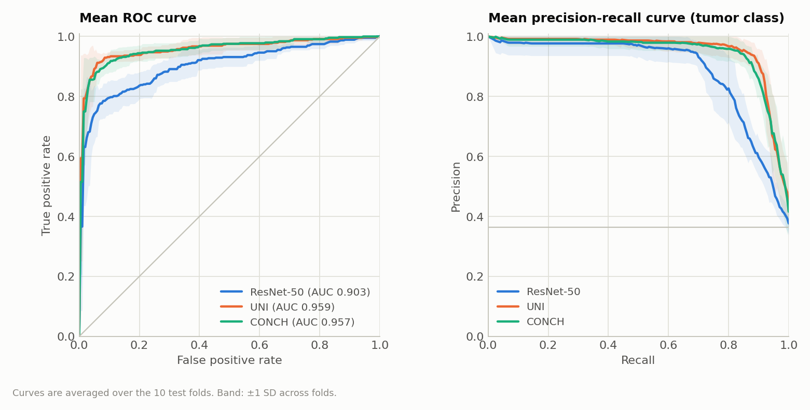
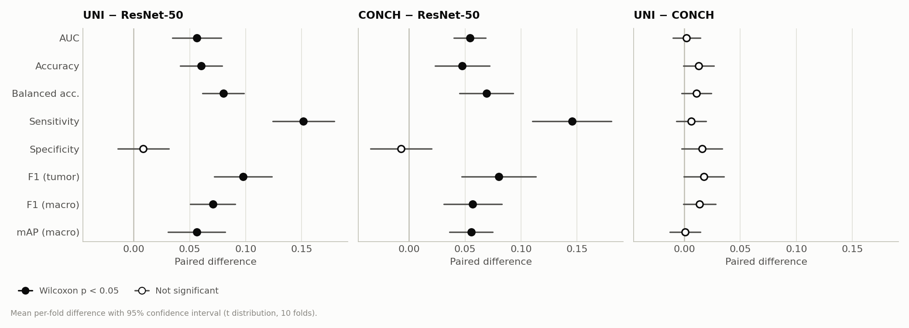
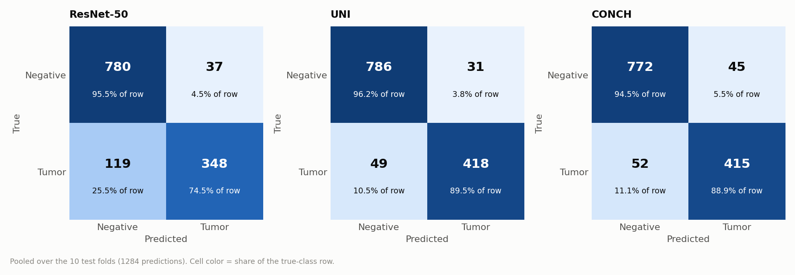
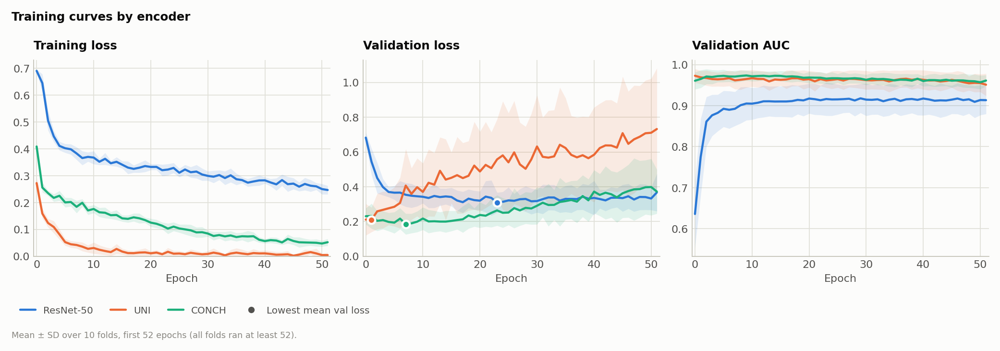
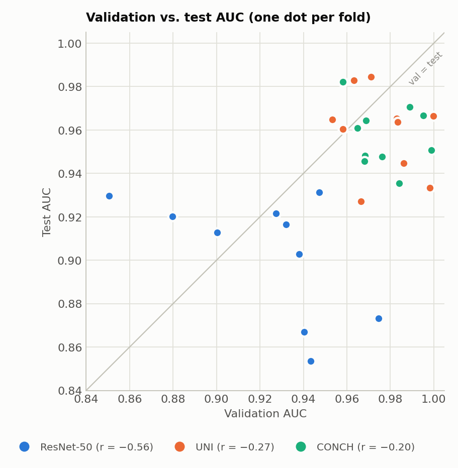
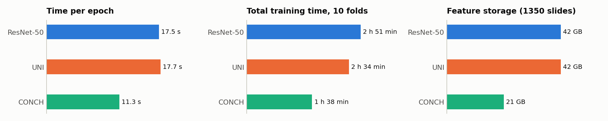
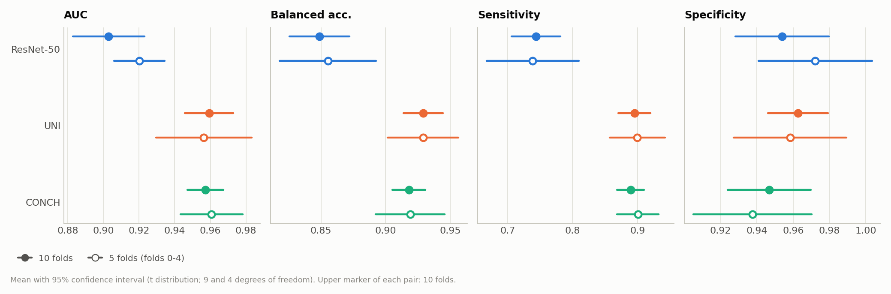
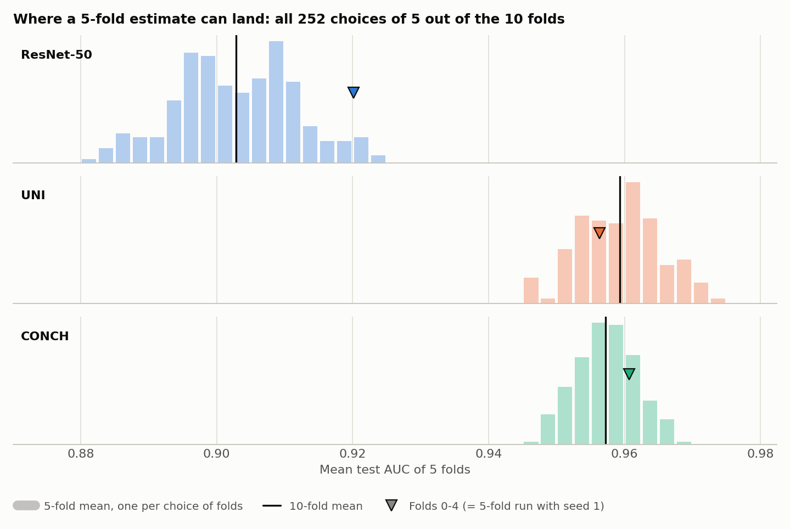
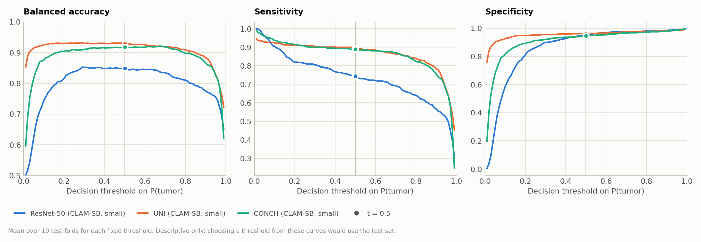
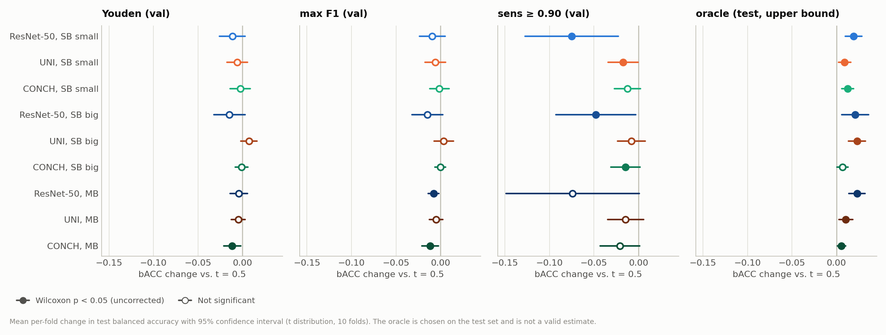

# CLAM-SB on Camelyon+ (2-class): ResNet-50 vs. UNI vs. CONCH (B = 32)

**Runs compared:**

| Encoder | Experiment code | Run date | Report |
|---|---|---|---|
| ResNet-50 | `camelyon_plus_2cls_resnet50_CLAM_B32_s1` | 2026-09-29 | `camelyon_plus_2cls_resnet50_CLAM_B32_s1/experiment_report.md` |
| UNI | `camelyon_plus_2cls_uni_CLAM_B32_s1` | 2026-09-30 | `camelyon_plus_2cls_uni_CLAM_B32_s1/experiment_report.md` |
| CONCH | `camelyon_plus_2cls_conch_CLAM_B32_s1` | 2026-10-01 | `camelyon_plus_2cls_conch_CLAM_B32_s1/experiment_report.md` |

All three runs are our own. "ResNet-50" in this report always means our ResNet-50 B = 32 run, not the value reported in the original CLAM paper. B = 32 is used for all three runs because it is the value used in the original CLAM paper. The Camelyon+ project provided only the dataset (slides, labels and pre-extracted features).

Sections 1–10 compare the three CLAM-SB runs above. Section 11 adds the CLAM-MB runs of the same encoders (`camelyon_plus_2cls_<encoder>_CLAM_MB_B32_s1`, 2026-10-06). Section 12 adds a decision-threshold analysis across all CLAM-SB and CLAM-MB runs. Both sections summarize dedicated reports: `model_type_mb_vs_sb_B32_report.md` and `threshold_analysis_report.md`.

## 1. Summary

| Metric (test, mean ± SD over 10 folds) | ResNet-50 | UNI | CONCH |
|---|---|---|---|
| **AUC** | 0.9029 ± 0.0280 | **0.9593 ± 0.0190** | 0.9572 ± 0.0140 |
| **Balanced accuracy** | 0.8489 ± 0.0325 | **0.9289 ± 0.0214** | 0.9180 ± 0.0178 |
| **Sensitivity** | 0.7438 ± 0.0524 | **0.8954 ± 0.0347** | 0.8892 ± 0.0288 |
| **Specificity** | 0.9539 ± 0.0359 | **0.9625 ± 0.0231** | 0.9468 ± 0.0320 |
| Training time (10 folds) | 2 h 51 min | 2 h 34 min | **1 h 38 min** |

- **Both foundation-model encoders are far better than ResNet-50.** UNI and CONCH beat ResNet-50 on AUC in every one of the 10 folds, by about 0.055 on average (p = 0.002, the smallest possible value for 10 paired folds).
- **The gain is in sensitivity, specifically for small metastases.** Specificity is about the same for all three encoders (0.95–0.96). Sensitivity rises from 0.74 to about 0.89. Micro-metastasis detection rises from 0.64 to about 0.90, and ITC detection from almost zero (1 of 46) to 35–43%.
- **UNI and CONCH are statistically tied.** Their AUC and mAP differ by 0.002 or less, and each wins 5 of 10 folds. UNI is slightly ahead on threshold-based metrics at the default 0.5 threshold (accuracy +0.013, F1 +0.018, fewer false positives), but none of these differences is significant (all p ≥ 0.055).
- **CONCH is the most efficient.** It has half the feature dimension (512 vs. 1024), half the feature storage (21 GB vs. 42 GB), about 35% shorter training time and the smallest fold-to-fold variance (AUC SD 0.014).
- **10 folds are needed for the close comparisons.** With only 5 Monte Carlo folds (folds 0–4), the foundation-model advantage over ResNet-50 still holds, but the ResNet-50 AUC is overestimated by 0.017, the UNI-vs-CONCH order on AUC flips, and no Wilcoxon test can reach p < 0.05 (see [Section 10](#10-5-fold-vs-10-fold-monte-carlo-cv)).
- **Neither CLAM-MB nor a different decision threshold improves the results.** CLAM-MB changes no metric significantly for any encoder (all AUC changes within ±0.006). A threshold chosen on the validation set lowered test balanced accuracy in 25 of 27 run-and-rule combinations, so t = 0.5 is kept (see [Section 11](#11-clam-mb-vs-clam-sb) and [Section 12](#12-decision-threshold)).
- **Even the best encoder misses about half of the ITCs.** Every tumor slide missed by both UNI and CONCH is also missed by ResNet-50. These 41 missed predictions are 22 ITC, 16 micro- and 3 macro-metastases.

## 2. Setup

### What is the same in all three runs

| Setting | Value |
|---|---|
| Task | Camelyon+ 2-class (negative vs. tumor), 1350 slides (871 negative, 479 tumor: 251 macro, 174 micro, 54 ITC), 586 cases |
| Splits | `splits/camelyon_plus_2cls_100`: 10-fold Monte Carlo CV, 80 / 10 / 10 train / val / test, patient-stratified. Identical files for all three runs |
| Seed | 1 |
| Model | CLAM-SB, `model_size = small`, dropout 0.25 |
| Optimizer | Adam, lr 2e-4, weight decay 1e-5 |
| Loss | 0.7 × cross-entropy (bag) + 0.3 × smooth top-1 SVM (instance), B = 32 |
| Class imbalance | `--weighted_sample` |
| Early stopping | Validation loss, patience 20, minimum 50 epochs, maximum 200. The checkpoint with the lowest validation loss is tested |
| Hardware | 1 × NVIDIA GeForce RTX 3090 (24 GB), folds run sequentially |

### What differs: the encoder

| | ResNet-50 | UNI | CONCH |
|---|---|---|---|
| Feature archive (NAS `/mnt/nas/Camelyon+/feature-files/`) | `ResNet-50.zip` | `UNI.zip` | `CONCH.zip` |
| Feature dimension (`--embed_dim`) | 1024 | 1024 | **512** |
| CLAM layer widths | 1024 → 512 → 256 | 1024 → 512 → 256 | **512** → 512 → 256 |
| Feature storage (1350 slides) | 42 GB | 42 GB | 21 GB |
| `--feature_dir` | `camelyon_plus_resnet50` | `camelyon_plus_uni` | `camelyon_plus_conch` |

- All features were used as provided with the Camelyon+ dataset and were not re-extracted.
- The spot-checked slides have exactly the same number of patches in all three feature sets, so the encoders see the same patches.
- The only architectural difference is CLAM's first fully connected layer for CONCH: `Linear(512, 512)` instead of `Linear(1024, 512)`. This is required by the smaller feature dimension. No other hyperparameter was changed.

### Metrics

- The positive class is `tumor`. Threshold-based metrics use argmax, which for two classes is a 0.5 probability threshold.
- bACC is (sensitivity + specificity) / 2. F1 (macro) and mAP (macro) average the per-class F1 and one-vs-rest average precision over both classes.
- All metrics are computed per fold from `split_{k}_results.pkl` and reported as mean ± SD (sample SD, ddof = 1) over the 10 folds.
- Because all three runs share the same test set in every fold, the encoders are compared with paired tests over the folds: the two-sided Wilcoxon signed-rank test, exact, with a smallest possible p of 0.002 for n = 10.

## 3. Overall Test Performance

| Metric | ResNet-50 | UNI | CONCH | Significant differences (p < 0.05) |
|---|---|---|---|---|
| AUC | 0.9029 ± 0.0280 (0.854–0.931) | **0.9593 ± 0.0190** (0.927–0.984) | 0.9572 ± 0.0140 (0.935–0.982) | UNI, CONCH > ResNet-50 |
| Accuracy | 0.8771 ± 0.0320 | **0.9376 ± 0.0208** | 0.9248 ± 0.0187 | UNI, CONCH > ResNet-50 |
| Balanced accuracy | 0.8489 ± 0.0325 | **0.9289 ± 0.0214** | 0.9180 ± 0.0178 | UNI, CONCH > ResNet-50 |
| Sensitivity | 0.7438 ± 0.0524 | **0.8954 ± 0.0347** | 0.8892 ± 0.0288 | UNI, CONCH > ResNet-50 |
| Specificity | 0.9539 ± 0.0359 | **0.9625 ± 0.0231** | 0.9468 ± 0.0320 | none |
| Precision (tumor) | 0.9056 ± 0.0695 | **0.9317 ± 0.0409** | 0.9034 ± 0.0586 | not tested |
| F1 (tumor) | 0.8148 ± 0.0449 | **0.9125 ± 0.0270** | 0.8950 ± 0.0281 | UNI, CONCH > ResNet-50 |
| F1 (macro) | 0.8612 ± 0.0343 | **0.9318 ± 0.0219** | 0.9181 ± 0.0209 | UNI, CONCH > ResNet-50 |
| mAP (macro) | 0.8977 ± 0.0393 | **0.9539 ± 0.0269** | 0.9532 ± 0.0204 | UNI, CONCH > ResNet-50 |
| AP (tumor) | 0.8769 ± 0.0600 | **0.9446 ± 0.0378** | 0.9393 ± 0.0361 | not tested |
| Pooled AUC (1284 predictions) | 0.8988 | 0.9539 | **0.9563** | not applicable (single pooled value) |

AUC values in parentheses are the minimum and maximum over the 10 folds. Bold marks the highest mean. The last column lists the pairs that differ with p < 0.05 in the paired test of [Section 5](#5-paired-statistical-comparison). UNI vs. CONCH is not significant for any metric.


*Figure 1. Test metrics of the three encoders, mean ± SD over 10 folds. The y-axis starts at 0.6. UNI and CONCH are close on every metric; ResNet-50 is lower on everything except specificity and precision.*



*Figure 2. Mean ROC curve (left) and mean precision-recall curve for the tumor class (right) over the 10 test folds; band: ±1 SD. The UNI and CONCH curves overlap almost everywhere; ResNet-50 loses most in the high-sensitivity region (right part of the PR curve).*

## 4. Per-Fold Test Results

### Test AUC

| Fold | ResNet-50 | UNI | CONCH | Best in fold |
|---|---|---|---|---|
| 0 | 0.9166 | **0.9648** | 0.9482 | UNI |
| 1 | 0.9297 | 0.9606 | **0.9608** | CONCH |
| 2 | 0.9203 | **0.9844** | 0.9821 | UNI |
| 3 | 0.9028 | 0.9271 | **0.9478** | CONCH |
| 4 | 0.9314 | 0.9447 | **0.9645** | CONCH |
| 5 | 0.9128 | 0.9664 | **0.9667** | CONCH |
| 6 | 0.8670 | **0.9654** | 0.9457 | UNI |
| 7 | 0.9216 | **0.9829** | 0.9706 | UNI |
| 8 | 0.8536 | **0.9636** | 0.9354 | UNI |
| 9 | 0.8732 | 0.9334 | **0.9507** | CONCH |
| **Mean** | 0.9029 | **0.9593** | 0.9572 | UNI 5, CONCH 5 |


*Figure 3. Test AUC of each encoder in each fold, on the same test set within a fold. ResNet-50 is the lowest in every fold; the order of UNI and CONCH changes from fold to fold.*

### Test sensitivity and specificity

| Fold | Sens. ResNet-50 | Sens. UNI | Sens. CONCH | Spec. ResNet-50 | Spec. UNI | Spec. CONCH |
|---|---|---|---|---|---|---|
| 0 | 0.6500 | 0.8500 | 0.8750 | 0.9880 | 0.9639 | 0.9518 |
| 1 | 0.7234 | 0.9149 | 0.8936 | 0.9663 | 0.9551 | 0.9213 |
| 2 | 0.7600 | 0.9400 | 0.9400 | 0.9870 | 0.9870 | 0.9740 |
| 3 | 0.7556 | 0.9111 | 0.9111 | 0.9302 | 0.9186 | 0.9070 |
| 4 | 0.8039 | 0.8824 | 0.8824 | 0.9889 | 0.9667 | 0.9333 |
| 5 | 0.8043 | 0.9130 | 0.8696 | 0.9659 | 0.9773 | 0.9318 |
| 6 | 0.7111 | 0.8667 | 0.8667 | 0.9571 | 1.0000 | 1.0000 |
| 7 | 0.8085 | 0.9362 | 0.9149 | 0.9419 | 0.9651 | 0.9535 |
| 8 | 0.7250 | 0.9000 | 0.9000 | 0.8701 | 0.9481 | 0.9091 |
| 9 | 0.6964 | 0.8393 | 0.8393 | 0.9437 | 0.9437 | 0.9859 |
| **Mean** | 0.7438 | 0.8954 | 0.8892 | 0.9539 | 0.9625 | 0.9468 |

- Every fold shows the same pattern: sensitivity jumps by about 0.07–0.23 from ResNet-50 to either foundation model, while specificity moves in both directions.
- UNI and CONCH have exactly the same sensitivity in 6 of 10 folds.

## 5. Paired Statistical Comparison

Mean ± SD of the per-fold difference, the number of folds where the first encoder is better, and the Wilcoxon signed-rank p-value.

| Metric | UNI − ResNet-50 | CONCH − ResNet-50 | UNI − CONCH |
|---|---|---|---|
| AUC | +0.0564 ± 0.0305, 10/10, **p = 0.002** | +0.0543 ± 0.0199, 10/10, **p = 0.002** | +0.0021 ± 0.0173, 5/10, p = 0.92 |
| Accuracy | +0.0604 ± 0.0261, 10/10, **p = 0.002** | +0.0476 ± 0.0340, 8/10 (1 tie), **p = 0.008** | +0.0128 ± 0.0190, 7/10 (2 ties), p = 0.078 |
| Balanced accuracy | +0.0801 ± 0.0259, 10/10, **p = 0.002** | +0.0691 ± 0.0335, 10/10, **p = 0.002** | +0.0109 ± 0.0184, 7/10 (1 tie), p = 0.13 |
| Sensitivity | +0.1515 ± 0.0382, 10/10, **p = 0.002** | +0.1454 ± 0.0491, 10/10, **p = 0.002** | +0.0061 ± 0.0184, 3/10 (6 ties), p = 0.63 |
| Specificity | +0.0086 ± 0.0319, 4/10 (2 ties), p = 0.64 | −0.0071 ± 0.0381, 4/10, p = 0.63 | +0.0157 ± 0.0252, 8/10 (1 tie), p = 0.090 |
| F1 (tumor) | +0.0976 ± 0.0361, 10/10, **p = 0.002** | +0.0801 ± 0.0463, 10/10, **p = 0.002** | +0.0175 ± 0.0251, 7/10 (1 tie), p = 0.055 |
| F1 (macro) | +0.0707 ± 0.0279, 10/10, **p = 0.002** | +0.0569 ± 0.0363, 9/10, **p = 0.006** | +0.0137 ± 0.0202, 7/10 (1 tie), p = 0.074 |
| mAP (macro) | +0.0563 ± 0.0358, 10/10, **p = 0.002** | +0.0555 ± 0.0271, 10/10, **p = 0.002** | +0.0007 ± 0.0191, 5/10, p = 1.0 |

Bold marks p < 0.05, without correction for multiple comparisons. With 10 folds, the smallest p the exact test can give is 1/512 ≈ 0.00195, which happens when one encoder is better in all 10 folds. This value also passes a Bonferroni correction over all 24 tests (threshold 0.05 / 24 ≈ 0.0021), so every result reported as p = 0.002 stays significant after correction. The two foundation-model vs. ResNet-50 results at p = 0.006–0.008 (CONCH accuracy and macro F1) would not pass Bonferroni, although they pass at p < 0.05.

- **UNI vs. ResNet-50 and CONCH vs. ResNet-50:** significant on every metric except specificity.
- **UNI vs. CONCH:** no significant difference on any metric. On the threshold-independent metrics (AUC, mAP), the difference is essentially zero. On the threshold-based metrics, UNI is ahead in 7 of 10 folds. This is a consistent trend, but not significant with 10 folds. It may partly reflect calibration at the 0.5 threshold rather than better ranking.



*Figure 4. Mean per-fold difference between two encoders with its 95% confidence interval (t distribution, 10 folds), on a shared x-axis. Filled markers: Wilcoxon p < 0.05; open markers: not significant. Both foundation models differ clearly from ResNet-50 on every metric except specificity, while UNI − CONCH stays close to zero.*

## 6. Error Analysis

### Pooled confusion matrices (1284 test predictions, 853 unique slides)

| | ResNet-50 | UNI | CONCH |
|---|---|---|---|
| True negative → predicted negative | 780 | **786** | 772 |
| False positives (negative → tumor) | 37 | **31** | 45 |
| False negatives (tumor → negative) | 119 | **49** | 52 |
| True tumor → predicted tumor | 348 | **418** | 415 |

Switching from ResNet-50 to a foundation model cuts missed tumors by more than half (119 → 49 or 52), at no cost in false positives for UNI and +8 for CONCH.



*Figure 5. Pooled confusion matrices over the 10 test folds (1284 predictions). Cell color is the share of the true-class row. The main difference is the number of missed tumors (bottom left).*

### Sensitivity by metastasis size (pooled)

| Subtype (pooled test predictions) | ResNet-50 | UNI | CONCH |
|---|---|---|---|
| Macro-metastasis (235) | 0.970 (228) | **0.987** (232) | **0.987** (232) |
| Micro-metastasis (186) | 0.640 (119) | 0.892 (166) | **0.898** (167) |
| ITC (46) | 0.022 (1) | **0.435** (20) | 0.348 (16) |
| False-positive rate on negatives (817) | 0.045 (37) | **0.038** (31) | 0.055 (45) |

Per-fold mean ± SD of the same rates (ITC counts per fold are only 2–9, so these vary a lot):

| Subtype | ResNet-50 | UNI | CONCH |
|---|---|---|---|
| Macro | 0.974 ± 0.029 | 0.989 ± 0.019 | 0.989 ± 0.019 |
| Micro | 0.642 ± 0.118 | 0.897 ± 0.070 | 0.898 ± 0.061 |
| ITC | 0.014 ± 0.045 | 0.437 ± 0.317 | 0.295 ± 0.254 |


*Figure 6. Share of tumor slides detected, by metastasis size, pooled over all test folds. The foundation models gain most on micro-metastases and ITCs.*

### Agreement between encoders

UNI and CONCH predict the same class for 96.2% of the test predictions, and their tumor probabilities correlate at r = 0.94. The table shows how the foundation-model errors relate to each other and to ResNet-50:

| True class | Both UNI and CONCH correct | Only UNI correct | Only CONCH correct | Both wrong | Both wrong and ResNet-50 also wrong |
|---|---|---|---|---|---|
| Macro (235) | 232 | 0 | 0 | 3 | 3 |
| Micro (186) | 163 | 3 | 4 | 16 | 16 |
| ITC (46) | 12 | 8 | 4 | 22 | 22 |
| Negative (817) | 764 | 22 | 8 | 23 | 13 |

- **The tumors that the foundation models miss are a subset of those that ResNet-50 misses.** No tumor slide was detected by ResNet-50 but missed by both foundation models.
- **The hardest cases are shared.** 54 test predictions (34 unique slides) are wrong for all three encoders: 22 ITC, 16 micro, 3 macro and 13 negative. These are good candidates for visual review with the attention heatmaps.
- **UNI and CONCH make partly different errors on ITCs and negatives.** UNI detects 8 ITCs that CONCH misses, and CONCH detects 4 that UNI misses. On negatives, UNI is right on 22 slides where CONCH gives a false positive, and CONCH on 8 where UNI does. Combining the two models, for example by averaging their probabilities, could help, but this was not tested.

## 7. Training Dynamics and Model Selection

| | ResNet-50 | UNI | CONCH |
|---|---|---|---|
| Best val-loss epoch (0-indexed), mean (range) | 33.8 (17–50) | **4.8** (0–22) | 8.2 (2–17) |
| Folds that trained beyond 52 epochs | 6 / 10 | 0 / 10 | 0 / 10 |
| Total epochs (10 folds) | 588 | 520 | 520 |
| Val loss after epoch 0, mean | 0.683 | 0.211 | 0.231 |
| Lowest val loss, mean | 0.279 | 0.182 | 0.171 |
| Val loss at last epoch, mean (range) | 0.370 (0.25–0.55) | 0.733 (0.25–1.18) | 0.372 (0.24–0.62) |
| Train loss at last epoch, mean (range) | 0.245 (0.19–0.27) | 0.004 (0.000–0.034) | 0.053 (0.034–0.068) |
| Mean val AUC | 0.9234 | 0.9763 | 0.9771 |
| Correlation of val AUC and test AUC across folds | −0.57 | −0.27 | −0.20 |

- **ResNet-50 features need many epochs.** The validation loss starts near ln 2 ≈ 0.69, which corresponds to random guessing, and the best checkpoint comes after 17–50 epochs.
- **Foundation-model features are almost linearly separable from the start.** After a single epoch, the validation loss of UNI and CONCH (about 0.21–0.23) is already lower than the best ResNet-50 validation loss (0.28). The best checkpoint comes within the first few epochs, and all folds stop at epoch 52, the minimum allowed.
- **UNI overfits the most.** Its training loss falls to almost zero and its validation loss rises to 0.73 on average. CONCH overfits more mildly. Whether this comes from its smaller input layer or from properties of the features was not tested.
- **The shared hyperparameters favor neither foundation model.** lr 2e-4, the 50-epoch minimum and dropout 0.25 come from CLAM's defaults, which were designed for ResNet-50 features. They were kept identical on purpose for a fair comparison. UNI and CONCH might improve with a lower learning rate or stronger regularization, and the UNI-vs-CONCH ranking could change under tuned settings.
- **Validation AUC is a poor guide to test AUC for all three encoders.** The correlation across folds is negative for all three, and for the foundation models val AUC is close to 1. Validation sets are small (about 120–150 slides), so per-fold model selection is noisy.



*Figure 7. Mean ± SD over 10 folds of the training loss, validation loss and validation AUC (first 52 epochs). Dots mark the epoch with the lowest mean validation loss. UNI and CONCH start with a low validation loss and then overfit; ResNet-50 needs about 20 epochs to converge.*



*Figure 8. Validation AUC vs. test AUC for each fold and encoder. The correlation across folds is negative for all three encoders, so validation AUC is a poor guide to test AUC.*

**Follow-up: input feature normalization.** A separate experiment tested whether the different feature scales explain these dynamics. Mean vector lengths are 2.3 for ResNet-50, 38.7 for UNI and 1 for CONCH. Normalizing the inputs (L2 or per-dimension z-score) did not improve any encoder, and z-score made ResNet-50 worse (AUC −0.018). Enlarging the inputs, which z-score does for ResNet-50 and CONCH, made the models overfit within a few epochs. Shrinking UNI's inputs to unit length did not delay its early best epoch. UNI's fast fitting therefore comes from its features, not their scale. See `feature_normalization_report.md`.

## 8. Computational Cost

| | ResNet-50 | UNI | CONCH |
|---|---|---|---|
| Feature dimension | 1024 | 1024 | 512 |
| Feature storage | 42 GB | 42 GB | **21 GB** |
| Parameters of CLAM's first layer | 524,800 | 524,800 | **262,656** |
| Time per epoch | 17.5 s | 17.7 s | **11.3 s** |
| Total epochs (10 folds) | 588 | 520 | 520 |
| Total training time (10 folds) | 2 h 51 min | 2 h 34 min | **1 h 38 min** |

- Time per epoch tracks the feature size, not the model size. ResNet-50 and UNI have equally large features and take the same time per epoch. CONCH, with half the data, is about 35% faster. Training is therefore limited mainly by loading the feature files.
- These times cover only CLAM training on pre-extracted features. If features had to be extracted from the WSIs, UNI (ViT-L) would be much more expensive than CONCH (ViT-B) or ResNet-50. This was not needed here, because the features came with the dataset.



*Figure 9. Time per epoch, total training time for 10 folds and feature storage. Time per epoch follows the feature size: CONCH features are half as large and train about 35% faster.*

## 9. Context: The Original CLAM Paper

For reference, the original CLAM paper reports CLAM-SB with ResNet-50 features at AUC 0.9532 ± 0.0292 (B = 32, 10-fold MCCV). That result was obtained on the paper's own data and features, not on Camelyon+, so it is not directly comparable with our runs. Our ResNet-50 run is 0.050 below that value; possible reasons are discussed in `camelyon_plus_2cls_resnet50_CLAM_B32_s1/paper_comparison_report.md`. The CLAM paper predates UNI and CONCH and has no results for them, so the foundation-model runs are not compared with it here.

## 10. 5-fold vs. 10-fold Monte Carlo CV

This section asks how the results would differ if only 5 Monte Carlo folds had been run instead of 10. No new training was done. All numbers come from the existing 10-fold runs.

### How the 5-fold results were obtained

- In Monte Carlo CV, the number of folds is only the number of random resamples. Each fold still samples 10% validation and 10% test cases per class from the full dataset, so **every model is trained on the same amount of data (about 80%, about 1080 slides) with 5 folds as with 10.** A 5-fold run simply trains 5 models instead of 10.
- `generate_split` (`utils/utils.py:96`) seeds NumPy once and then draws the splits one after another. Generating 5 splits with seed 1 (`create_splits_seq.py --seed 1 --k 5`) therefore gives **exactly the same splits as folds 0–4 of the existing 10-fold splits**. This was checked by generating the 5 splits in memory and comparing them with `splits/camelyon_plus_2cls_100/splits_{0..4}.csv`. All train, val and test sets were identical, and no split file was written.
- `main.py` also resets the training seed at the start of every fold (`main.py:44`). A 5-fold run with seed 1 would therefore train the same 5 models as folds 0–4 of the 10-fold run, apart from GPU nondeterminism. **"5-fold" below therefore means folds 0–4 of the existing runs.**
- To see how much the 5-fold estimate depends on which 5 folds happen to be drawn, the analysis also uses all C(10, 5) = 252 ways of choosing 5 of the 10 folds.

### Test performance: 10 folds vs. 5 folds

Mean ± SD over folds, with the half-width of the 95% confidence interval of the mean (t distribution, 9 and 4 degrees of freedom).

| Encoder | Metric | 10 folds | 95% CI ± | 5 folds (0–4) | 95% CI ± | 5 − 10 |
|---|---|---|---|---|---|---|
| ResNet-50 | AUC | 0.9029 ± 0.0280 | 0.0200 | 0.9202 ± 0.0115 | 0.0143 | **+0.0173** |
| | Balanced accuracy | 0.8489 ± 0.0325 | 0.0232 | 0.8553 ± 0.0300 | 0.0373 | +0.0065 |
| | Sensitivity | 0.7438 ± 0.0524 | 0.0375 | 0.7386 ± 0.0572 | 0.0710 | −0.0053 |
| | Specificity | 0.9539 ± 0.0359 | 0.0257 | 0.9721 ± 0.0252 | 0.0313 | +0.0182 |
| | mAP (macro) | 0.8977 ± 0.0393 | 0.0281 | 0.9174 ± 0.0166 | 0.0206 | +0.0198 |
| UNI | AUC | 0.9593 ± 0.0190 | 0.0136 | 0.9563 ± 0.0216 | 0.0268 | −0.0030 |
| | Balanced accuracy | 0.9289 ± 0.0214 | 0.0153 | 0.9290 ± 0.0220 | 0.0273 | +0.0000 |
| | Sensitivity | 0.8954 ± 0.0347 | 0.0248 | 0.8997 ± 0.0345 | 0.0428 | +0.0043 |
| | Specificity | 0.9625 ± 0.0231 | 0.0165 | 0.9582 ± 0.0251 | 0.0311 | −0.0043 |
| | mAP (macro) | 0.9539 ± 0.0269 | 0.0192 | 0.9529 ± 0.0307 | 0.0382 | −0.0011 |
| CONCH | AUC | 0.9572 ± 0.0140 | 0.0100 | 0.9607 ± 0.0141 | 0.0175 | +0.0034 |
| | Balanced accuracy | 0.9180 ± 0.0178 | 0.0127 | 0.9190 ± 0.0214 | 0.0266 | +0.0009 |
| | Sensitivity | 0.8892 ± 0.0288 | 0.0206 | 0.9004 ± 0.0260 | 0.0323 | +0.0112 |
| | Specificity | 0.9468 ± 0.0320 | 0.0229 | 0.9375 ± 0.0262 | 0.0325 | −0.0093 |
| | mAP (macro) | 0.9532 ± 0.0204 | 0.0146 | 0.9554 ± 0.0200 | 0.0248 | +0.0022 |



*Figure 10. Mean and 95% confidence interval of four test metrics, from all 10 folds (filled) and from folds 0–4 only (open). With 5 folds, 13 of the 15 intervals are 1.2–2.1 times as wide. The ResNet-50 AUC and mAP intervals are narrower only because folds 0–4 happen to be unusually similar for ResNet-50. Also for ResNet-50, the 5-fold AUC is shifted upward, because the three hardest ResNet-50 folds (6, 8 and 9) are all in the second half.*

### How much the 5-fold estimate depends on which folds are drawn

| Encoder | 10-fold mean AUC | Folds 0–4 | Range over all 252 choices of 5 folds | Central 95% of choices | Percentile of folds 0–4 |
|---|---|---|---|---|---|
| ResNet-50 | 0.9029 | 0.9202 | 0.8819–0.9239 | 0.8854–0.9204 | 97th |
| UNI | 0.9593 | 0.9563 | 0.9459–0.9728 | 0.9470–0.9716 | 31st |
| CONCH | 0.9572 | 0.9607 | 0.9456–0.9689 | 0.9488–0.9657 | 77th |



*Figure 11. Mean test AUC for each of the 252 ways to choose 5 of the 10 folds (histogram), compared with the 10-fold mean (vertical line) and folds 0–4 (triangle). Depending on the folds drawn, a 5-fold ResNet-50 estimate can land anywhere between 0.882 and 0.924, and folds 0–4 lie near the top of that range.*

The 252 choices are subsets of the same 10 folds, so they understate how much a truly independent 5-fold run (with a new seed) would vary. For ResNet-50, the SD of the 5-fold mean AUC is 0.0089 across these subsets, but about 0.028 / √5 ≈ 0.0125 for an independent run.

### Do the encoder comparisons hold with 5 folds?

Paired per-fold differences with folds 0–4 only, compared with all 10 folds. "Choices with the same sign" is the share of the 252 choices of 5 folds in which the mean difference has the same sign as with 10 folds.

| Comparison | Metric | 10 folds: diff (wins, Wilcoxon p) | 5 folds: diff (wins, Wilcoxon p, paired t p) | Choices with the same sign |
|---|---|---|---|---|
| UNI − ResNet-50 | AUC | +0.0564 (10/10, 0.002) | +0.0362 (5/5, 0.0625, 0.016) | 100% |
| | Sensitivity | +0.1515 (10/10, 0.002) | +0.1611 (5/5, 0.0625, 0.002) | 100% |
| | Specificity | +0.0086 (4/10, 0.64) | −0.0138 (0/5, 0.125, 0.034) | 77% |
| CONCH − ResNet-50 | AUC | +0.0543 (10/10, 0.002) | +0.0405 (5/5, 0.0625, 0.002) | 100% |
| | Sensitivity | +0.1454 (10/10, 0.002) | +0.1618 (5/5, 0.0625, 0.003) | 100% |
| | Specificity | −0.0071 (4/10, 0.63) | −0.0346 (0/5, 0.0625, 0.010) | 71% |
| UNI − CONCH | AUC | +0.0021 (5/10, 0.92) | −0.0044 (2/5, 0.63, 0.57) | 63% |
| | Balanced accuracy | +0.0109 (7/10, 0.13) | +0.0100 (4/5, 0.19, 0.15) | 97% |
| | Specificity | +0.0157 (8/10, 0.090) | +0.0207 (5/5, 0.0625, 0.017) | 98% |
| | F1 (tumor) | +0.0175 (7/10, 0.055) | +0.0165 (4/5, 0.125, 0.092) | 100% |

### Other effects of using 5 folds

| | 10 folds | 5 folds (0–4) |
|---|---|---|
| Pooled test predictions (unique slides) | 1284 (853) | 658 (525) |
| ITC test predictions | 46 | 18 |
| ITC detected: ResNet-50 / UNI / CONCH | 1 / 20 / 16 (2% / 43% / 35%) | 0 / 6 / 6 (0% / 33% / 33%) |
| Micro-metastases detected: ResNet-50 / UNI / CONCH | 64% / 89% / 90% | 60% / 91% / 91% |
| Training time: ResNet-50 / UNI / CONCH | 171 / 154 / 98 min | 85 / 77 / 49 min |

### Interpretation

- **The main conclusion does not depend on the number of folds.** With any 5 of the 10 folds, both foundation models beat ResNet-50 on AUC, balanced accuracy, sensitivity and F1 in every fold (100% of the 252 choices).
- **With 5 folds, a Wilcoxon test can never be significant.** The smallest possible exact two-sided p for 5 paired folds is 2/32 = 0.0625, reached only when one encoder wins all 5 folds. A paired t-test can reach p < 0.05 with 5 folds, but it relies on a normality assumption that 5 values cannot check. In this data it also produces "significant" specificity differences (UNI − ResNet-50, p = 0.034; CONCH − ResNet-50, p = 0.010) that are not significant with 10 folds and have the opposite sign for UNI.
- **The 5-fold point estimate can be noticeably off.** Folds 0–4 overestimate the ResNet-50 AUC by 0.017 (0.9202 vs. 0.9029) and its mAP by 0.020, because they happen to be the 97th-percentile choice of folds. They also understate the fold-to-fold SD (AUC SD 0.0115 vs. 0.0280). The encoder gap therefore looks smaller with 5 folds (UNI − ResNet-50 AUC +0.036 instead of +0.056).
- **Close comparisons can flip.** UNI vs. CONCH on AUC changes sign: CONCH is ahead with folds 0–4 (0.9607 vs. 0.9563), UNI is ahead with 10 folds, and the sign agrees with 10 folds in only 63% of the choices of 5 folds. Differences of this size cannot be ranked with either 5 or 10 folds.
- **Confidence intervals are wider and subtype estimates rest on fewer cases.** With 5 folds, 13 of the 15 confidence intervals in the table are 1.2–2.1 times as wide; the two exceptions (ResNet-50 AUC and mAP) reflect the unusually similar folds 0–4, not a real gain in precision. Only 18 ITC predictions remain, so the ITC detection rates (for example 33% for both UNI and CONCH) are very imprecise.
- **The only gain is time.** 5 folds take half the training time (for example 49 min instead of 98 min for CONCH), with the same amount of training data per model.

**Recommendation.** Keep 10 folds when comparing encoders or settings whose differences are small, or when significance tests are reported. 5 folds are enough for a quick check of large effects, such as a foundation model vs. ResNet-50. If a separate 5-fold run is needed, generate new splits with a different seed into a **new split folder**. `create_splits_seq.py` currently always writes to `splits/<task>_100/` and would overwrite the 10-fold splits there, so it needs an output-folder option first. With seed 1, a 5-fold run only reproduces folds 0–4.

**Follow-up: standard k-fold.** The analysis above reuses Monte Carlo folds. A separate experiment trained ResNet-50 with standard, patient-level k-fold CV (every slide tested exactly once): 10-fold (80/10/10) and 5-fold (70/10/20). Both gave the same estimate as Monte Carlo 10-fold: mean test AUC 0.9048, 0.9019 and 0.9029. On the same 1350 slides, 10-fold and 5-fold differ by +0.0006 in pooled AUC (95% CI −0.015 to +0.013). See `kfold_vs_mccv_resnet50_report.md`.

## 11. CLAM-MB vs. CLAM-SB

All results above use CLAM-SB (one attention branch). The three encoders were also trained with CLAM-MB (`--model_type clam_mb`, one attention branch per class), with everything else unchanged: same splits, seed, `model_size small`, B = 32 and hyperparameters. For two classes, MB adds only 257 parameters per model. Full details are in `model_type_mb_vs_sb_B32_report.md`.

| Encoder | Metric | CLAM-SB | CLAM-MB | MB − SB (paired) | Folds MB better | p |
|---|---|---|---|---|---|---|
| ResNet-50 | AUC | 0.9029 ± 0.0280 | 0.9015 ± 0.0271 | −0.0013 | 6/10 | 1.0 |
| | Balanced accuracy | 0.8489 ± 0.0325 | 0.8428 ± 0.0417 | −0.0061 | 4/10 (2 ties) | 0.64 |
| | Sensitivity | 0.7438 ± 0.0524 | 0.7389 ± 0.0612 | −0.0049 | 2/10 (6 ties) | 0.63 |
| | Specificity | 0.9539 ± 0.0359 | 0.9467 ± 0.0352 | −0.0072 | 2/10 (2 ties) | 0.23 |
| UNI | AUC | 0.9593 ± 0.0190 | 0.9633 ± 0.0142 | +0.0040 | 5/10 | 0.43 |
| | Balanced accuracy | 0.9289 ± 0.0214 | 0.9274 ± 0.0236 | −0.0015 | 4/10 | 0.92 |
| | Sensitivity | 0.8954 ± 0.0347 | 0.9062 ± 0.0370 | +0.0108 | 4/10 (5 ties) | 0.31 |
| | Specificity | 0.9625 ± 0.0231 | 0.9486 ± 0.0233 | −0.0139 | 3/10 (1 tie) | 0.13 |
| CONCH | AUC | 0.9572 ± 0.0140 | 0.9519 ± 0.0146 | −0.0054 | 3/10 | 0.19 |
| | Balanced accuracy | 0.9180 ± 0.0178 | 0.9177 ± 0.0127 | −0.0003 | 5/10 | 1.0 |
| | Sensitivity | 0.8892 ± 0.0288 | 0.8762 ± 0.0268 | −0.0131 | 1/10 (3 ties) | 0.078 |
| | Specificity | 0.9468 ± 0.0320 | 0.9592 ± 0.0206 | +0.0124 | 6/10 (1 tie) | 0.25 |


*Figure 12. Test metrics (mean ± SD over 10 folds) for CLAM-SB (lighter bar) and CLAM-MB (darker bar) for each encoder. The y-axis starts at 0.6. The bars are practically the same height.*


*Figure 13. Mean per-fold difference (MB − SB) with its 95% confidence interval, on a shared x-axis. Every interval includes zero.*

- **CLAM-MB does not change performance for any encoder.** No metric differs significantly (smallest p = 0.078), and SB and MB predict the same class for 96.9–97.5% of the test predictions.
- **The encoder comparison is unchanged.** With MB, UNI and CONCH again beat ResNet-50 on AUC in all 10 folds (p = 0.002). With MB, UNI is ahead of CONCH more consistently than with SB (AUC +0.011, 9 of 10 folds, p = 0.049; with SB +0.002, 5 of 10 folds, p = 0.92). This comes from small, non-significant moves in opposite directions (UNI +0.004, CONCH −0.005) and would not survive correction for the many comparisons in these reports, so it is a trend, not evidence that UNI is better.
- **ITC detection moves in opposite directions:** 24 of 46 for UNI with MB (SB: 20), and 11 of 46 for CONCH with MB (SB: 16). With 46 pooled predictions, this is within the noise.
- **Widening the attention network** (`model_size big`, `model_size_big_vs_small_B32_report.md`) gave the same picture: all AUC changes within ±0.005, none significant. So far, neither architecture change has moved the results beyond the size of single-fold run-to-run variation.

## 12. Decision Threshold

All threshold-based metrics in this report use t = 0.5. To check whether another threshold would be better, a threshold was chosen on each fold's **validation** set and then applied to that fold's test set. The test set was never used for the choice. Validation predictions were regenerated from the saved checkpoints with `eval.py --split val`, and they reproduce the validation AUC and accuracy recorded during training exactly. Full details, including the CLAM-SB big and CLAM-MB runs, are in `threshold_analysis_report.md`.

Change in test balanced accuracy versus t = 0.5 (mean per-fold change, folds better, Wilcoxon p; bold: p < 0.05):

| Encoder (CLAM-SB) | bACC at t = 0.5 | Youden (val) | max F1 (val) | sens ≥ 0.90 (val) | Oracle (test, upper bound) |
|---|---|---|---|---|---|
| ResNet-50 | 0.8489 | −0.0114 (2/10, p = 0.15) | −0.0093 (2/10, p = 0.22) | **−0.0749 (2/10, p = 0.0098)** | **+0.0192 (10/10, p = 0.002)** |
| UNI | 0.9289 | −0.0058 (2/10, p = 0.31) | −0.0058 (2/10, p = 0.31) | **−0.0173 (0/10, p = 0.016)** | **+0.0092 (7/10, p = 0.016)** |
| CONCH | 0.9180 | −0.0025 (4/10, p = 0.95) | −0.0012 (4/10, p = 0.81) | −0.0124 (3/10, p = 0.084) | **+0.0125 (8/10, p = 0.0078)** |

The oracle chooses the best threshold on each test set itself. It shows the theoretical headroom and is not a valid performance estimate.



*Figure 14. Mean test balanced accuracy, sensitivity and specificity over the 10 folds for each fixed threshold (descriptive only). Between t = 0.3 and 0.65, bACC stays within about 0.01 of its maximum for all three encoders.*



*Figure 15. Mean per-fold change in test bACC relative to t = 0.5 with 95% confidence interval, for all 9 runs (CLAM-SB small and big, CLAM-MB) and each rule. Filled markers: p < 0.05. The validation-based rules sit at or below zero almost everywhere.*

- **A validation-chosen threshold does not beat 0.5.** Across all 9 runs and the three validation-based rules, test bACC was lower than at 0.5 in 25 of 27 cases, significantly so in 7, and never significantly higher.
- **The validation sets are too small to locate a better threshold.** Each has 40–52 tumor slides, and for UNI and CONCH only 8–17% of the validation predictions fall between 0.1 and 0.9. The threshold that is best on validation is essentially unrelated to the one that is best on test (correlation across folds between −0.54 and 0.33).
- **The headroom is small anyway.** The best fixed threshold for all folds, read off the test curve, would gain at most 0.003 bACC for the three CLAM-SB small runs. Most of the oracle's gain comes from fitting each test set's borderline slides.
- **The sensitivity target only works for ResNet-50, at a large cost.** The "sensitivity ≥ 0.90 on validation" rule raises ResNet-50 test sensitivity from 0.744 to 0.847, but specificity falls from 0.954 to 0.701. For UNI and CONCH the rule raises the threshold above 0.5 in most folds and lowers test sensitivity. A different threshold does not recover the missed small metastases. It only trades errors between the two classes.

## 13. Conclusions

1. **Use a pathology foundation model instead of ResNet-50.** With identical CLAM settings, UNI and CONCH improve AUC by about 0.055 and sensitivity by about 0.15. The improvement holds in every fold.
2. **UNI and CONCH perform equally on this task.** AUC and mAP are the same within noise. UNI has a small, non-significant edge at the default threshold. CONCH is cheaper (half the storage, about 35% faster training) and more stable across folds. Unless the small threshold-level advantage of UNI matters, CONCH offers the better cost/performance trade-off.
3. **The remaining errors are mostly ITCs and micro-metastases.** About half of the ITCs are still missed, and all the tumors missed by the foundation models are also missed by ResNet-50. Further gains on this task should target small lesions.
4. **Keep CLAM-SB with `model_size small` and t = 0.5.** CLAM-MB and a wider attention network both stay within ±0.006 AUC of CLAM-SB small, with no significant differences. A validation-chosen threshold made test results worse rather than better, and the test curves are flat around 0.5. These settings also keep all reports comparable.
5. **Architecture and threshold changes do not address the small-lesion problem.** CLAM-MB and a larger model leave ITC and micro-metastasis detection almost unchanged. Lowering the threshold raises sensitivity only by giving up a lot of specificity (ResNet-50: sensitivity 0.744 → 0.847, specificity 0.954 → 0.701). The more promising directions are the training setup for foundation-model features (learning rate, regularization), the features themselves, and the 4-class task, where CLAM-MB's class-specific attention has a purpose.

### Limitations

- Each configuration was trained with one seed. Fold-to-fold variation is captured, but run-to-run variation from different initializations is not.
- Hyperparameters were not tuned for any encoder. The early, strong overfitting of UNI and CONCH suggests that their results may be underestimated.
- Monte Carlo test sets overlap. Pooled counts include some slides more than once (1284 predictions, 853 unique slides).
- Subtype results, especially for ITC (46 pooled predictions, 2–9 per fold), are based on small numbers.
- The 5-fold analysis in Section 10 reuses folds 0–4 of the same runs. It shows what a 5-fold run with seed 1 would give, but not how much an independent 5-fold run with a different seed would vary.
- The threshold analysis in Section 12 chooses thresholds on single 10% validation splits (40–52 tumor slides). A larger calibration set might locate a useful operating point, but this was not tested.

### Possible next steps

- Tune the learning rate, weight decay and early-stopping minimum separately for UNI and CONCH.
- Run additional seeds to estimate run-to-run variance. All architecture changes so far (model_size, CLAM-MB) differ by ±0.005 AUC, which needs to be judged against this noise level.
- Run CLAM-MB on the 4-class Camelyon+ labels (negative / macro / micro / ITC).
- If a fixed operating point is needed, for example a guaranteed sensitivity, choose it on a larger calibration set, such as validation predictions pooled across folds, never on the test set.
- Try an ensemble of UNI and CONCH, since their ITC errors only partly overlap.
- Evaluate the other provided encoders (CONCH v1.5, Virchow, GigaPath, etc.) with the same protocol.
- Review the 34 slides that all three encoders get wrong.

## Figures

All figures are in `results/figures/` and are generated from the saved predictions and TensorBoard logs by `results/make_report_figures.py`. Figures 12–13 (`mb_*.png`) and 14–15 (`thr_*.png`) come from the CLAM-MB runs and from `results/threshold_analysis/`, which `threshold_analysis.py` produces:

```bash
python results/make_report_figures.py
```
