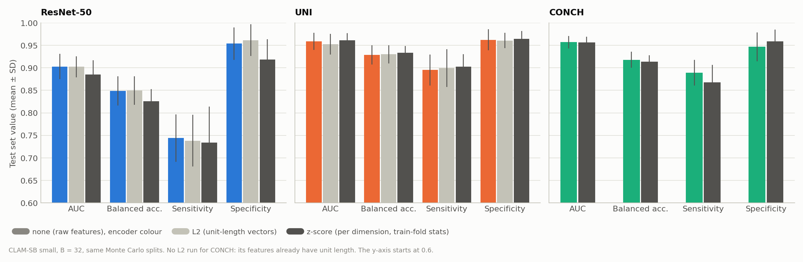
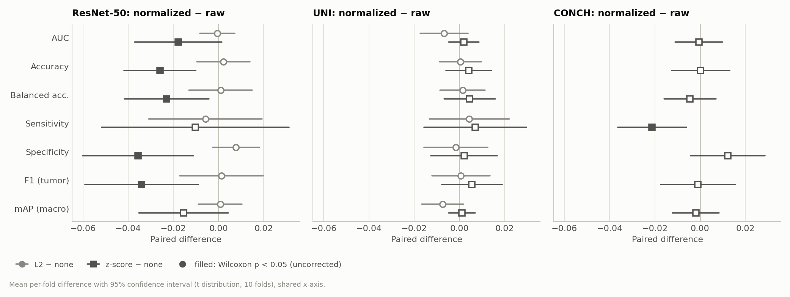
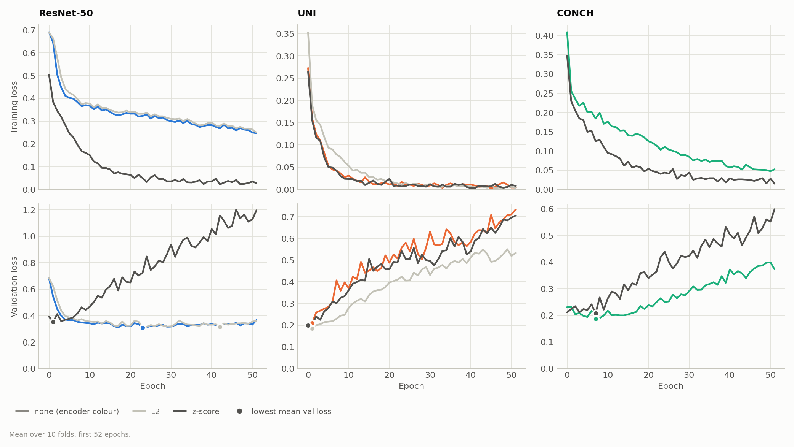
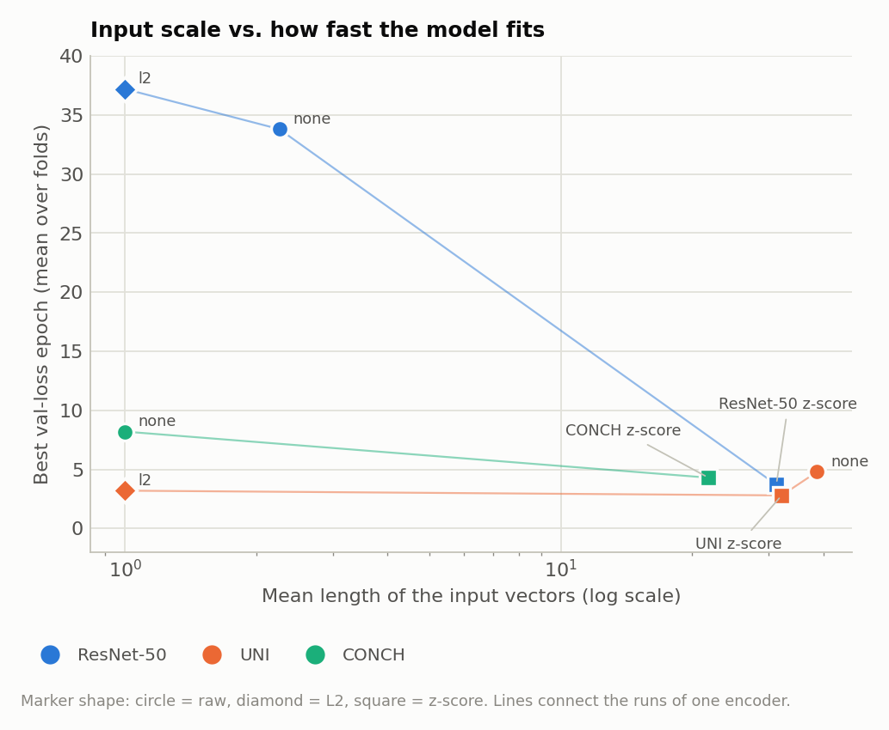

# Input Feature Normalization for CLAM on Camelyon+ (2-class, B = 32): ResNet-50, UNI and CONCH

**Question.** The three encoders produce features on very different scales. The mean length of a patch vector is 2.3 for ResNet-50, 38.7 for UNI and exactly 1 for CONCH. CLAM uses the same initialization and learning rate for all of them. Does normalizing the input features change performance? Is the input scale the reason why UNI overfits within the first few epochs?

**Runs compared** (all CLAM-SB, `model_size small`, B = 32, same Monte Carlo splits `splits/camelyon_plus_2cls_100`, seed 1):

| Encoder | No normalization (existing run) | L2 | z-score |
|---|---|---|---|
| ResNet-50 | `camelyon_plus_2cls_resnet50_CLAM_B32_s1` | `..._resnet50_CLAM_B32_l2_s1` | `..._resnet50_CLAM_B32_zscore_s1` |
| UNI | `camelyon_plus_2cls_uni_CLAM_B32_s1` | `..._uni_CLAM_B32_l2_s1` | `..._uni_CLAM_B32_zscore_s1` |
| CONCH | `camelyon_plus_2cls_conch_CLAM_B32_s1` | not run (see below) | `..._conch_CLAM_B32_zscore_s1` |

The five new runs were trained on 2026-10-15/16 with `run_feat_norm.sh`.

## 1. Summary

| Test AUC (mean ± SD, 10 folds) | None | L2 | z-score |
|---|---|---|---|
| ResNet-50 | 0.9029 ± 0.0280 | 0.9023 ± 0.0236 | **0.8850 ± 0.0317** |
| UNI | 0.9593 ± 0.0190 | 0.9526 ± 0.0230 | 0.9613 ± 0.0157 |
| CONCH | 0.9572 ± 0.0140 | (= none) | 0.9567 ± 0.0126 |

- **Normalization does not improve any encoder.** L2 and z-score leave UNI and CONCH unchanged (all AUC changes within ±0.007, none significant). L2 leaves ResNet-50 unchanged as well.
- **z-score hurts ResNet-50.** AUC drops by 0.018 (p = 0.049), accuracy by 0.026 (worse in 9 of 10 folds, p = 0.014), and specificity by 0.036 (p = 0.012). False positives almost double, from 37 to 66 pooled.
- **Large inputs make CLAM fit fast. This is supported.** z-score makes the inputs *larger*: about 31 for ResNet-50 instead of 2.3, and about 22 for CONCH instead of 1. In both cases the model then reaches its best validation loss much earlier and overfits:
  - ResNet-50: best epoch 3.7 instead of 33.8, and the final training loss falls from 0.245 to 0.027;
  - CONCH: best epoch 4.3 instead of 8.2.
- **The input scale is *not* why UNI overfits quickly. The original hypothesis is not supported.** Shrinking UNI's inputs to unit length (L2, about 39 times smaller) does not slow it down: its best epoch is 3.2 instead of 4.8. UNI's features are separable enough to be fitted within one or two epochs at any scale. With L2, UNI's validation loss rises somewhat less steeply (0.53 instead of 0.73 at the last epoch), but the checkpoint used for testing is equally good.
- **Recommendation: keep the raw features (`--feat_norm none`).** If a normalization is wanted, use L2, which was harmless for all encoders. Avoid per-dimension z-score for ResNet-50 features.

## 2. Setup

### What is the same in all runs

| Setting | Value |
|---|---|
| Task, data | Camelyon+ 2-class, 1350 slides, provided features (ResNet-50 and UNI 1024-d, CONCH 512-d) |
| Splits | `splits/camelyon_plus_2cls_100` (10-fold Monte Carlo, 80/10/10, patient-level). Identical for all runs, so each normalized run is compared fold by fold with its un-normalized counterpart |
| Model and training | CLAM-SB small, dropout 0.25, Adam lr 2e-4, weight decay 1e-5, 0.7 × CE + 0.3 × smooth top-1 SVM (B = 32), `--weighted_sample`, early stopping on validation loss (patience 20, min. 50 epochs) |
| Initialization | PyTorch default for `nn.Linear`: U(−1/√fan_in, +1/√fan_in), seed 1 |

### What differs: `--feat_norm`

| Mode | Operation, applied to every patch vector x | Statistics |
|---|---|---|
| `none` | x unchanged (all earlier runs) | — |
| `l2` | x / ‖x‖, so every vector has length 1 | none needed |
| `zscore` | (x − μ) / σ per dimension | μ and σ over all patches of the **training slides of each fold** (8.5–8.7 million patches per fold). Validation and test slides are never used |

**No L2 run for CONCH.** Across all 10.8 million CONCH patch vectors, the mean squared length is exactly 1.0000: the provided features already have unit length, so L2 would leave them unchanged.

**Resulting input scale** (mean vector length as seen by CLAM; z-score values measured with the fold-0 statistics on 20 test slides):

| | None | L2 | z-score |
|---|---|---|---|
| ResNet-50 | 2.26 | 1.00 | 31.2 (≈ √1024) |
| UNI | 38.7 | 1.00 | 32.1 (≈ √1024) |
| CONCH | 1.00 | 1.00 | 21.8 (≈ √512) |

After z-score, every dimension has variance 1, so the vector length is about √D whatever the encoder. For ResNet-50 and CONCH, z-score therefore *enlarges* the inputs (by about 13× and 22×). For UNI it leaves the scale nearly unchanged but equalizes the dimensions. L2 shrinks ResNet-50 by about 2× and UNI by about 39×. Together, the runs cover both directions of scale change.

### Implementation

- `models/model_clam.py`: a `FeatureNorm` module applied as the first step of the CLAM forward pass. This means training, validation, test and `eval.py` use exactly the same transform. The z-score μ and σ are buffers, stored in each checkpoint and restored by `eval.py --feat_norm zscore`.
- `utils/feature_stats.py`: computes per-slide sums once per encoder and caches them in `feature_stats/`. The fold statistics are computed exactly from the training slides' sums.
- New argument `--feat_norm {none, l2, zscore}` in `main.py` and `eval.py`, recorded in the settings file.

Checks before training:
- with `--feat_norm none`, re-evaluating an existing checkpoint gave exactly the recorded test AUC;
- the cached statistics matched a direct computation;
- a 2-epoch z-score test run, re-evaluated with `eval.py`, reproduced its test AUC exactly;
- the split files were unchanged (checksum).

## 3. Test Performance

| Metric | ResNet-50 none | ResNet-50 L2 | ResNet-50 z-score | UNI none | UNI L2 | UNI z-score | CONCH none | CONCH z-score |
|---|---|---|---|---|---|---|---|---|
| AUC | 0.9029 ± 0.0280 | 0.9023 ± 0.0236 | 0.8850 ± 0.0317 | 0.9593 ± 0.0190 | 0.9526 ± 0.0230 | 0.9613 ± 0.0157 | 0.9572 ± 0.0140 | 0.9567 ± 0.0126 |
| Accuracy | 0.8771 ± 0.0320 | 0.8793 ± 0.0303 | 0.8512 ± 0.0231 | 0.9376 ± 0.0208 | 0.9381 ± 0.0176 | 0.9417 ± 0.0141 | 0.9248 ± 0.0187 | 0.9250 ± 0.0158 |
| Balanced accuracy | 0.8489 ± 0.0325 | 0.8498 ± 0.0317 | 0.8259 ± 0.0271 | 0.9289 ± 0.0214 | 0.9304 ± 0.0203 | 0.9335 ± 0.0150 | 0.9180 ± 0.0178 | 0.9136 ± 0.0147 |
| Sensitivity | 0.7438 ± 0.0524 | 0.7380 ± 0.0574 | 0.7336 ± 0.0800 | 0.8954 ± 0.0347 | 0.8998 ± 0.0419 | 0.9024 ± 0.0280 | 0.8892 ± 0.0288 | 0.8680 ± 0.0389 |
| Specificity | 0.9539 ± 0.0359 | 0.9616 ± 0.0353 | 0.9183 ± 0.0455 | 0.9625 ± 0.0231 | 0.9610 ± 0.0170 | 0.9647 ± 0.0171 | 0.9468 ± 0.0320 | 0.9591 ± 0.0261 |
| F1 (tumor) | 0.8148 ± 0.0449 | 0.8161 ± 0.0435 | 0.7808 ± 0.0326 | 0.9125 ± 0.0270 | 0.9132 ± 0.0245 | 0.9180 ± 0.0201 | 0.8950 ± 0.0281 | 0.8940 ± 0.0194 |
| mAP (macro) | 0.8977 ± 0.0393 | 0.8984 ± 0.0295 | 0.8822 ± 0.0386 | 0.9539 ± 0.0269 | 0.9465 ± 0.0324 | 0.9551 ± 0.0244 | 0.9532 ± 0.0204 | 0.9513 ± 0.0204 |
| Pooled AUC (1284 predictions) | 0.8988 | 0.9000 | 0.8766 | 0.9539 | 0.9497 | 0.9545 | 0.9563 | 0.9447 |

*Figure 1. Test AUC, balanced accuracy, sensitivity and specificity (mean ± SD over 10 folds) without normalization (encoder colour), with L2 (light gray) and with z-score (dark gray). The y-axis starts at 0.6. Only ResNet-50 with z-score is visibly lower, mainly through specificity.*

## 4. Paired Comparison with the Un-normalized Runs

Mean per-fold difference (normalized − none), the number of folds where the normalized run is better (with ties), and the two-sided exact Wilcoxon p (smallest possible 0.002). Bold marks p < 0.05, uncorrected.

| Metric | ResNet-50 L2 | ResNet-50 z-score | UNI L2 | UNI z-score | CONCH z-score |
|---|---|---|---|---|---|
| AUC | −0.0005, 5/10, p = 0.92 | **−0.0179, 3/10, p = 0.049** | −0.0067, 4/10, p = 0.19 | +0.0020, 7/10, p = 0.56 | −0.0005, 4/10, p = 0.92 |
| Accuracy | +0.0021, 4/10 (3 ties), p = 0.69 | **−0.0259, 1/10, p = 0.014** | +0.0005, 5/10 (2 ties), p = 1.0 | +0.0041, 7/10 (1 tie), p = 0.36 | +0.0003, 6/10 (1 tie), p = 0.91 |
| Balanced accuracy | +0.0010, 4/10 (3 ties), p = 0.81 | **−0.0229, 1/10, p = 0.049** | +0.0014, 7/10, p = 0.63 | +0.0046, 7/10, p = 0.42 | −0.0044, 5/10 (1 tie), p = 0.73 |
| Sensitivity | −0.0058, 1/10 (6 ties), p = 0.63 | −0.0102, 4/10 (2 ties), p = 0.57 | +0.0044, 6/10 (1 tie), p = 0.59 | +0.0070, 3/10 (5 ties), p = 0.63 | **−0.0212, 0/10 (4 ties), p = 0.031** |
| Specificity | +0.0077, 3/10 (7 ties), p = 0.25 | **−0.0356, 1/10 (1 tie), p = 0.012** | −0.0015, 3/10 (3 ties), p = 0.81 | +0.0021, 6/10, p = 0.77 | +0.0123, 6/10 (2 ties), p = 0.20 |
| F1 (tumor) | +0.0013, 4/10 (3 ties), p = 0.81 | **−0.0340, 1/10, p = 0.027** | +0.0007, 7/10, p = 0.77 | +0.0056, 7/10, p = 0.38 | −0.0010, 6/10 (1 tie), p = 0.91 |
| mAP (macro) | +0.0008, 5/10, p = 0.85 | −0.0154, 3/10, p = 0.13 | −0.0075, 3/10, p = 0.084 | +0.0012, 6/10, p = 0.63 | −0.0019, 3/10, p = 0.63 |
| Same predicted class as "none" | 97.6% | 92.4% | 97.6% | 97.1% | 96.7% |

*Figure 2. Mean per-fold difference to the un-normalized run, with 95% confidence interval, on a shared x-axis (circles: L2, squares: z-score; filled: p < 0.05, uncorrected). Only ResNet-50 with z-score moves away from zero, consistently in the negative direction.*

- **Correction for multiple comparisons.** This report runs 55 such tests (5 comparisons × 11 metrics in the analysis script), so the Bonferroni threshold is about 0.0009. No single p-value survives it. The ResNet-50 z-score result is nonetheless consistent: it is worse in 9 of 10 folds on accuracy, balanced accuracy and F1, its predictions differ from the raw run on 7.6% of slides (2–3 times as many as any other variant), and it is visible in the pooled confusion matrix (Section 5). It is the only effect in this report that should be read as real.
- **CONCH with z-score** shifts its operating point (sensitivity −0.021, p = 0.031; specificity +0.012, n.s.) without changing AUC. This is a threshold or calibration effect, not a ranking effect.

## 5. Error Analysis

| Pooled over test folds | ResNet-50 none | ResNet-50 L2 | ResNet-50 z-score | UNI none | UNI L2 | UNI z-score | CONCH none | CONCH z-score |
|---|---|---|---|---|---|---|---|---|
| False positives (of 817) | 37 | 31 | **66** | 31 | 32 | 29 | 45 | 34 |
| False negatives (of 467) | 119 | 122 | 124 | 49 | 47 | 46 | 52 | 62 |
| Macro detected (of 235) | 228 | 228 | 227 | 232 | 231 | 232 | 232 | 231 |
| Micro detected (of 186) | 119 | 116 | 116 | 166 | 168 | 164 | 167 | 157 |
| ITC detected (of 46) | 1 | 1 | 0 | 20 | 21 | 25 | 16 | 17 |

- **Normalization does not change the detection of small metastases.** Macro- and micro-metastasis detection moves by at most 3 slides, except CONCH z-score for micro (−10). ResNet-50 still misses almost all ITCs.
- UNI with z-score detects 25 ITC predictions instead of 20. With 46 pooled ITC predictions (2–9 per fold), that is within noise.
- **The ResNet-50 z-score loss is almost entirely extra false positives** (66 instead of 37). Sensitivity is unchanged.

## 6. Training Dynamics: Input Scale and Speed of Fitting

| | ResNet-50 none | ResNet-50 L2 | ResNet-50 z-score | UNI none | UNI L2 | UNI z-score | CONCH none | CONCH z-score |
|---|---|---|---|---|---|---|---|---|
| Mean input vector length | 2.26 | 1.00 | 31.2 | 38.7 | 1.00 | 32.1 | 1.00 | 21.8 |
| Best val-loss epoch, mean (range) | 33.8 (17–50) | 37.2 (16–86) | **3.7 (0–12)** | 4.8 (0–22) | 3.2 (0–22) | 2.8 (0–16) | 8.2 (2–17) | **4.3 (0–20)** |
| Val loss after epoch 0 | 0.683 | 0.684 | 0.393 | 0.211 | 0.188 | 0.199 | 0.231 | 0.211 |
| Val loss at last epoch | 0.370 | 0.376 | **1.196** | 0.733 | 0.533 | 0.705 | 0.372 | **0.598** |
| Train loss at last epoch | 0.245 | 0.244 | **0.027** | 0.004 | 0.004 | 0.008 | 0.053 | **0.015** |
| Total epochs (10 folds) | 588 | 625 | 520 | 520 | 520 | 520 | 520 | 520 |
| Correlation of val and test AUC across folds | −0.56 | −0.48 | −0.22 | −0.27 | −0.35 | −0.34 | −0.20 | 0.13 |
| Training time (10 folds) | 2 h 51 min | 3 h 5 min | 2 h 42 min | 2 h 34 min | 2 h 41 min | 2 h 40 min | 1 h 38 min | 1 h 47 min |

*Figure 3. Mean training loss (top) and validation loss (bottom) over 10 folds, first 52 epochs. With z-score, ResNet-50 (dark gray, left) behaves like UNI: the training loss drops fast and the validation loss rises from the first epochs on. CONCH with z-score also overfits faster. UNI looks almost the same in all three variants.*

*Figure 4. Mean input vector length (log scale) against the mean best validation-loss epoch, for all 8 runs. Enlarging the inputs (ResNet-50 and CONCH z-score) makes the model reach its best checkpoint much earlier. Shrinking UNI's inputs 39-fold (L2) does not delay it.*

**What this shows**

- **Scaling the inputs up speeds up fitting.** With the PyTorch default initialization, w ~ U(−1/√fan_in, +1/√fan_in), the standard deviation of a first-layer pre-activation is ‖x‖ / √(3·fan_in). It is therefore proportional to the input length, so larger inputs give larger activations and gradients from the first step on. With z-score, ResNet-50's inputs are 13× larger. It then reaches a validation loss of 0.39 after one epoch (raw: 0.68) and its best checkpoint after 0–12 epochs (raw: 17–50). It drives the training loss to 0.03 and overfits strongly (final validation loss 1.20). CONCH, with 22× larger inputs, shows the same pattern in a milder form.
- **Scaling the inputs down does not slow down UNI.** At unit length, UNI still reaches a validation loss of 0.19 after the first epoch and its best checkpoint within 0–4 epochs in 9 of 10 folds. UNI's fast fitting therefore comes from how separable its features are, not from their scale. A smaller scale only makes the later overfitting milder (final validation loss 0.53 vs. 0.73). That does not matter for the result, because early stopping picks an early checkpoint anyway.
- **Scaling ResNet-50 down slightly (L2, about 2×) changes nothing**: best epoch 37 vs. 34, identical curves.

**Why z-score hurts ResNet-50 (possible causes, not tested individually)**

- **Faster overfitting.** The checkpoint is chosen after 0–12 epochs from a model that fits the training data very quickly. For ResNet-50 features, which are much less separable than UNI's, such early checkpoints generalize worse, especially on negative slides.
- **Amplified sparse dimensions.** ResNet-50 features are ReLU outputs and therefore sparse. Some dimensions are almost always zero; one has σ ≈ 0.0006 on the training data. z-score scales these dimensions by up to about 1700×, so the rare non-zero values become outliers (maximum |z| = 57 on the sample slides, compared with 7 for UNI and CONCH). The model may latch on to such rare, noisy patterns.

## 7. Conclusions

1. **Keep the raw features (`--feat_norm none`).** No normalization improved any encoder.
2. **L2 normalization is harmless** for ResNet-50 and UNI (all differences within noise) and is a no-op for CONCH. It is the safe choice if a common input scale is needed, for example when mixing encoders.
3. **Do not z-score ResNet-50 features.** It makes the model overfit within a few epochs and adds false positives (AUC −0.018, specificity −0.036).
4. **On the earlier hypothesis.** Input scale clearly affects how fast CLAM fits: larger inputs lead to faster fitting and earlier overfitting. But it is not the cause of UNI's early best epoch, which persists at unit length. Making UNI and CONCH generalize better will need other measures, such as a lower learning rate or stronger regularization, not input scaling.

### Limitations

- One seed per configuration.
- The learning rate and other hyperparameters were kept fixed. With z-score, a smaller learning rate might compensate for the larger inputs, but this was not tested.
- The input norms after z-score were measured with the fold-0 statistics on a sample of 20 test slides. They agree with the theoretical value √D.

### Possible next steps

- Lower the learning rate (e.g. 2e-5) for UNI and CONCH. This is the remaining candidate for their early overfitting. *Update 2026-10-19: done (5e-5 and 2e-5), see `learning_rate_report.md`. Neither rate changed test performance, and UNI still reached its best checkpoint within 0–6 epochs.*
- If z-score is revisited for ResNet-50, clip the standardized values or drop near-constant dimensions.

## Files

- Runs: `results/camelyon_plus_2cls_<encoder>_CLAM_B32_{l2,zscore}_s1/`; run script `run_feat_norm.sh`; logs in `logs/`.
- Code: `models/model_clam.py` (`FeatureNorm`), `utils/feature_stats.py`, `--feat_norm` in `main.py` / `eval.py`; statistics cache in `feature_stats/`.
- Figures: `results/figures/fn_*.png`, generated by `results/make_report_figures.py`.
- Re-evaluating a normalized checkpoint needs the same `--feat_norm` value in `eval.py`. The z-score statistics are read from the checkpoint.
