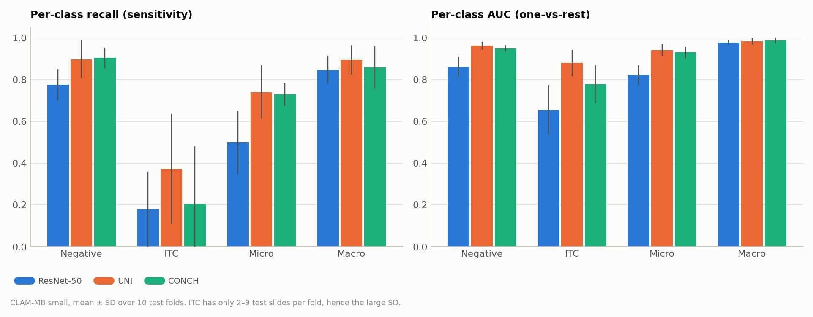
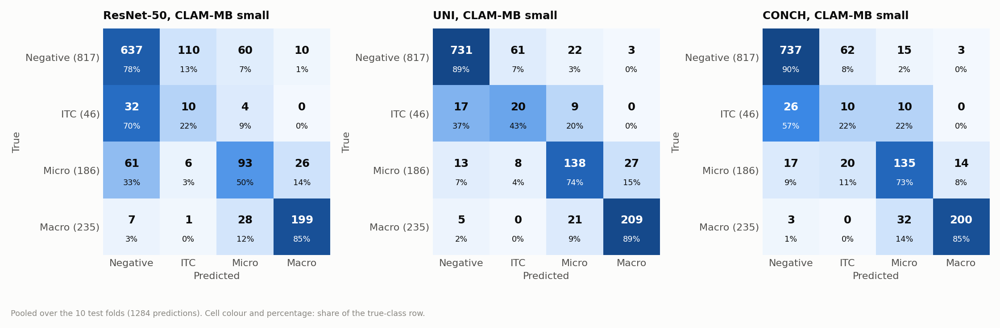
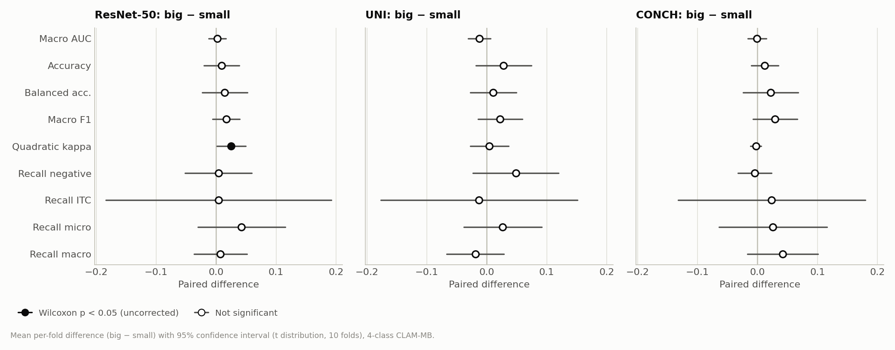
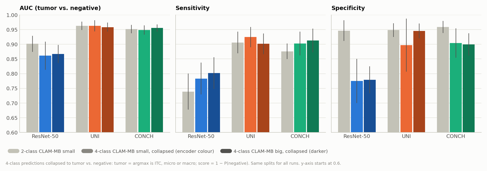

# CLAM-MB on Camelyon+ 4-class (negative / ITC / micro / macro): ResNet-50, UNI and CONCH, model_size small and big (B = 32)

**Runs compared:**

| Encoder | `model_size` | Experiment code | Run date |
|---|---|---|---|
| ResNet-50 | small | `camelyon_plus_4cls_resnet50_CLAM_MB_B32_s1` | 2026-10-07 |
| UNI | small | `camelyon_plus_4cls_uni_CLAM_MB_B32_s1` | 2026-10-07 |
| CONCH | small | `camelyon_plus_4cls_conch_CLAM_MB_B32_s1` | 2026-10-07 |
| ResNet-50 | big | `camelyon_plus_4cls_resnet50_CLAM_MB_B32_big_s1` | 2026-10-08 |
| UNI | big | `camelyon_plus_4cls_uni_CLAM_MB_B32_big_s1` | 2026-10-08 |
| CONCH | big | `camelyon_plus_4cls_conch_CLAM_MB_B32_big_s1` | 2026-10-08 |

All six runs were trained one after another with `run_4cls_mb.sh`. For comparison with the 2-class task, this report also uses the 2-class CLAM-MB small runs (`camelyon_plus_2cls_<encoder>_CLAM_MB_B32_s1`, see `model_type_mb_vs_sb_B32_report.md`). They have the same model type, model size, splits, seed and hyperparameters.

## 1. Summary

| Test, mean ± SD over 10 folds | ResNet-50 small | UNI small | CONCH small | ResNet-50 big | UNI big | CONCH big |
|---|---|---|---|---|---|---|
| Macro AUC (one-vs-rest) | 0.8286 ± 0.0325 | **0.9420 ± 0.0209** | 0.9110 ± 0.0283 | 0.8306 ± 0.0327 | 0.9296 ± 0.0280 | 0.9101 ± 0.0332 |
| Balanced accuracy (4-class) | 0.5755 ± 0.0528 | 0.7263 ± 0.0706 | 0.6743 ± 0.0605 | 0.5899 ± 0.0617 | **0.7371 ± 0.0586** | 0.6960 ± 0.0750 |
| Macro F1 | 0.5606 ± 0.0421 | 0.6988 ± 0.0777 | 0.6589 ± 0.0398 | 0.5773 ± 0.0448 | **0.7211 ± 0.0571** | 0.6883 ± 0.0540 |
| Quadratic-weighted kappa | 0.7682 ± 0.0593 | 0.9050 ± 0.0499 | 0.9071 ± 0.0248 | 0.7935 ± 0.0379 | **0.9092 ± 0.0279** | 0.9047 ± 0.0327 |

- **Foundation-model features matter even more for 4 classes than for 2.** UNI and CONCH beat ResNet-50 on macro AUC, balanced accuracy, macro F1 and quadratic kappa in all 10 folds (p = 0.002), for both model sizes. With small, the macro-AUC gap is +0.11 for UNI and +0.08 for CONCH, about twice the 2-class gap (≈ +0.055).
- **Macro- and micro-metastases are separated reasonably well, ITC is not.** One-vs-rest AUC is about 0.98 for macro and 0.93–0.95 for micro with UNI or CONCH. ITC recall is only 0.18–0.37: most ITC slides are called negative or micro. ITC is the rarest class (54 slides, 2–9 per test fold).
- **UNI is the best encoder for 4 classes**, ahead of CONCH on macro AUC with small (+0.031, better in 8 of 10 folds, p = 0.027) and on ITC AUC (+0.10, p = 0.049). With big, the macro-AUC difference disappears (+0.019, 5 of 10 folds, p = 0.43). Both small-model results are single uncorrected tests, so they should be read as a trend.
- **`model_size big` does not change the results.** For every encoder, no 4-class metric differs significantly from small, except ResNet-50's quadratic kappa (+0.025, p = 0.037, uncorrected).
- **Training on 4 classes does not improve tumor detection.** When the 4-class predictions are collapsed to tumor vs. negative, they are not better than the 2-class models trained on the same splits. ResNet-50 is worse (AUC −0.040, p = 0.010). For UNI and CONCH the AUC is the same, but the operating point shifts. Sensitivity is higher and specificity much lower, because the models call many negative slides ITC (61–110 of 817).

## 2. Setup

### Task and data

| Item | Value |
|---|---|
| Labels | `slide-lables/Camelyon+(4-classes).xlsx` (NAS `/mnt/nas/Camelyon+/`) |
| Classes (label index) | negative 0, ITC 1, micro 2, macro 3. They are ordered by lesion size, so CLAM's `max` patient voting gives each patient its largest lesion |
| Slides | 1350: negative 871, ITC 54, micro 174, macro 251 |
| Cases | 586. Patient-level labels: negative 294, ITC 24, micro 110, macro 158 |
| Dataset CSV | `dataset_csv/camelyon_plus_4cls.csv`, built from the 4-class label file with the `case_id` grouping of `camelyon_plus_2cls.csv` |
| Consistency with the 2-class labels | Exact: all 871 negative slides are negative in both files, and the 479 tumor slides are exactly the ITC + micro + macro slides |
| Features | Same provided features as the 2-class runs: ResNet-50 and UNI 1024-d, CONCH 512-d |

Code changes for this task: a `camelyon_plus_4cls` entry in `main.py`, `eval.py` and `create_splits_seq.py`, identical to `camelyon_plus_2cls` except for the CSV, `n_classes = 4` and the label dictionary.

### Splits

The runs reuse the existing 2-class splits (`--split_dir camelyon_plus_2cls_100`, read-only) instead of new 4-class splits:

- Both tasks contain the same 1350 slides and 586 cases. Every 4-class run therefore has exactly the same train / val / test slides in every fold as the 2-class runs, so the two tasks can be compared fold by fold ([Section 6](#6-4-class-vs-2-class-tumor-detection)).
- The split files were not modified. Their checksum was recorded before the runs and is unchanged after them.
- These splits were stratified by the 2-class label, so the tumor subtypes are not evenly spread across folds. Every fold has all four classes in train, validation and test, but ITC is sparse:

| Per fold | Negative | ITC | Micro | Macro |
|---|---|---|---|---|
| Train | 680–717 | 41–48 | 133–145 | 191–213 |
| Validation | 72–102 | **1–10** | 14–23 | 15–31 |
| Test | 70–90 | **2–9** | 14–25 | 12–33 |

### Training configuration

```bash
CUDA_VISIBLE_DEVICES=0 python main.py --drop_out 0.25 --early_stopping --lr 2e-4 --k 10 --weighted_sample \
  --bag_loss ce --inst_loss svm --task camelyon_plus_4cls --model_type clam_mb --log_data \
  --data_root_dir /var/tmp/shouteng_data/CLAM_DATA --B 32 --split_dir camelyon_plus_2cls_100 \
  --model_size <small|big> --exp_code camelyon_plus_4cls_<encoder>_CLAM_MB_B32[_big] \
  --feature_dir camelyon_plus_<encoder> --embed_dim <1024|512>
```

| Setting | Value |
|---|---|
| Model | CLAM-MB: 4 attention branches, one per class |
| `model_size` | small (attention hidden dim 256) or big (384) |
| Optimizer, loss, early stopping | Same as all 2-class runs: Adam lr 2e-4, weight decay 1e-5; 0.7 × CE + 0.3 × smooth top-1 SVM, B = 32; val loss, patience 20, min. 50 epochs |
| `--subtyping` | Not used, as in all earlier runs. With subtyping, the high-attention patches of the *other* classes' branches are trained as negative evidence. Here ITC, micro and macro are all tumor, so that constraint would be wrong for the tumor classes |
| Class balance | `--weighted_sample`, sampling weight N / N_class: negative 1.5, macro 5.4, micro 7.8, ITC 25.0. Each epoch therefore sees the four classes about equally often (checked in a test run: 253–293 draws per class per epoch). ITC slides are drawn about 25 / 1.5 ≈ 16 times as often as a negative slide |

### Metrics

- **Macro AUC.** CLAM's multi-class AUC is the mean of the four one-vs-rest AUCs (`summary.csv`, reproduced exactly).
- **Accuracy and balanced accuracy.** Balanced accuracy is the mean per-class recall.
- **Macro F1 and kappa.** Macro F1 is the mean per-class F1. **Quadratic-weighted Cohen's kappa** is included because the classes are ordered by lesion size: it penalizes macro → negative more than macro → micro.
- **Binary collapse** (for the comparison with the 2-class task). A slide is called tumor when the 4-class argmax is ITC, micro or macro. The tumor score is 1 − P(negative).
- **Statistics.** All values are mean ± SD over the 10 folds (ddof = 1). Comparisons use the paired two-sided exact Wilcoxon signed-rank test (smallest possible p = 0.002).

## 3. Overall 4-Class Performance

| Metric | ResNet-50 small | UNI small | CONCH small | ResNet-50 big | UNI big | CONCH big |
|---|---|---|---|---|---|---|
| Macro AUC | 0.8286 ± 0.0325 | 0.9420 ± 0.0209 | 0.9110 ± 0.0283 | 0.8306 ± 0.0327 | 0.9296 ± 0.0280 | 0.9101 ± 0.0332 |
| Accuracy | 0.7290 ± 0.0558 | 0.8554 ± 0.0631 | 0.8432 ± 0.0243 | 0.7381 ± 0.0345 | 0.8834 ± 0.0171 | 0.8554 ± 0.0308 |
| Balanced accuracy | 0.5755 ± 0.0528 | 0.7263 ± 0.0706 | 0.6743 ± 0.0605 | 0.5899 ± 0.0617 | 0.7371 ± 0.0586 | 0.6960 ± 0.0750 |
| Macro F1 | 0.5606 ± 0.0421 | 0.6988 ± 0.0777 | 0.6589 ± 0.0398 | 0.5773 ± 0.0448 | 0.7211 ± 0.0571 | 0.6883 ± 0.0540 |
| Weighted F1 | 0.7502 ± 0.0471 | 0.8655 ± 0.0478 | 0.8566 ± 0.0202 | 0.7631 ± 0.0316 | 0.8831 ± 0.0121 | 0.8687 ± 0.0262 |
| Cohen's kappa | 0.5308 ± 0.0845 | 0.7451 ± 0.0974 | 0.7182 ± 0.0377 | 0.5475 ± 0.0549 | 0.7831 ± 0.0291 | 0.7407 ± 0.0534 |
| Quadratic-weighted kappa | 0.7682 ± 0.0593 | 0.9050 ± 0.0499 | 0.9071 ± 0.0248 | 0.7935 ± 0.0379 | 0.9092 ± 0.0279 | 0.9047 ± 0.0327 |
| Mean val macro AUC | 0.8589 | 0.9420 | 0.9315 | 0.8676 | 0.9411 | 0.9255 |

### Encoder comparisons (paired, same splits)

| Metric | UNI − ResNet-50 (small) | CONCH − ResNet-50 (small) | UNI − CONCH (small) | UNI − CONCH (big) |
|---|---|---|---|---|
| Macro AUC | +0.1135, 10/10, p = 0.002 | +0.0824, 10/10, p = 0.002 | +0.0311, 8/10, p = 0.027 | +0.0194, 5/10, p = 0.43 |
| Balanced accuracy | +0.1508, 10/10, p = 0.002 | +0.0988, 10/10, p = 0.002 | +0.0520, 8/10, p = 0.064 | +0.0410, 7/10, p = 0.23 |
| Macro F1 | +0.1383, 10/10, p = 0.002 | +0.0983, 10/10, p = 0.002 | +0.0400, 7/10, p = 0.11 | +0.0328, 6/10, p = 0.23 |
| Quadratic kappa | +0.1367, 10/10, p = 0.002 | +0.1389, 10/10, p = 0.002 | −0.0022, 5/10, p = 1.0 | +0.0045, 7/10, p = 0.43 |
| ITC AUC (one-vs-rest) | +0.2250, 10/10, p = 0.002 | +0.1222, 8/10 (1 tie), p = 0.012 | +0.1028, 8/10, p = 0.049 | — |
| Micro AUC (one-vs-rest) | +0.1206, 10/10, p = 0.002 | +0.1087, 10/10, p = 0.002 | +0.0119, 6/10, p = 0.19 | — |

With big, UNI and CONCH again beat ResNet-50 in all 10 folds on macro AUC, balanced accuracy, macro F1 and quadratic kappa (all p = 0.002).

## 4. Per-Class Results

Mean ± SD over 10 folds, CLAM-MB small. The test set has 70–90 negative, 2–9 ITC, 14–25 micro and 12–33 macro slides per fold.

| Class | Metric | ResNet-50 | UNI | CONCH |
|---|---|---|---|---|
| Negative | AUC (OvR) | 0.8612 ± 0.0480 | 0.9629 ± 0.0193 | 0.9489 ± 0.0159 |
| | Recall | 0.7752 ± 0.0756 | 0.8970 ± 0.0903 | 0.9043 ± 0.0496 |
| | F1 | 0.8150 ± 0.0565 | 0.9222 ± 0.0478 | 0.9212 ± 0.0221 |
| ITC | AUC (OvR) | 0.6552 ± 0.1184 | 0.8801 ± 0.0638 | 0.7774 ± 0.0904 |
| | Recall | 0.1810 ± 0.1796 | 0.3731 ± 0.2633 | 0.2044 ± 0.2770 |
| | F1 | 0.0914 ± 0.0990 | 0.2636 ± 0.2197 | 0.1198 ± 0.1483 |
| Micro | AUC (OvR) | 0.8214 ± 0.0468 | 0.9420 ± 0.0298 | 0.9301 ± 0.0272 |
| | Recall | 0.4991 ± 0.1504 | 0.7402 ± 0.1279 | 0.7292 ± 0.0535 |
| | F1 | 0.4919 ± 0.1169 | 0.7281 ± 0.0946 | 0.7121 ± 0.0553 |
| Macro | AUC (OvR) | 0.9766 ± 0.0120 | 0.9831 ± 0.0166 | 0.9875 ± 0.0134 |
| | Recall | 0.8469 ± 0.0675 | 0.8950 ± 0.0702 | 0.8593 ± 0.1015 |
| | F1 | 0.8441 ± 0.0370 | 0.8816 ± 0.0449 | 0.8826 ± 0.0525 |



*Figure 1. Per-class recall (left) and one-vs-rest AUC (right), mean ± SD over 10 folds, CLAM-MB small. All encoders recognize macro-metastases well. The foundation models gain most on micro-metastases and ITC. ITC recall stays low with very large fold-to-fold variation.*

### Pooled confusion matrices



*Figure 2. Pooled 4-class confusion matrices over the 10 test folds (1284 predictions), CLAM-MB small. Rows are true classes, and cell colour is the share of the row. The largest error for every encoder is negative → ITC (110, 61 and 62 slides). Other common errors are ITC → negative, micro → negative (mainly ResNet-50) and confusions between adjacent sizes (micro ↔ macro, ITC ↔ micro). Macro is almost never called negative or ITC.*

- **Most errors are between adjacent size classes or between ITC and negative.** Macro is called negative or ITC in only 3–8 of 235 predictions, and negative is called macro in only 3–10 of 817. This is why quadratic-weighted kappa, which penalizes distant errors more, is much higher (0.77–0.91) than unweighted kappa (0.53–0.75).
- **ITC and negative are hard to tell apart.** An ITC is a cluster of at most 200 tumor cells and covers very few patches. Among the true ITC predictions, 17–32 of 46 are called negative. In the other direction, 7–13% of negative slides are called ITC.
- **The negative → ITC errors are probably due to class weighting.** Weighted sampling shows ITC slides about 16 times as often as negative slides, so the model learns as if all four classes were equally common. In reality, ITC makes up 3.6% of the test predictions. A model trained this way predicts ITC much more often than ITC occurs. This explanation was not tested directly. A run without `--weighted_sample`, or with a capped weight, would test it.

## 5. model_size big vs. small

Paired per-fold differences (big − small):

| Metric | ResNet-50 | UNI | CONCH |
|---|---|---|---|
| Macro AUC | +0.0020, 6/10, p = 0.56 | −0.0125, 4/10, p = 0.19 | −0.0008, 6/10, p = 0.70 |
| Accuracy | +0.0091, 5/10, p = 0.68 | +0.0280, 5/10, p = 0.56 | +0.0122, 6/10, p = 0.29 |
| Balanced accuracy | +0.0144, 6/10, p = 0.38 | +0.0107, 5/10, p = 0.70 | +0.0217, 6/10, p = 0.43 |
| Macro F1 | +0.0167, 7/10, p = 0.13 | +0.0223, 6/10, p = 0.28 | +0.0294, 7/10, p = 0.13 |
| Quadratic kappa | **+0.0252, 8/10, p = 0.037** | +0.0043, 5/10, p = 0.77 | −0.0025, 5/10, p = 0.92 |
| ITC recall | +0.0041, 4/10 (3 ties), p = 1.0 | −0.0129, 1/10 (7 ties), p = 1.0 | +0.0236, 3/10 (6 ties), p = 0.88 |
| Micro recall | +0.0424, 5/10 (2 ties), p = 0.15 | +0.0267, 3/10 (5 ties), p = 0.62 | +0.0258, 5/10 (2 ties), p = 0.64 |



*Figure 3. Mean per-fold difference (big − small) with 95% confidence interval, on a shared x-axis. Apart from ResNet-50's quadratic kappa, every interval includes zero. The ITC recall intervals span about ±0.2, so ITC cannot show a size effect with this test-set size.*

- **big is not better in a reliable way.** The threshold-based metrics lean slightly positive for big (macro F1 +0.017 to +0.029), but none is significant. The one significant result (ResNet-50 quadratic kappa, p = 0.037) does not survive a correction for the many tests in this section.
- **For UNI, big is slightly worse in ranking (macro AUC −0.013) but slightly better in thresholded accuracy (+0.028).** It calls far fewer negatives ITC (19 vs. 61), which raises negative recall (+0.048) and accuracy. This resembles the threshold and calibration shift seen with model_size in the 2-class task. None of these differences is significant.
- This matches the 2-class result (`model_size_big_vs_small_B32_report.md`): the attention width is not the limiting factor.

## 6. 4-Class vs. 2-Class: Tumor Detection

The 4-class models are collapsed to tumor vs. negative (Section 2) and compared fold by fold with the 2-class CLAM-MB small models on the same test sets:

| Encoder | Metric | 2-class MB small | 4-class MB small, collapsed | Difference (p) | 4-class MB big, collapsed | Difference (p) |
|---|---|---|---|---|---|---|
| ResNet-50 | AUC | 0.9015 | 0.8612 | **−0.0404 (p = 0.0098)** | 0.8670 | **−0.0346 (p = 0.0039)** |
| | Sensitivity | 0.7389 | 0.7833 | **+0.0444 (p = 0.043)** | 0.8019 | **+0.0630 (p = 0.0039)** |
| | Specificity | 0.9467 | 0.7752 | **−0.1715 (p = 0.002)** | 0.7790 | **−0.1677 (p = 0.002)** |
| | Balanced accuracy | 0.8428 | 0.7792 | **−0.0636 (p = 0.002)** | 0.7905 | **−0.0523 (p = 0.002)** |
| UNI | AUC | 0.9633 | 0.9629 | −0.0004 (p = 0.92) | 0.9583 | −0.0050 (p = 0.11) |
| | Sensitivity | 0.9062 | 0.9246 | +0.0184 (p = 0.062) | 0.9016 | −0.0045 (p = 0.69) |
| | Specificity | 0.9486 | 0.8970 | −0.0516 (p = 0.098) | 0.9453 | −0.0034 (p = 0.73) |
| | Balanced accuracy | 0.9274 | 0.9108 | −0.0166 (p = 0.43) | 0.9235 | −0.0040 (p = 0.49) |
| CONCH | AUC | 0.9519 | 0.9489 | −0.0029 (p = 0.85) | 0.9555 | +0.0036 (p = 0.56) |
| | Sensitivity | 0.8762 | 0.9026 | **+0.0264 (p = 0.023)** | 0.9130 | **+0.0369 (p = 0.0059)** |
| | Specificity | 0.9592 | 0.9043 | **−0.0549 (p = 0.0039)** | 0.8995 | **−0.0597 (p = 0.002)** |
| | Balanced accuracy | 0.9177 | 0.9034 | **−0.0142 (p = 0.0098)** | 0.9063 | −0.0114 (p = 0.084) |



*Figure 4. Tumor-vs-negative AUC, sensitivity and specificity: 2-class CLAM-MB small (gray), 4-class CLAM-MB small collapsed (encoder colour) and 4-class CLAM-MB big collapsed (darker shade), mean ± SD over the same 10 test folds. The y-axis starts at 0.6. The 4-class models trade specificity for sensitivity. For UNI and CONCH the AUC is unchanged, and for ResNet-50 it is lower.*

### Tumor slides detected (called any tumor class), pooled over the test folds

| | ResNet-50 2-class | ResNet-50 4-class | UNI 2-class | UNI 4-class | CONCH 2-class | CONCH 4-class |
|---|---|---|---|---|---|---|
| Negative called tumor (of 817) | 43 | 180 | 42 | 86 | 34 | 80 |
| ITC detected (of 46) | 1 | 14 | 24 | 29 | 11 | 20 |
| Micro detected (of 186) | 117 | 125 | 167 | 173 | 166 | 169 |
| Macro detected (of 235) | 228 | 228 | 232 | 230 | 232 | 232 |

(2-class and 4-class: CLAM-MB small.)

**Is the extra sensitivity real, or just a shifted threshold?** To check, each fold's 4-class tumor score was thresholded at the same specificity as the 2-class model on that fold. This is descriptive only, because it uses the test labels. At matched specificity, the 4-class models are **not** more sensitive:

| Encoder | 2-class sensitivity | 4-class sensitivity at the same specificity | Difference |
|---|---|---|---|
| ResNet-50 | 0.7389 | 0.7273 | −0.0116 (better in 2/10, p = 0.64) |
| UNI | 0.9062 | 0.8958 | −0.0104 (better in 3/10, p = 0.94) |
| CONCH | 0.8762 | 0.7726 | −0.1036 (better in 1/10, p = 0.031) |

- **4-class training does not help tumor detection.** The additional ITC and micro detections of the 4-class models come from a more permissive operating point. Most of that shift comes from negatives being called ITC. At equal specificity there is no gain, and for CONCH the 4-class model is clearly worse in the high-specificity range, even though its overall AUC is similar.
- **For ResNet-50, 4-class training even hurts the tumor-vs-negative ranking** (AUC −0.04, worse in 8 of 10 folds). Its weak features cannot separate negative from ITC, and the heavy ITC weighting pulls many negatives toward the ITC class.
- **If tumor detection is the goal, use the 2-class model.** The 4-class model is useful when the lesion size itself is needed. For UNI and CONCH, the size class is right for about 74% of micro and 85–89% of macro slides.

## 7. Training Dynamics

| | ResNet-50 small | UNI small | CONCH small | ResNet-50 big | UNI big | CONCH big |
|---|---|---|---|---|---|---|
| Best val-loss epoch, mean (range) | 39.7 (12–69) | 1.6 (0–4) | 16.1 (7–31) | 44.1 (18–70) | 2.1 (0–6) | 10.6 (5–31) |
| Total epochs (10 folds) | 629 | 520 | 520 | 667 | 520 | 520 |
| Val loss: first / best / last epoch | 1.332 / 0.647 / 0.844 | 0.508 / 0.392 / 1.107 | 0.761 / 0.425 / 0.639 | 1.340 / 0.647 / 0.843 | 0.546 / 0.385 / 1.140 | 0.784 / 0.423 / 0.648 |
| Train loss at last epoch | 0.364 | 0.011 | 0.093 | 0.343 | 0.009 | 0.092 |
| Correlation of val and test macro AUC across folds | 0.46 | 0.32 | −0.11 | −0.13 | 0.44 | 0.23 |
| Time per epoch | 18.7 s | 18.5 s | 12.6 s | 19.0 s | 18.8 s | 12.9 s |
| Total time | 3 h 16 min | 2 h 40 min | 1 h 49 min | 3 h 31 min | 2 h 43 min | 1 h 52 min |

- **The convergence pattern of each encoder carries over from the 2-class task.** The first-epoch validation loss of ResNet-50 is about ln 4 ≈ 1.39, which is chance level for 4 classes, and its best checkpoint comes after 12–70 epochs. UNI reaches its best validation loss within the first 0–6 epochs and then overfits strongly (training loss ≈ 0.01, validation loss rising to about 1.1). CONCH is in between (best epoch 5–31).
- **CONCH converges later with 4 classes than with 2.** Its mean best epoch is 16.1 for small, against 7.7 for 2-class MB small. The finer task gives it more to learn before it overfits.
- Compared with the 2-class CLAM-MB small runs, time per epoch is 0.5–0.7 s higher (18.7 vs. 18.1 s for ResNet-50, 18.5 vs. 18.0 s for UNI, 12.6 vs. 11.9 s for CONCH), because the model has 4 attention branches and 4 instance classifiers instead of 2. Total time also depends on how many epochs early stopping allows. For example, ResNet-50 small ran 629 epochs instead of 619.

## 8. Conclusions

1. **For lesion-size classification, use UNI (or CONCH) features.** UNI small gives the best macro AUC (0.942) and the best ITC AUC (0.880). UNI big is close and has the best thresholded metrics. Both foundation models are far ahead of ResNet-50, whose macro AUC is 0.829, in every fold.
2. **ITC is the open problem.** ITC recall is at best about 0.37, and the main confusion is with negative slides, which is expected given how few tumor cells an ITC contains. ITC estimates are also very noisy: 2–9 test slides per fold, and as few as 1 in a validation set.
3. **`model_size big` brings no reliable gain** for 4 classes either. small remains the default.
4. **4-class training does not improve tumor-vs-negative detection** compared with a 2-class model on the same splits. The apparent sensitivity gain is a shift of the operating point that costs specificity. For detection use the 2-class model, and for size grading use the 4-class model.

### Limitations

- The splits are stratified by the 2-class label, so the subtypes are not balanced across folds. Some validation sets contain only 1–3 ITC slides, which makes early stopping and the ITC metrics noisy. This was a deliberate choice, to keep the comparison with the 2-class runs exact.
- One seed per configuration.
- Hyperparameters were taken from the 2-class runs and not tuned for the 4-class task. That includes the class weighting, which probably drives the negative → ITC errors.
- The matched-specificity comparison in Section 6 uses the test labels to set the threshold. It is descriptive only.

### Possible next steps

- Reduce or cap the ITC sampling weight (or drop `--weighted_sample`) to test whether the negative → ITC errors come from the class weighting.
- Create 4-class-stratified splits in a **new** split folder, to get more stable ITC estimates. This gives up the exact fold-by-fold comparison with the 2-class runs.
- Lower the learning rate for UNI and CONCH, which again overfit within a few epochs.
- Consider a hierarchical setup: the 2-class model for tumor detection, and a size classifier applied only to detected tumors.

## Files

- Runs: `results/camelyon_plus_4cls_<encoder>_CLAM_MB_B32[_big]_s1/`; training logs in `logs/`.
- Dataset CSV: `dataset_csv/camelyon_plus_4cls.csv`. Run script: `run_4cls_mb.sh`.
- Metrics: `.claude/skills/clam-experiment-report/scripts/collect_metrics_multiclass.py` (new multi-class counterpart of `collect_metrics.py`).
- Figures: `results/figures/c4_*.png`, generated by `results/make_report_figures.py`.
- To re-evaluate a checkpoint, `eval.py` needs `--task camelyon_plus_4cls --model_type clam_mb --model_size <small|big> --splits_dir splits/camelyon_plus_2cls_100`.
