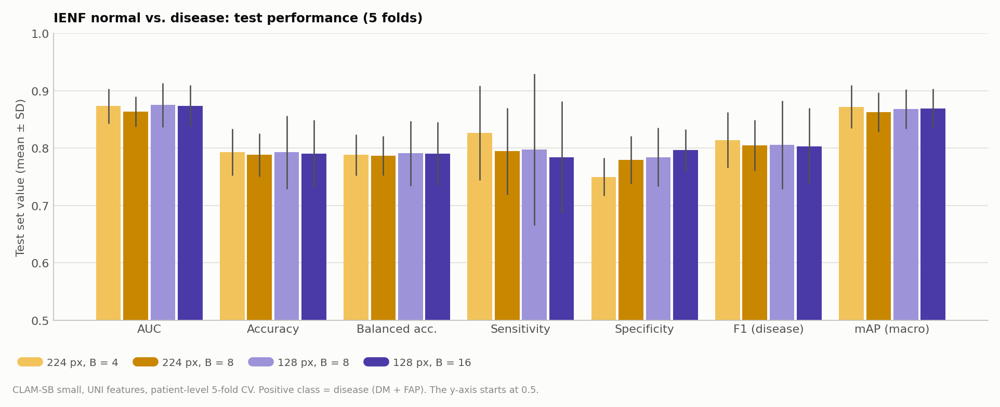
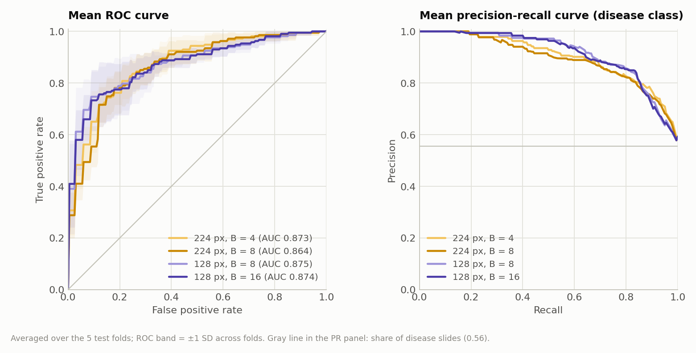
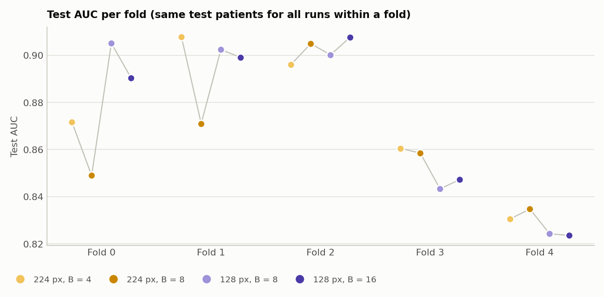
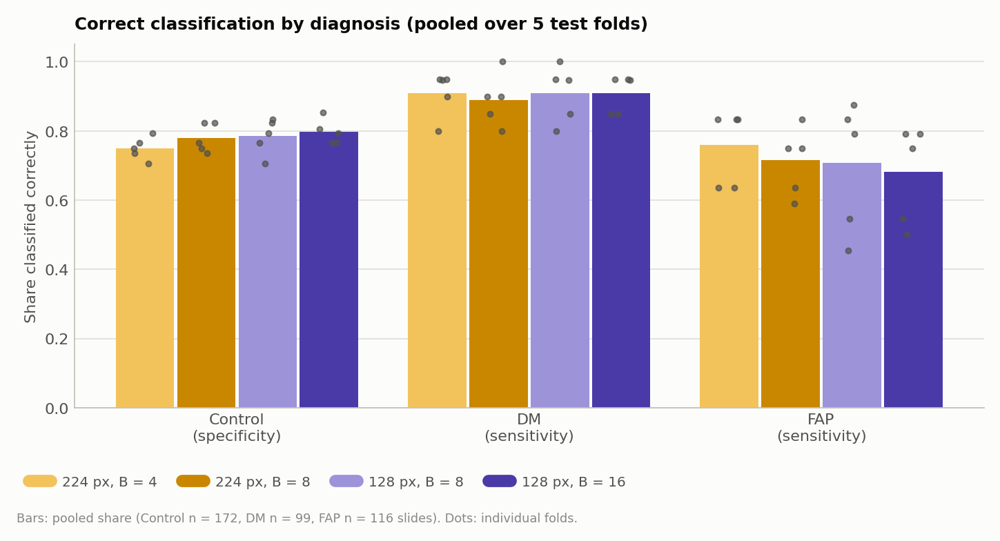
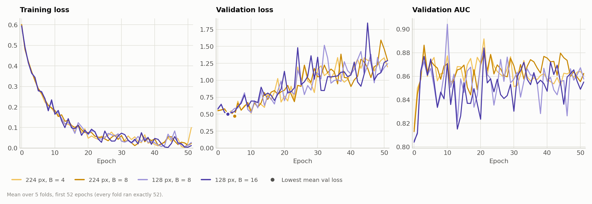

# CLAM on IENF Skin Biopsies (Normal vs. Disease, UNI features): Patch Size 224 vs. 128 and B

**Runs compared** (our own runs, all trained on 2026-10-20, 13:26–13:57, with `run_ienf_2cls.sh`):

| Name | Experiment code | Patch size | B | Feature folder |
|---|---|---|---|---|
| 224 px, B = 4 | `ienf_2cls_uni_p224_CLAM_B4_s1` | 224 | 4 | `ienf_uni_p224_s224` |
| 224 px, B = 8 | `ienf_2cls_uni_p224_CLAM_B8_s1` | 224 | 8 | `ienf_uni_p224_s224` |
| 128 px, B = 8 | `ienf_2cls_uni_p128_CLAM_B8_s1` | 128 | 8 | `ienf_uni_p128_s128` |
| 128 px, B = 16 | `ienf_2cls_uni_p128_CLAM_B16_s1` | 128 | 16 | `ienf_uni_p128_s128` |

This is the first CLAM experiment on the IENF (intraepidermal nerve fiber) images. It uses the new ROI-driven preprocessing in `~/projects/IENF_CLAM_Preprocessing`: only the epidermis band (from the Epidermis ROI) is patched. The task is 2-class: **Control (normal) vs. DM + FAP (disease)**. Two patch sizes were tested, each with two values of B (the number of top and bottom attention patches used for CLAM's instance loss). B was chosen per patch size from the bag sizes (Section 2).

## 1. Summary

| Test (mean ± SD, 5 folds) | 224 px, B = 4 | 224 px, B = 8 | 128 px, B = 8 | 128 px, B = 16 |
|---|---|---|---|---|
| AUC | 0.8733 ± 0.0304 | 0.8636 ± 0.0266 | **0.8750 ± 0.0383** | 0.8736 ± 0.0364 |
| Balanced accuracy | 0.7883 ± 0.0359 | 0.7870 ± 0.0344 | **0.7910 ± 0.0567** | 0.7904 ± 0.0549 |
| Sensitivity (disease) | **0.8265 ± 0.0825** | 0.7946 ± 0.0755 | 0.7976 ± 0.1322 | 0.7844 ± 0.0974 |
| Specificity (Control) | 0.7500 ± 0.0329 | 0.7794 ± 0.0416 | 0.7843 ± 0.0514 | **0.7964 ± 0.0364** |

- **The pipeline works end to end, and the models clearly learn the task.** Using ROI patching, UNI features and CLAM-SB, all four runs reach a test AUC of 0.86–0.88 and a balanced accuracy of about 0.79. The four runs are within 0.012 AUC of each other.
- **Neither patch size nor B makes a measurable difference.** With 5 folds, the exact Wilcoxon test cannot give p < 0.0625, so no difference can be significant. More importantly, the differences are small compared with the fold-to-fold SD of 0.03–0.04 AUC, and no setting wins consistently (at most 3 of 5 folds for AUC). On this evidence, 224 px with B = 4 and 128 px with B = 8 are equally good choices.
- **The errors are concentrated in FAP and Control.** DM is detected well: 88–90 of 99 slides (0.89–0.91). FAP is detected less well: 79–88 of 116 (0.68–0.76). About 1 in 4–5 Control slides is called disease: specificity is 0.75–0.80. 43 slides are misclassified by all four models (19 FAP, 18 Control, 6 DM).
- **Patient-level results are somewhat better.** If the prediction for a patient is the mean of its two slides, the pooled out-of-fold AUC is 0.89–0.91 and the accuracy 0.80–0.83 (194 patients). The two slides of a patient get different predictions in 30–46 of 193 patients.
- **The models overfit within a few epochs.** The best validation-loss epoch is 1–31 (mean 4–9). The validation loss then rises from about 0.38 to about 1.2–1.3 by epoch 51. Early stopping uses the early checkpoint, but the validation sets are small (19 patients), and validation AUC does not predict test AUC (r = −0.36 to −0.52).
- **Heatmaps** (Section 9) were made with CLAM's heatmap tools for 2 slides each of TP, TN, FN and FP, with 95% patch overlap and blur as in the CLAM paper. The attention varies along the epidermis band. Whether it follows nerve-fiber features has not been checked.

## 2. Setup

### Data

| Item | Value |
|---|---|
| Images | IENF skin-biopsy TIFFs, `/data/datasets/neuroimages/20250214/Image/Original` (439 images; the 387 with labels are used). Fluorescence, about 1.54 px/µm (0.65 µm/px), per the preprocessing README |
| Labels | `IENF_ResNet-50_Classification/data/labels/labels.csv` → `dataset_csv/ienf_3cls.csv` (Control / DM / FAP) → `dataset_csv/ienf_2cls.csv` (normal = Control, disease = DM + FAP) |
| Slides | 387: 172 normal (Control), 215 disease (99 DM, 116 FAP) |
| Patients | 194 (`case_id` = SkinID): 193 with two slides (sides a and b), 1 with one. No patient has mixed labels. 86 normal, 108 disease |
| ROI | `Epidermis_ROI/*.roi`, lower edge extended 5 px toward the dermis (upward for `S1357-2_b`, whose dermis lies above the band) |

### Patching (ROI-driven, `IENF_CLAM_Preprocessing/scripts/create_patches_roi.py`)

```bash
python scripts/create_patches_roi.py \
    --source /data/datasets/neuroimages/20250214 \
    --csv ~/projects/CLAM/dataset_csv/ienf_3cls.csv \
    --save_dir /var/tmp/shouteng_data/IENF_CLAM/clam_prep \
    --clam_root ~/projects/CLAM \
    --patch_size 224 128 --overlap 0
```

| | 224 px | 128 px |
|---|---|---|
| Patch size in µm (0.65 µm/px) | ≈ 145 µm | ≈ 83 µm |
| Scale seen by UNI after resizing to 224 px | 0.65 µm/px | 0.37 µm/px (upsampled 1.75×) |
| Accept rule | ROI covers ≥ 5% of the patch (`roi_overlap`) | same |
| Patches per slide, min / median / max | 10 / 27 / 48 | 22 / 62 / 119 |
| Total patches | 10,410 | 24,094 |
| Mean ROI coverage (share of ROI area inside a patch) | 0.990 | 0.994 |

All 387 slides got patches. The compatibility test of the preprocessing project (`tests/check_against_clam.py`, 8 slides per variant) passed for both: CLAM's own attributes and loader work with the patch files.

### Features

UNI (v1, `MahmoodLab/UNI`, `vit_large_patch16_224`) through CLAM's own `extract_features_fp.py`, launched by `scripts/extract_features_ienf.py` (it provides an `openslide` stand-in, because the plain TIFFs cannot be opened by OpenSlide). CLAM resizes every patch to 224 px and applies ImageNet normalization. Output: 1024-d features in `/var/tmp/shouteng_data/CLAM_DATA/ienf_uni_p224_s224` and `.../ienf_uni_p128_s128`. Every feature file was checked against its patch file (same number of patches, same coordinates, finite values). Mean feature length is 39.7 (224 px) and 39.6 (128 px), close to UNI features on Camelyon+ (38.7). Extraction took 2 min 43 s (224 px) and 5 min (128 px) on the RTX 3090.

UNI was trained on H&E and IHC bright-field images. IENF images are fluorescence, so the features are used well outside UNI's training domain.

### Splits: patient-level stratified 5-fold CV

```bash
python create_splits_kfold.py \
    --k 5 --seed 1 \
    --csv dataset_csv/ienf_3cls.csv --order Control DM FAP \
    --out_dir ienf_kfold5_seed1
```

Standard k-fold (not Monte Carlo): every patient is in the test set of exactly one fold, so each of the 387 slides gets exactly one out-of-fold prediction. Both slides of a patient are always in the same set (the script asserts this). Stratification is on Control / DM / FAP, so the 2-class ratio is also balanced. Per fold, in patients: 136–137 train / 19 val / 38–39 test (70 / 10 / 20); in slides: 271–274 / 37–38 / 76–78. Every test fold has 34–36 Control, 19–20 DM and 22–24 FAP slides.

### Training

```bash
CUDA_VISIBLE_DEVICES=0 python main.py \
    --task ienf_2cls --split_dir ienf_kfold5_seed1 --k 5 \
    --model_type clam_sb --model_size small --B 8 \
    --drop_out 0.25 --lr 2e-4 --reg 1e-5 --max_epochs 200 --early_stopping \
    --weighted_sample --bag_loss ce --inst_loss svm \
    --data_root_dir /var/tmp/shouteng_data/CLAM_DATA \
    --feature_dir ienf_uni_p128_s128 --embed_dim 1024 \
    --seed 1 --log_data \
    --exp_code ienf_2cls_uni_p128_CLAM_B8
```

The other runs change only `--feature_dir`, `--B` and `--exp_code` (table at the top). Settings are the same as in the Camelyon+ runs: CLAM-SB small (Linear(1024, 512) → gated attention 512 → 256), dropout 0.25, Adam lr 2e-4, weight decay 1e-5, 0.7 × CE + 0.3 × smooth top-1 SVM instance loss, weighted sampling, early stopping on validation loss (patience 20, not before epoch 50, max. 200 epochs), seed 1.

### Choice of B, and the cap for small bags

CLAM's instance loss takes the B patches with the highest attention as positive and the B with the lowest as negative. If a bag has fewer than 2B patches, the same patch can end up in both sets. If it has fewer than B patches, the original code crashes. IENF bags are small, so B was chosen per patch size from the share of slides with fewer than 2B patches:

| | B = 4 | B = 8 | B = 16 |
|---|---|---|---|
| 224 px: slides with N < 2B | 0 | 18 (5%; 14 of them Control) | 323 (83%) |
| 128 px: slides with N < 2B | 0 | 0 | 7 (2%; all Control) |

B = 16 was dropped for 224 px. In addition, `models/model_clam.py` now uses k = min(B, N // 2) patches per bag, so the two sets never overlap and every slide is kept. This affects only the 18 slides of the 224 px, B = 8 run (k = 5–7 instead of 8) and the 7 slides of the 128 px, B = 16 run. Bags with N ≥ 2B, including every Camelyon+ bag, are unchanged.

### Metrics

Positive class = disease. Threshold-based metrics use argmax (0.5). Mean ± SD over the 5 test folds (ddof = 1). F1 = disease-class F1; mAP = macro over both classes. Paired comparisons use the same test patients in each fold. **With 5 folds the smallest possible two-sided exact Wilcoxon p is 2/32 = 0.0625**, so p-values are given only for completeness; the number of folds won is more informative.

## 3. Overall Test Performance

| Metric | 224 px, B = 4 | 224 px, B = 8 | 128 px, B = 8 | 128 px, B = 16 |
|---|---|---|---|---|
| AUC | 0.8733 ± 0.0304 | 0.8636 ± 0.0266 | **0.8750 ± 0.0383** | 0.8736 ± 0.0364 |
| Accuracy | **0.7933 ± 0.0407** | 0.7882 ± 0.0378 | 0.7930 ± 0.0638 | 0.7904 ± 0.0586 |
| Balanced accuracy | 0.7883 ± 0.0359 | 0.7870 ± 0.0344 | **0.7910 ± 0.0567** | 0.7904 ± 0.0549 |
| Sensitivity | **0.8265 ± 0.0825** | 0.7946 ± 0.0755 | 0.7976 ± 0.1322 | 0.7844 ± 0.0974 |
| Specificity | 0.7500 ± 0.0329 | 0.7794 ± 0.0416 | 0.7843 ± 0.0514 | **0.7964 ± 0.0364** |
| Precision | 0.8048 ± 0.0236 | 0.8183 ± 0.0319 | 0.8220 ± 0.0285 | **0.8263 ± 0.0382** |
| F1 (disease) | **0.8142 ± 0.0483** | 0.8049 ± 0.0441 | 0.8056 ± 0.0770 | 0.8034 ± 0.0667 |
| mAP (macro) | **0.8721 ± 0.0374** | 0.8626 ± 0.0347 | 0.8682 ± 0.0348 | 0.8688 ± 0.0343 |
| Pooled AUC (387 slides, each once) | 0.8695 | 0.8541 | 0.8698 | 0.8703 |
| Patient-level AUC (mean of a patient's slides, 194 patients) | **0.9062** | 0.8928 | 0.8934 | 0.8920 |
| Patient-level accuracy | **0.8299** | 0.8041 | 0.8041 | 0.8144 |

Bold = best mean. No difference is significant (Section 5). Pooled and patient-level values are computed over all out-of-fold predictions together, so they mix the 5 fold models.



*Figure 1. Test metrics (mean ± SD over 5 folds). Yellow = 224 px, violet = 128 px; the darker shade has the larger B. The y-axis starts at 0.5. The bars within each metric are about the same height; the error bars (fold-to-fold SD) are larger than the differences.*



*Figure 2. Mean ROC (left) and precision-recall curves (right) over the 5 test folds. The four curves overlap almost everywhere.*

## 4. Per-Fold Test Results

| Fold | Test slides (Control / DM / FAP) | 224 px, B = 4 | 224 px, B = 8 | 128 px, B = 8 | 128 px, B = 16 | Best |
|---|---|---|---|---|---|---|
| 0 | 78 (34 / 20 / 24) | 0.8717 | 0.8489 | **0.9051** | 0.8904 | 128, B = 8 |
| 1 | 78 (34 / 20 / 24) | **0.9078** | 0.8710 | 0.9024 | 0.8991 | 224, B = 4 |
| 2 | 77 (34 / 19 / 24) | 0.8960 | 0.9049 | 0.9001 | **0.9077** | 128, B = 16 |
| 3 | 78 (36 / 20 / 22) | **0.8604** | 0.8585 | 0.8433 | 0.8472 | 224, B = 4 |
| 4 | 76 (34 / 20 / 22) | 0.8305 | **0.8347** | 0.8242 | 0.8235 | 224, B = 8 |



*Figure 3. Test AUC per fold. The fold matters more than the setting: fold 4 is the lowest for all four runs (0.82–0.83), folds 0–2 are mostly around 0.85–0.91.*

Per-fold sensitivity varies a lot, especially at 128 px: 0.64–0.91 for B = 8 and 0.67–0.86 for B = 16. In folds 3 and 4, both 128 px runs have a sensitivity of 0.64–0.69. That is where 128 px loses against 224 px, B = 4 (0.71–0.76 there).

## 5. Paired Comparison (same test patients in every fold)

Test AUC difference (first − second), folds where the first is better, two-sided exact Wilcoxon p (smallest possible: 0.0625), and the share of slides that get the same predicted class:

| Pair | What differs | AUC difference | Folds first better | p | Same prediction |
|---|---|---|---|---|---|
| 224 B4 − 224 B8 | B | +0.0097 ± 0.0194 | 3/5 | 0.63 | 95.3% |
| 128 B8 − 128 B16 | B | +0.0015 ± 0.0085 | 3/5 | 1.0 | 96.1% |
| 224 B4 − 128 B8 | patch size (and B) | −0.0017 ± 0.0193 | 3/5 | 0.81 | 83.5% |
| 224 B8 − 128 B8 | patch size only | −0.0114 ± 0.0310 | 3/5 | 0.81 | 84.0% |
| 224 B4 − 128 B16 | patch size and B | −0.0003 ± 0.0140 | 3/5 | 1.0 | 83.7% |
| 224 B8 − 128 B16 | patch size and B | −0.0100 ± 0.0238 | 2/5 | 0.63 | 85.3% |

- **B changes little** within a patch size: 95–96% of predictions stay the same. At 224 px, B = 4 vs. B = 8 shifts the operating point: sensitivity +0.032 (3 of 5 folds, 1 tie), specificity −0.029 (0 of 5 folds better, 2 ties), with no change in AUC.
- **Patch size changes which slides are wrong, but not how many.** Across patch sizes only 84–85% of predictions agree, although the AUC is the same. The 224 px and 128 px models therefore make partly different errors. Combining them might help; this was not tested.

## 6. Error Analysis

| Pooled over the 5 test folds | 224 px, B = 4 | 224 px, B = 8 | 128 px, B = 8 | 128 px, B = 16 |
|---|---|---|---|---|
| False positives (Control called disease, of 172) | 43 | 38 | 37 | 35 |
| False negatives (of 215) | 37 | 44 | 43 | 46 |
| DM detected (of 99) | 90 | 88 | 90 | 90 |
| FAP detected (of 116) | 88 | 83 | 82 | 79 |



*Figure 4. Share of slides classified correctly, by diagnosis (bars: pooled; dots: folds). DM is easiest (0.89–0.91), FAP and Control are harder (0.68–0.80). FAP varies most between folds.*

- **DM is detected much more reliably than FAP** (0.89–0.91 vs. 0.68–0.76 pooled). Possible reasons, not checked: a different degree of nerve-fiber loss in the two groups in this cohort, or FAP changes that are less visible in the epidermis patches.
- **Specificity is the weaker side** (0.75–0.80): 35–43 of 172 Control slides are called disease.
- **Errors are shared.** 43 slides are misclassified by all four models (19 FAP, 18 Control, 6 DM); 120 by at least one. A set of consistently hard slides suggests that it is not the patching setting that limits the result. It could be label noise, image quality, or real overlap between groups; this has not been checked.
- **The two slides of a patient often disagree**: 30–46 of 193 patients get different predictions for their two slides (fewer at 128 px: 30–31; more at 224 px: 42–46).

## 7. Training Dynamics and Model Selection

| | 224 px, B = 4 | 224 px, B = 8 | 128 px, B = 8 | 128 px, B = 16 |
|---|---|---|---|---|
| Best val-loss epoch, per fold | 12, 20, 8, 3, 1 | 3, 31, 8, 3, 1 | 5, 6, 2, 3, 4 | 5, 6, 2, 3, 4 |
| Best val-loss epoch, mean | 8.8 | 9.2 | 4.0 | 4.0 |
| Lowest val loss (mean) | 0.376 | 0.372 | 0.399 | 0.386 |
| Val loss at last epoch (mean) | 1.197 | 1.294 | 1.242 | 1.290 |
| Train loss at last epoch (mean) | 0.099 | 0.022 | 0.027 | 0.012 |
| Epochs run per fold | 52 | 52 | 52 | 52 |
| Correlation of val and test AUC across folds | −0.36 | −0.52 | −0.48 | −0.48 |
| Training time (5 folds) | 6.1 min | 6.3 min | 6.2 min | 6.4 min |



*Figure 5. Mean training loss, validation loss and validation AUC over the 5 folds. The validation loss is lowest within the first few epochs and then roughly doubles. Note: the lowest-point markers of the two 128 px runs coincide (epoch 3), as do those of the two 224 px runs (epoch 5), so only two dots are visible.*

- **Early overfitting.** Every fold stopped at the earliest possible point (epoch 51). The best checkpoint was reached at epochs 1–31, and the training loss went close to 0 while the validation loss rose to about 1.2–1.3. This is like UNI on Camelyon+, but with a much smaller training set (about 270 slides per fold).
- **Model selection is noisy.** The validation set is 19 patients (37–38 slides). Validation AUC is negatively correlated with test AUC in all four runs (5 folds, so r itself is very uncertain). The checkpoint choice is therefore largely random among the early epochs.
- The two 128 px runs have identical best epochs. Both runs share the seed, the data order and the bag-level path; B affects only the instance loss, which apparently did not change the epoch with the lowest validation loss.

## 8. Computational Cost

Training is cheap: 1.4–1.5 s per epoch and about 6 minutes per run (5 folds × 52 epochs). Feature extraction took 2 min 43 s for 224 px and 5 min for 128 px. The features take 100 MB (224 px) and 216 MB (128 px).

## 9. Attention Heatmaps

Heatmaps were made for the 128 px, B = 8 run with `heatmaps/ienf_heatmaps.py`. The final version uses **95% patch overlap** and Gaussian blur, as in the original CLAM paper's fine-grained heatmaps:

```bash
UNI_CKPT_PATH=~/projects/UNI/assets/ckpts/uni/pytorch_model.bin \
python heatmaps/ienf_heatmaps.py \
    --run ienf_2cls_uni_p128_CLAM_B8_s1 \
    --variant p128_s128_bufdown5 --feature_dir ienf_uni_p128_s128 \
    --n 2 --overlap 0.95 --blur \
    --out_dir heatmaps/ienf/ienf_2cls_uni_p128_CLAM_B8_s1_overlap95_blur
```

A first version with 50% overlap (CLAM's config-template default; same command with `--overlap 0.5`, no `--blur`, default output folder) is kept for comparison.

**Method.** CLAM's `create_heatmaps.py` cannot be used directly: it segments tissue with Otsu/HSV thresholds and opens slides with OpenSlide. The script follows the same steps with CLAM's own components: `initiate_model`, `get_encoder('uni_v1')`, `score2percentile` and `drawHeatmap` → `WholeSlideImage.visHeatmap`. The epidermis ROI contours are loaded as the segmentation, so only the band is colored.

- Each slide is drawn with the model of the fold that tested it. The recomputed P(disease) matched the saved test result for all 8 slides.
- **Overlapping patches.** 128 px patches are laid on the same ROI rule with a 6 px step (95% overlap). That gives 13,735–28,015 patches per slide instead of the 37–78 of the trained bag. Each patch gets its own UNI features and attention score.
- **Scores.** Each score is converted to a percentile of the slide's own bag scores (as with `use_ref_scores: true` in CLAM's config). `visHeatmap` then averages the overlapping scores pixel by pixel.
- **Blur.** `blur=True` applies a Gaussian blur with a kernel of 2 × step + 1 = 13 px to the colored overlay before it is blended with the original (alpha 0.4). The original's detail therefore stays visible.
- **Colormap.** jet (CLAM default).
- The 8 slides took about half an hour on the RTX 3090 (from the output file times), mostly UNI feature extraction for the overlapping patches.

**Interpretation.** Higher overlap only samples the same model more densely; it does not raise its resolution. The model was trained on non-overlapping 128 px patches (about 83 µm), so the value at each point still describes the surrounding 128 px window. The smooth maps are easier to read, but they are not finer in what the model can resolve.

**Selection.** The 2 most confident slides of each kind (out-of-fold predictions, one slide per patient):

| Group | Slide | Diagnosis | P(disease) | Fold |
|---|---|---|---|---|
| TP (correct, disease) | S3933-2_b | DM | 1.000 | 1 |
| TP | S1445-2_a | DM | 1.000 | 3 |
| TN (correct, normal) | S1616-2_b | Control | 0.001 | 0 |
| TN | S341-2_a | Control | 0.003 | 0 |
| FN (missed disease) | S1702-2_b | DM | 0.007 | 4 |
| FN | S3620-2_a | FAP | 0.028 | 4 |
| FP (false alarm) | S2577-2_a | Control | 0.997 | 0 |
| FP | S425-2_b | Control | 0.969 | 4 |


*Figure 6. Original image (left) and attention heatmap with 95% overlap and blur (right), cropped to the epidermis ROI, for 2 slides each of TP, TN, FN and FP. Colors are attention percentiles within each slide (blue = low, red = high). They show where the model looked, relative to the rest of the same slide, not where disease is.*


*Figure 7. The same two slides at 50% overlap (no blur) and at 95% overlap with blur. The 64 px blocks disappear, but the high- and low-attention stretches stay in the same places. The smoothing therefore does not change what the heatmap says.*

**What can be seen** (descriptive; not reviewed by a pathologist):
- In every slide, attention varies along the band: some stretches are mostly high (red), others mostly low (blue).
- In some slides, attention also changes across the thickness of the band. For example, in `S1616-2_b` and `S425-2_b` the lower edge toward the dermis is often lower than the upper part. This was not quantified.
- Visually, the maps of the confident errors (FP with P(disease) ≥ 0.97, FN with P(disease) ≤ 0.03) show the same kind of pattern as the correct cases. The heatmaps alone do not reveal why these slides are misclassified.
- FN `S1702-2_b` has a very thin epidermis band (37 patches) and a large black, empty region in the image. FN `S3620-2_a` is a FAP case, the harder disease group (Section 6).

**Files.** Each slide has four separate images in `heatmaps/ienf/ienf_2cls_uni_p128_CLAM_B8_s1_overlap95_blur/slides/` (and the same four in the 50% folder `heatmaps/ienf/ienf_2cls_uni_p128_CLAM_B8_s1/slides/`):

| File | Content |
|---|---|
| `<group>_<slide>_heatmap.jpg` | full image, heatmap with 95% overlap + blur |
| `<group>_<slide>_heatmap_roi.jpg` | the same, cropped to the ROI |
| `<group>_<slide>_orig_roi.jpg` | the original image, same crop |
| `<group>_<slide>_blockmap.jpg` | coarse map from the trained bag (no overlap), like CLAM's `_blockmap` output |

`overview.png` combines all slides; `selected_slides.csv` lists the selection. `--overview_only` redraws `overview.png` from the saved images without recomputing the heatmaps.

## 10. Conclusions

1. **The IENF → CLAM pipeline works.** With ROI patching, UNI features and CLAM-SB, normal vs. disease reaches a test AUC of about 0.87 at the slide level and 0.89–0.91 at the patient level.
2. **Patch size (224 vs. 128) and B (4/8 vs. 8/16) do not change the result** within the precision of 5-fold CV. 224 px with B = 4 is the cheapest choice: smallest bags, no capped bags, fastest feature extraction. 128 px gives finer heatmaps.
3. **The limiting factors are elsewhere:** FAP detection, specificity, a group of 43 slides that every model gets wrong, early overfitting, and a validation set too small for reliable model selection.

### Limitations

- One seed. 5 folds give little statistical power (minimum p = 0.0625); differences below about 0.03 AUC cannot be resolved.
- UNI is a bright-field (H&E/IHC) model applied to fluorescence images. Its features may not capture the relevant structures, and no other encoder was tried.
- Hyperparameters are the Camelyon+ settings and were not tuned for IENF. The epoch-50 minimum and patience 20 are far longer than needed here.
- The k = min(B, N // 2) cap is a change to CLAM. It affects only small bags (18 slides at 224 px, B = 8; 7 at 128 px, B = 16).
- The heatmaps are a small, confidence-selected sample and were not reviewed against the nerve-fiber annotations (`IENF_ROI`).

### Possible next steps

- Compare with the existing ResNet-50 classification project (`IENF_ResNet-50_Classification`) on the same patients, if its splits can be matched.
- Patient-level prediction (both slides together), since slides of a patient often disagree and patient-level AUC is higher.
- Look at the 43 consistently misclassified slides (image quality, labels, ROI).
- Compare the heatmaps with the IENF particle ROIs (`IENF_ROI/*.zip`) to see whether high attention coincides with nerve fibers.
- More regularization or a lower learning rate (on Camelyon+, a lower learning rate did not change results for UNI).
- Other encoders (e.g. CONCH, or a ResNet-50 baseline) and the 3-class task (Control / DM / FAP).

## 11. Code Changes

| File | Change |
|---|---|
| `main.py` | new task `ienf_2cls` (`dataset_csv/ienf_2cls.csv`, label dict normal: 0, disease: 1) |
| `models/model_clam.py` | instance sampling uses k = max(1, min(B, N // 2)) per bag in `inst_eval` and `inst_eval_out`; unchanged for N ≥ 2B |
| `dataset_csv/ienf_3cls.csv`, `dataset_csv/ienf_2cls.csv` | new (from `make_clam_dataset_csv.py`; 2-class merges DM and FAP) |
| `splits/ienf_kfold5_seed1/` | new patient-level stratified 5-fold splits (`create_splits_kfold.py`, unchanged script) |
| `run_ienf_uni_features.sh`, `run_ienf_2cls.sh` | feature extraction and the 4 training runs |
| `heatmaps/ienf_heatmaps.py` | heatmaps for IENF with CLAM's heatmap components and the ROI contours (`--overlap`, `--blur`, `--overview_only`) |
| `results/make_report_figures.py` | IENF figures (`ienf_*.png`, including the 50% vs. 95% heatmap comparison); `--only ienf` renders just these |

The preprocessing project `~/projects/IENF_CLAM_Preprocessing` was used as is (no changes). UNI was cloned to `~/projects/UNI`, and the weights were downloaded to `~/projects/UNI/assets/ckpts/uni/pytorch_model.bin`. CLAM's own `uni_v1` loader reads them with `strict=True`.

## Files

- Runs: `results/ienf_2cls_uni_{p224_CLAM_B4, p224_CLAM_B8, p128_CLAM_B8, p128_CLAM_B16}_s1/` (summary.csv, `split_{k}_results.pkl`, checkpoints, TensorBoard logs, settings). Logs: `logs/run_ienf_2cls.log`, `logs/ienf_2cls_uni_*.log`.
- Patches: `/var/tmp/shouteng_data/IENF_CLAM/clam_prep/p{224_s224,128_s128}_bufdown5/` (patch h5, contours, masks, `process_list_autogen.csv`).
- Features: `/var/tmp/shouteng_data/CLAM_DATA/ienf_uni_p224_s224/`, `.../ienf_uni_p128_s128/`.
- Figures: `results/figures/ienf_*.png`, regenerated with:

  ```bash
  python results/make_report_figures.py --only ienf
  ```

- Heatmaps: `heatmaps/ienf/ienf_2cls_uni_p128_CLAM_B8_s1_overlap95_blur/` (95% overlap + blur, used in the report) and `heatmaps/ienf/ienf_2cls_uni_p128_CLAM_B8_s1/` (50% overlap). Log of the 95% run: `logs/ienf_heatmaps_overlap95_blur.log`.
