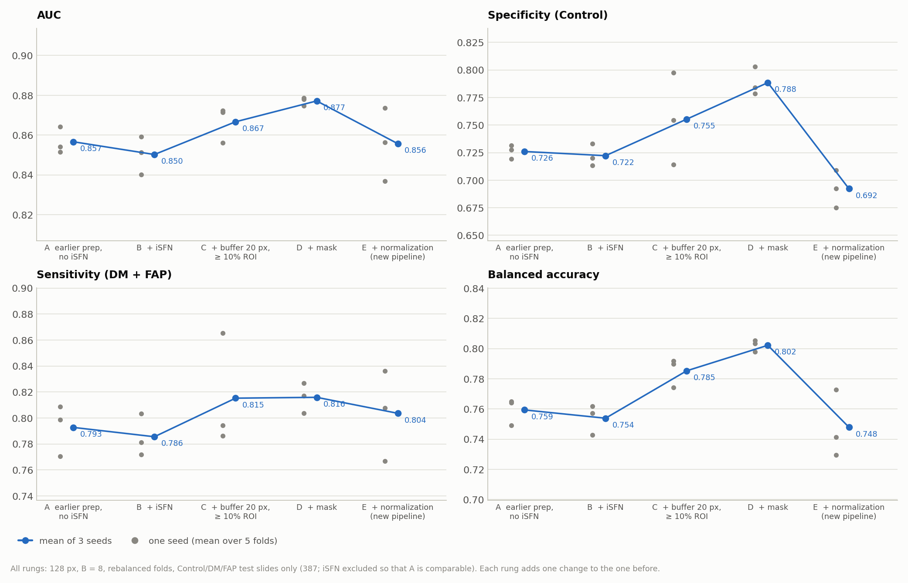
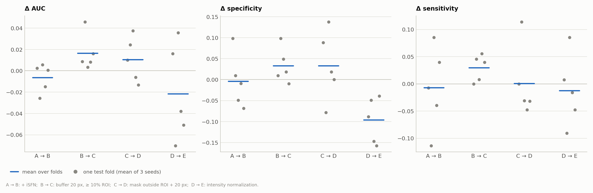
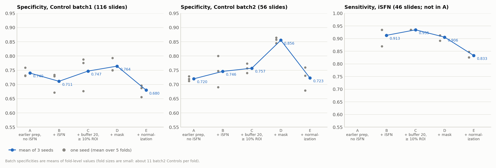
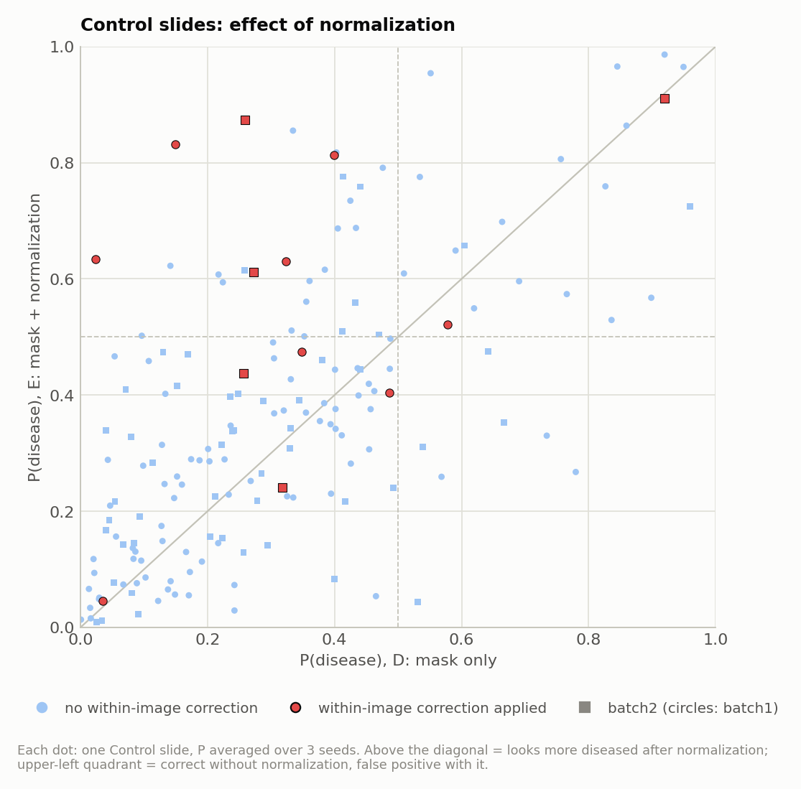
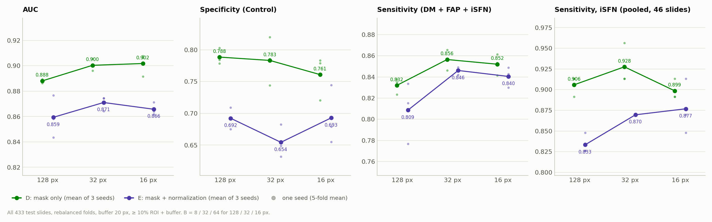

# IENF Ablation: Which Preprocessing Change Costs Specificity? (3 Seeds; Ladder at 128 px, Follow-up at 32 / 16 px)

**Question.** The new IENF + iSFN pipeline ([ienf_isfn_2cls_report.md](ienf_isfn_2cls_report.md)) had lower specificity than the earlier 2-class pipeline ([ienf_2cls_patch_size_B_report.md](ienf_2cls_patch_size_B_report.md)). That comparison changed six things at once:
- the folds;
- iSFN added;
- buffer and accept rule;
- background mask;
- intensity normalization;
- patch size and B.

This ablation holds the patch size at 128 px and B = 8. It adds the other changes one at a time, on the same folds, with 3 seeds each. A follow-up repeats the last step (mask only vs. mask + normalization) at 32 px and 16 px (Section 7).

**Runs** (our own, trained on 2026-11-05, 13:25–15:13, with `run_ienf_ablation.sh`; seed 1 of E is the run from 2026-11-04):

| Rung | Change from the rung before | Task | Feature folder | Experiment code (`_s1`, `_s2`, `_s3`) |
|---|---|---|---|---|
| A | earlier preprocessing, Control/DM/FAP only, **new folds** | `ienf_2cls` | `ienf_uni_p128_s128` | `ienf_ab_A_oldprep_noisfn_p128_CLAM_B8` |
| B | + iSFN slides (patched the earlier way) | `ienf_isfn_2cls` | `ienf_ab_oldprep_all_uni_p128_s128` | `ienf_ab_B_oldprep_p128_CLAM_B8` |
| C | buffer 20 px and ≥ 10% ROI + buffer (was 5 px, ≥ 5%) | `ienf_isfn_2cls` | `ienf_ab_orig_buf20_uni_p128_s128` | `ienf_ab_C_buf20_p128_CLAM_B8` |
| D | + pixels outside ROI + 20 px set to 0 (original intensities) | `ienf_isfn_2cls` | `ienf_ab_maskonly_buf20_uni_p128_s128` | `ienf_ab_D_mask_p128_CLAM_B8` |
| E | + intensity normalization (= the new pipeline) | `ienf_isfn_2cls` | `ienf_norm_uni_p128_s128` | `ienf_isfn_2cls_uni_p128_CLAM_B8` |

## 1. Summary

| Test, Control/DM/FAP slides (mean ± SD over 3 seeds of the 5-fold mean) | A | B | C | D | E |
|---|---|---|---|---|---|
| AUC | 0.857 ± 0.007 | 0.850 ± 0.009 | 0.867 ± 0.009 | **0.877 ± 0.002** | 0.856 ± 0.018 |
| Specificity (Control) | 0.726 ± 0.006 | 0.722 ± 0.010 | 0.755 ± 0.042 | **0.788 ± 0.013** | 0.692 ± 0.017 |
| Sensitivity (DM + FAP) | 0.793 ± 0.020 | 0.786 ± 0.016 | 0.815 ± 0.044 | **0.816 ± 0.012** | 0.804 ± 0.035 |
| Balanced accuracy | 0.759 ± 0.009 | 0.754 ± 0.010 | 0.785 ± 0.010 | **0.802 ± 0.004** | 0.748 ± 0.022 |
| iSFN sensitivity (46 slides) | – | 0.913 ± 0.038 | **0.935 ± 0.000** | 0.906 ± 0.013 | 0.833 ± 0.013 |

- **Intensity normalization is what costs specificity.**
  - From D to E, specificity falls by 0.096 (0.788 → 0.692). It is lower in all 5 folds (p = 0.0625, the smallest possible with 5 folds) and in all 3 seeds.
  - AUC falls by 0.021 and iSFN sensitivity by 0.07.
  - It hits both batches: batch 1 Controls 0.764 → 0.680, batch 2 Controls 0.856 → 0.723.
  - Of the 172 Controls, 27 change from correct to false positive and 7 the other way (seed-averaged predictions).
- **The other preprocessing changes help.**
  - Buffer 20 px with ≥ 10% (B → C): AUC +0.016, higher in all 5 folds (p = 0.0625); the bootstrap CI of the pooled AUC difference excludes 0.
  - The background mask (C → D): AUC +0.011, specificity +0.033, mostly in batch 2 Controls (+0.10). Not significant.
  - D is the best rung on every metric in the table except iSFN sensitivity (C is higher there). Against A, its pooled AUC is higher by +0.028 (95% CI +0.005 to +0.052).
- **Adding iSFN (A → B) changes almost nothing** on the Control/DM/FAP slides: AUC −0.006 and specificity −0.004.
- **The rebalanced folds are harder than the earlier folds.**
  - On the new folds, the earlier preprocessing (A) reaches AUC 0.852–0.864 in 3 seeds. The earlier run on its own folds reached 0.875 (seed 1).
  - So part of the gap reported in [ienf_isfn_2cls_report.md](ienf_isfn_2cls_report.md) comes from the folds, not from the pipeline: about 0.02 AUC. This is not a paired comparison, because the test sets differ.
- **Normalization also hurts at 32 px and 16 px** (Section 7, all 433 slides, 3 seeds each).
  - Without normalization, AUC is higher by 0.029 at 32 px and 0.036 at 16 px, in all 3 seeds at each size. Specificity is higher by 0.13 and 0.07.
  - Mask-only images reach AUC 0.900 at 32 px and 0.902 at 16 px, the highest so far. At 128 px they reach 0.888.
  - The small-patch gain over 128 px is consistent in the fold means: +0.012 / +0.014, in all 5 folds and 3 seeds. In the pooled, seed-ensembled AUC it is only +0.004, with a CI that includes 0.
- **Recommendation:** drop the intensity normalization and keep the 20 px buffer, the 10% rule and the mask, i.e. use rung D.
  - At 128 px it has the best specificity (0.788).
  - At 32 px it has the best balanced accuracy (0.820) and iSFN sensitivity (0.928), with a similar specificity (0.783).
  - 16 px costs 3× the extraction time of 32 px and gains nothing over it.

## 2. Setup

### Shared by all rungs

| | Value |
|---|---|
| Features | UNI v1, 1024-d, 128 px patches resized to 224 px |
| Model | CLAM-SB small, B = 8 (k = min(8, N // 2); never capped, every bag has N ≥ 16) |
| Training | Adam, lr 2e-4, weight decay 1e-5, dropout 0.25, max 200 epochs, early stopping (patience 20, from epoch 50), weighted sampling, CE bag loss, SVM instance loss, bag weight 0.7 |
| Folds | `splits/ienf_isfn_kfold5_rebalanced` (B–E); the same folds with the iSFN slides removed for A (`splits/ienf_kfold5_rebalanced_noisfn`, written by `create_splits_ienf_noisfn.py`) |
| Seeds | 1, 2, 3 (the seed changes initialization and sampling, not the folds) |

These are the same settings as the earlier run `ienf_2cls_uni_p128_CLAM_B8_s1`, checked against its `experiment_*.txt`. Only the split folder differs.

### What each rung changes

| Rung | Images | Buffer / accept rule | Patches (dataset) | iSFN |
|---|---|---|---|---|
| A | original | 5 px / ROI ≥ 5% | 24,094 (387 slides) | no |
| B | original | 5 px / ROI ≥ 5% | 24,094 + 2,857 (46 iSFN slides) | yes |
| C | original | 20 px / ROI + buffer ≥ 10% | 27,187 (439 slides) | yes |
| D | original intensities, 0 outside ROI + 20 px | same as C | same coordinates as C | yes |
| E | normalized, 0 outside ROI + 20 px | same as C | same coordinates as C | yes |

- C, D and E use **identical patch coordinates**. I checked this for all 439 slides against the patch files of E. So these three differ only in pixel values.
- I also checked that D's images equal the originals inside ROI + 20 px and are 0 outside (S3933-2_b: 11.7% of pixels non-zero).
- 6 slides of 439 are Unclassified. They have features but are not in the task CSV.
- **All metrics are on the 387 Control/DM/FAP test slides** unless marked iSFN, so that A, which has no iSFN, can be compared with the other rungs.

### Commands

The whole ladder (preprocessing, features, 14 training runs; runs with an existing `summary.csv` are skipped):

```bash
UNI_CKPT_PATH=~/projects/UNI/assets/ckpts/uni/pytorch_model.bin \
bash run_ienf_ablation.sh 2>&1 | tee logs/run_ienf_ablation.log
```

The steps inside the script, for one rung each:

```bash
# A: splits without iSFN
python create_splits_ienf_noisfn.py

# B: the 46 iSFN slides patched the earlier way
python ~/projects/IENF_CLAM_Preprocessing/scripts/create_patches_roi.py \
    --source /data/datasets/neuroimages/20250214 \
    --csv /var/tmp/shouteng_data/IENF_CLAM/ablation/isfn_slides.csv \
    --save_dir /var/tmp/shouteng_data/IENF_CLAM/ablation/prep_isfn_old \
    --clam_root ~/projects/CLAM \
    --patch_size 128 --overlap 0 \
    --buffer_down 5 --min_roi_overlap 0.05

# C: original images, buffer 20 px, >= 10%
python ~/projects/IENF_CLAM_Preprocessing/scripts/create_patches_roi.py \
    --source /data/datasets/neuroimages/20250214 \
    --save_dir /var/tmp/shouteng_data/IENF_CLAM/ablation/prep_orig \
    --clam_root ~/projects/CLAM \
    --patch_size 128 --overlap 0 \
    --buffer_down 20 --min_roi_overlap 0.10

# D: mask only, no intensity correction
python ~/projects/IENF_CLAM_Preprocessing/scripts/normalize_images.py \
    --source /data/datasets/neuroimages/20250214 \
    --batches /data/datasets/neuroimages/20250214/labels/canonical_original_images.csv \
    --out_dir /var/tmp/shouteng_data/IENF_CLAM/ablation/images_maskonly_bufdown20 \
    --buffer_down 20 --no_norm --workers 14
```

Features are extracted with `extract_features_ienf.py` as in `run_ienf_isfn_features.sh`. B's feature folder holds symlinks to the 387 earlier features plus the 46 new iSFN ones.

One training run, rung D, seed 2:

```bash
CUDA_VISIBLE_DEVICES=0 python main.py \
    --task ienf_isfn_2cls --split_dir ienf_isfn_kfold5_rebalanced --k 5 \
    --model_type clam_sb --model_size small --B 8 \
    --drop_out 0.25 --lr 2e-4 --reg 1e-5 --max_epochs 200 --early_stopping \
    --weighted_sample --bag_loss ce --inst_loss svm \
    --data_root_dir /var/tmp/shouteng_data/CLAM_DATA \
    --feature_dir ienf_ab_maskonly_buf20_uni_p128_s128 \
    --embed_dim 1024 --seed 2 --log_data \
    --exp_code ienf_ab_D_mask_p128_CLAM_B8
```

### Metrics

- **Threshold metrics** use P(disease) ≥ 0.5.
- **"Fold mean"** is the mean of 5 fold-level values. The table in Section 1 gives the mean ± SD over the 3 seeds of that fold mean. The SD is therefore seed variance, not fold variance.
- **Step effects** (Section 4) are paired over 15 seed × fold pairs. The Wilcoxon test uses the 5 fold differences averaged over seeds, because seeds share test sets. The smallest possible p with 5 folds is 0.0625.
- **Seed-ensembled** numbers average P(disease) over the 3 seeds for each slide, then pool all 387 slides.
- **Bootstrap:** patient-level, 2000 resamples, of the pooled AUC difference of the seed-ensembled predictions.

## 3. Results by rung



*Figure 1. Test metrics on the 387 Control/DM/FAP slides for each rung. Gray: each seed (5-fold mean); blue: mean of the 3 seeds.*

Per seed (5-fold means):

| Rung | Seed | AUC | Sensitivity | Specificity | Spec. batch 1 | Spec. batch 2 | bACC | Spec. at sens. 0.80 (pooled) | iSFN sens. |
|---|---|---|---|---|---|---|---|---|---|
| A | 1 | 0.8542 | 0.8089 | 0.7193 | 0.7315 | 0.7190 | 0.7641 | 0.7267 | – |
| A | 2 | 0.8642 | 0.7988 | 0.7314 | 0.7589 | 0.7119 | 0.7651 | 0.7326 | – |
| A | 3 | 0.8516 | 0.7706 | 0.7275 | 0.7303 | 0.7286 | 0.7490 | 0.6860 | – |
| B | 1 | 0.8403 | 0.7720 | 0.7134 | 0.6715 | 0.8000 | 0.7427 | 0.7035 | 0.8696 |
| B | 2 | 0.8591 | 0.7814 | 0.7330 | 0.7284 | 0.7476 | 0.7572 | 0.7151 | 0.9348 |
| B | 3 | 0.8514 | 0.8034 | 0.7203 | 0.7335 | 0.6905 | 0.7618 | 0.7209 | 0.9348 |
| C | 1 | 0.8724 | 0.8654 | 0.7141 | 0.6770 | 0.7571 | 0.7897 | 0.7674 | 0.9348 |
| C | 2 | 0.8715 | 0.7863 | 0.7974 | 0.7882 | 0.7738 | 0.7918 | 0.7849 | 0.9348 |
| C | 3 | 0.8561 | 0.7942 | 0.7546 | 0.7760 | 0.7405 | 0.7744 | 0.7500 | 0.9348 |
| D | 1 | 0.8787 | 0.8269 | 0.7840 | 0.7497 | 0.8571 | 0.8054 | 0.8023 | 0.8913 |
| D | 2 | 0.8747 | 0.8171 | 0.7784 | 0.7507 | 0.8452 | 0.7978 | 0.8140 | 0.9130 |
| D | 3 | 0.8781 | 0.8038 | 0.8029 | 0.7928 | 0.8643 | 0.8034 | 0.8023 | 0.9130 |
| E | 1 | 0.8370 | 0.7668 | 0.6925 | 0.6559 | 0.7595 | 0.7296 | 0.6279 | 0.8261 |
| E | 2 | 0.8737 | 0.8363 | 0.7092 | 0.6965 | 0.7310 | 0.7727 | 0.7674 | 0.8261 |
| E | 3 | 0.8563 | 0.8078 | 0.6752 | 0.6878 | 0.6786 | 0.7415 | 0.7500 | 0.8478 |

Seed-ensembled, pooled over the 387 slides:

| Rung | Pooled AUC | Sensitivity | Specificity | Spec. batch 1 | Spec. batch 2 |
|---|---|---|---|---|---|
| A | 0.8577 | 0.8140 | 0.7267 | 0.7328 | 0.7143 |
| B | 0.8597 | 0.7860 | 0.7384 | 0.7500 | 0.7143 |
| C | 0.8782 | 0.8372 | 0.7791 | 0.7931 | 0.7500 |
| D | **0.8857** | **0.8372** | **0.8430** | **0.8276** | **0.8750** |
| E | 0.8635 | 0.8093 | 0.7267 | 0.6897 | 0.8036 |

Observations:
- **D has the highest 3-seed mean** on AUC, specificity, sensitivity and balanced accuracy.
  - Seed by seed, it is the highest rung for AUC and balanced accuracy in all 3 seeds.
  - For specificity it is the highest in 2 of 3 seeds (seed 2: C 0.797 vs. D 0.778).
  - Its 3 seeds are also the closest together (AUC 0.875–0.879).
- **E is lower than D in every seed** for specificity (0.675–0.709 vs. 0.778–0.803), balanced accuracy and AUC. The AUC gap is small in seed 2 (0.874 vs. 0.875).
- **E's seed 1** (the run in the earlier report) is its worst seed. Over 3 seeds, E's AUC is 0.856 rather than 0.837.
- **The loss is not only a threshold shift.**
  - At a matched sensitivity of 0.80, D keeps a specificity of 0.80–0.81, against 0.63–0.77 for E.
  - The mean P(disease) of Controls rises from 0.312 (D) to 0.370 (E).

## 4. Step effects

Differences from the rung before, paired over 15 seed × fold pairs (mean ± SD). "Folds up" counts folds where the seed-averaged difference is > 0.

| Step | Metric | Mean difference | SD | Folds up | Wilcoxon p (5 folds) |
|---|---|---|---|---|---|
| A → B (+ iSFN) | AUC | −0.006 | 0.042 | 3/5 | 0.81 |
| | Specificity | −0.004 | 0.124 | 2/5 | 1.00 |
| | Sensitivity | −0.007 | 0.103 | 2/5 | 0.88 |
| B → C (buffer 20, ≥ 10%) | AUC | +0.016 | 0.036 | **5/5** | 0.0625 |
| | Specificity | +0.033 | 0.082 | 4/5 | 0.19 |
| | Sensitivity | +0.030 | 0.063 | 4/5 | 0.13 |
| C → D (+ mask) | AUC | +0.011 | 0.031 | 3/5 | 0.44 |
| | Specificity | +0.033 | 0.148 | 3/5 | 0.38 |
| | Spec. batch 2 | +0.098 | 0.195 | 4/5 | 0.19 |
| | Sensitivity | +0.001 | 0.097 | 1/5 | 0.88 |
| D → E (+ normalization) | AUC | −0.022 | 0.048 | 2/5 | 0.31 |
| | Specificity | **−0.096** | 0.106 | **0/5** | 0.0625 |
| | Spec. batch 1 | −0.084 | 0.111 | 0/5 | 0.0625 |
| | Spec. batch 2 | −0.133 | 0.135 | 1/5 | 0.13 |
| | Sensitivity | −0.012 | 0.089 | 2/5 | 0.63 |

Patient bootstrap of the pooled AUC difference (seed-ensembled):

| Comparison | Difference | 95% CI |
|---|---|---|
| B − A | +0.002 | −0.019 to +0.023 |
| C − B | **+0.019** | +0.002 to +0.035 |
| D − C | +0.008 | −0.016 to +0.029 |
| E − D | −0.022 | −0.054 to +0.008 |
| D − A | **+0.028** | +0.005 to +0.052 |
| E − A | +0.006 | −0.029 to +0.042 |



*Figure 2. Per-fold change from the rung before (each dot is one test fold, averaged over 3 seeds).*

Observations:
- **The normalization step is the only one that lowers specificity consistently.** No fold gains, and the batch 1 loss is in all 5 folds too. With 5 folds, p = 0.0625 is the strongest result the test can give; it is not below 0.05.
- **The patching change (B → C) is the only step with a bootstrap CI above 0.** Its AUC gain is also in all 5 folds.
- The mask's gain is concentrated in batch 2 Controls (4 of 5 folds), but the fold-level spread is large: only about 11 batch 2 Controls per fold.
- With 3 seeds and 5 folds, none of the effects reaches p < 0.05. Seed variance alone is up to 0.018 AUC (E), similar in size to most steps.

## 5. Batches and iSFN



*Figure 3. Specificity in each image batch, and iSFN sensitivity, per rung.*

- **Batch 2 Controls gain the most from the mask** (0.757 → 0.856) and lose the most from normalization (0.856 → 0.723).
- **Batch 1 Controls drop below every other rung under normalization** (0.680; the others are 0.711–0.764).
- **iSFN sensitivity:**
  - 0.91–0.94 in B, C and D;
  - 0.833 in E, lower in all 3 seeds (E: 0.826–0.848; D: 0.891–0.913).
  - Seed-ensembled, the difference is smaller: 41 vs. 40 of 46 detected.
- **Batch signal in the features.** A linear probe predicts the batch from mean-pooled slide features, with patient-grouped 5-fold CV repeated 5 times:

  | Features | Batch AUC, Controls only (172) | Batch AUC, Control/DM/FAP (387) |
  |---|---|---|
  | A (earlier prep) | 0.557 ± 0.031 | 0.686 ± 0.029 |
  | C (buffer 20) | 0.559 ± 0.032 | 0.692 ± 0.028 |
  | D (mask) | 0.618 ± 0.027 | 0.695 ± 0.027 |
  | E (normalized) | 0.624 ± 0.011 | 0.728 ± 0.018 |

  - Among Controls, batch is only weakly predictable from mean features (AUC ≤ 0.62).
  - **Normalization did not remove that signal:** E is at least as high as D. The aim of the between-image step was to reduce batch differences; by this measure it did not.
  - The probe sees only mean features, so batch information that CLAM's attention can still use is not measured.

## 6. Where normalization hurts



*Figure 4. P(disease) of every Control slide without (D) and with (E) normalization, averaged over 3 seeds. Red: images where the within-image (tile seam) correction was applied.*

Control slides, seed-averaged P(disease), by whether the within-image correction was applied:

| Batch | Within-image correction | n | Mean change in P(disease), D → E | Specificity D | Specificity E |
|---|---|---|---|---|---|
| batch 1 | no | 108 | +0.045 | 0.824 | 0.713 |
| batch 1 | yes | 8 | +0.251 | 0.875 | 0.375 |
| batch 2 | no | 51 | +0.040 | 0.882 | 0.843 |
| batch 2 | yes | 5 | +0.210 | 0.800 | 0.400 |

- **Images with the within-image correction are hit hardest.**
  - Their P(disease) rises by about 0.2–0.25.
  - 6 of the 11 that D got right become false positives.
- **But most of the lost Controls had no within-image correction:** 21 of the 27 correct-to-wrong changes. Those images only went through the offset and between-image steps. Their average shift is small (+0.04), but enough to push slides near 0.5 over the threshold.
- **For DM/FAP slides the change is small:** mean change in P(disease) −0.03 to +0.05 by group. So normalization mainly makes Controls look more diseased.
- **The between-image step changes the channel levels a lot.**
  - In Control ROIs, the median after/before ratio is 0.97 for R, 0.70 for G and 0.95 for B. The interquartile range for G is 0.53–0.92.
  - The correlation of these gains with the P(disease) change is weak (Spearman |ρ| ≤ 0.22).
- **Possible causes, not tested:**
  - rescaling the channels, G most strongly, changes what UNI sees in a way that makes Control tissue look more like disease;
  - the within-image tile gains introduce local intensity changes that look like abnormal tissue.

  Within-only and between-only variants would separate the two; they were not run.

## 7. Mask only vs. normalization at 32 px and 16 px

**Follow-up runs** (2026-11-05, 15:31–20:40, `run_ienf_ablation_small.sh`):
- rung D at 32 px (B = 32) and 16 px (B = 64), seeds 1–3: `ienf_ab_D_mask_p{32_CLAM_B32, 16_CLAM_B64}`;
- rung E seeds 2–3 at the same sizes (seed 1 is from the iSFN report): `ienf_isfn_2cls_uni_p{32_CLAM_B32, 16_CLAM_B64}`.

**Setup.**
- D reuses E's patch coordinates (`clam_prep_norm/p{32,16}_s*_bufdown20`), which depend only on the ROI files, and reads the mask-only images. So D and E again differ only in pixel values.
- All other settings are as in Section 2.
- Since rung A is not involved here, **the metrics in this section use all 433 test slides**, including iSFN.

| All 433 slides (mean ± SD over 3 seeds of the 5-fold mean) | 128 px D | 128 px E | 32 px D | 32 px E | 16 px D | 16 px E |
|---|---|---|---|---|---|---|
| AUC | 0.888 ± 0.002 | 0.859 ± 0.017 | 0.900 ± 0.005 | 0.871 ± 0.006 | **0.902 ± 0.009** | 0.866 ± 0.005 |
| Specificity (Control) | **0.788 ± 0.013** | 0.692 ± 0.017 | 0.783 ± 0.038 | 0.654 ± 0.026 | 0.761 ± 0.035 | 0.693 ± 0.046 |
| Sensitivity (all disease) | 0.832 ± 0.008 | 0.809 ± 0.029 | **0.856 ± 0.010** | 0.846 ± 0.004 | 0.852 ± 0.010 | 0.840 ± 0.010 |
| Balanced accuracy | 0.810 ± 0.003 | 0.750 ± 0.019 | **0.820 ± 0.021** | 0.750 ± 0.014 | 0.806 ± 0.022 | 0.767 ± 0.023 |
| Spec. batch 1 | **0.764** | 0.680 | 0.754 | 0.662 | 0.737 | 0.684 |
| Spec. batch 2 | **0.856** | 0.723 | 0.836 | 0.656 | 0.810 | 0.702 |
| iSFN sensitivity (pooled, 46 slides) | 0.906 ± 0.013 | 0.833 ± 0.013 | **0.928 ± 0.025** | 0.870 ± 0.000 | 0.899 ± 0.013 | 0.877 ± 0.033 |



*Figure 5. D (mask only) and E (mask + normalization) at each patch size, all 433 slides. Faint dots: each seed; lines: mean of 3 seeds.*

**E − D**, paired over 15 seed × fold pairs (all 433 slides):

| Patch size | Metric | E − D | SD | Folds where E is higher | Seeds where E is higher | Wilcoxon p (5 folds) |
|---|---|---|---|---|---|---|
| 128 px | AUC | −0.029 | 0.049 | 2/5 | 0/3 | 0.31 |
| | Specificity | −0.096 | 0.106 | 0/5 | 0/3 | 0.0625 |
| 32 px | AUC | −0.029 | 0.035 | 1/5 | 0/3 | 0.13 |
| | Specificity | −0.129 | 0.158 | 0/5 | 0/3 | 0.0625 |
| 16 px | AUC | −0.036 | 0.041 | 1/5 | 0/3 | 0.13 |
| | Specificity | −0.068 | 0.117 | 1/5 | 0/3 | 0.31 |

Seed-ensembled pooled AUC, E − D, with a patient bootstrap:
- 128 px: −0.028 (95% CI −0.060 to −0.001);
- 32 px: −0.027 (−0.059 to +0.004);
- 16 px: −0.032 (−0.065 to −0.002).

**Patch size within D** (paired over seed × fold, all 433 slides):

| Comparison | AUC | Folds up | Seeds up | Specificity | Sensitivity |
|---|---|---|---|---|---|
| 32 px − 128 px | +0.012 | 5/5 | 3/3 | −0.005 | +0.024 |
| 16 px − 128 px | +0.014 | 5/5 | 3/3 | −0.028 | +0.020 |
| 16 px − 32 px | +0.001 | 3/5 | 2/3 | −0.022 | −0.004 |

- The seed-ensembled pooled AUC differences are smaller: +0.004 for 32 − 128 px (95% CI −0.019 to +0.028) and +0.004 for 16 − 128 px (−0.024 to +0.031).
- Per-fold AUC of D (mean of 3 seeds):

  | Patch size | Fold 0 | Fold 1 | Fold 2 | Fold 3 | Fold 4 |
  |---|---|---|---|---|---|
  | 128 px | 0.933 | 0.906 | 0.874 | 0.895 | 0.833 |
  | 32 px | 0.950 | 0.914 | 0.898 | 0.899 | 0.841 |
  | 16 px | 0.946 | 0.915 | 0.906 | 0.896 | 0.846 |

Observations:
- **Normalization lowers AUC at every patch size**, in every one of the 9 seed × size pairs. It lowers specificity in all 9 as well. Two of the three bootstrap CIs (128 px and 16 px) exclude 0.
- **The specificity loss is largest at 32 px** (−0.13), mainly in batch 2 Controls (0.836 → 0.656).
- **Normalization also costs iSFN sensitivity at every size:** −0.07, −0.06 and −0.02.
- **Small patches help AUC and sensitivity a little and cost some specificity.**
  - The AUC gain over 128 px is in all 5 folds and all 3 seeds, but is only about 0.01 in the fold means. With 5 folds, p = 0.0625 is the best possible.
  - Pooled over the seed-ensembled predictions, the gain nearly disappears (+0.004). Pooled AUC also depends on how comparable the scores of different fold models are. So the gain from small patches is small and not established.
- **Fold 4 is still the worst fold at every patch size** (0.833–0.846).
- **The seed-1 E runs in the iSFN report** (32 px 0.864, 16 px 0.871) are close to their 3-seed means (0.871, 0.866). So the ranking there of 16 px above 32 px was within seed noise.

## 8. What this means for the iSFN report

[ienf_isfn_2cls_report.md](ienf_isfn_2cls_report.md) concluded that the new pipeline did not improve on the earlier one, and that specificity was lost. The ablation refines this:
- **The comparison there mixed fold, preprocessing and seed effects.**
  - On the same rebalanced folds, the earlier preprocessing reaches AUC 0.857 (A, 3 seeds), not 0.875.
  - The new 128 px pipeline averages 0.856 over 3 seeds (E), not 0.843 (seed 1).
- **The specificity loss is real, and it comes from the normalization step.** Without it (D), the new patching and mask beat the earlier preprocessing on the same folds: AUC +0.028, with a CI that excludes 0, and specificity +0.06.
- **The 16 px result there (AUC 0.871) used normalized images.** On mask-only images, 16 px reaches 0.902 and 32 px 0.900 (Section 7, 3 seeds).

## 9. Conclusions, limitations and next steps

**Conclusions**
1. **Intensity normalization is the change that lowers specificity**: −0.096 at 128 px, in all folds and all seeds. It also costs AUC (−0.02) and iSFN sensitivity (−0.07). The same holds at 32 px and 16 px: AUC −0.03 to −0.04, lower in all 9 seed × size pairs.
2. **The 20 px buffer with the 10% rule, and the background mask, both help.** Together they give +0.028 pooled AUC over the earlier preprocessing.
3. **Adding iSFN does not hurt** performance on Control/DM/FAP.
4. **The rebalanced folds are about 0.02 AUC harder** than the earlier folds. Earlier numbers on the old folds should not be compared directly with numbers on the new folds.
5. **Best setup so far: mask-only images at 32 px, B = 32.** On all 433 slides it reaches AUC 0.900, balanced accuracy 0.820, specificity 0.783 and iSFN sensitivity 0.928. Its advantage over 128 px (AUC 0.888) is small and not established.

**Limitations**
- **The folds were built using earlier test results**, so all numbers here are optimistic in absolute terms. The comparisons between rungs are fair, because every rung uses the same folds.
- **The ladder has one order.** Each step's effect is measured given the steps before it. For example, normalization without the mask was not tested, and it may behave differently.
- **The full ladder was run only at 128 px.** At 32 / 16 px only the last step (normalization) was tested.
- **3 seeds and 5 folds.** No step effect is below p = 0.05. The consistency of the normalization loss (0 of 5 folds, 0 of 3 seeds better) is the strongest evidence.
- **The batch probe is linear and uses mean features only.**

**Next steps** (none run yet)
- Use D-style images (mask, no normalization) as the default preprocessing.
- Re-make the heatmaps of the 8 example slides from a D-style 32 px model, to check whether attention changes without normalization.
- To find out which part of the normalization hurts, run within-only and between-only variants at 128 px, about 30 min each for 3 seeds.
- If tile seams still need fixing, try a gentler within-image correction, e.g. only the x-profile without the per-tile gains, and check Controls first.

## 10. Code changes and files

| File | Change |
|---|---|
| `IENF_CLAM_Preprocessing/scripts/normalize_images.py` | new flag `--no_norm`: write the original image, masked outside ROI + buffer, with no intensity correction |
| `create_splits_ienf_noisfn.py` | new: `splits/ienf_kfold5_rebalanced_noisfn` = the rebalanced folds without the iSFN slides; checks that every slide is tested once |
| `run_ienf_ablation.sh` | new: preprocessing, features and the 14 training runs of the ladder |
| `run_ienf_ablation_small.sh` | new: D features at 32 / 16 px, D seeds 1–3 and E seeds 2–3 at those sizes (`PART=D` / `PART=E`) |
| `results/make_report_figures.py` | figures `ienf_ablation_*.png`; `--only ienf_ablation` renders just these |

`create_patches_roi.py`, `extract_features_ienf.py`, `main.py` and the model code were used unchanged.

**Files**
- Runs:
  - `results/ienf_ab_{A_oldprep_noisfn, B_oldprep, C_buf20, D_mask}_p128_CLAM_B8_s{1,2,3}/`;
  - `results/ienf_ab_D_mask_{p32_CLAM_B32, p16_CLAM_B64}_s{1,2,3}/`;
  - `results/ienf_isfn_2cls_uni_{p128_CLAM_B8, p32_CLAM_B32, p16_CLAM_B64}_s{1,2,3}/`.
- Logs: `logs/run_ienf_ablation.log`, `logs/run_ienf_ablation_small_{D,E}.log`, plus one log per run.
- Ablation data: `/var/tmp/shouteng_data/IENF_CLAM/ablation/` (patches for B and C; mask-only images for D).
- Features: `/var/tmp/shouteng_data/CLAM_DATA/ienf_ab_*`.
- Figures: `results/figures/ienf_ablation_*.png` (no patient images), regenerated with:

  ```bash
  python results/make_report_figures.py --only ienf_ablation
  ```

**Cost.**
- Preprocessing: 2 min.
- Feature extraction: 12 min for the three new feature sets.
- Training: 6–7 min per run, 1 h 48 min for the 14 runs, one at a time on one GPU.
- Follow-up:
  - Features on mask-only images took 54 min at 32 px (sharing the GPU with E training) and 3 h 01 min at 16 px (alone).
  - D training at 16 px took 12–13 min per run, alone on the GPU.
  - The 32 px D runs (10–11 min) and the E runs (32 px: 21–38 min; 16 px: 13–14 min) shared the GPU with other jobs, so their times are not comparable.
