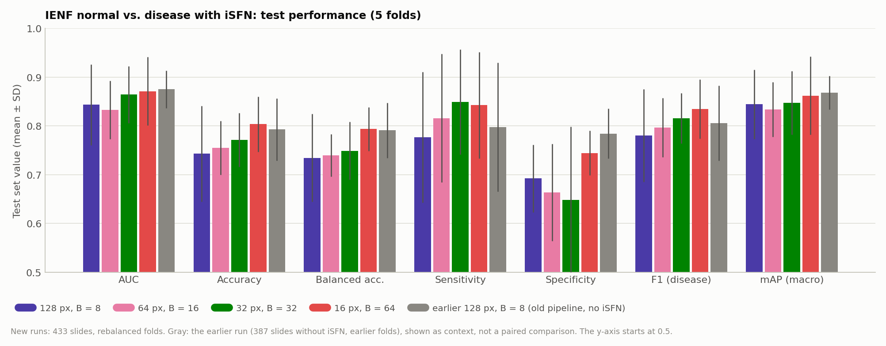
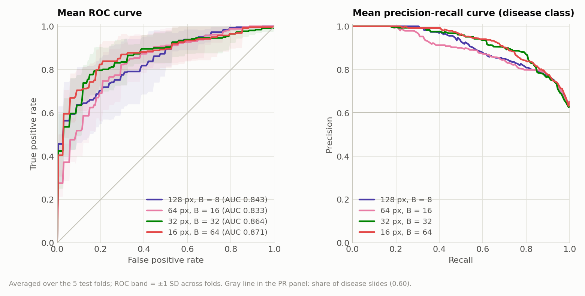
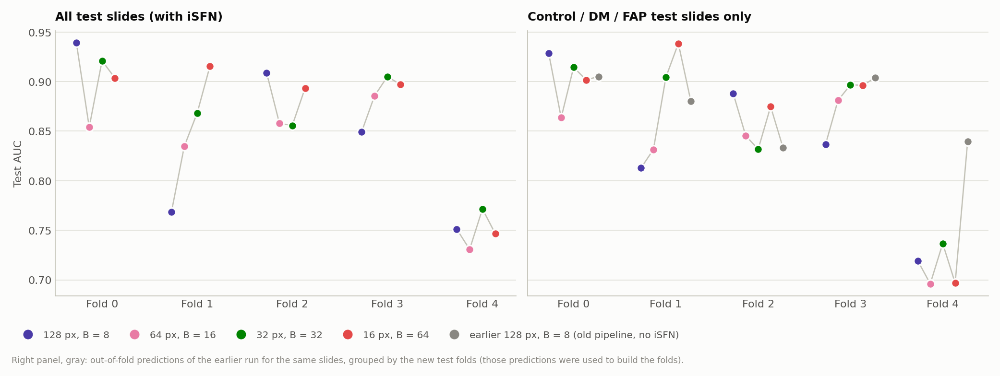
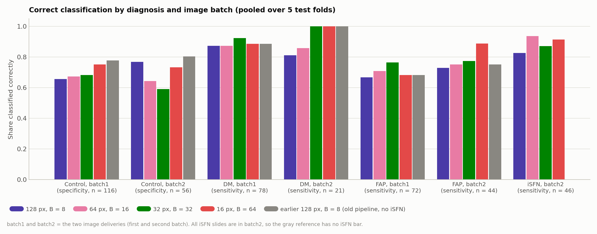
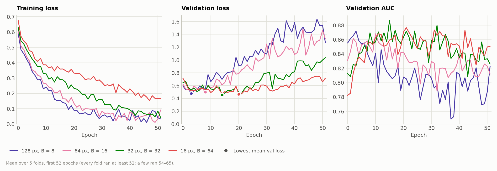

# CLAM on IENF Skin Biopsies with iSFN (Normal vs. Disease, UNI): New Preprocessing and Patch Sizes 128 / 64 / 32 / 16

> **Update (2026-11-07).** The folds here were rebalanced using earlier test results; see [ienf_ablation_report.md](ienf_ablation_report.md) and [ienf_norm_random_folds_report.md](ienf_norm_random_folds_report.md) for the ablation on the same folds and on random folds. On random folds, mask-only images at 32 px (no intensity normalization) reach AUC 0.902 (3 seeds); the normalization used in this report lowers it to 0.848.

**Runs compared** (our own runs, trained on 2026-11-04, 16:09–20:39, with `run_ienf_isfn_2cls.sh`):

| Name | Experiment code | Patch size | B | Feature folder |
|---|---|---|---|---|
| 128 px, B = 8 | `ienf_isfn_2cls_uni_p128_CLAM_B8_s1` | 128 | 8 | `ienf_norm_uni_p128_s128` |
| 64 px, B = 16 | `ienf_isfn_2cls_uni_p64_CLAM_B16_s1` | 64 | 16 | `ienf_norm_uni_p64_s64` |
| 32 px, B = 32 | `ienf_isfn_2cls_uni_p32_CLAM_B32_s1` | 32 | 32 | `ienf_norm_uni_p32_s32` |
| 16 px, B = 64 | `ienf_isfn_2cls_uni_p16_CLAM_B64_s1` | 16 | 64 | `ienf_norm_uni_p16_s16` |

**Reference:** the earlier 2-class runs in [ienf_2cls_patch_size_B_report.md](ienf_2cls_patch_size_B_report.md), mainly `ienf_2cls_uni_p128_CLAM_B8_s1` ("earlier 128 px, B = 8").

Compared with the earlier runs, this experiment changes several things at once:
1. **Data.** The third disease subtype iSFN is added: 46 slides, 23 patients. The task is now Control vs. DM + FAP + iSFN.
2. **Intensity normalization** within each image (tile seams) and between images.
3. **Patching.** The ROI buffer toward the dermis is 20 px (was 5 px). A patch is kept when ROI + buffer covers ≥ 10% of it (was ≥ 5% for the ROI). Every pixel outside ROI + buffer is set to 0.
4. **Patch sizes** 64, 32 and 16 px in addition to 128 px. B grows with the bag size.
5. **Folds.** They are rebalanced: 5 patients who were hard for the earlier models were swapped between folds. **The folds were built using earlier test results**, so performance on them is optimistic (Section 2).

> **Update (2026-11-05): see [ienf_ablation_report.md](ienf_ablation_report.md).** That report adds the changes one at a time at 128 px, B = 8, on the same folds, with 3 seeds. Its findings:
> - **The specificity loss comes from the intensity normalization:** −0.096, lower in all 5 folds and all 3 seeds.
> - **The 20 px buffer, the 10% rule and the mask help.** Without normalization, the new preprocessing reaches AUC 0.877 against 0.857 for the earlier preprocessing on the same folds.
> - **The rebalanced folds are about 0.02 AUC harder** than the earlier folds. So the comparison with the earlier run below mixes fold and pipeline effects.
> - **The 128 px run here (seed 1) is the weakest of 3 seeds:** the 3-seed mean AUC on Control/DM/FAP slides is 0.856.
> - **At 32 px and 16 px, removing the normalization raises AUC** from 0.871 / 0.866 to 0.900 / 0.902 (all slides, 3 seeds). So the patch-size ranking in this report (16 > 32 px) is within seed noise.

## 1. Summary

| Test (mean ± SD, 5 folds) | 128 px, B = 8 | 64 px, B = 16 | 32 px, B = 32 | 16 px, B = 64 | Earlier 128 px, B = 8 (no iSFN, earlier folds) |
|---|---|---|---|---|---|
| AUC | 0.8434 ± 0.0830 | 0.8326 ± 0.0597 | 0.8643 ± 0.0583 | **0.8713 ± 0.0702** | 0.8750 ± 0.0383 |
| Balanced accuracy | 0.7346 ± 0.0900 | 0.7397 ± 0.0435 | 0.7489 ± 0.0595 | **0.7936 ± 0.0447** | 0.7910 ± 0.0567 |
| Sensitivity (disease) | 0.7768 ± 0.1337 | 0.8161 ± 0.1317 | **0.8491 ± 0.1074** | 0.8427 ± 0.1092 | 0.7976 ± 0.1322 |
| Specificity (Control) | 0.6925 ± 0.0692 | 0.6634 ± 0.0997 | 0.6487 ± 0.1499 | **0.7444 ± 0.0458** | 0.7843 ± 0.0514 |

- **The new pipeline did not improve on the earlier one.**
  - The best new run (16 px, B = 64) reaches AUC 0.871 and balanced accuracy 0.794, about the same as the earlier 128 px run (0.875 / 0.791).
  - The new 128 px run is lower (0.843 / 0.735).
  - On the 387 Control / DM / FAP slides that both pipelines predicted, the pooled AUC of every new run is lower than that of the earlier 128 px run:

    | New run | Pooled AUC difference | 95% patient bootstrap CI |
    |---|---|---|
    | 16 px | −0.018 | −0.064 to +0.027 |
    | 32 px | −0.029 | −0.076 to +0.015 |
    | 128 px | −0.035 | −0.080 to +0.006 |
    | 64 px | −0.074 | −0.126 to −0.024 |

    Only the 64 px interval excludes zero (Section 5).
- **What was lost is specificity.**
  - 26–35% of Control slides are now called disease, against 22% before.
  - At 128 px and 64 px the loss is mainly in batch 1 Controls. At 32 px and 16 px it is about equal in both batches.
  - Sensitivity is similar or higher: 0.78–0.85, against 0.80.
- **iSFN is detected well:** 38–43 of 46 slides (0.83–0.94).
  - All iSFN slides come from image batch 2. Even so, the models separate iSFN from the batch 2 Controls (AUC 0.87–0.94), at least as well as from all Controls.
  - The evidence on a batch shortcut is mixed:
    - in 3 of 4 runs, the mean P(disease) of batch 2 Controls is not higher than that of batch 1 Controls;
    - in 3 of 4 runs, batch 2 Controls have a lower specificity than batch 1 Controls (0.59–0.73 vs. 0.67–0.75). In the earlier pipeline it was the other way round.
  - So the models do not simply call batch 2 "disease", but a smaller batch effect is possible (Section 6).
- **Smaller patches did not hurt; 16 px is the best new run.**
  - Order by AUC: 16 px > 32 px > 128 px > 64 px. By balanced accuracy and specificity: 16 px first.
  - 16 px beats 64 px in all 5 folds for AUC (p = 0.0625, the smallest possible with 5 folds).
  - Against 128 px, 16 px wins only 2 of 5 folds. Its higher mean comes mostly from fold 1 (0.916 vs. 0.769).
  - With 5 folds, none of these differences is significant.
  - At 16 px, UNI sees 10 µm patches upsampled 14×. Why that works this well was not studied.
- **The fold rebalancing did not even out the folds.**
  - Fold 4 is the worst fold in all four new runs (AUC 0.73–0.77; 0.70–0.74 without iSFN).
  - The per-fold SD is larger than before: 0.058–0.083, against 0.027–0.038.
  - On the same fold 4 slides, the earlier model reaches 0.84. Fold 4 therefore became harder for the new pipeline, not easier. Its main weakness is FAP in batch 1: 5–8 of 16 detected (Section 4).
- **The patients that were hard before stay hard.**
  - They are now 41–53% correct, against 24–30% for the earlier runs.
  - The patients that were easy before drop from 100% to 87–93%.
  - Both groups were defined from the earlier runs' own test errors, so these numbers mostly show regression to the mean, not an effect of the new pipeline.
- **Smaller patches overfit more slowly.**

  | Patch size | Best validation-loss epoch (mean) | Training loss at epoch 51 |
  |---|---|---|
  | 128 px | 4.6 | 0.03 |
  | 16 px | 19.8 | 0.17 |

  Validation AUC is again negatively correlated with test AUC (r = −0.26 to −0.59).

## 2. Setup

### Data

| Item | Value |
|---|---|
| Images | IENF fluorescence TIFFs, `/data/datasets/neuroimages/20250214/Image/Original`, 1.54 px/µm (one magnification for all images) |
| Labels | `labels/canonical_original_images.csv` (column `Category`) → `make_ienf_isfn_dataset_csv.py` → `dataset_csv/ienf_isfn_4sub.csv` (Control / DM / FAP / iSFN, with image batch) and `dataset_csv/ienf_isfn_2cls.csv` (normal = Control, disease = DM + FAP + iSFN). The 387 slides of the earlier `ienf_3cls.csv` keep their label (the script asserts this). The 6 Unclassified slides are left out |
| Slides | 433: 172 normal (Control), 261 disease (99 DM, 116 FAP, 46 iSFN) |
| Patients | 217 (`case_id` = SkinID) |
| Image batches | batch 1 (第一批): 266 slides; batch 2 (第二批): 167 slides. All 46 iSFN slides are in batch 2 |
| ROI | `Epidermis_ROI/*.roi`, lower edge extended **20 px** toward the dermis (upward for `S1357-2_b`). All 46 iSFN images have the dermis below the band |

Slides by subtype and batch:

| | batch 1 | batch 2 |
|---|---|---|
| Control | 116 | 56 |
| DM | 78 | 21 |
| FAP | 72 | 44 |
| iSFN | 0 | 46 |
| Share disease | 0.56 | 0.66 |

Adding iSFN makes batch 2 more "disease-heavy". That creates a possible batch–label shortcut, and it is the main reason for the between-image normalization.

### Intensity normalization (`IENF_CLAM_Preprocessing/ienf_prep/normalize.py`, `scripts/normalize_images.py`)

The images are stitched from 1024 × 1024 camera tiles with about 10% overlap, which gives a stride of about 922 px. In 121 of 439 images the tile seams are visible. Two effects cause them:
- a brightness profile across each tile (dark first columns);
- a gain drift per tile and channel (R and B fall and G rises along the tile order).

Per image and channel:

1. **Offset.** Subtract the 1st percentile.
2. **Seams.** Compute the tile grid from the image size and refine it at the visible seams. An image counts as having seams when the median one-pixel step at the seams is ≥ 0.5 grey levels.
3. **Within-image correction** (images with seams only):
   - Divide by the image's own tile x-profile: the median over its tiles, smoothed (σ = 3), clipped to 0.5–2.0.
   - Divide by one gain per tile. The gains are fitted by ridge least squares, so that the two sides of every seam match, and clipped to 0.4–2.5.
   - The correction is **kept only if it lowers the seam score in tissue by at least 20%**. It was kept for 54 of the 121 images (33 from batch 1, 21 from batch 2).
4. **Between images.** Scale each channel so that its median inside ROI + buffer equals the dataset target (R, G, B) = (89, 35, 95). That target is the median over all images.
   - The median is used, not a high percentile, because the brightest ROI pixels are the nerve fibers, the signal itself.
   - The median is taken inside ROI + buffer, not over all tissue. Scaling on the whole-tissue median left a batch gap inside the Control ROIs (R 88.5 vs. 79).
5. **Background removal.** Set every pixel outside ROI + 20 px to 0. Patching and feature extraction then read this masked image, so every patch is masked automatically.

QC:
- On the 54 corrected images, the median seam score inside ROI + buffer fell from 0.071 to 0.033, and the 90th percentile from 0.23 to 0.074.
- In tissue, the median seam score fell from 0.061 to 0.015.
- Because of step 4, the ROI channel medians are equal for every image by construction. This removes the between-batch level difference, but also any real difference in overall ROI brightness between groups.

```bash
python scripts/normalize_images.py \
    --source /data/datasets/neuroimages/20250214 \
    --batches /data/datasets/neuroimages/20250214/labels/canonical_original_images.csv \
    --out_dir /var/tmp/shouteng_data/IENF_CLAM/images_norm_bufdown20 \
    --buffer_down 20 --fit --workers 14
```


*Figure 1. Seam score before vs. after the within-image correction for the 121 images with seams, in tissue (left) and inside ROI + 20 px (right). Blue: correction kept (54); gray: rejected because it did not lower the tissue seam score by 20% (67). Those images are left as they were and lie on the diagonal.*


*Figure 2. Before and after normalization for the QC images (unmasked QC run, `norm_qc_nomask`). This figure shows patient images, so it is git-ignored.*

### Patching (`scripts/create_patches_roi.py`, unchanged script)

```bash
python scripts/create_patches_roi.py \
    --source /data/datasets/neuroimages/20250214 \
    --image_dir /var/tmp/shouteng_data/IENF_CLAM/images_norm_bufdown20/images \
    --save_dir /var/tmp/shouteng_data/IENF_CLAM/clam_prep_norm \
    --clam_root ~/projects/CLAM \
    --patch_size 128 64 32 16 \
    --overlap 0 \
    --buffer_down 20 \
    --min_roi_overlap 0.10
```

| | 128 px | 64 px | 32 px | 16 px |
|---|---|---|---|---|
| Patch size in µm (0.65 µm/px) | ≈ 83 µm | ≈ 42 µm | ≈ 21 µm | ≈ 10 µm |
| Upsampling to UNI's 224 px | 1.75× | 3.5× | 7× | 14× |
| Patches per slide, min / median / max | 21 / 62 / 119 | 70 / 190 / 408 | 234 / 649 / 1490 | 845 / 2361 / 5698 |
| Total patches (439 slides) | 27,187 | 84,830 | 289,584 | 1,055,524 |
| Bags with N < 2B (k cap active) | 0 | 0 | 0 | 0 |

Checks on 5 slides × 4 sizes:
- The patch coordinates equal `generate_coords_roi_overlap(mask, ps, ps, 0.10)`.
- Every pixel outside ROI + buffer is 0.

### Features

UNI v1 through CLAM's `extract_features_fp.py` (via `scripts/extract_features_ienf.py`), with `run_ienf_isfn_features.sh`. Every patch is resized to 224 px. The output is 1024-d features in `/var/tmp/shouteng_data/CLAM_DATA/ienf_norm_uni_p{ps}_s{ps}`, for all 439 slides.

| | 128 px | 64 px | 32 px | 16 px |
|---|---|---|---|---|
| Extraction time (RTX 3090) | 5 min 16 s | 16 min 17 s | 56 min 27 s | 3 h 05 min 44 s |
| Feature storage (`pt_files`) | 108 MB | 334 MB | 1.2 GB | 4.1 GB |

```bash
UNI_CKPT_PATH=~/projects/UNI/assets/ckpts/uni/pytorch_model.bin \
bash run_ienf_isfn_features.sh 2>&1 | tee logs/run_ienf_isfn_features.log
```

### Splits: patient-level 5-fold CV, rebalanced (`create_splits_ienf_rebalanced.py`)

```bash
python create_splits_ienf_rebalanced.py \
    --out_dir ienf_isfn_kfold5_rebalanced
```

1. **Start from the earlier test folds** (`splits/ienf_kfold5_seed1`) for the Control / DM / FAP patients.
2. **Grade each patient from the out-of-fold test predictions of the 4 earlier runs:**
   - **hard:** some slide is wrong in ≥ 3 of the 4 runs (40 patients);
   - **easy:** every slide is right in every run;
   - **mid:** everything else.
3. **Swap hard and easy patients** between the folds with the most and fewest hard patients, one for one. Each pair has the same subtype, batch and number of slides, so per-fold class and batch counts do not change. The 5 swaps:

   | Hard patient (fold) | Easy patient (fold) | Subtype, batch |
   |---|---|---|
   | S2433-2 (3 → 2) | S1405-2 (2 → 3) | FAP, batch 1 |
   | S2135-2 (3 → 1) | S1619-2 (1 → 3) | FAP, batch 1 |
   | S3505-2 (3 → 2) | S236-2 (2 → 3) | Control, batch 1 |
   | S3705-2 (4 → 1) | S3061-2 (1 → 4) | Control, batch 2 |
   | S1233-2 (3 → 2) | S1423-2 (2 → 3) | DM, batch 1 |

   Hard patients per test fold went from 8 / 6 / 5 / 12 / 9 to 8 / 8 / 8 / 8 / 8.
4. **Add the 23 iSFN patients,** each to the fold with the fewest iSFN patients (4–5 per fold, 8–10 slides).
5. **Draw new validation sets:** 22 patients per fold, stratified by subtype, never from the test fold.

The script checks that no patient spans two sets and that every slide is tested exactly once. Per fold, in slides: 301–304 train / 43–44 val / 86–88 test. Every test fold has 34–36 Control, 19–20 DM, 22–24 FAP and 8–10 iSFN slides. Batch 2 slides per test fold: 42 / 36 / 33 / 24 / 32. Details are in `splits/ienf_isfn_kfold5_rebalanced/` (`split_summary.csv`, `swap_log.csv`, `patients.csv`).

**Caveat.** The swaps use the earlier models' **test** errors. Hard patients were spread so that no fold collects them. That is a choice made after seeing test results, so per-fold and mean performance on these folds is not an unbiased estimate. Only 5 patients moved, so the effect is probably small. It was not measured.

### Training

```bash
CUDA_VISIBLE_DEVICES=0 python main.py \
    --task ienf_isfn_2cls --split_dir ienf_isfn_kfold5_rebalanced --k 5 \
    --model_type clam_sb --model_size small --B 8 \
    --drop_out 0.25 --lr 2e-4 --reg 1e-5 --max_epochs 200 --early_stopping \
    --weighted_sample --bag_loss ce --inst_loss svm \
    --data_root_dir /var/tmp/shouteng_data/CLAM_DATA \
    --feature_dir ienf_norm_uni_p128_s128 --embed_dim 1024 \
    --seed 1 --log_data \
    --exp_code ienf_isfn_2cls_uni_p128_CLAM_B8
```

The other runs change only `--feature_dir`, `--B` and `--exp_code` (table at the top). All four runs come from:

```bash
bash run_ienf_isfn_2cls.sh 2>&1 | tee logs/run_ienf_isfn_2cls.log
```

All other settings are as in the earlier IENF runs:
- CLAM-SB small, dropout 0.25, Adam lr 2e-4, weight decay 1e-5;
- loss 0.7 × CE + 0.3 × SVM instance loss, weighted sampling;
- early stopping on validation loss (patience 20, not before epoch 50), seed 1.

B was scaled with the bag size: 8 / 16 / 32 / 64. The k = min(B, N // 2) cap in `models/model_clam.py` was never active, because no bag has N < 2B.

### Metrics

- Positive class = disease. Threshold-based metrics use argmax (0.5).
- Values are the mean ± SD over the 5 test folds (ddof = 1).
- F1 = disease-class F1; mAP = macro over both classes.
- Paired comparisons between the new runs use the same test patients in each fold.
- With 5 folds, the smallest possible two-sided exact Wilcoxon p is 0.0625. So no difference can be significant, and the number of folds won is more informative.
- The earlier runs used other folds and 46 fewer slides, so they are compared only through pooled out-of-fold predictions on the shared slides (Section 5).

## 3. Overall Test Performance

| Metric | 128 px, B = 8 | 64 px, B = 16 | 32 px, B = 32 | 16 px, B = 64 | Earlier 128 px, B = 8 |
|---|---|---|---|---|---|
| AUC | 0.8434 ± 0.0830 | 0.8326 ± 0.0597 | 0.8643 ± 0.0583 | **0.8713 ± 0.0702** | 0.8750 ± 0.0383 |
| Accuracy | 0.7429 ± 0.0985 | 0.7549 ± 0.0553 | 0.7713 ± 0.0550 | **0.8035 ± 0.0568** | 0.7930 ± 0.0638 |
| Balanced accuracy | 0.7346 ± 0.0900 | 0.7397 ± 0.0435 | 0.7489 ± 0.0595 | **0.7936 ± 0.0447** | 0.7910 ± 0.0567 |
| Sensitivity | 0.7768 ± 0.1337 | 0.8161 ± 0.1317 | **0.8491 ± 0.1074** | 0.8427 ± 0.1092 | 0.7976 ± 0.1322 |
| Specificity | 0.6925 ± 0.0692 | 0.6634 ± 0.0997 | 0.6487 ± 0.1499 | **0.7444 ± 0.0458** | 0.7843 ± 0.0514 |
| Precision | 0.7889 ± 0.0612 | 0.7884 ± 0.0372 | 0.7932 ± 0.0586 | **0.8334 ± 0.0204** | 0.8220 ± 0.0285 |
| F1 (disease) | 0.7805 ± 0.0949 | 0.7968 ± 0.0606 | 0.8159 ± 0.0516 | **0.8350 ± 0.0607** | 0.8056 ± 0.0770 |
| mAP (macro) | 0.8446 ± 0.0711 | 0.8336 ± 0.0559 | 0.8472 ± 0.0652 | **0.8623 ± 0.0800** | 0.8682 ± 0.0348 |
| Pooled AUC (433 slides, each once) | 0.8428 | 0.8060 | 0.8501 | **0.8620** | 0.8698 (387 slides) |
| Patient-level AUC (mean of a patient's slides) | 0.8574 | 0.8353 | 0.8757 | **0.8826** | 0.8934 (194 patients) |
| Patient-level accuracy | 0.7650 | 0.7788 | 0.7880 | **0.8433** | 0.8041 |

Bold = best of the new runs. The earlier run is on a different dataset (no iSFN) and different folds, so it is context, not a paired comparison.



*Figure 3. Test metrics (mean ± SD over 5 folds) of the four new runs and, in gray, the earlier 128 px run. The y-axis starts at 0.5. Specificity is where the new runs fall furthest below the earlier one.*



*Figure 4. Mean ROC (left) and precision-recall curves (right) over the 5 test folds. The 32 px and 16 px curves are above the 128 px and 64 px curves at low false-positive rates (0.05–0.4).*

## 4. Per-Fold Test Results

| Fold | Test slides (Control / DM / FAP / iSFN) | 128 px | 64 px | 32 px | 16 px | Earlier 128 px on the same Control / DM / FAP slides |
|---|---|---|---|---|---|---|
| 0 | 88 (34 / 20 / 24 / 10) | **0.9390** | 0.8540 | 0.9210 | 0.9036 | 0.9051 |
| 1 | 86 (34 / 20 / 24 / 8) | 0.7687 | 0.8348 | 0.8682 | **0.9157** | 0.8803 |
| 2 | 87 (34 / 19 / 24 / 10) | **0.9090** | 0.8579 | 0.8557 | 0.8935 | 0.8331 |
| 3 | 86 (36 / 20 / 22 / 8) | 0.8494 | 0.8856 | **0.9050** | 0.8972 | 0.9041 |
| 4 | 86 (34 / 20 / 22 / 10) | 0.7511 | 0.7308 | **0.7715** | 0.7466 | 0.8396 |
| SD | | 0.0830 | 0.0597 | 0.0583 | 0.0702 | 0.0345 |

The last column regroups the earlier run's out-of-fold predictions by the **new** test folds, for the Control / DM / FAP slides. Those predictions came from 5 different models trained on the earlier folds.



*Figure 5. Test AUC per fold. Left: all test slides. Right: Control / DM / FAP slides only, with the earlier run's predictions of the same slides in gray. In fold 4, all new runs are 0.10–0.14 below the earlier predictions.*

- **Fold 4 is the worst fold in all four new runs.** The rebalancing moved only one hard patient out of fold 4 (S3705-2). Fold 4 is also where the new pipeline falls furthest below the earlier one.
  - FAP in fold 4: 8–10 of 22 detected, against 12 for the earlier model.
  - Batch 1 FAP in fold 4: 5–8 of 16.
- **Fold 1 is poor only for 128 px** (0.769). There DM is 15/20, FAP 15/24 and iSFN only 3/8. The other patch sizes reach 0.83–0.92 in fold 1.
- **The rebalancing evened out the folds only for the earlier predictions.** Those predictions are also what the folds were built from.
  - Earlier predictions regrouped by the new folds: SD 0.026–0.035, against 0.027–0.038 by the earlier folds.
  - The new runs: SD 0.058–0.083.

## 5. Comparisons

### Between the new runs (paired, same test patients per fold)

| Pair | AUC difference | Folds first better | p | bACC difference | Same prediction |
|---|---|---|---|---|---|
| 128 − 64 | +0.0108 ± 0.0619 | 3/5 | 0.81 | −0.0051 ± 0.0638 | 82.2% |
| 128 − 32 | −0.0208 ± 0.0600 | 2/5 | 0.44 | −0.0143 ± 0.0993 | 79.7% |
| 128 − 16 | −0.0279 ± 0.0734 | 3/5 | 0.81 | −0.0589 ± 0.0850 | 80.6% |
| 64 − 32 | −0.0317 ± 0.0256 | 1/5 | 0.13 | −0.0092 ± 0.0408 | 80.8% |
| 64 − 16 | −0.0387 ± 0.0281 | 0/5 | 0.0625 | −0.0538 ± 0.0488 | 79.9% |
| 32 − 16 | −0.0070 ± 0.0332 | 3/5 | 0.81 | −0.0447 ± 0.0553 | 88.5% |

- **16 px vs. 64 px** is the most consistent difference: 16 px has the higher AUC in all 5 folds, higher accuracy, F1 and positive-class AP in all 5, and higher balanced accuracy in 4. With 5 folds that is p = 0.0625, so it is a trend, not significant.
- **16 px vs. 128 px:** the mean AUC is 0.028 higher, but 128 px wins 3 of 5 folds. The mean is driven by fold 1. Balanced accuracy favours 16 px in 3 of 5 folds.
- **32 px vs. 16 px:** they have nearly the same AUC (16 px wins 2 of 5 folds) and the highest agreement (88.5%). 16 px has the better operating point: specificity +0.096, better in 4 of 5 folds.
- Across patch sizes only 80–89% of predictions agree, so the runs make partly different errors.

### Against the earlier pipeline (pooled predictions on the 387 shared Control / DM / FAP slides)

The folds differ, so a per-fold paired test is not possible. Instead, the pooled out-of-fold AUC on the 387 slides is compared. The 95% interval comes from 2000 bootstrap resamples of the 194 patients. It covers the variation over slides, not the variation from training.

| New run − earlier 128 px, B = 8 | Pooled AUC (new / earlier) | Difference | 95% CI | Accuracy (new / earlier) |
|---|---|---|---|---|
| 128 px | 0.8349 / 0.8698 | −0.0349 | −0.0801 to +0.0063 | 0.7339 / 0.7933 |
| 64 px | 0.7956 / 0.8698 | **−0.0741** | **−0.1256 to −0.0244** | 0.7339 / 0.7933 |
| 32 px | 0.8408 / 0.8698 | −0.0290 | −0.0759 to +0.0148 | 0.7597 / 0.7933 |
| 16 px | 0.8515 / 0.8698 | −0.0183 | −0.0635 to +0.0273 | 0.7907 / 0.7933 |

All four new runs are below the earlier one on these slides. Only for 64 px does the interval exclude zero. Compared with the earlier 224 px, B = 4 run (pooled 0.8695), 16 px is −0.0180 (−0.0649 to +0.0299).

**Why the new pipeline is not better was not tested.** Possible causes:
- **ROI-median scaling** makes the ROI brightness of every image equal. If overall epidermis brightness carried class information, it is now gone.
- **Masking** removes the tissue around the band. The earlier patches still contained the dermis and the background next to the ROI.
- **iSFN** changes the training data: 46 more disease slides, all from batch 2.
- **The folds** changed for 5 patients and were re-drawn for validation.

Ablations that change one thing at a time would separate these causes. The cleanest one is the new 128 px pipeline without iSFN, or with masking turned off (Section 9).

## 6. Errors by Subtype and Batch

| Correct / n (pooled) | 128 px | 64 px | 32 px | 16 px | Earlier 128 px |
|---|---|---|---|---|---|
| Control, batch 1 (n = 116) | 76 (0.655) | 78 (0.672) | 79 (0.681) | 87 (0.750) | 90 (0.776) |
| Control, batch 2 (n = 56) | 43 (0.768) | 36 (0.643) | 33 (0.589) | 41 (0.732) | 45 (0.804) |
| DM, batch 1 (n = 78) | 68 (0.872) | 68 (0.872) | 72 (0.923) | 69 (0.885) | 69 (0.885) |
| DM, batch 2 (n = 21) | 17 (0.810) | 18 (0.857) | 21 (1.000) | 21 (1.000) | 21 (1.000) |
| FAP, batch 1 (n = 72) | 48 (0.667) | 51 (0.708) | 55 (0.764) | 49 (0.681) | 49 (0.681) |
| FAP, batch 2 (n = 44) | 32 (0.727) | 33 (0.750) | 34 (0.773) | 39 (0.886) | 33 (0.750) |
| iSFN, batch 2 (n = 46) | 38 (0.826) | 43 (0.935) | 40 (0.870) | 42 (0.913) | — |
| **All Control (specificity)** | 119/172 (0.692) | 114/172 (0.663) | 112/172 (0.651) | 128/172 (0.744) | 135/172 (0.785) |
| **DM / FAP / iSFN detected** | 85 / 80 / 38 | 86 / 84 / 43 | 93 / 89 / 40 | 90 / 88 / 42 | 90 / 82 / — |



*Figure 6. Share classified correctly by diagnosis and image batch, pooled over the 5 test folds. Gray: earlier run (no iSFN). Controls are where every new run is below the earlier one.*

**iSFN and the batch shortcut.**

| | 128 px | 64 px | 32 px | 16 px | Earlier 128 px |
|---|---|---|---|---|---|
| AUC iSFN vs. all Control | 0.8797 | 0.8543 | 0.8935 | 0.9114 | — |
| AUC iSFN vs. batch 2 Control (same batch) | 0.9045 | 0.8723 | 0.8960 | 0.9383 | — |
| AUC DM vs. Control | 0.8928 | 0.8507 | 0.9146 | 0.9110 | 0.9280 |
| AUC FAP vs. Control | 0.7855 | 0.7486 | 0.7778 | 0.8006 | 0.8201 |
| AUC within batch 1 (all subtypes) | 0.8228 | 0.7907 | 0.8382 | 0.8195 | 0.8643 |
| AUC within batch 2 (all subtypes) | 0.8789 | 0.8333 | 0.8639 | 0.9263 | 0.8819 |
| Mean P(disease), batch 1 Controls | 0.369 | 0.388 | 0.365 | 0.357 | 0.290 |
| Mean P(disease), batch 2 Controls | 0.295 | 0.350 | 0.391 | 0.305 | 0.299 |

- **iSFN is separated from Controls of its own batch** (AUC 0.87–0.94). This is as high as, or higher than, against all Controls. If the models only flagged batch 2, iSFN vs. batch 2 Control would be near 0.5.
- **The evidence on batch 2 Controls is mixed.**
  - In 3 of 4 runs, their mean P(disease) is lower than that of batch 1 Controls. The exception is 32 px: 0.391 vs. 0.365.
  - At the 0.5 threshold, their specificity is lower than in batch 1 in 3 of 4 runs:

    | Run | Specificity, batch 2 | Specificity, batch 1 |
    |---|---|---|
    | 64 px | 0.643 | 0.672 |
    | 32 px | 0.589 | 0.681 |
    | 16 px | 0.732 | 0.750 |
    | 128 px (the exception) | 0.768 | 0.655 |
    | Earlier pipeline | 0.804 | 0.776 |

  - The models therefore do not simply flag batch 2, but a weaker batch effect on Controls cannot be ruled out. With 56 batch 2 Controls, differences of this size are within sampling noise. This was not tested.
- **Where the specificity was lost** (Controls correct, against 90 in batch 1 and 45 in batch 2 for the earlier run):

  | Run | Batch 1 | Batch 2 |
  |---|---|---|
  | 128 px | −14 | −2 |
  | 64 px | −12 | −9 |
  | 32 px | −11 | −12 |
  | 16 px | −3 | −4 |

  Batch 1 has no iSFN and lost Controls in every run. The normalization and masking changed batch 1 images too. So the drop is consistent with one of those steps removing a cue that the earlier model used for Controls. That was not tested.
- **FAP is still the hardest disease subtype** (0.69–0.77 detected). DM is detected best (0.86–0.94).

**Consistently misclassified slides.**
- 39 slides are wrong in all four new runs:
  - by subtype: 22 Control, 13 FAP, 2 DM, 2 iSFN;
  - by batch: 28 batch 1, 11 batch 2;
  - by fold: 12 in fold 4.
- 178 slides are wrong in at least one run.
- Of the 43 slides that all four earlier runs got wrong, 15 are again wrong in all four new runs, and 8 are now right in all four.

**Earlier difficulty.** Correct share by the patient's earlier grade:

| Earlier grade | 128 px | 64 px | 32 px | 16 px | Earlier runs |
|---|---|---|---|---|---|
| Hard (80 slides) | 0.413 | 0.450 | 0.463 | 0.525 | 0.24–0.30 |
| Mid (86 slides) | 0.616 | 0.640 | 0.628 | 0.674 | 0.72–0.77 |
| Easy (221 slides) | 0.896 | 0.873 | 0.919 | 0.932 | 1.000 |
| iSFN (46 slides) | 0.826 | 0.935 | 0.870 | 0.913 | — |

The grades were defined from the earlier runs' errors, so the earlier runs are at 100% (easy) and below 30% (hard) by construction. The new runs move toward the middle in both groups. That is what regression to the mean predicts, so these numbers do not show that the new pipeline handles hard cases better.

**Patients.** The two slides of a patient get different predictions in 39–49 of 216 two-slide patients. That is more than the 30–31 of 193 in the earlier 128 px runs; the new runs have 23 more patients. Averaging a patient's slides gives patient-level AUC 0.84–0.88 (Section 3).

## 7. Training Dynamics and Model Selection

| | 128 px, B = 8 | 64 px, B = 16 | 32 px, B = 32 | 16 px, B = 64 |
|---|---|---|---|---|
| Best val-loss epoch, per fold | 7, 1, 4, 10, 1 | 1, 44, 10, 12, 1 | 38, 8, 33, 11, 15 | 37, 17, 14, 8, 23 |
| Best val-loss epoch, mean | 4.6 | 13.6 | 21.0 | 19.8 |
| Epochs run per fold | 52 × 5 | 52, 65, 52, 52, 52 | 59, 52, 54, 52, 52 | 58, 52, 52, 52, 52 |
| Lowest val loss (mean) | 0.423 | 0.421 | 0.394 | 0.411 |
| Val loss at last epoch (mean) | 1.270 | 1.394 | 0.987 | 0.701 |
| Train loss at last epoch (mean) | 0.034 | 0.087 | 0.040 | 0.171 |
| Correlation of val and test AUC across folds | −0.59 | −0.47 | −0.39 | −0.26 |
| Training time (5 folds) | 27.9 min | 38.1 min | 48.1 min | 11.8 min |



*Figure 7. Mean training loss, validation loss and validation AUC over the 5 folds (first 52 epochs). The 128 px and 64 px validation loss rises after about epoch 10. At 16 px it rises slowly, and the training loss stays above 0.15.*

- **Smaller patches overfit more slowly.**
  - At 128 px the training loss reaches 0.03 and the validation loss triples, as in the earlier runs.
  - At 16 px the training loss stays at 0.17 and the validation loss ends at 0.70.
  - Possible reasons, not checked: bags of 845–5698 patches make the attention average over more inputs, and B = 64 gives a larger instance loss.
- **Most folds stopped at the minimum** (epoch 51). Four of 20 folds ran longer (54–65 epochs), because their best epoch was 33–44 and patience is 20.
- **Validation still does not predict test.** The correlation of validation and test AUC is negative in all four runs. The validation sets (22 patients) are too small for reliable checkpoint selection.

**Training times are not comparable between runs.** The 128, 64 and 32 px runs trained while feature extraction for the next size was running on the same GPU. The 16 px run trained alone (2.7 s per epoch with the largest bags).

## 8. Computational Cost

- **Feature extraction dominates.** It took 4 h 24 min in total, 3 h 06 min of it for 16 px.
- **Storage** grows with the patch count: 108 MB (128 px) to 4.1 GB (16 px).
- **The normalized, masked TIFFs** take 9.1 GB (`/var/tmp/shouteng_data/IENF_CLAM/images_norm_bufdown20/images`).
- **Training is cheap:** 12–48 min per run of 5 folds.

## 9. Conclusions

1. **Adding iSFN works.** iSFN is detected well (0.83–0.94) and separated from Controls of the same batch (AUC 0.87–0.94), so the models do not simply use batch as a shortcut. A weaker batch effect on Controls cannot be ruled out.
2. **The new preprocessing (normalization + masking + 20 px buffer + 10% rule) does not beat the earlier pipeline.** The best new run (16 px) matches it, and the new 128 px run is below it. The drop is in specificity. It is spread over both batches, and batch 1 (without iSFN) lost Controls in every run. The cause is not known, because several things changed at once.
3. **Small patches are viable.** 16 px with B = 64 is the best new run (AUC 0.871, bACC 0.794, patient-level accuracy 0.843). It overfits least, and it beats 64 px in every fold. It is, however, by far the most expensive to extract.
4. **The fold rebalancing did not balance the new runs.** Fold 4 remains the hardest, and the fold-to-fold SD doubled. Because the folds were built from earlier test errors, they should not be tuned further. A fresh, untuned split, or several seeds, would give a fairer estimate.

### Limitations

- One seed and 5 folds (minimum p = 0.0625). Differences below about 0.03–0.05 AUC cannot be resolved.
- The folds were chosen using earlier test results.
- The comparison with the earlier pipeline is confounded: data, preprocessing and folds all changed. The bootstrap intervals cover only slide sampling.
- UNI is a bright-field model applied to fluorescence images. At 16 px it sees 10 µm patches upsampled 14×, far from its training inputs.
- Hyperparameters were not tuned. B was scaled with bag size and not varied separately.
- The normalization was checked visually and with seam scores. Its effect on classification was not isolated.

### Possible next steps

- **Ablations at 128 px with iSFN, one change at a time:**
  - without masking;
  - without the between-image scaling;
  - with the earlier 5 px buffer and 5% rule.

  These show which step costs specificity.
- **Train the new pipeline without iSFN on the earlier folds,** for a clean paired comparison with the earlier runs.
- **A new, untuned patient-level split** (or repeated CV with several seeds) to replace the rebalanced folds.
- **Look at fold 4 FAP (batch 1)** and at the 39 slides that every new run gets wrong.
- **Combine patch sizes.** The runs agree on only 80–89% of slides, so an ensemble of 16 px and 128 px might help. This was not tested.

## 10. Code Changes

| File | Change |
|---|---|
| `IENF_CLAM_Preprocessing/ienf_prep/normalize.py` | new: tile layout and seam detection, within-image correction (tile x-profile + tile gains, accept rule), between-image scaling on the ROI + buffer median, masking, seam score |
| `IENF_CLAM_Preprocessing/scripts/normalize_images.py` | new: fits the target (`--fit`), writes normalized and masked TIFFs and `normalize_qc.csv` (`--buffer_down`, `--no_mask`, `--slides`, `--workers`) |
| `make_ienf_isfn_dataset_csv.py` | new: `dataset_csv/ienf_isfn_4sub.csv` and `dataset_csv/ienf_isfn_2cls.csv` from `canonical_original_images.csv` |
| `create_splits_ienf_rebalanced.py` | new: rebalanced patient-level 5-fold splits (`splits/ienf_isfn_kfold5_rebalanced/`) |
| `main.py` | new task `ienf_isfn_2cls` (label dict normal: 0, disease: 1) |
| `run_ienf_isfn_features.sh`, `run_ienf_isfn_2cls.sh` | feature extraction at 4 patch sizes and the 4 training runs |
| `results/make_report_figures.py` | figures `ienf_isfn_*.png`; `--only ienf_isfn` renders just these |

`create_patches_roi.py`, `extract_features_ienf.py` and CLAM's model code were used unchanged.

## Files

- Runs: `results/ienf_isfn_2cls_uni_{p128_CLAM_B8, p64_CLAM_B16, p32_CLAM_B32, p16_CLAM_B64}_s1/`. Logs: `logs/run_ienf_isfn_2cls.log`, `logs/run_ienf_isfn_features.log`, `logs/ienf_isfn_2cls_uni_*.log`.
- Normalized images: `/var/tmp/shouteng_data/IENF_CLAM/images_norm_bufdown20/` (`images/`, `normalize_qc.csv`, `normalization_model.npz`).
- Patches: `/var/tmp/shouteng_data/IENF_CLAM/clam_prep_norm/p{128,64,32,16}_s*_bufdown20/`.
- Features: `/var/tmp/shouteng_data/CLAM_DATA/ienf_norm_uni_p{128,64,32,16}_s*/`.
- Splits: `splits/ienf_isfn_kfold5_rebalanced/`.
- Normalization QC: `results/ienf_normalization_qc/` (the figures show patient images and are git-ignored).
- Figures: `results/figures/ienf_isfn_*.png`, regenerated with:

  ```bash
  python results/make_report_figures.py --only ienf_isfn
  ```
