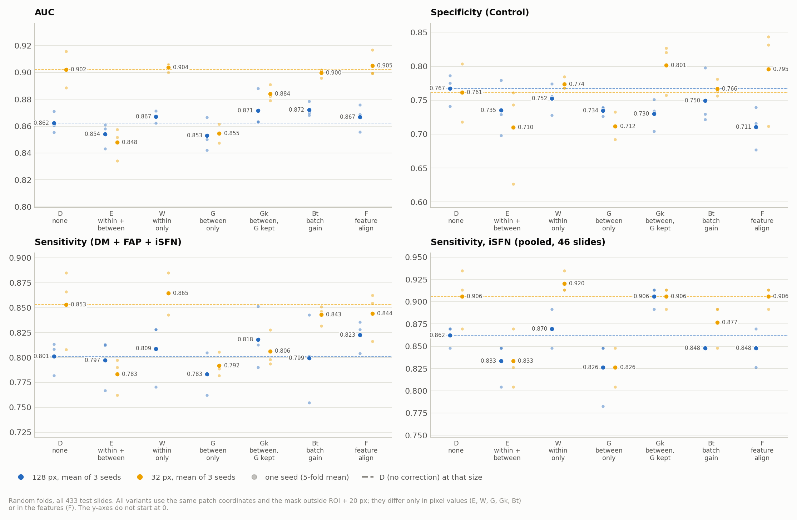
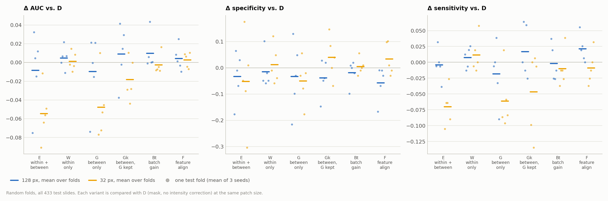
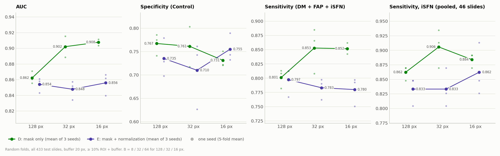
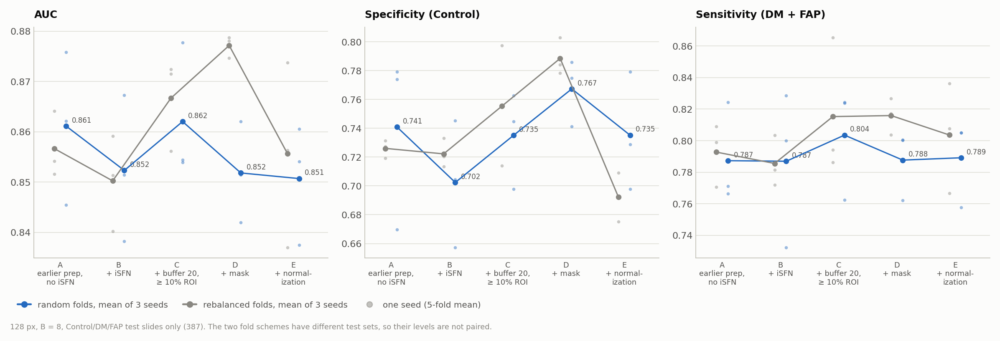

# IENF Intensity Normalization on Random Folds: Within-Image vs. Between-Image, and Alternatives (3 Seeds; 128 px and 32 px)

**Questions.**
1. Which part of the intensity normalization lowers performance: the within-image (tile seam) correction or the between-image scaling?
2. Is there a normalization strategy that improves on no correction?
3. Do the earlier conclusions hold on **random** 5-fold splits? The earlier ablation ([ienf_ablation_report.md](ienf_ablation_report.md)) used folds rebalanced with earlier test results.

**Runs** (our own, trained 2026-11-06 17:06 to 2026-11-07 02:46 with `run_ienf_norm_random.sh`; 57 runs = 19 settings × seeds 1–3):

| Variant | Images or features | 128 px, B = 8 | 32 px, B = 32 | 16 px, B = 64 |
|---|---|---|---|---|
| A–C | ablation ladder rungs, as in the earlier report | `ienf_rf_{A_oldprep_noisfn, B_oldprep, C_buf20}_p128_CLAM_B8` | – | – |
| D | mask outside ROI + 20 px, original intensities (no correction) | `ienf_rf_D_mask_p128_CLAM_B8` | `ienf_rf_D_mask_p32_CLAM_B32` | `ienf_rf_D_mask_p16_CLAM_B64` |
| E | D + within + between (the earlier "new pipeline") | `ienf_rf_E_full_p128_CLAM_B8` | `ienf_rf_E_full_p32_CLAM_B32` | `ienf_rf_E_full_p16_CLAM_B64` |
| W | D + within-image only | `ienf_rf_W_within_p128_CLAM_B8` | `ienf_rf_W_within_p32_CLAM_B32` | – |
| G | D + between-image only | `ienf_rf_G_between_p128_CLAM_B8` | `ienf_rf_G_between_p32_CLAM_B32` | – |
| Gk | G on red and blue only; green kept | `ienf_rf_Gk_betweenkeepG_p128_CLAM_B8` | `ienf_rf_Gk_betweenkeepG_p32_CLAM_B32` | – |
| Bt | D + one gain per batch and channel | `ienf_rf_Bt_batchgain_p128_CLAM_B8` | `ienf_rf_Bt_batchgain_p32_CLAM_B32` | – |
| F | D features aligned per batch in feature space | `ienf_rf_F_featalign_p128_CLAM_B8` | `ienf_rf_F_featalign_p32_CLAM_B32` | – |

Each experiment code has the suffixes `_s1`, `_s2` and `_s3`.

## 1. Summary

All 433 test slides, random folds. Mean ± SD over 3 seeds of the 5-fold mean:

| 32 px, B = 32 | D none | E within + between | W within only | G between only | Gk between, G kept | Bt batch gain | F feature align |
|---|---|---|---|---|---|---|---|
| AUC | 0.902 ± 0.013 | 0.848 ± 0.012 | 0.904 ± 0.003 | 0.855 ± 0.007 | 0.884 ± 0.006 | 0.900 ± 0.003 | **0.905 ± 0.010** |
| Specificity (Control) | 0.761 ± 0.043 | 0.710 ± 0.073 | 0.774 ± 0.010 | 0.712 ± 0.020 | **0.801 ± 0.038** | 0.766 ± 0.013 | 0.795 ± 0.073 |
| Sensitivity (all disease) | 0.853 ± 0.040 | 0.783 ± 0.019 | **0.865 ± 0.021** | 0.792 ± 0.012 | 0.806 ± 0.019 | 0.843 ± 0.010 | 0.844 ± 0.025 |
| Balanced accuracy | 0.807 | 0.747 | 0.819 | 0.752 | 0.804 | 0.805 | **0.820** |
| F1 (disease) | 0.849 ± 0.028 | 0.794 ± 0.013 | **0.859 ± 0.012** | 0.798 ± 0.003 | 0.830 ± 0.001 | 0.845 ± 0.003 | 0.853 ± 0.015 |
| F1 (macro) | 0.806 ± 0.034 | 0.739 ± 0.030 | **0.819 ± 0.013** | 0.748 ± 0.005 | 0.797 ± 0.006 | 0.802 ± 0.004 | 0.817 ± 0.026 |
| iSFN sensitivity (46 slides) | 0.906 | 0.833 | **0.920** | 0.826 | 0.906 | 0.877 | 0.906 |
| AUC vs. D, pooled (95% CI) | – | **−0.057** (−0.092 to −0.025) | +0.004 (−0.006 to +0.014) | **−0.046** (−0.079 to −0.015) | −0.017 (−0.042 to +0.007) | −0.004 (−0.016 to +0.007) | +0.003 (−0.007 to +0.012) |

- **The between-image step causes the loss; the within-image step does not.**
  - At 32 px, between-only (G) loses AUC 0.048 against D. It is lower in 4 of 5 folds and all 3 seeds, and the bootstrap CI excludes 0. This is almost the whole loss of the full normalization (E: −0.054, lower in all 5 folds and all 3 seeds).
  - Within-only (W) is equal to D: AUC +0.002, specificity +0.012, sensitivity +0.012, macro F1 +0.014, none consistent across folds.
- **Most of the between-image loss comes from rescaling the green (nerve-fibre) channel.**
  - Between-image scaling of only red and blue (Gk) loses 0.018 AUC, against 0.048 for G.
  - The raw ROI median of green alone separates disease from Control with AUC 0.675; in batch 2 it reaches 0.822 (Section 6). The between-image step sets this median to the same value in every image, so it removes that information.
- **No normalization improves clearly on no correction.**
  - The three variants close to D at 32 px are W, Bt and F. Their AUC is within ±0.004 of D, and all three bootstrap CIs include 0.
  - **W** is among the most stable: its seed SD is 0.003 (as for Bt) against D's 0.013, and it has the highest sensitivity (0.865), iSFN sensitivity (0.920) and F1 (disease 0.859, macro 0.819). It changes only 52 of the 433 task slides; the others have identical features.
  - **F** has the highest specificity in batch 2 (0.852 vs. 0.788, higher in all 5 folds and all 3 seeds; p = 0.0625, the smallest possible with 5 folds). But it is transductive: test slides contribute to the alignment statistics.
  - At 128 px no variant differs from D beyond seed noise (all AUC differences ≤ 0.010, all bootstrap CIs include 0).
- **Control is the weaker class in every variant** (F1 0.68–0.78 vs. 0.79–0.86 for disease; Section 3.3). Between-image scaling lowers Control F1 most (E: −0.079), mainly because more disease slides are called Control.
- **On random folds, 32 px and 16 px beat 128 px clearly** (D: 0.902 and 0.908 vs. 0.862).
  - The AUC gain is +0.040 and +0.046. It is in all 5 folds and all 3 seeds, and both bootstrap CIs exclude 0.
  - On the rebalanced folds the gain was only +0.012 / +0.014.
- **On random folds, the 128 px ladder is flatter than on the rebalanced folds.**
  - Only the buffer / accept-rule step (B → C) has a pooled-AUC CI above 0 (+0.024).
  - The mask (C → D) no longer raises AUC (−0.010). It still raises batch 2 specificity (+0.100, in 4 of 5 folds and all 3 seeds).
  - Normalization at 128 px (D → E) costs little here: AUC −0.001, specificity −0.032. The earlier report found −0.096 on the rebalanced folds.
  - So the size of the normalization effect at 128 px depended on the folds. At 32 px and 16 px it is large on both fold schemes.
- **Recommendation:** use mask-only images at 32 px (D). The within-image correction (W) can be added: it costs nothing here and only changes the 52 images with visible tile seams. Do not use between-image scaling of the green channel.

## 2. Setup

### What is the same in all runs

| | Value |
|---|---|
| Task | `ienf_isfn_2cls`: Control (normal) vs. DM + FAP + iSFN (disease), 433 slides, 217 patients. Rung A: `ienf_2cls` (387 slides, no iSFN). |
| Features | UNI v1, 1024-d; patches resized to 224 px |
| Model | CLAM-SB small; B = 8 / 32 / 64 for 128 / 32 / 16 px |
| Training | Adam, lr 2e-4, weight decay 1e-5, dropout 0.25, max 200 epochs, early stopping, weighted sampling, CE bag loss, SVM instance loss, bag weight 0.7 |
| Folds | `splits/ienf_isfn_kfold5_random` (B–F); the same folds without the iSFN slides for A (`splits/ienf_kfold5_random_noisfn`) |
| Seeds | 1, 2, 3 (the seed changes initialization and sampling, not the folds) |
| Patch coordinates | D, E, W, G, Gk, Bt and F share `clam_prep_norm/p{ps}_s{ps}_bufdown20` (buffer 20 px toward the dermis, ≥ 10% ROI + buffer). These coordinates are computed from the ROI files only. So these variants differ only in pixel values (or, for F, in the features). |

Settings were checked against `experiment_*.txt` of the runs. They are the same as in the earlier ablation; only the split folder differs.

### The random folds

`create_splits_ienf_random.py --seed 2026 --out_dir ienf_isfn_kfold5_random`:
- Patients go to test folds by a stratified random 5-fold over subtype × batch (7 strata; iSFN exists only in batch 2).
- **No model result was used.** The earlier "rebalanced" folds moved hard patients between folds, based on earlier test results.
- Validation: 22 patients per fold, stratified by subtype, drawn from outside the test fold.
- Checks in the script: the sets are patient-disjoint, and every slide is tested exactly once.

| Test fold | Patients | Slides | Control | DM | FAP | iSFN | Batch 2 slides | Earlier "hard" patients |
|---|---|---|---|---|---|---|---|---|
| 0 | 44 | 88 | 34 | 20 | 24 | 10 | 36 | 7 |
| 1 | 44 | 88 | 36 | 20 | 22 | 10 | 34 | **14** |
| 2 | 43 | 86 | 34 | 20 | 24 | 8 | 30 | 9 |
| 3 | 43 | 85 | 34 | 21 | 22 | 8 | 31 | 4 |
| 4 | 43 | 86 | 34 | 18 | 24 | 10 | 36 | 6 |

"Hard" is the label from the rebalancing (a slide wrong in ≥ 3 of 4 earlier runs; 40 patients). The rebalanced folds had 8 per fold. By chance, random fold 1 got 14 of them. It is the lowest-AUC fold for D at all three patch sizes, and for W, Bt and F at both sizes (Section 5).

### What each variant changes

The normalization steps are those of `IENF_CLAM_Preprocessing/ienf_prep/normalize.py`. The "within" and "between" parts were split into separate modes of `scripts/normalize_images.py --mode`:

| Variant | Mode | What is done to each image (then masked outside ROI + 20 px) |
|---|---|---|
| D | `none` | nothing |
| E | `full` | within-image correction, then between-image scaling |
| W | `within` | Tile x-profile and per-tile gains, only where seams are detected and the correction lowers the seam score by ≥ 20% (54 of 439 images; 52 are in the task). The dark offset is added back, so each image keeps its own level. |
| G | `between` | Dark offset (1st percentile per channel) subtracted. Each channel is scaled so that its ROI + buffer median equals the dataset target (89 / 35 / 95). No seam correction. |
| Gk | `between_keepG` | as G for red and blue; green keeps its original values |
| Bt | `batch` | One gain per batch and channel, so that the batch's median ROI median equals the dataset median (target 89 / 43 / 97). Gains: about 0.94 for batch 1 and 1.10–1.13 for batch 2. Differences between images of a batch are kept. |
| F | – | D's patch features, per batch and dimension: x' = (x − mean_batch) / sd_batch × sd_all + mean_all, over the 433 slides (`make_ienf_feature_batch_align.py`). Unsupervised but transductive. |

Checks on the images:
- On S3933-2_b, every variant is 0 outside the mask, and Gk's green channel equals D's.
- After Bt, both batches have the same median ROI median (89 / 43 / 97); the spread within each batch is unchanged.
- For the images without within-image correction, W's features equal D's exactly (max |difference| = 0 at 128 px and 32 px, checked on 3 slides).

### Commands

The whole set (images, features, training; runs with an existing `summary.csv` are skipped):

```bash
UNI_CKPT_PATH=~/projects/UNI/assets/ckpts/uni/pytorch_model.bin \
PART=P128 bash run_ienf_norm_random.sh 2>&1 | tee logs/run_ienf_norm_random_P128.log
```

```bash
PART=SMALL bash run_ienf_norm_random.sh 2>&1 | tee logs/run_ienf_norm_random_SMALL.log
```

```bash
UNI_CKPT_PATH=~/projects/UNI/assets/ckpts/uni/pytorch_model.bin \
PART=P32 VARIANTS="W Gk F" bash run_ienf_norm_random.sh 2>&1 | tee logs/run_ienf_norm_random_P32_q1.log
```

```bash
UNI_CKPT_PATH=~/projects/UNI/assets/ckpts/uni/pytorch_model.bin \
PART=P32 VARIANTS="G Bt" bash run_ienf_norm_random.sh 2>&1 | tee logs/run_ienf_norm_random_P32_q2.log
```

One variant's images, here between-only:

```bash
python ~/projects/IENF_CLAM_Preprocessing/scripts/normalize_images.py \
    --source /data/datasets/neuroimages/20250214 \
    --batches /data/datasets/neuroimages/20250214/labels/canonical_original_images.csv \
    --out_dir /var/tmp/shouteng_data/IENF_CLAM/ablation/images_between_bufdown20 \
    --buffer_down 20 --mode between --fit --workers 14
```

One training run, W at 32 px, seed 2:

```bash
CUDA_VISIBLE_DEVICES=0 python main.py \
    --task ienf_isfn_2cls --split_dir ienf_isfn_kfold5_random --k 5 \
    --model_type clam_sb --model_size small --B 32 \
    --drop_out 0.25 --lr 2e-4 --reg 1e-5 --max_epochs 200 --early_stopping \
    --weighted_sample --bag_loss ce --inst_loss svm \
    --data_root_dir /var/tmp/shouteng_data/CLAM_DATA \
    --feature_dir ienf_ab_within_buf20_uni_p32_s32 \
    --embed_dim 1024 --seed 2 --log_data \
    --exp_code ienf_rf_W_within_p32_CLAM_B32
```

### Metrics

- **Threshold metrics** use P(disease) ≥ 0.5.
- **Fold mean:** the mean of 5 fold-level values. Tables give the mean ± SD over the 3 seeds of that fold mean, so the SD is seed variance.
- **Paired differences** are over 15 seed × fold pairs. "Folds up" and "seeds up" count the folds (seed-averaged) and the seeds (fold-averaged) in which the variant is higher.
  - The Wilcoxon test uses the 5 seed-averaged fold differences, because seeds share test sets. The smallest possible p is 0.0625, so **no single comparison can reach p < 0.05**. The bootstrap CI is the stronger evidence here.
- **Pooled, seed-ensembled:** P(disease) averaged over the 3 seeds per slide, then all slides pooled. The bootstrap resamples patients (2000 resamples) to give a CI for the pooled AUC difference.
- **F1:** F1 (disease) is the F1 of class 1. F1 (macro) is the mean of the Control and disease F1. Both are computed per fold and averaged like the other metrics.
- **Per-class metrics** (Section 3.3): precision, recall and F1 of each class. Recall of disease = sensitivity, recall of Control = specificity, precision of disease = PPV, precision of Control = NPV.
- **iSFN sensitivity:** the pooled share of the 46 iSFN slides detected (8–10 per fold).
- **Slide sets:** all 433 slides for the variants. For the ladder A–E, the 387 Control/DM/FAP slides, so that A (no iSFN) is comparable.
- All recomputed fold AUCs and accuracies (285 folds) match `summary.csv`.

## 3. Normalization variants



*Figure 1. Each variant at 128 px (blue) and 32 px (yellow), all 433 slides. Faint dots: each seed (5-fold mean); large dots: mean of 3 seeds; dashed lines: D at that patch size.*

### 3.1 At 32 px

| 32 px, all 433 slides | D | E | W | G | Gk | Bt | F |
|---|---|---|---|---|---|---|---|
| Spec. batch 1 (116 Controls) | 0.749 | 0.705 | 0.771 | 0.710 | **0.787** | 0.746 | 0.770 |
| Spec. batch 2 (56 Controls) | 0.788 | 0.724 | 0.782 | 0.718 | 0.841 | 0.813 | **0.852** |
| DM sensitivity | 0.911 | 0.856 | **0.927** | 0.877 | 0.904 | 0.919 | 0.909 |
| FAP sensitivity | 0.781 | 0.698 | **0.790** | 0.705 | 0.683 | 0.764 | 0.764 |
| Spec. at sens. 0.80 (pooled per seed) | 0.837 | 0.690 | **0.866** | 0.707 | 0.810 | 0.843 | 0.864 |
| Pooled AUC, seed-ensembled | 0.891 | 0.834 | **0.895** | 0.845 | 0.874 | 0.887 | 0.894 |
| Mean P(disease) of Controls | 0.296 | 0.338 | 0.306 | 0.338 | 0.279 | 0.301 | 0.277 |

Difference to D, paired over 15 seed × fold pairs:

| 32 px | AUC | Folds up | Seeds up | p | Specificity | Folds up | Sensitivity | Folds up | F1 (macro) | Folds up |
|---|---|---|---|---|---|---|---|---|---|---|
| E − D | **−0.054** | 0/5 | 0/3 | 0.0625 | −0.051 | 2/5 | **−0.070** | 0/5 | −0.067 | 1/5 |
| W − D | +0.002 | 2/5 | 2/3 | 1.00 | +0.012 | 2/5 | +0.012 | 2/5 | +0.014 | 3/5 |
| G − D | **−0.048** | 1/5 | 0/3 | 0.13 | −0.050 | 1/5 | −0.061 | 1/5 | −0.058 | 1/5 |
| Gk − D | −0.018 | 1/5 | 1/3 | 0.19 | +0.040 | 3/5 | −0.047 | 1/5 | −0.009 | 3/5 |
| Bt − D | −0.003 | 1/5 | 1/3 | 0.63 | +0.005 | 2/5 | −0.010 | 1/5 | −0.003 | 2/5 |
| F − D | +0.003 | 3/5 | 2/3 | 0.44 | +0.034 | 3/5 | −0.009 | 1/5 | +0.011 | 3/5 |

F's batch-2 specificity is higher than D's in all 5 folds and all 3 seeds: +0.064, p = 0.0625.

Observations:
- **G reproduces most of E's loss**, on every metric: AUC (0.855 vs. 0.848), specificity (0.712 vs. 0.710), sensitivity (0.792 vs. 0.783) and iSFN sensitivity (0.826 vs. 0.833). W does not. So the within-image correction is not what hurts.
- **The loss is not a threshold shift.** At a matched sensitivity of 0.80, specificity is 0.69 (E) and 0.71 (G), against 0.84 for D.
- **Gk trades sensitivity for specificity.**
  - It has the highest specificity among the corrected variants (0.801) and the lowest FAP sensitivity (0.683).
  - Its AUC loss (−0.018) and its specificity at matched sensitivity (0.810) are both between D and G.
  - Keeping the green channel therefore removes most, but not all, of the between-image loss.
- **W, Bt and F are within seed noise of D on AUC.**
  - W and Bt have the smallest seed SD of any 32 px setting (AUC ± 0.003). It has the best sensitivity, iSFN sensitivity and specificity at matched sensitivity.
  - Its features differ from D only on 52 slides (13 Controls, 39 disease). So most of the W − D difference is training variation, not a pixel effect.
  - F has the highest balanced accuracy (0.820), but its specificity varies a lot between seeds (± 0.073).

### 3.2 At 128 px

| 128 px, all 433 slides | D | E | W | G | Gk | Bt | F |
|---|---|---|---|---|---|---|---|
| AUC | 0.862 ± 0.008 | 0.854 ± 0.010 | 0.867 ± 0.005 | 0.853 ± 0.012 | 0.871 ± 0.014 | **0.872 ± 0.006** | 0.867 ± 0.010 |
| Specificity (Control) | **0.767 ± 0.023** | 0.735 ± 0.041 | 0.752 ± 0.023 | 0.734 ± 0.007 | 0.730 ± 0.024 | 0.750 ± 0.042 | 0.711 ± 0.032 |
| Sensitivity (all disease) | 0.801 ± 0.017 | 0.797 ± 0.026 | 0.809 ± 0.033 | 0.783 ± 0.021 | 0.818 ± 0.031 | 0.799 ± 0.044 | **0.823 ± 0.016** |
| Balanced accuracy | **0.784** | 0.766 | 0.781 | 0.759 | 0.774 | 0.775 | 0.767 |
| F1 (disease) | 0.818 ± 0.012 | 0.808 ± 0.007 | **0.819 ± 0.022** | 0.799 ± 0.012 | 0.817 ± 0.013 | 0.811 ± 0.019 | 0.815 ± 0.012 |
| F1 (macro) | **0.778 ± 0.012** | 0.760 ± 0.008 | 0.777 ± 0.020 | 0.752 ± 0.009 | 0.770 ± 0.008 | 0.768 ± 0.012 | 0.764 ± 0.016 |
| Spec. batch 1 | **0.743** | 0.713 | 0.710 | 0.719 | 0.726 | 0.722 | 0.668 |
| Spec. batch 2 | 0.820 | 0.788 | **0.846** | 0.773 | 0.743 | 0.813 | 0.809 |
| iSFN sensitivity | 0.862 | 0.833 | 0.870 | 0.826 | **0.906** | 0.848 | 0.848 |
| AUC − D (folds up, seeds up) | – | −0.008 (3/5, 1/3) | +0.005 (3/5, 3/3) | −0.009 (2/5, 1/3) | +0.009 (3/5, 2/3) | +0.010 (3/5, 3/3) | +0.004 (3/5, 2/3) |
| Pooled AUC − D (95% CI) | – | −0.009 (−0.047 to +0.029) | +0.007 (−0.007 to +0.021) | −0.005 (−0.043 to +0.033) | +0.011 (−0.020 to +0.043) | +0.014 (−0.004 to +0.032) | +0.003 (−0.016 to +0.023) |

Observations:
- **No variant is separated from D at 128 px.** The AUC differences are at most 0.010, and every bootstrap CI includes 0.
- **Every variant has lower specificity than D** (−0.015 to −0.057). The only consistent difference is F's: lower in all 5 folds and all 3 seeds (p = 0.0625), mostly in batch 1 (0.668 vs. 0.743).
- **E and G are close at 128 px too** (AUC 0.854 vs. 0.853), and both are slightly below D. The direction matches 32 px, but the size is about a seventh.
- **Why is the effect so much smaller at 128 px?** It has not been tested. One possibility: at 128 px, the model's AUC is limited by other factors, so removing intensity information costs less. Section 3.1 shows that at 32 px the same normalization costs 0.05.



*Figure 2. Per-fold difference to D at the same patch size (each dot: one test fold, mean of 3 seeds; bar: mean over folds).*

### 3.3 Per-class performance

Class 0 = Control (172 slides), class 1 = disease (261 slides: DM, FAP, iSFN). Fold mean, mean ± SD over 3 seeds; threshold 0.5. Recall of Control = specificity, precision of Control = NPV, recall of disease = sensitivity.

| 32 px, all 433 slides | D | E | W | G | Gk | Bt | F |
|---|---|---|---|---|---|---|---|
| Control precision (NPV) | 0.778 ± 0.048 | 0.688 ± 0.023 | **0.794 ± 0.027** | 0.701 ± 0.013 | 0.743 ± 0.009 | 0.765 ± 0.007 | 0.775 ± 0.020 |
| Control recall (specificity) | 0.761 ± 0.043 | 0.710 ± 0.073 | 0.774 ± 0.010 | 0.712 ± 0.020 | **0.801 ± 0.038** | 0.766 ± 0.013 | 0.795 ± 0.073 |
| Control F1 | 0.763 ± 0.042 | 0.683 ± 0.049 | **0.780 ± 0.015** | 0.698 ± 0.011 | 0.764 ± 0.012 | 0.760 ± 0.008 | **0.780 ± 0.039** |
| Disease precision (PPV) | 0.851 ± 0.023 | 0.817 ± 0.033 | 0.856 ± 0.007 | 0.813 ± 0.005 | **0.867 ± 0.022** | 0.852 ± 0.006 | **0.867 ± 0.036** |
| Disease recall (sensitivity) | 0.853 ± 0.040 | 0.783 ± 0.019 | **0.865 ± 0.021** | 0.792 ± 0.012 | 0.806 ± 0.019 | 0.843 ± 0.010 | 0.844 ± 0.025 |
| Disease F1 | 0.849 ± 0.028 | 0.794 ± 0.013 | **0.859 ± 0.012** | 0.798 ± 0.003 | 0.830 ± 0.001 | 0.845 ± 0.003 | 0.853 ± 0.015 |
| Macro precision | 0.815 | 0.753 | **0.825** | 0.757 | 0.805 | 0.808 | 0.821 |
| Macro recall (= balanced accuracy) | 0.807 | 0.747 | 0.819 | 0.752 | 0.804 | 0.805 | **0.820** |
| Macro F1 | 0.806 | 0.739 | **0.819** | 0.748 | 0.797 | 0.802 | 0.817 |

Per-class F1 difference to D at 32 px, paired over 15 seed × fold pairs (folds up, seeds up):

| 32 px | Control F1 | Disease F1 | Macro F1 | Control precision (NPV) |
|---|---|---|---|---|
| E − D | −0.079 (1/5, 0/3) | −0.055 (1/5, 0/3) | −0.067 (1/5, 0/3) | **−0.091 (0/5, 0/3)**, p = 0.0625 |
| W − D | +0.017 (3/5, 2/3) | +0.010 (3/5, 2/3) | +0.014 (3/5, 2/3) | +0.016 (3/5, 2/3) |
| G − D | −0.065 (1/5, 0/3) | −0.051 (1/5, 0/3) | −0.058 (1/5, 0/3) | −0.077 (1/5, 0/3) |
| Gk − D | +0.001 (3/5, 2/3) | −0.019 (2/5, 1/3) | −0.009 (3/5, 1/3) | −0.035 (1/5, 1/3) |
| Bt − D | −0.003 (2/5, 2/3) | −0.004 (2/5, 2/3) | −0.003 (2/5, 2/3) | −0.013 (1/5, 1/3) |
| F − D | +0.017 (3/5, 1/3) | +0.004 (3/5, 1/3) | +0.011 (3/5, 1/3) | −0.003 (1/5, 1/3) |

Observations:
- **Control is the weaker class in every variant.** Control F1 is 0.68–0.78 and disease F1 is 0.79–0.86. In D, Control precision (0.778) and recall (0.761) are close, so both error types contribute: Controls called disease, and disease slides called Control.
- **Between-image scaling hurts Control F1 most, through Control precision.** Under E, Control F1 drops by 0.079 and disease F1 by 0.055. The largest single change is Control precision (NPV): −0.091, lower in all 5 folds and all 3 seeds. So more disease slides are predicted Control, the sensitivity loss of Section 3.1. G shows the same pattern (NPV −0.077).
- **Gk shifts the operating point rather than improving it.** It has the highest Control recall (0.801), but lower Control precision (0.743) and disease recall (0.806). Its Control F1 equals D's (+0.001).
- **W has the highest F1 for both classes** (Control 0.780, tied with F; disease 0.859), but its differences to D are within seed noise (3 of 5 folds up).
- **At 128 px** Control F1 is 0.705–0.738 and disease F1 0.799–0.819 across the variants. Going from 128 px to 32 px (D) raises Control precision by 0.051 (all 5 folds, all 3 seeds) and disease F1 by 0.031 (all 5 folds, all 3 seeds): small patches gain mainly by calling fewer disease slides Control.

## 4. Patch size and full normalization (128 / 32 / 16 px)



*Figure 3. D (mask only) and E (mask + full normalization) at each patch size, random folds, all 433 slides.*

| All 433 slides | 128 px D | 128 px E | 32 px D | 32 px E | 16 px D | 16 px E |
|---|---|---|---|---|---|---|
| AUC | 0.862 ± 0.008 | 0.854 ± 0.010 | 0.902 ± 0.013 | 0.848 ± 0.012 | **0.908 ± 0.004** | 0.856 ± 0.014 |
| Specificity | **0.767 ± 0.023** | 0.735 ± 0.041 | 0.761 ± 0.043 | 0.710 ± 0.073 | 0.731 ± 0.017 | 0.755 ± 0.030 |
| Sensitivity | 0.801 ± 0.017 | 0.797 ± 0.026 | **0.853 ± 0.040** | 0.783 ± 0.019 | 0.852 ± 0.010 | 0.780 ± 0.026 |
| Balanced accuracy | 0.784 | 0.766 | **0.807** | 0.747 | 0.792 | 0.768 |
| F1 (disease) | 0.818 ± 0.012 | 0.808 ± 0.007 | **0.849 ± 0.028** | 0.794 ± 0.013 | 0.840 ± 0.009 | 0.803 ± 0.020 |
| F1 (macro) | 0.778 ± 0.012 | 0.760 ± 0.008 | **0.806 ± 0.034** | 0.739 ± 0.030 | 0.791 ± 0.014 | 0.762 ± 0.022 |
| iSFN sensitivity | 0.862 | 0.833 | **0.906** | 0.833 | 0.884 | 0.862 |

| Comparison | AUC | Folds up | Seeds up | Pooled AUC difference (95% CI) | F1 (macro) (folds up, seeds up) |
|---|---|---|---|---|---|
| E − D, 128 px | −0.008 | 3/5 | 1/3 | −0.009 (−0.047 to +0.029) | −0.018 (1/5, 0/3) |
| E − D, 32 px | **−0.054** | 0/5 | 0/3 | −0.057 (−0.092 to −0.025) | −0.067 (1/5, 0/3) |
| E − D, 16 px | **−0.052** | 0/5 | 0/3 | −0.043 (−0.073 to −0.014) | −0.028 (2/5, 0/3) |
| D 32 px − D 128 px | **+0.040** | 5/5 | 3/3 | +0.042 (+0.016 to +0.070) | +0.028 (5/5, 3/3) |
| D 16 px − D 128 px | **+0.046** | 5/5 | 3/3 | +0.046 (+0.015 to +0.080) | +0.013 (2/5, 2/3) |

Observations:
- **Small patches are clearly better on random folds.** This is the most consistent result in this report: every fold, every seed, and a bootstrap CI above 0.
  - The gain comes from sensitivity (+0.05); specificity does not change at 32 px (−0.006) and drops at 16 px (−0.036).
- **16 px is not better than 32 px** on balanced accuracy, specificity, macro F1 (0.791 vs. 0.806) or iSFN sensitivity. It costs about 3× the extraction time. 32 px remains the better choice.
- **Full normalization loses sensitivity at 32 px and 16 px** (−0.070 and −0.072, lower in all 5 folds at both sizes). At 16 px its specificity is slightly higher than D's (+0.024), so part of that loss is a shift of the operating point. But the AUC loss is equally consistent.

## 5. The ladder A–E on random folds vs. rebalanced folds



*Figure 4. The ablation ladder at 128 px on the 387 Control/DM/FAP slides: random folds (blue) and the rebalanced folds of the earlier report (gray). The two fold schemes have different test sets, so their levels are not paired.*

| 128 px, Control/DM/FAP slides (387) | A earlier prep | B + iSFN | C buffer 20, ≥ 10% | D + mask | E + normalization |
|---|---|---|---|---|---|
| AUC, random folds | 0.861 ± 0.015 | 0.852 ± 0.015 | **0.862 ± 0.014** | 0.852 ± 0.010 | 0.851 ± 0.012 |
| AUC, rebalanced folds (earlier) | 0.857 ± 0.007 | 0.850 ± 0.009 | 0.867 ± 0.009 | **0.877 ± 0.002** | 0.856 ± 0.018 |
| Specificity, random folds | 0.741 ± 0.062 | 0.702 ± 0.044 | 0.735 ± 0.034 | **0.767 ± 0.023** | 0.735 ± 0.041 |
| Specificity, rebalanced folds (earlier) | 0.726 ± 0.006 | 0.722 ± 0.010 | 0.755 ± 0.042 | **0.788 ± 0.013** | 0.692 ± 0.017 |
| Sensitivity, random folds | 0.787 ± 0.032 | 0.787 ± 0.049 | **0.804 ± 0.036** | 0.788 ± 0.022 | 0.789 ± 0.027 |
| Balanced accuracy, random folds | 0.764 | 0.745 | 0.769 | **0.778** | 0.762 |
| F1 (disease), random folds | 0.787 ± 0.003 | 0.769 ± 0.038 | 0.796 ± 0.017 | **0.797 ± 0.016** | 0.790 ± 0.006 |
| F1 (macro), random folds | 0.760 ± 0.014 | 0.740 ± 0.030 | 0.768 ± 0.015 | **0.774 ± 0.015** | 0.758 ± 0.009 |

Step effects on random folds (paired over seed × fold; pooled AUC difference with patient bootstrap):

| Step | AUC | Folds up | Seeds up | Specificity | Spec. batch 2 | F1 (macro) (folds up) | Pooled AUC difference (95% CI) |
|---|---|---|---|---|---|---|---|
| A → B (+ iSFN) | −0.009 | 2/5 | 0/3 | −0.039 | −0.031 | −0.020 (1/5) | −0.012 (−0.034 to +0.009) |
| B → C (buffer 20, ≥ 10%) | +0.010 | 4/5 | 3/3 | +0.033 | +0.019 | +0.028 (4/5) | **+0.024 (+0.004 to +0.044)** |
| C → D (+ mask) | −0.010 | 1/5 | 0/3 | +0.032 | **+0.100** (4/5, 3/3) | +0.006 (2/5) | −0.023 (−0.051 to +0.003) |
| D → E (+ normalization) | −0.001 | 3/5 | 1/3 | −0.032 | −0.032 | −0.016 (1/5) | −0.001 (−0.042 to +0.040) |
| A → D (all changes but normalization) | −0.009 | 1/5 | 0/3 | +0.027 | +0.088 | +0.014 (3/5) | −0.011 (−0.044 to +0.020) |

Observations:
- **What holds on both fold schemes:**
  - the buffer / accept-rule step (B → C) raises AUC;
  - the mask raises batch 2 specificity (+0.10 on both);
  - adding iSFN does not help Control/DM/FAP.
- **What does not hold:**
  - On the rebalanced folds, D was the best rung on AUC (0.877), and normalization cost 0.096 specificity in every fold. On random folds, D is not above A–C on AUC, and normalization at 128 px costs only 0.032 specificity (lower in 3 of 5 folds).
  - So the earlier report's strongest 128 px findings are partly specific to those folds. Those folds were built from earlier test results, which can make specific comparisons look larger.
- **At 128 px the AUC of D differs most between fold schemes** (0.877 vs. 0.852). The rebalanced folds put the same number of hard patients in each fold, while random fold 1 has 14 of the 40 (Section 2). This was not tested further.
- **Per-fold AUC on random folds** (all 433 slides, mean of 3 seeds):

  | Variant | Fold 0 | Fold 1 | Fold 2 | Fold 3 | Fold 4 |
  |---|---|---|---|---|---|
  | D 128 px | 0.845 | 0.836 | 0.858 | 0.890 | 0.882 |
  | E 128 px | 0.770 | 0.869 | 0.863 | 0.875 | 0.894 |
  | D 32 px | 0.888 | 0.858 | 0.906 | 0.916 | 0.943 |
  | E 32 px | 0.797 | 0.847 | 0.842 | 0.860 | 0.894 |
  | W 32 px | 0.886 | 0.873 | 0.896 | 0.913 | 0.951 |
  | G 32 px | 0.811 | 0.868 | 0.833 | 0.863 | 0.898 |
  | Gk 32 px | 0.859 | 0.868 | 0.862 | 0.888 | 0.943 |
  | Bt 32 px | 0.879 | 0.851 | 0.901 | 0.908 | 0.959 |
  | F 32 px | 0.897 | 0.864 | 0.901 | 0.909 | 0.953 |
  | D 16 px | 0.903 | 0.882 | 0.883 | 0.923 | 0.949 |

  - Fold 1 (14 hard patients) is the lowest fold for D at 32 px and for W, Bt and F.
  - Fold 0 is where E and G lose most (0.797 and 0.811 vs. 0.888 at 32 px; 0.770 and 0.772 vs. 0.845 at 128 px).

## 6. Why between-image scaling hurts: the green channel carries signal

ROI + buffer median of the **original** image, per channel, as a single-number classifier of disease vs. Control (433 slides; the AUC is direction-free, max(AUC, 1 − AUC)):

| Channel | AUC, all | Direction | AUC, batch 1 | AUC, batch 2 |
|---|---|---|---|---|
| Red | 0.503 | – | 0.557 | 0.587 |
| **Green** | **0.675** | lower in disease | 0.576 | **0.822** |
| Blue | 0.517 | – | 0.548 | 0.624 |

Median ROI green level: Control 50, DM 35, FAP 50, iSFN 25.5.

- **The green channel is the nerve-fibre channel, and its overall level is lower in disease.**
  - This fits fewer fibres, though that link was not checked against fibre counts.
  - In batch 2, where all iSFN slides are, green alone reaches AUC 0.822.
- **The between-image step sets every image's ROI green median to 35.** With it, an image's overall green level no longer carries information. The model must rely on the spatial pattern within the image.
- **This is consistent with the results:**
  - G and E lose sensitivity: disease P(disease) at 32 px drops by 0.066 to 0.077 on average, against D.
  - Keeping green (Gk) recovers 60% of the AUC loss.
  - Whether it is the whole explanation was not tested. Gk still loses 0.018 AUC, so scaling red and blue also costs something.
- **Within-image correction and the Controls with seams.** At 32 px, the 13 Controls with a within-image correction look slightly more diseased under W: mean P(disease) +0.048 vs. D, against +0.006 for the other 159 Controls, whose features are identical. With 13 slides this is not established. Under E, the same 13 Controls rise by +0.156.

## 7. Batch signal in the features

A linear probe (logistic regression on mean-pooled slide features, patient-grouped 5-fold CV, repeated 5 times) predicts the image batch:

| Features | 128 px, Controls only (172) | 128 px, Control/DM/FAP (387) | 32 px, Controls only | 32 px, Control/DM/FAP |
|---|---|---|---|---|
| C (no mask) | 0.559 ± 0.032 | 0.692 ± 0.028 | – | – |
| D none | 0.618 ± 0.027 | 0.695 ± 0.027 | 0.605 ± 0.031 | 0.662 ± 0.031 |
| E within + between | 0.624 ± 0.011 | 0.728 ± 0.018 | 0.601 ± 0.020 | 0.698 ± 0.027 |
| W within | 0.617 ± 0.025 | 0.697 ± 0.024 | 0.591 ± 0.031 | 0.661 ± 0.030 |
| G between | 0.622 ± 0.012 | 0.725 ± 0.020 | 0.606 ± 0.021 | 0.694 ± 0.028 |
| Gk between, G kept | 0.596 ± 0.033 | 0.715 ± 0.024 | 0.598 ± 0.046 | 0.687 ± 0.036 |
| Bt batch gain | **0.794 ± 0.022** | **0.877 ± 0.015** | **0.844 ± 0.013** | **0.944 ± 0.015** |
| F feature align | 0.728 ± 0.019 | 0.422 ± 0.038 | 0.738 ± 0.036 | 0.477 ± 0.052 |

- **No pixel normalization removes the batch signal.** Among Controls, the batch stays predictable at AUC about 0.6 for D, E, W, G and Gk. So the batch difference that UNI sees is not mainly the overall intensity level.
- **Bt makes the batch much more predictable**, although it equalizes the batch medians.
  - A possible cause, not tested: every image of a batch is multiplied by the same gain (×0.94 or ×1.1), which leaves the same pattern of skipped or merged grey levels in all images of that batch. UNI may pick this up. Per-image gains (G) do not show the effect.
  - Bt's classification results are nevertheless close to D's (AUC −0.003 at 32 px). So the model does not appear to use that signal.
- **F's probe values are an artifact of the transductive alignment.**
  - On all slides the probe falls below 0.5, which happens when the batch means are removed with statistics that include the held-out slides.
  - Among Controls the probe rises: the batch 2 mean also contains the iSFN slides, so subtracting it moves batch 2 Controls away from batch 1 Controls.
  - Note that **F is the variant with the best batch 2 specificity**. The same mechanism (removing a batch mean that includes disease) may shift batch 2 Controls toward "normal". That would be a dataset-specific effect, not a better model.

## 8. Cost

| Step | Time |
|---|---|
| Images per normalization mode (439 TIFFs, 14 workers) | 2–3 min |
| UNI features at 128 px | about 6 min |
| UNI features at 32 px | 1 h 46 min per variant, with two extractions sharing the GPU |
| Feature alignment (F) | 2 s (128 px), 4 s (32 px) |
| Training, one run of 5 folds | 6–10 min (128 px), 8–11 min (32 px), 13–15 min (16 px); up to 27 min for a 32 px run while another job shared the GPU |

## 9. Conclusions, limitations and next steps

**Conclusions**
1. **The between-image step is what lowers performance.** At 32 px, between-only scaling (G) costs 0.048 AUC (CI −0.079 to −0.015). That is close to the 0.054 cost of the full normalization. The within-image tile correction alone (W) costs nothing (+0.002).
2. **Most of the between-image loss comes from the green channel.** Its raw ROI level separates disease from Control (AUC 0.675; 0.822 in batch 2), and per-image scaling erases it. Leaving green untouched (Gk) reduces the AUC loss to 0.018.
3. **No tested normalization clearly improves on no correction.** W, Bt and F are within ±0.004 AUC of D at 32 px.
   - W gives the most stable results and the best sensitivity.
   - F gives the best batch 2 specificity, but it is transductive, and its gain may come from the batch–disease confound.
4. **32 px is clearly better than 128 px on random folds** (+0.040 AUC, in all folds and seeds). 16 px adds nothing over 32 px.
5. **Some earlier 128 px findings were fold-specific.** On the rebalanced folds, the mask raised AUC and normalization cost 0.096 specificity. On random folds, neither is clear at 128 px.
   - The findings at 32 px and 16 px hold on both fold schemes: normalization lowers AUC by 0.03–0.05, and small patches are better.
6. **Recommended setup:** mask-only images (D) or within-only images (W), 32 px, B = 32. On random folds, all 433 slides:
   - D: AUC 0.902, balanced accuracy 0.807, macro F1 0.806, iSFN sensitivity 0.906;
   - W: AUC 0.904, balanced accuracy 0.819, macro F1 0.819, iSFN sensitivity 0.920.

**Limitations**
- **One random split** (seed 2026). Its fold 1 has an unusual number of hard patients. Fold-to-fold differences are large (AUC 0.86–0.94 for D at 32 px), so a second split seed would make the absolute numbers firmer.
- **3 seeds, 5 folds.** With 5 folds the smallest possible Wilcoxon p is 0.0625, so no comparison reaches p < 0.05 by that test. The bootstrap CIs of the pooled, seed-ensembled AUC are used as the main evidence. They ignore the seed and fold structure, so they are approximate.
- **Many comparisons.** 6 variants × 2 sizes, plus the ladder. The two strong effects survive a correction for this; the small ones (±0.01) should be read as "no difference":
  - E and G at 32 px (CIs exclude 0, every fold or all but one);
  - patch size (CIs exclude 0, every fold).
- **The green-channel explanation is inferred.** It was checked only with the single-number classifier in Section 6, not with a variant that removes only the green information.
- **W changes only 52 task slides**, so this experiment cannot show a large effect of tile-seam correction either way.
- **F is transductive** and uses the test slides' features for the alignment statistics.
- **Mechanisms behind the batch probe results (Bt, F) are hypotheses.**

**Possible next steps** (none run)
- Use D or W images at 32 px as the default.
- A second random split seed for D and W at 32 px, to check that the 32 px numbers do not depend on this split (about 1 h of training).
- If batch 2 specificity is still a concern, a non-transductive variant of F: alignment statistics from the training folds only, and from Controls only, so that disease composition does not enter the batch means.
- Re-make the heatmaps from the random-fold D or W model at 32 px.

## 10. Code changes and files

| File | Change |
|---|---|
| `create_splits_ienf_random.py` | new: random stratified 5-fold (subtype × batch), no earlier results used; writes `splits/ienf_isfn_kfold5_random/` |
| `create_splits_ienf_noisfn.py` | new `--src` / `--dst` options; used to write `splits/ienf_kfold5_random_noisfn` (rung A) |
| `make_ienf_feature_batch_align.py` | new: feature-level batch alignment (variant F) |
| `run_ienf_norm_random.sh` | new: images, features and training for all variants (`PART=P128`, `SMALL`, `P32 VARIANTS=...`) |
| `results/make_report_figures.py` | figures `ienf_norm_rf_*.png`; `--only ienf_norm_rf` renders just these |
| `IENF_CLAM_Preprocessing/ienf_prep/normalize.py` | new functions `correct_within_only`, `between_reference`, `correct_between_only` (with a channel list) and `correct_batch_gain`; docstring corrected (72% of images have no visible seams) |
| `IENF_CLAM_Preprocessing/scripts/normalize_images.py` | new `--mode {full, within, between, between_keepG, batch, none}`; the stored model records its mode and is checked when loaded |

Data (not in the repository):
- images: `/var/tmp/shouteng_data/IENF_CLAM/ablation/images_{within, between, between_keepG, batch}_bufdown20/`, each with `normalize_qc.csv`;
- features: `/var/tmp/shouteng_data/CLAM_DATA/ienf_ab_{within, between, betweenkeepG, batchgain}_buf20_uni_p{128,32}_s{128,32}` and `ienf_ab_maskonly_featalign_uni_p{128,32}_s{128,32}`.

## Figures

All figures are in `results/figures/` and are regenerated with:

```bash
python results/make_report_figures.py --only ienf_norm_rf
```
