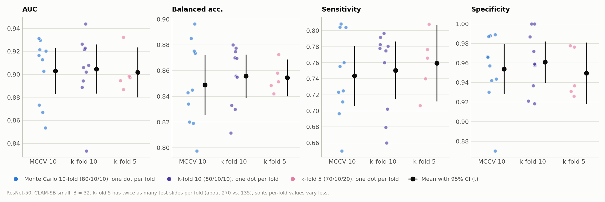
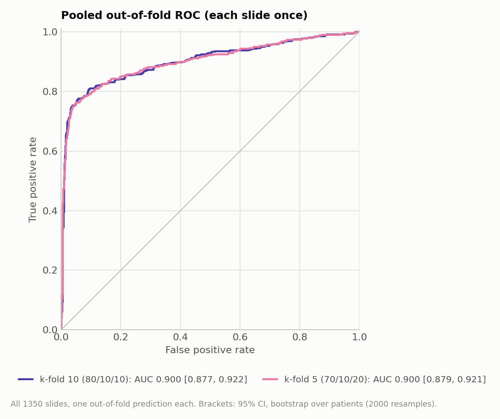

# Standard k-fold (5 vs. 10) vs. Monte Carlo CV: CLAM-SB with ResNet-50 on Camelyon+ (2-class, B = 32)

**Runs compared:**

| Scheme | Train / val / test (cases) | Experiment code | Split folder | Run date |
|---|---|---|---|---|
| Standard 10-fold | 80 / 10 / 10 | `camelyon_plus_2cls_resnet50_CLAM_B32_kfold10_s1` | `splits/camelyon_plus_kfold10_seed1` | 2026-10-08 |
| Standard 5-fold | 70 / 10 / 20 | `camelyon_plus_2cls_resnet50_CLAM_B32_kfold5_s1` | `splits/camelyon_plus_kfold5_seed1` | 2026-10-08 |
| Monte Carlo 10-fold (reference) | 80 / 10 / 10 | `camelyon_plus_2cls_resnet50_CLAM_B32_s1` | `splits/camelyon_plus_2cls_100` | 2026-09-29 |

All three runs use the same model and training settings. Only the cross-validation scheme differs. The k-fold runs were trained with `run_kfold_resnet50.sh`.

## 1. Summary

| Test AUC | Mean ± SD over folds (95% CI of the mean) | Pooled over all test predictions (95% CI) |
|---|---|---|
| Standard 10-fold | 0.9048 ± 0.0300 (± 0.0215) | 0.9003 [0.8755, 0.9221], 1350 slides, each once |
| Standard 5-fold | 0.9019 ± 0.0176 (± 0.0218) | 0.8998 [0.8784, 0.9205], 1350 slides, each once |
| Monte Carlo 10-fold | 0.9029 ± 0.0280 (± 0.0200) | 0.8988, 1284 predictions of 853 slides (some repeated) |

- **All three schemes give the same performance estimate.** Mean test AUC differs by at most 0.003 between the schemes, which is far smaller than the fold-to-fold SD (0.018–0.030) and the 95% confidence intervals (about ±0.02). On the same 1350 slides, the pooled AUC of 10-fold and 5-fold differs by +0.0006 (95% CI −0.015 to +0.013, p = 0.90).
- **The 10% less training data in 5-fold (70% vs. 80%) had no measurable effect** on AUC for this model. The only visible difference is a trend toward lower specificity with 5-fold: 44 vs. 33 false positives pooled, specificity −0.013, p = 0.053.
- **5-fold has a smaller fold-to-fold SD, but it is not more precise.** Its test sets are twice as large (about 270 vs. 135 slides), so each fold's value is less noisy. With half as many folds, the confidence interval of the mean is almost the same (±0.0218 vs. ±0.0215).
- **Standard k-fold tests every slide exactly once.** Monte Carlo CV tested only 853 of the 1350 slides (497 never), and some slides several times. With k-fold, pooled metrics and per-subtype counts cover the whole dataset (for example all 54 ITC slides instead of 46 repeated predictions).
- **5-fold takes less than half the time** (1 h 12 min vs. 2 h 43 min), because it trains half as many models on slightly less data.

## 2. Setup

### What is the same in all three runs

| Setting | Value |
|---|---|
| Task | Camelyon+ 2-class (negative vs. tumor), 1350 slides, 586 cases |
| Encoder | Provided ResNet-50 features (1024-d), `camelyon_plus_resnet50` |
| Model | CLAM-SB, `model_size small`, dropout 0.25 |
| Optimizer, loss | Adam lr 2e-4, weight decay 1e-5; 0.7 × CE + 0.3 × smooth top-1 SVM, B = 32 |
| Class imbalance | `--weighted_sample` |
| Early stopping | Validation loss, patience 20, minimum 50 epochs, maximum 200 |
| Seed | 1 |

### What differs: the cross-validation scheme

| | Monte Carlo 10-fold | Standard 10-fold | Standard 5-fold |
|---|---|---|---|
| How the test set is chosen | Random 10% of cases per fold, drawn independently. Test sets of different folds overlap | Cases split into 10 disjoint groups. Each group is the test set once | Cases split into 5 disjoint groups. Each group is the test set once |
| Validation set | Random 10% of cases per class | Stratified random 10% of all cases (59), drawn from the non-test cases | Same: 59 cases from the non-test cases |
| Train / val / test (cases) | 80 / 10 / 10 | 80 / 10 / 10 | 70 / 10 / 20 |
| Train / val / test (slides, range over folds) | — | 78–80% / 10–12% / 8–12% | 69–71% / 9–11% / 20% |
| Test slides per fold | 115–141 | 114–156 | 268–273 |
| Slides tested | 853 of 1350 (1284 predictions) | 1350, each once | 1350, each once |
| Stratification | By the 2-class case label | By the 4-class case label (negative < ITC < micro < macro; a case gets its largest lesion) | Same as 10-fold |
| Patient-level splitting | Yes | Yes | Yes |

The k-fold splits were created by `create_splits_kfold.py` into new folders. The script refuses to write into an existing folder, and its checks fail loudly. It verifies the following:

- no case appears in more than one of train, val and test within a fold;
- every case is in exactly one test fold;
- the test folds together cover all 1350 slides exactly once.

It was also verified that the same seed reproduces identical splits and that CLAM's data loader reads them correctly. A checksum confirmed that the existing split folders, including the Monte Carlo splits, were not changed.

Because the validation set is fixed at 10% of all cases, 10-fold has exactly the train / val / test ratio of the Monte Carlo protocol (80/10/10). 5-fold differs from 10-fold in two ways: the number of folds and 10 percentage points less training data. This report measures the combined effect of the two and cannot separate them.

Training command (10-fold; for 5-fold use `--k 5 --split_dir camelyon_plus_kfold5_seed1`):

```bash
CUDA_VISIBLE_DEVICES=0 python main.py --drop_out 0.25 --early_stopping --lr 2e-4 --weighted_sample --bag_loss ce \
  --inst_loss svm --task camelyon_plus_2cls --model_type clam_sb --model_size small --log_data \
  --data_root_dir /var/tmp/shouteng_data/CLAM_DATA --B 32 --feature_dir camelyon_plus_resnet50 --embed_dim 1024 \
  --k 10 --split_dir camelyon_plus_kfold10_seed1 --exp_code camelyon_plus_2cls_resnet50_CLAM_B32_kfold10
```

### How the schemes are compared

- **Per-fold summaries.** For each scheme, metrics are computed per fold from `split_{k}_results.pkl` and reported as mean ± SD (ddof = 1), with a 95% t confidence interval of the mean.
- **No fold-by-fold pairing.** The schemes have different test sets in each fold, so the paired per-fold Wilcoxon test used in the other reports does not apply.
- **Slide-level pairing between 10-fold and 5-fold.** Each slide has exactly one out-of-fold prediction in each scheme, so the two schemes can be compared on the same 1350 slides. Confidence intervals and the p-value for the difference come from a bootstrap over **patients** (2000 resamples). Slides of the same patient are correlated, so resampling patients is more honest than resampling slides.
- **Pooled AUC.** For k-fold, the pooled out-of-fold AUC uses every slide exactly once. It can be lower than the mean per-fold AUC, because each fold has its own model with its own score calibration.

## 3. Results

### Test performance, mean ± SD over folds

| Metric | Monte Carlo 10-fold | Standard 10-fold | Standard 5-fold |
|---|---|---|---|
| AUC | 0.9029 ± 0.0280 | 0.9048 ± 0.0300 | 0.9019 ± 0.0176 |
| Accuracy | 0.8771 ± 0.0320 | 0.8856 ± 0.0237 | 0.8822 ± 0.0080 |
| Balanced accuracy | 0.8489 ± 0.0325 | 0.8557 ± 0.0235 | 0.8545 ± 0.0116 |
| Sensitivity | 0.7438 ± 0.0524 | 0.7506 ± 0.0503 | 0.7594 ± 0.0383 |
| Specificity | 0.9539 ± 0.0359 | 0.9609 ± 0.0295 | 0.9496 ± 0.0253 |
| Precision (tumor) | 0.9056 ± 0.0695 | 0.9188 ± 0.0619 | 0.8952 ± 0.0472 |
| F1 (tumor) | 0.8148 ± 0.0449 | 0.8238 ± 0.0313 | 0.8202 ± 0.0156 |
| F1 (macro) | 0.8612 ± 0.0343 | 0.8693 ± 0.0243 | 0.8662 ± 0.0097 |
| mAP (macro) | 0.8977 ± 0.0393 | 0.9038 ± 0.0354 | 0.8970 ± 0.0216 |
| 95% CI of the mean AUC (t) | ± 0.0200 | ± 0.0215 | ± 0.0218 |



*Figure 1. Test AUC, balanced accuracy, sensitivity and specificity of each fold (dots) and the mean with its 95% t confidence interval (black), for the three CV schemes. The means are practically at the same height. The 5-fold dots spread less, because each fold has twice as many test slides, but with only 5 folds the confidence interval of the mean is as wide as for 10 folds.*

### Pooled out-of-fold results: 10-fold vs. 5-fold on the same 1350 slides

| Metric | Standard 10-fold | Standard 5-fold | Difference (10 − 5) | p (bootstrap) |
|---|---|---|---|---|
| AUC | 0.9003 [0.8755, 0.9221] | 0.8998 [0.8784, 0.9205] | +0.0006 [−0.0146, +0.0134] | 0.90 |
| Sensitivity | 0.7495 [0.7035, 0.7939] | 0.7599 [0.7149, 0.8038] | −0.0104 [−0.0293, +0.0062] | 0.29 |
| Specificity | 0.9621 [0.9469, 0.9756] | 0.9495 [0.9315, 0.9654] | +0.0126 [+0.0000, +0.0255] | 0.053 |

Brackets: 95% CI from a bootstrap over patients (2000 resamples).



*Figure 2. ROC curves of the pooled out-of-fold predictions (every slide exactly once) for 10-fold and 5-fold. The two curves overlap almost everywhere. The confidence intervals in the legend come from a separate bootstrap for each curve, so they can differ from the table in the third decimal.*

| Agreement between 10-fold and 5-fold (1350 slides) | |
|---|---|
| Same predicted class | 1304 (96.6%) |
| Correlation of tumor probabilities | 0.965 |
| Negative with 10-fold, tumor with 5-fold | 31 |
| Tumor with 10-fold, negative with 5-fold | 15 |

### Pooled confusion matrices and detection by subtype

| | Standard 10-fold | Standard 5-fold |
|---|---|---|
| True negatives / false positives (of 871 negative slides) | 838 / 33 | 827 / 44 |
| False negatives / true positives (of 479 tumor slides) | 120 / 359 | 115 / 364 |
| Macro-metastases detected (of 251) | 242 (96.4%) | 243 (96.8%) |
| Micro-metastases detected (of 174) | 117 (67.2%) | 120 (69.0%) |
| ITC detected (of 54) | 0 (0.0%) | 1 (1.9%) |

The subtype pattern matches the Monte Carlo run (macro 97%, micro 64%, ITC 2%; `encoder_comparison_B32_report.md`). It is now measured on all slides of each subtype rather than on a subset with repeats.

### Comparison with Monte Carlo CV on the slides it tested

Monte Carlo CV tested 853 slides. On exactly these slides (Monte Carlo: probability averaged over the folds in which a slide was tested), the AUC is 0.9091 for Monte Carlo, 0.9118 for 10-fold and 0.9067 for 5-fold. The Monte Carlo and 10-fold probabilities correlate at r = 0.968. On the slides they share, all three schemes produce essentially the same predictions.

## 4. Training Dynamics and Cost

| | Monte Carlo 10-fold | Standard 10-fold | Standard 5-fold |
|---|---|---|---|
| Best val-loss epoch, mean (range) | 33.8 (17–50) | 29.4 (20–44) | 29.0 (9–39) |
| Total epochs | 588 | 551 | 275 |
| Correlation of val AUC and test AUC across folds | −0.56 | −0.33 | −0.38 |
| Time per epoch | 17.5 s | 17.7 s | 15.8 s |
| Total training time | 2 h 51 min | 2 h 43 min | 1 h 12 min |

- **Training behaves the same in all three schemes.** The best checkpoint comes after about 30 epochs on average, and many folds stop at the minimum of 52 epochs (4 of 10 for Monte Carlo, 7 of 10 for 10-fold, 3 of 5 for 5-fold).
- **5-fold is faster per epoch (15.8 vs. 17.7 s)** because its training sets are about 12% smaller (944 vs. 1072 slides on average). It needs half as many models, so the total time is less than half.
- **Validation AUC still does not predict test AUC** in any scheme (negative correlation across folds). The validation sets have the same size in all three schemes (59 cases, about 120–160 slides).

## 5. Interpretation

- **For this model and dataset, the choice between 5-fold, 10-fold and Monte Carlo 10-fold does not change the conclusion.** All AUC estimates lie within 0.003 of each other. Even on the same slides, 10-fold and 5-fold are statistically indistinguishable.
- **The expected pessimistic bias of 5-fold was not observed.** The CV literature (e.g. Kohavi 1995; Hastie et al., *The Elements of Statistical Learning*, Section 7.10) notes that k-fold with smaller k trains on less data and therefore tends to underestimate performance. Here, 70% instead of 80% training data cost nothing measurable in AUC. This suggests that ResNet-50 CLAM is near a plateau of its learning curve at this dataset size. It was not tested directly: a run with 10-fold splits and training subsampled to 70% would isolate the training-size effect.
- **Fold-to-fold SD must not be compared across k.** A smaller SD for 5-fold reflects the larger test sets per fold, not a better estimate. The confidence interval of the mean, or the slide-level bootstrap, is the right way to compare precision.
- **Practical implications for model comparisons.** With 5 folds, the paired Wilcoxon test used in the other reports can never reach p < 0.05 (smallest possible p = 0.0625; see Section 10 of `encoder_comparison_B32_report.md`). Comparing models with 5-fold therefore needs either more folds or slide-level methods such as the patient-level bootstrap used here.

## 6. Conclusions

1. **Any of the three schemes gives a valid estimate here**, and they agree closely (AUC 0.902–0.905).
2. **Prefer standard 10-fold (80/10/10) for final results on this dataset.** It has the same train / val / test ratio as the Monte Carlo protocol of the original CLAM paper, it tests every slide exactly once (so pooled and per-subtype numbers cover the whole dataset), and it keeps 10 folds for paired tests. Keep Monte Carlo CV only where results must be comparable with the earlier runs or with the CLAM paper's protocol.
3. **Standard 5-fold is a reasonable choice for quick experiments**, at less than half the cost. Its estimate matched 10-fold here, but its 5 folds limit paired fold-level statistics.

### Limitations

- ResNet-50 only. Encoders whose models converge differently (UNI and CONCH overfit within a few epochs) might react differently to 10% less training data.
- One seed for the splits and for training, so how much the k-fold estimates change with a different partition was not measured.
- 5-fold vs. 10-fold changes two factors at once (number of folds and training-set size). Their separate effects were not isolated.
- The k-fold splits are stratified by the 4-class case label, the Monte Carlo splits by the 2-class label. This difference is part of the comparison between k-fold and Monte Carlo.

### Possible next steps

- Repeat both k-fold schemes with 2–3 additional split seeds (repeated k-fold) to measure the partition variance.
- Run 10-fold with training subsampled to 70% to separate the training-size effect from the effect of k.
- Use the same k-fold splits (they are 4-class stratified) for the UNI and CONCH encoders and for the 4-class task.

## Files

- Splits: `create_splits_kfold.py`; `splits/camelyon_plus_kfold10_seed1/` and `splits/camelyon_plus_kfold5_seed1/`, each with `split_summary.csv` (class counts per fold and set) and `README.txt`.
- Run script: `run_kfold_resnet50.sh`. Logs: `logs/camelyon_plus_2cls_resnet50_CLAM_B32_kfold{10,5}.log`.
- Figures: `results/figures/kf_*.png`, generated by `results/make_report_figures.py`.
