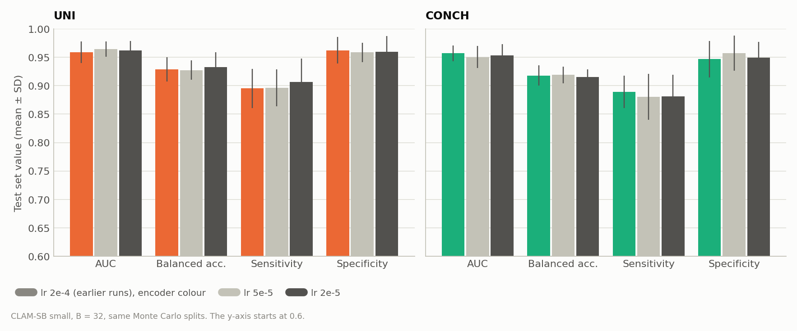
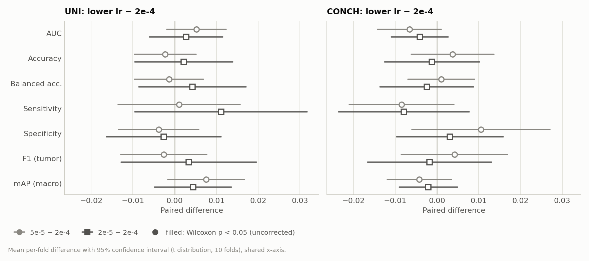
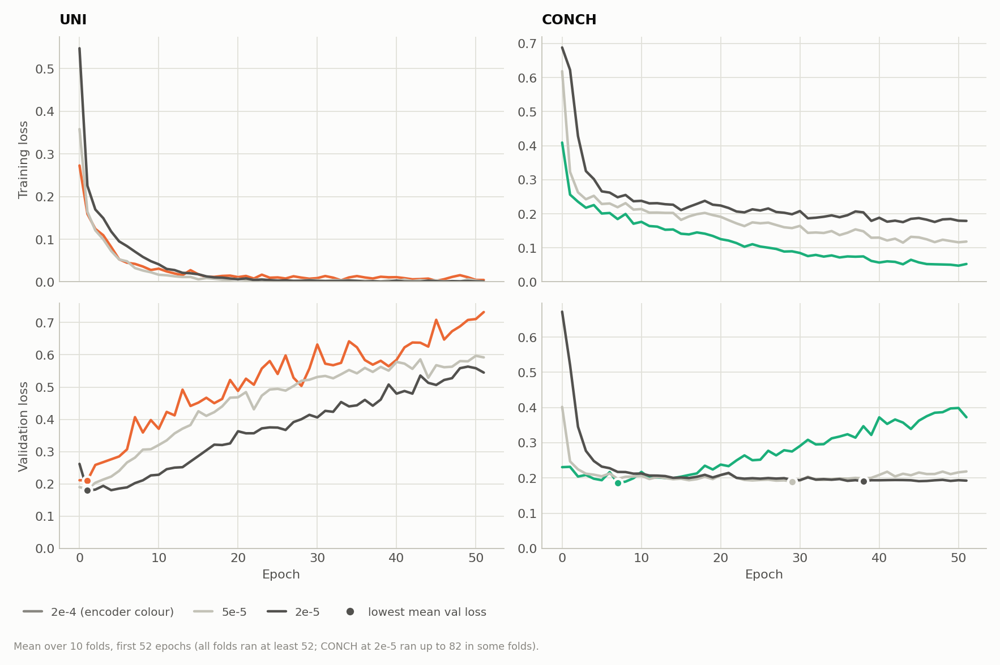
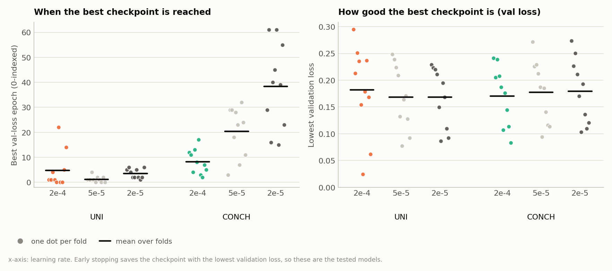

# Lower Learning Rate for CLAM on Camelyon+ (2-class, B = 32): UNI and CONCH

**Question.** With the CLAM default learning rate of 2e-4, the two foundation-model encoders reach their best validation loss within the first few epochs and then overfit. UNI's mean best epoch is 4.8 (median 1), CONCH's 8.2. Earlier reports (encoder comparison, model size, feature normalization) listed a lower learning rate as the remaining candidate. Does a 4× or 10× lower learning rate delay the overfitting, and does it improve the test performance?

**Runs compared** (all CLAM-SB, `model_size small`, B = 32, same Monte Carlo splits `splits/camelyon_plus_2cls_100`, seed 1):

| Encoder | lr 2e-4 (existing run) | lr 5e-5 (4× lower) | lr 2e-5 (10× lower) |
|---|---|---|---|
| UNI | `camelyon_plus_2cls_uni_CLAM_B32_s1` (2026-09-30) | `..._uni_CLAM_B32_lr5e-5_s1` | `..._uni_CLAM_B32_lr2e-5_s1` |
| CONCH | `camelyon_plus_2cls_conch_CLAM_B32_s1` (2026-10-01) | `..._conch_CLAM_B32_lr5e-5_s1` | `..._conch_CLAM_B32_lr2e-5_s1` |

The four new runs were trained one after another on 2026-10-16 (11:00–20:18) with `run_lower_lr.sh`, in tmux session `clam_lr`. All exited with code 0. ResNet-50 was not included, because it does not overfit early at 2e-4 (best epoch 17–50).

## 1. Summary

| Test AUC (mean ± SD, 10 folds) | lr 2e-4 | lr 5e-5 | lr 2e-5 |
|---|---|---|---|
| UNI | 0.9593 ± 0.0190 | 0.9645 ± 0.0138 | 0.9621 ± 0.0169 |
| CONCH | 0.9572 ± 0.0140 | 0.9507 ± 0.0191 | 0.9531 ± 0.0198 |

- **A lower learning rate does not change test performance for either encoder.** All AUC changes are within ±0.007 and none is significant (UNI +0.005 and +0.003; CONCH −0.007 and −0.004). Accuracy, balanced accuracy, sensitivity and specificity also move by at most 0.011, all n.s. Only 1 of 66 paired tests has p < 0.05 (UNI 5e-5, positive-class AP, p = 0.049), and none survives correction for multiple comparisons.
- **CONCH: a lower learning rate delays the best checkpoint as expected, but the checkpoint is not better.** The mean best epoch moves from 8.2 to 20.4 (5e-5) and 38.4 (2e-5); at 2e-5 it is later in all 10 folds. Overfitting after the best epoch almost disappears (mean final validation loss 0.372 → 0.221 → 0.195). But the lowest validation loss is the same (0.171 / 0.178 / 0.179), and so is the test AUC. Early stopping was already picking a checkpoint of equal quality at 2e-4.
- **UNI: even 10× lower, the best checkpoint still comes within the first few epochs.** The mean best epoch is 1.2 at 5e-5 and 3.5 at 2e-5 (median 1, 1 and 3 for 2e-4, 5e-5, 2e-5). The training loss still reaches ≈ 0.001 and the validation loss still rises steadily afterwards. Even at 2e-5, one epoch (about 1,090 slide-level Adam updates) is enough to fit UNI's features. The learning rate is therefore not the reason why UNI overfits early, just as the input scale was not (feature-normalization report).
- **Recommendation: keep lr 2e-4.** It gives the same results in the shortest time. The lower rates are not harmful; 5e-5 for UNI gives slightly less fold-to-fold variance (AUC SD 0.014 vs. 0.019) and removes the two late best epochs (22 and 14) of the 2e-4 run, but this is a single seed and not significant.

## 2. Setup

### What is the same in all runs

| Setting | Value |
|---|---|
| Task, data | Camelyon+ 2-class, 1350 slides, provided features (UNI 1024-d, CONCH 512-d, `--embed_dim` accordingly) |
| Splits | `splits/camelyon_plus_2cls_100` (10-fold Monte Carlo, 80/10/10, patient-level). Identical for all runs, so each lower-lr run is compared fold by fold with its 2e-4 counterpart. 1284 test predictions in total, covering 853 unique slides |
| Model | CLAM-SB small (Linear(D, 512) → gated attention 512 → 256), dropout 0.25, raw features (`--feat_norm none`) |
| Losses | 0.7 × CE (bag) + 0.3 × smooth top-1 SVM (instance), B = 32 |
| Optimizer | Adam, weight decay 1e-5, batch size 1 slide, `--weighted_sample` (about 1,090 updates per epoch; fold 0 has 1091 training slides) |
| Early stopping | on validation loss, patience 20, not before epoch 50, max. 200 epochs. The saved and tested checkpoint is the one with the lowest validation loss |
| Seed | 1 |

### What differs: `--lr`

| | 2e-4 | 5e-5 | 2e-5 |
|---|---|---|---|
| Relative to CLAM default | 1× | 4× lower | 10× lower |

No code changes were needed (`--lr` is an existing `main.py` argument). The command for one run (from `run_lower_lr.sh`):

```bash
CUDA_VISIBLE_DEVICES=0 python main.py --drop_out 0.25 --early_stopping --k 10 --weighted_sample \
    --bag_loss ce --inst_loss svm --task camelyon_plus_2cls --model_type clam_sb --model_size small \
    --log_data --data_root_dir /var/tmp/shouteng_data/CLAM_DATA --B 32 \
    --lr 5e-5 --exp_code camelyon_plus_2cls_uni_CLAM_B32_lr5e-5 \
    --feature_dir camelyon_plus_uni --embed_dim 1024
```

For CONCH: `--feature_dir camelyon_plus_conch --embed_dim 512`. The settings files in the run folders confirm `lr`, `split_dir`, `feature_dir`, `embed_dim` and `feat_norm: none` for all four runs.

### Metrics

Test-set metrics per fold, then mean ± SD over the 10 folds (sample SD, ddof = 1). Positive class = tumor. Threshold-based metrics use argmax (threshold 0.5). F1 is the tumor-class F1; mAP is macro-averaged over both classes. Paired comparisons use the per-fold differences on identical test sets: mean difference, number of folds where the lower-lr run is better (ties counted separately) and the two-sided exact Wilcoxon signed-rank p (smallest possible p with 10 folds: 0.002).

## 3. Test Performance

| Metric | UNI 2e-4 | UNI 5e-5 | UNI 2e-5 | CONCH 2e-4 | CONCH 5e-5 | CONCH 2e-5 |
|---|---|---|---|---|---|---|
| AUC | 0.9593 ± 0.0190 | **0.9645 ± 0.0138** | 0.9621 ± 0.0169 | **0.9572 ± 0.0140** | 0.9507 ± 0.0191 | 0.9531 ± 0.0198 |
| Accuracy | 0.9376 ± 0.0208 | 0.9353 ± 0.0169 | **0.9398 ± 0.0244** | 0.9248 ± 0.0187 | **0.9285 ± 0.0147** | 0.9236 ± 0.0135 |
| Balanced accuracy | 0.9289 ± 0.0214 | 0.9276 ± 0.0172 | **0.9332 ± 0.0256** | 0.9180 ± 0.0178 | **0.9190 ± 0.0149** | 0.9156 ± 0.0133 |
| Sensitivity | 0.8954 ± 0.0347 | 0.8964 ± 0.0323 | **0.9065 ± 0.0413** | **0.8892 ± 0.0288** | 0.8808 ± 0.0405 | 0.8813 ± 0.0379 |
| Specificity | **0.9625 ± 0.0231** | 0.9587 ± 0.0168 | 0.9599 ± 0.0274 | 0.9468 ± 0.0320 | **0.9573 ± 0.0308** | 0.9499 ± 0.0270 |
| Precision | **0.9317 ± 0.0409** | 0.9249 ± 0.0314 | 0.9273 ± 0.0503 | 0.9034 ± 0.0586 | **0.9220 ± 0.0531** | 0.9088 ± 0.0489 |
| F1 (tumor) | 0.9125 ± 0.0270 | 0.9098 ± 0.0207 | **0.9158 ± 0.0342** | 0.8950 ± 0.0281 | **0.8992 ± 0.0210** | 0.8932 ± 0.0178 |
| mAP (macro) | 0.9539 ± 0.0269 | **0.9615 ± 0.0216** | 0.9583 ± 0.0250 | **0.9532 ± 0.0204** | 0.9490 ± 0.0235 | 0.9511 ± 0.0230 |
| Pooled AUC (1284 predictions) | 0.9539 | 0.9624 | 0.9563 | 0.9563 | 0.9508 | 0.9497 |

Bold marks the best mean within each encoder. None of these differences is significant (Section 4). Pooled AUC is computed over all test predictions of all folds together. It is lower than the mean per-fold AUC for most runs, because the fold models are calibrated differently.



*Figure 1. Test AUC, balanced accuracy, sensitivity and specificity (mean ± SD over 10 folds) at lr 2e-4 (encoder colour), 5e-5 (light gray) and 2e-5 (dark gray). The y-axis starts at 0.6. The bars within each group are practically the same height.*

### Per-fold test AUC

| Fold | UNI 2e-4 | UNI 5e-5 | UNI 2e-5 | CONCH 2e-4 | CONCH 5e-5 | CONCH 2e-5 |
|---|---|---|---|---|---|---|
| 0 | 0.9648 | 0.9678 | **0.9720** | **0.9482** | 0.9247 | 0.9349 |
| 1 | 0.9606 | 0.9637 | **0.9644** | 0.9608 | 0.9682 | **0.9775** |
| 2 | **0.9844** | 0.9782 | 0.9800 | **0.9821** | 0.9771 | 0.9813 |
| 3 | 0.9271 | **0.9439** | 0.9424 | **0.9478** | 0.9437 | 0.9419 |
| 4 | 0.9447 | **0.9503** | 0.9466 | 0.9645 | **0.9654** | 0.9582 |
| 5 | 0.9664 | **0.9763** | 0.9659 | **0.9667** | 0.9461 | 0.9526 |
| 6 | **0.9654** | 0.9629 | 0.9610 | 0.9457 | **0.9505** | 0.9419 |
| 7 | 0.9829 | 0.9894 | **0.9936** | 0.9706 | 0.9711 | **0.9770** |
| 8 | **0.9636** | 0.9555 | 0.9406 | **0.9354** | 0.9250 | 0.9244 |
| 9 | 0.9334 | **0.9575** | 0.9545 | **0.9507** | 0.9349 | 0.9416 |
| Best in fold | 3 | 4 | 3 | 6 | 2 | 2 |

For UNI, no learning rate wins consistently. For CONCH, 2e-4 is best in 6 of 10 folds, but the margins are small (Section 4).

## 4. Paired Comparison with lr 2e-4

Mean per-fold difference (lower lr − 2e-4), folds where the lower-lr run is better (with ties), two-sided exact Wilcoxon p.

| Metric | UNI 5e-5 | UNI 2e-5 | CONCH 5e-5 | CONCH 2e-5 |
|---|---|---|---|---|
| AUC | +0.0052, 7/10, p = 0.16 | +0.0028, 6/10, p = 0.49 | −0.0066, 4/10, p = 0.16 | −0.0041, 2/10, p = 0.23 |
| Accuracy | −0.0023, 3/10 (4 ties), p = 0.84 | +0.0022, 5/10 (2 ties), p = 0.46 | +0.0037, 4/10 (3 ties), p = 0.47 | −0.0012, 4/10 (1 tie), p = 0.91 |
| Balanced accuracy | −0.0014, 6/10, p = 0.98 | +0.0043, 5/10 (1 tie), p = 0.43 | +0.0010, 4/10 (2 ties), p = 0.84 | −0.0024, 5/10, p = 0.77 |
| Sensitivity | +0.0011, 4/10 (2 ties), p = 0.52 | +0.0111, 5/10 (2 ties), p = 0.31 | −0.0085, 1/10 (5 ties), p = 0.19 | −0.0079, 2/10 (4 ties), p = 0.19 |
| Specificity | −0.0038, 3/10 (2 ties), p = 0.55 | −0.0026, 3/10 (4 ties), p = 0.69 | +0.0105, 5/10 (3 ties), p = 0.17 | +0.0031, 4/10 (1 tie), p = 0.43 |
| F1 (tumor) | −0.0026, 6/10, p = 0.92 | +0.0034, 5/10 (1 tie), p = 0.50 | +0.0042, 4/10 (2 ties), p = 0.74 | −0.0017, 5/10, p = 0.85 |
| mAP (macro) | +0.0076, 7/10, p = 0.11 | +0.0044, 7/10, p = 0.32 | −0.0042, 4/10, p = 0.38 | −0.0021, 2/10, p = 0.28 |
| AP (tumor) | **+0.0053, 8/10, p = 0.049** | +0.0014, 6/10, p = 0.56 | −0.0030, 4/10, p = 0.32 | −0.0016, 3/10, p = 0.56 |
| Same predicted class as 2e-4 | 98.2% | 97.7% | 97.6% | 97.9% |



*Figure 2. Mean per-fold difference to the lr 2e-4 run, with 95% confidence interval, on a shared x-axis (circles: 5e-5, squares: 2e-5; filled would mean p < 0.05). Every interval crosses zero. The figure shows 7 of the 8 metrics in the table (AP (tumor) is not plotted).*

- **Correction for multiple comparisons.** The analysis script ran 66 paired tests (2 encoders × 3 pairs of learning rates × 11 metrics), so the Bonferroni threshold is about 0.0008. The single p < 0.05 (UNI 5e-5, AP (tumor), p = 0.049) does not survive it, and the related metrics (AUC p = 0.16, macro mAP p = 0.11) are not significant. It should be read as a trend at most.
- **The models make almost the same predictions.** 97.6–98.2% of the 1284 test predictions get the same class as at 2e-4. This is about the same agreement as for other changes that had no effect (L2 normalization: 97.6%; model size big vs. small: 96–98%).
- **5e-5 vs. 2e-5** (not in the table): no metric differs significantly for either encoder (all p ≥ 0.105).

## 5. Error Analysis

| Pooled over test folds | UNI 2e-4 | UNI 5e-5 | UNI 2e-5 | CONCH 2e-4 | CONCH 5e-5 | CONCH 2e-5 |
|---|---|---|---|---|---|---|
| False positives (of 817) | 31 | 34 | 33 | 45 | 36 | 42 |
| False negatives (of 467) | 49 | 49 | 44 | 52 | 56 | 56 |
| Macro detected (of 235) | 232 | 232 | 232 | 232 | 232 | 232 |
| Micro detected (of 186) | 166 | 166 | 167 | 167 | 163 | 165 |
| ITC detected (of 46) | 20 | 20 | 24 | 16 | 16 | 14 |

Counts are pooled over the 10 test folds, so slides that appear in several test sets are counted more than once (1284 predictions, 853 unique slides).

- **A lower learning rate does not help with small metastases.** Macro-metastasis detection is identical in all six runs (232 of 235). Micro-metastasis detection changes by at most 4 slides. UNI at 2e-5 detects 24 instead of 20 ITC predictions, but with only 2–9 ITC slides per test fold (per-fold detection rate 0.55 ± 0.30 vs. 0.44 ± 0.32), this is within noise.
- For CONCH, 5e-5 trades 9 fewer false positives for 4 more false negatives. That is a small shift of the operating point, not a change in ranking (AUC unchanged).

## 6. Training Dynamics: Does a Lower Learning Rate Delay Overfitting?

| | UNI 2e-4 | UNI 5e-5 | UNI 2e-5 | CONCH 2e-4 | CONCH 5e-5 | CONCH 2e-5 |
|---|---|---|---|---|---|---|
| Best val-loss epoch, mean (range) | 4.8 (0–22) | 1.2 (0–4) | 3.5 (1–6) | 8.2 (2–17) | 20.4 (3–32) | **38.4 (15–61)** |
| Best val-loss epoch, median | 1 | 1 | 3 | 7.5 | 23.5 | 39.5 |
| Lowest val loss (mean) | 0.182 | 0.169 | 0.169 | 0.171 | 0.178 | 0.179 |
| Val loss after epoch 0 | 0.211 | 0.190 | 0.262 | 0.231 | 0.402 | 0.672 |
| Val loss at last epoch | 0.733 | 0.592 | 0.545 | 0.372 | 0.221 | **0.195** |
| Train loss in epoch 0 | 0.273 | 0.358 | 0.548 | 0.409 | 0.619 | 0.688 |
| Train loss at last epoch | 0.004 | 0.001 | 0.001 | 0.053 | 0.115 | 0.164 |
| Epochs run (10 folds) | 520 | 520 | 520 | 520 | 521 | 635 |
| Correlation of val and test AUC across folds | −0.27 | −0.42 | −0.30 | −0.20 | −0.13 | −0.40 |
| Training time (10 folds) | 2 h 34 min | 2 h 33 min | 2 h 33 min | 1 h 38 min | 1 h 39 min | 2 h 1 min |
| Time per epoch | 17.7 s | 17.7 s | 17.7 s | 11.3 s | 11.4 s | 11.5 s |

Epochs are 0-indexed and come from TensorBoard. "Last epoch" is the last logged epoch of each fold. Training times are TensorBoard wall times from the first to the last event of each fold (including validation and the final test); no fold had an extra event file from a crashed attempt.



*Figure 3. Mean training loss (top) and validation loss (bottom) over 10 folds, first 52 epochs; the dot marks the lowest point of each mean validation-loss curve. For CONCH (right), a lower learning rate slows the drop of the training loss and turns the rising validation loss of 2e-4 into a flat one. For UNI (left), all three curves reach their validation minimum in the first epochs and then rise; a lower rate only makes the rise less steep.*



*Figure 4. Left: epoch of the lowest validation loss (the tested checkpoint) for each fold. Right: the validation loss at that checkpoint. For CONCH, a lower learning rate moves the best epoch from about 8 to about 38, but the right panel shows that the checkpoint it reaches is not better. For UNI, the best epoch stays in the first few epochs at every learning rate.*

**What this shows**

- **CONCH behaves as expected for a learning rate that was too high, but the high rate did no harm.** At 2e-5 the training loss falls slowly (0.164 at the end vs. 0.053 at 2e-4), the validation loss reaches its minimum later in all 10 folds and then stays flat. All folds still stopped through early stopping (best epoch + 20 patience), at epoch 52–82, well below the maximum of 200. The minimum itself is just as low as at 2e-4 (0.179 vs. 0.171). Early stopping on validation loss already captured the good checkpoint at 2e-4, so avoiding the later overfitting does not change the tested model's quality.
- **UNI fits within one or two epochs at every learning rate tested.** With batch size 1, an epoch is about 1,090 Adam updates. Even at 2e-5 that is enough: 8 of 10 folds have their best checkpoint at epoch ≤ 5, and the training loss still ends at about 0.001. UNI's fast fitting therefore comes from how linearly separable its slide features are, not from the step size. A lower rate makes the later rise in validation loss less steep (final 0.733 → 0.545), but early stopping does not use those epochs.
- **At 5e-5, UNI's best epoch is even earlier than at 2e-4** (mean 1.2 vs. 4.8). This is driven by two folds of the 2e-4 run (fold 5: epoch 22, fold 9: epoch 14); the medians are the same (1). It does not indicate faster fitting at the lower rate.
- **Validation AUC still does not predict test AUC** (r between −0.42 and −0.13 in all six runs). The validation sets (about 135 slides) are too small to select between models that differ by less than 0.01 AUC. This would also limit any attempt to choose the learning rate on the validation set.
- **Cost.** The learning rate does not change the time per epoch. CONCH at 2e-5 took 24% longer (121.5 vs. 98.3 min) because some folds ran up to 82 epochs instead of 52.

## 7. Conclusions

1. **Keep lr 2e-4 for UNI and CONCH.** Neither 5e-5 nor 2e-5 changed any test metric significantly (all AUC changes within ±0.007, prediction agreement ≥ 97.6%).
2. **For CONCH, a lower learning rate delays overfitting but does not find a better model.** The best checkpoint moves from epoch 8 to 38 (2e-5), with the same validation loss and test AUC.
3. **For UNI, the learning rate is not the cause of the early best epoch.** Even at 10× lower, UNI reaches its best checkpoint within 0–6 epochs. Together with the feature-normalization result (input scale is not the cause either), this suggests that UNI features are simply separable enough for CLAM to fit them within about one epoch of slide-level updates.
4. **Early overfitting is not costing performance.** With validation-loss early stopping, the checkpoint tested at 2e-4 is as good as the ones found more slowly at lower rates. Effort aimed at "preventing" this overfitting (learning rate, input scaling) has so far not paid off. The remaining errors (missed ITCs and micro-metastases) are unchanged across all of these settings.

### Limitations

- One seed per configuration. Fold variance is captured, seed variance is not. Differences of ±0.005 AUC are within what a different seed could produce.
- Only two learning rates below 2e-4 were tested, and no other hyperparameter was changed together with them. In particular, the early-stopping minimum of 50 epochs and the patience of 20 were kept.
- The learning rate was compared on the test set, as in the other reports. Choosing one of them based on these numbers would be test-set selection. The validation AUC would not have been a reliable selector (Section 6).

### Possible next steps

- Stop tuning the learning rate for these encoders on this task; the effects are below the noise level.
- If the goal is better small-lesion detection, look at the input side (patch-level information, magnification, the 4-class task) rather than the optimizer.
- If a more precise estimate of small differences like these is needed, repeat the most promising configuration with 2–3 more seeds before drawing conclusions.

## Files

- Runs: `results/camelyon_plus_2cls_{uni,conch}_CLAM_B32_lr{5e-5,2e-5}_s1/` (summary.csv, `split_{k}_results.pkl`, `s_{k}_checkpoint.pt`, `splits_{k}.csv`, TensorBoard logs in `0/`–`9/`, settings file). Run script `run_lower_lr.sh`; logs in `logs/camelyon_plus_2cls_*_CLAM_B32_lr*.log` and `logs/run_lower_lr.log`.
- Baselines: `results/camelyon_plus_2cls_uni_CLAM_B32_s1/`, `results/camelyon_plus_2cls_conch_CLAM_B32_s1/` (see `results/encoder_comparison_B32_report.md`).
- Figures: `results/figures/lr_*.png`, generated by `results/make_report_figures.py` (section "lower learning rate").
- Re-evaluating a checkpoint does not need the learning rate, only the usual encoder flags:

```bash
CUDA_VISIBLE_DEVICES=0 python eval.py --k 10 --models_exp_code camelyon_plus_2cls_conch_CLAM_B32_lr2e-5_s1 \
  --save_exp_code camelyon_plus_2cls_conch_CLAM_B32_lr2e-5_s1_cv --task camelyon_plus_2cls --model_type clam_sb \
  --results_dir results --data_root_dir /var/tmp/shouteng_data/CLAM_DATA \
  --feature_dir camelyon_plus_conch --embed_dim 512
```
