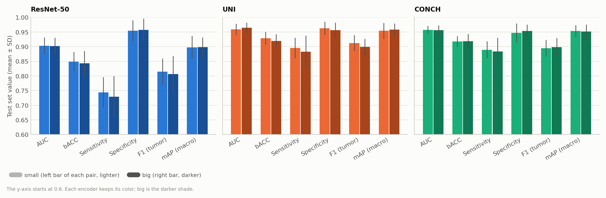
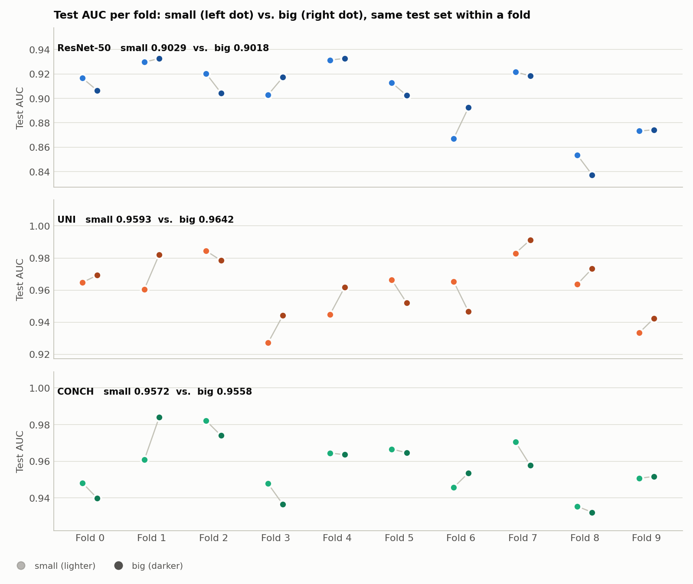
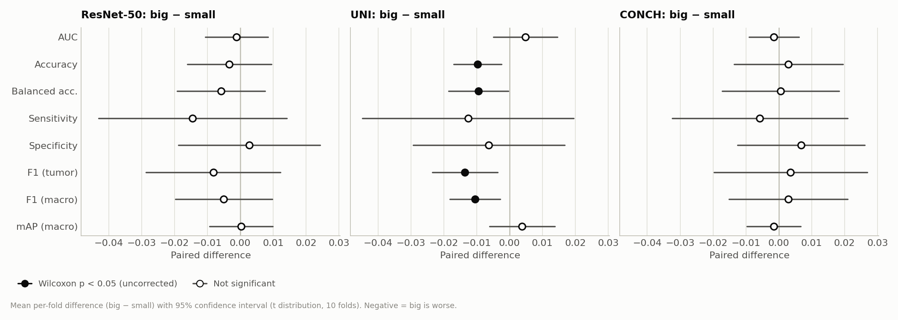
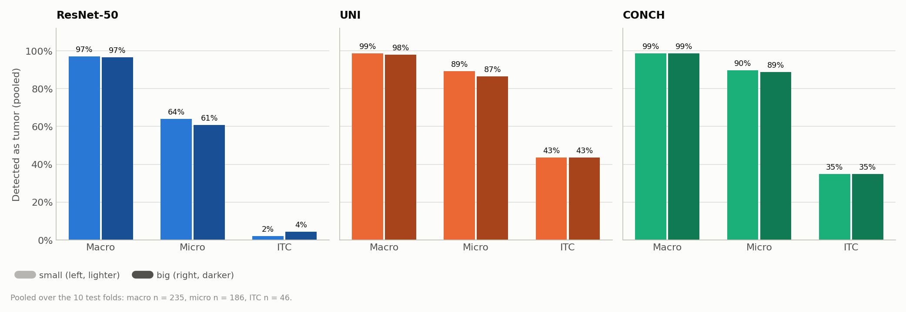
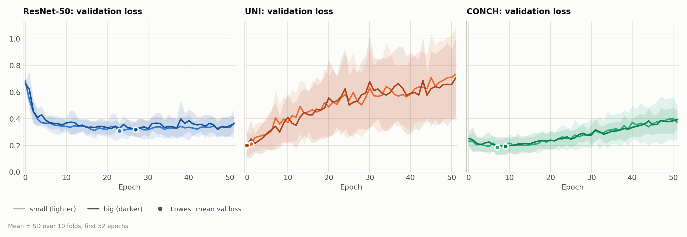

# CLAM-SB on Camelyon+ (2-class): `model_size` big vs. small for ResNet-50, UNI and CONCH (B = 32)

**Runs compared:**

| Encoder | `model_size` | Experiment code | Run date |
|---|---|---|---|
| ResNet-50 | small | `camelyon_plus_2cls_resnet50_CLAM_B32_s1` | 2026-09-29 |
| ResNet-50 | big | `camelyon_plus_2cls_resnet50_CLAM_B32_big_s1` | 2026-10-02 |
| UNI | small | `camelyon_plus_2cls_uni_CLAM_B32_s1` | 2026-09-30 |
| UNI | big | `camelyon_plus_2cls_uni_CLAM_B32_big_s1` | 2026-10-02 |
| CONCH | small | `camelyon_plus_2cls_conch_CLAM_B32_s1` | 2026-10-01 |
| CONCH | big | `camelyon_plus_2cls_conch_CLAM_B32_big_s1` | 2026-10-02 |

The three `small` runs are the ones described in `encoder_comparison_B32_report.md` and in each run's `experiment_report.md`. The three `big` runs were trained one after another with `run_model_size_big.sh`. All six are our own runs.

## 1. Summary

| Test AUC (mean ± SD, 10 folds) | small | big | big − small (paired) | p |
|---|---|---|---|---|
| ResNet-50 | 0.9029 ± 0.0280 | 0.9018 ± 0.0288 | −0.0011 | 0.70 |
| UNI | 0.9593 ± 0.0190 | 0.9642 ± 0.0173 | +0.0048 | 0.32 |
| CONCH | 0.9572 ± 0.0140 | 0.9558 ± 0.0166 | −0.0015 | 0.32 |

- **`model_size big` does not improve performance for any encoder.** All AUC differences are 0.005 or smaller and not significant. The 95% confidence intervals of the paired differences include zero for every metric of ResNet-50 and CONCH.
- **For UNI, big is slightly ahead on AUC but behind on threshold-based metrics.** AUC is +0.005, better in 7 of 10 folds (p = 0.32). At the 0.5 threshold, big is worse: accuracy −0.010, balanced accuracy −0.009, F1 −0.014, with p = 0.014–0.049. None of these differences survives a correction for the 33 tests in this report (see [Section 5](#5-paired-comparison-big--small)). The pattern points to a shift in score calibration rather than better or worse ranking.
- **The models barely change.** For each encoder, small and big predict the same class for 95.5–97.6% of the test predictions. The detection rates by metastasis size are within a few slides of each other.
- **Training behavior and cost are essentially unchanged.** The best epochs, the overfitting pattern of UNI and CONCH, and the time per epoch stay the same. big adds about 131,000 parameters per model (+17% for 1024-d features, +25% for CONCH).
- **The encoder ranking is unchanged.** With big, UNI and CONCH still beat ResNet-50 on AUC in all 10 folds (p = 0.002), and UNI and CONCH remain tied (AUC difference +0.008, 5 of 10 folds, p = 0.49).

## 2. Setup

### What is the same in all six runs

| Setting | Value |
|---|---|
| Task | Camelyon+ 2-class (negative vs. tumor), 1350 slides (871 negative, 479 tumor: 251 macro, 174 micro, 54 ITC), 586 cases |
| Splits | `splits/camelyon_plus_2cls_100`: 10-fold Monte Carlo CV, 80 / 10 / 10, patient-stratified. Identical files for all six runs |
| Seed | 1 |
| Model | CLAM-SB, dropout 0.25 |
| Optimizer | Adam, lr 2e-4, weight decay 1e-5 |
| Loss | 0.7 × cross-entropy (bag) + 0.3 × smooth top-1 SVM (instance), B = 32 |
| Class imbalance | `--weighted_sample` |
| Early stopping | Validation loss, patience 20, minimum 50 epochs, maximum 200. The checkpoint with the lowest validation loss is tested |
| Features | Provided Camelyon+ features: ResNet-50 and UNI 1024-d, CONCH 512-d |
| Hardware | 1 × NVIDIA GeForce RTX 3090 (24 GB) |

### What differs: `--model_size`

| | small | big |
|---|---|---|
| CLAM layer widths `[input, fc, attention]` | `[embed_dim, 512, 256]` | `[embed_dim, 512, 384]` |
| What changes | — | Only the hidden dimension of the gated attention network (256 → 384). The first fully connected layer, the bag classifier and the instance classifiers are identical |
| Parameters per model, 1024-d input (ResNet-50, UNI) | 790,791 | 922,247 (+16.6%) |
| Parameters per model, 512-d input (CONCH) | 528,647 | 660,103 (+24.9%) |

Training command of the big runs (from `run_model_size_big.sh`). The small runs used the same command without `--model_size big`, since small is the default:

```bash
CUDA_VISIBLE_DEVICES=0 python main.py --drop_out 0.25 --early_stopping --lr 2e-4 --k 10 --weighted_sample \
  --bag_loss ce --inst_loss svm --task camelyon_plus_2cls --model_type clam_sb --model_size big --log_data \
  --data_root_dir /var/tmp/shouteng_data/CLAM_DATA --B 32 \
  --exp_code camelyon_plus_2cls_<encoder>_CLAM_B32_big --feature_dir camelyon_plus_<encoder> --embed_dim <1024|512>
```

### Metrics

- The positive class is `tumor`. Threshold-based metrics use argmax, which for two classes is a 0.5 probability threshold.
- All metrics are computed per fold from `split_{k}_results.pkl` and reported as mean ± SD (sample SD, ddof = 1) over the 10 folds.
- All six runs share the same test set in every fold, so big and small are compared with paired tests: the two-sided exact Wilcoxon signed-rank test over the 10 folds. Its smallest possible p is 0.002, reached when one setting wins all 10 folds.

## 3. Overall Test Performance

| Metric | ResNet-50 small | ResNet-50 big | UNI small | UNI big | CONCH small | CONCH big |
|---|---|---|---|---|---|---|
| AUC | 0.9029 ± 0.0280 | 0.9018 ± 0.0288 | 0.9593 ± 0.0190 | 0.9642 ± 0.0173 | 0.9572 ± 0.0140 | 0.9558 ± 0.0166 |
| Accuracy | 0.8771 ± 0.0320 | 0.8739 ± 0.0370 | 0.9376 ± 0.0208 | 0.9279 ± 0.0210 | 0.9248 ± 0.0187 | 0.9277 ± 0.0213 |
| Balanced accuracy | 0.8489 ± 0.0325 | 0.8430 ± 0.0424 | 0.9289 ± 0.0214 | 0.9195 ± 0.0232 | 0.9180 ± 0.0178 | 0.9186 ± 0.0249 |
| Sensitivity | 0.7438 ± 0.0524 | 0.7294 ± 0.0705 | 0.8954 ± 0.0347 | 0.8827 ± 0.0551 | 0.8892 ± 0.0288 | 0.8835 ± 0.0473 |
| Specificity | 0.9539 ± 0.0359 | 0.9567 ± 0.0386 | 0.9625 ± 0.0231 | 0.9563 ± 0.0261 | 0.9468 ± 0.0320 | 0.9536 ± 0.0222 |
| Precision (tumor) | 0.9056 ± 0.0695 | 0.9085 ± 0.0787 | 0.9317 ± 0.0409 | 0.9199 ± 0.0470 | 0.9034 ± 0.0586 | 0.9161 ± 0.0406 |
| F1 (tumor) | 0.8148 ± 0.0449 | 0.8066 ± 0.0609 | 0.9125 ± 0.0270 | 0.8989 ± 0.0281 | 0.8950 ± 0.0281 | 0.8985 ± 0.0313 |
| F1 (macro) | 0.8612 ± 0.0343 | 0.8562 ± 0.0431 | 0.9318 ± 0.0219 | 0.9214 ± 0.0223 | 0.9181 ± 0.0209 | 0.9210 ± 0.0235 |
| mAP (macro) | 0.8977 ± 0.0393 | 0.8979 ± 0.0336 | 0.9539 ± 0.0269 | 0.9578 ± 0.0216 | 0.9532 ± 0.0204 | 0.9517 ± 0.0234 |
| Pooled AUC (1284 predictions) | 0.8988 | 0.8942 | 0.9539 | 0.9574 | 0.9563 | 0.9503 |



*Figure 1. Test metrics (mean ± SD over 10 folds) for small (lighter bar) and big (darker bar) for each encoder. The y-axis starts at 0.6. Within each encoder the bars are practically the same height. The SD bars of big are slightly longer for ResNet-50 sensitivity and for UNI sensitivity.*

## 4. Per-Fold Test AUC

| Fold | 0 | 1 | 2 | 3 | 4 | 5 | 6 | 7 | 8 | 9 | Folds big better |
|---|---|---|---|---|---|---|---|---|---|---|---|
| ResNet-50 small | 0.9166 | 0.9297 | 0.9203 | 0.9028 | 0.9314 | 0.9128 | 0.8670 | 0.9216 | 0.8536 | 0.8732 | |
| ResNet-50 big | 0.9063 | 0.9326 | 0.9044 | 0.9173 | 0.9327 | 0.9024 | 0.8924 | 0.9184 | 0.8373 | 0.8742 | 5 / 10 |
| UNI small | 0.9648 | 0.9606 | 0.9844 | 0.9271 | 0.9447 | 0.9664 | 0.9654 | 0.9829 | 0.9636 | 0.9334 | |
| UNI big | 0.9693 | 0.9821 | 0.9784 | 0.9442 | 0.9619 | 0.9521 | 0.9467 | 0.9913 | 0.9734 | 0.9424 | 7 / 10 |
| CONCH small | 0.9482 | 0.9608 | 0.9821 | 0.9478 | 0.9645 | 0.9667 | 0.9457 | 0.9706 | 0.9354 | 0.9507 | |
| CONCH big | 0.9398 | 0.9840 | 0.9740 | 0.9364 | 0.9636 | 0.9647 | 0.9537 | 0.9577 | 0.9321 | 0.9517 | 3 / 10 |



*Figure 2. Test AUC of small (left, lighter) and big (right, darker) in each fold, on the same test set. The changes go in both directions and are mostly smaller than the differences between folds. The largest single-fold changes are about ±0.02 (for example ResNet-50 fold 6: +0.025, CONCH fold 1: +0.023, UNI fold 1: +0.022, UNI fold 6: −0.019).*

## 5. Paired Comparison: big − small

Mean ± SD of the per-fold difference (big − small), the number of folds where big is better (with ties), and the Wilcoxon p-value.

| Metric | ResNet-50 | UNI | CONCH |
|---|---|---|---|
| AUC | −0.0011 ± 0.0133, 5/10, p = 0.70 | +0.0048 ± 0.0136, 7/10, p = 0.32 | −0.0015 ± 0.0107, 3/10, p = 0.32 |
| Accuracy | −0.0033 ± 0.0178, 4/10 (2 ties), p = 0.55 | **−0.0097 ± 0.0102, 1/10 (1 tie), p = 0.027** | +0.0029 ± 0.0231, 5/10 (1 tie), p = 1.0 |
| Balanced accuracy | −0.0058 ± 0.0186, 4/10 (1 tie), p = 0.57 | **−0.0094 ± 0.0127, 3/10, p = 0.049** | +0.0005 ± 0.0248, 5/10 (1 tie), p = 0.91 |
| Sensitivity | −0.0144 ± 0.0400, 3/10 (3 ties), p = 0.30 | −0.0126 ± 0.0449, 3/10 (2 ties), p = 0.55 | −0.0057 ± 0.0372, 2/10 (6 ties), p = 1.0 |
| Specificity | +0.0028 ± 0.0301, 3/10 (4 ties), p = 0.69 | −0.0063 ± 0.0322, 4/10 (1 tie), p = 0.43 | +0.0068 ± 0.0270, 6/10 (1 tie), p = 0.57 |
| F1 (tumor) | −0.0082 ± 0.0286, 5/10 (1 tie), p = 0.57 | **−0.0136 ± 0.0138, 2/10, p = 0.020** | +0.0036 ± 0.0325, 5/10 (1 tie), p = 0.91 |
| F1 (macro) | −0.0050 ± 0.0206, 5/10 (1 tie), p = 0.65 | **−0.0105 ± 0.0108, 2/10, p = 0.014** | +0.0029 ± 0.0252, 5/10 (1 tie), p = 1.0 |
| mAP (macro) | +0.0003 ± 0.0135, 5/10, p = 1.0 | +0.0039 ± 0.0140, 6/10, p = 0.43 | −0.0015 ± 0.0115, 2/10, p = 0.32 |

Bold marks p < 0.05 without correction for multiple comparisons. This report runs 33 such tests (11 metrics × 3 encoders; precision, positive-class AP and validation AUC were also tested but are not shown). The Bonferroni threshold is therefore 0.05 / 33 ≈ 0.0015. The smallest p here is 0.014, so **no difference survives the correction.** The four bold UNI results all measure the same thing (threshold-based performance) and come from the same 10 folds, so they are not four independent pieces of evidence.



*Figure 3. Mean per-fold difference (big − small) with its 95% confidence interval, on a shared x-axis. Filled markers: Wilcoxon p < 0.05 (uncorrected). For ResNet-50 and CONCH every interval includes zero. For UNI, the threshold-based metrics lean negative, while AUC and mAP lean positive.*

### Agreement between small and big

| | ResNet-50 | UNI | CONCH |
|---|---|---|---|
| Same predicted class (of 1284) | 1232 (96.0%) | 1226 (95.5%) | 1253 (97.6%) |
| Correlation of tumor probabilities | 0.953 | 0.944 | 0.980 |
| small negative → big tumor | 22 | 28 | 11 |
| small tumor → big negative | 30 | 30 | 20 |

## 6. Error Analysis

### Pooled confusion matrices (1284 test predictions)

| | ResNet-50 small | ResNet-50 big | UNI small | UNI big | CONCH small | CONCH big |
|---|---|---|---|---|---|---|
| False positives (of 817 negatives) | 37 | 35 | 31 | 36 | 45 | 38 |
| False negatives (of 467 tumors) | 119 | 125 | 49 | 56 | 52 | 54 |

For UNI, big makes more errors of both kinds at the 0.5 threshold (+5 false positives, +7 false negatives), even though its AUC is slightly higher. This is the threshold effect described in [Section 1](#1-summary).

### Sensitivity by metastasis size (pooled)

| Subtype | ResNet-50 small | ResNet-50 big | UNI small | UNI big | CONCH small | CONCH big |
|---|---|---|---|---|---|---|
| Macro (235) | 0.970 (228) | 0.966 (227) | 0.987 (232) | 0.979 (230) | 0.987 (232) | 0.987 (232) |
| Micro (186) | 0.640 (119) | 0.608 (113) | 0.892 (166) | 0.866 (161) | 0.898 (167) | 0.887 (165) |
| ITC (46) | 0.022 (1) | 0.043 (2) | 0.435 (20) | 0.435 (20) | 0.348 (16) | 0.348 (16) |



*Figure 4. Share of tumor slides detected, by metastasis size, pooled over the 10 test folds. A larger attention network does not help with the small lesions: ITC detection is identical for UNI and CONCH, and micro-metastasis detection is 2–6 slides lower with big for every encoder.*

## 7. Training Dynamics

| | ResNet-50 small | ResNet-50 big | UNI small | UNI big | CONCH small | CONCH big |
|---|---|---|---|---|---|---|
| Best val-loss epoch, mean (range) | 33.8 (17–50) | 34.6 (18–58) | 4.8 (0–22) | 2.0 (0–12) | 8.2 (2–17) | 7.2 (3–10) |
| Total epochs (10 folds) | 588 | 593 | 520 | 520 | 520 | 520 |
| Val loss at last epoch, mean | 0.370 | 0.361 | 0.733 | 0.706 | 0.372 | 0.393 |
| Train loss at last epoch, mean | 0.245 | 0.237 | 0.004 | 0.007 | 0.053 | 0.048 |
| Mean val AUC | 0.9234 | 0.9230 | 0.9763 | 0.9757 | 0.9771 | 0.9690 |
| Correlation of val AUC and test AUC across folds | −0.56 | −0.26 | −0.27 | −0.47 | −0.20 | −0.33 |



*Figure 5. Mean ± SD of the validation loss over 10 folds (first 52 epochs) for small (lighter) and big (darker). The curves almost coincide for every encoder. UNI overfits right from the start in both sizes, CONCH more mildly, and ResNet-50 converges slowly in both.*

- The larger attention network does not change how the models train. ResNet-50 still needs about 20–60 epochs, and UNI and CONCH still reach their best validation loss within the first few epochs and then overfit.
- For UNI, big reaches its lowest validation loss even earlier (mean epoch 2.0; 4 folds at epoch 0). This fits the observation in the encoder report that the shared learning rate is high for foundation-model features. A larger model does not counteract that.
- For CONCH, the mean validation AUC of big is lower than that of small (0.9690 vs. 0.9771; small better in 7 of 10 folds, p = 0.037). This is a validation-set effect and does not appear on the test set.

## 8. Computational Cost

| | ResNet-50 small | ResNet-50 big | UNI small | UNI big | CONCH small | CONCH big |
|---|---|---|---|---|---|---|
| Parameters per model | 790,791 | 922,247 | 790,791 | 922,247 | 528,647 | 660,103 |
| Time per epoch | 17.5 s | 17.7 s | 17.7 s | 17.7 s | 11.3 s | 11.6 s |
| Total training time (10 folds) | 2 h 51 min | 2 h 55 min | 2 h 34 min | 2 h 33 min | 1 h 38 min | 1 h 40 min |

The extra attention parameters cost at most 0.3 s per epoch, because training time is dominated by loading the feature files. The 4-minute difference for ResNet-50 comes mostly from 5 more epochs in total (593 vs. 588).

## 9. Encoder Comparison with `model_size big`

Paired comparisons among the three big runs (same splits):

| Metric | ResNet-50 big − UNI big | ResNet-50 big − CONCH big | UNI big − CONCH big |
|---|---|---|---|
| AUC | −0.0624, UNI better 10/10, p = 0.002 | −0.0540, CONCH better 10/10, p = 0.002 | +0.0084, 5/10, p = 0.49 |
| Balanced accuracy | −0.0765, 10/10, p = 0.002 | −0.0755, 10/10, p = 0.002 | +0.0009, 5/10, p = 0.77 |
| Sensitivity | −0.1534, 10/10, p = 0.002 | −0.1541, 10/10, p = 0.002 | −0.0008, 6/10, p = 0.85 |
| Specificity | +0.0004, p = 0.98 | +0.0031, p = 0.98 | +0.0026, p = 1.0 |

The conclusions of `encoder_comparison_B32_report.md` hold with big as well. Both foundation models are far better than ResNet-50, entirely through sensitivity, and UNI and CONCH remain statistically indistinguishable.

## 10. Conclusions

1. **Keep `model_size small`.** Widening the attention network from 256 to 384 brings no measurable benefit for ResNet-50, UNI or CONCH. All AUC changes are within ±0.005 and not significant, and no metric differs significantly after correcting for multiple comparisons. small is also the configuration all earlier reports use, so results stay comparable.
2. **The attention width is not the bottleneck on this task.** The models make nearly the same predictions (96–98% agreement) and the same errors, including the missed ITCs and micro-metastases. Gains are more likely to come from the training setup, such as the learning rate and regularization for foundation-model features, or from the features themselves, than from model capacity.
3. **The UNI threshold effect is worth noting but not acting on.** big ranks slightly better (AUC +0.005) but is calibrated slightly worse for the 0.5 threshold (accuracy −0.010). Neither effect is reliable over 10 folds.

### Limitations

- One seed per configuration. Differences of ±0.005 AUC are within what a different initialization could produce, and seed variance was not measured.
- Only the attention width was changed. Other capacity settings, such as the 512-unit first layer or `clam_mb`, were not tested.
- Hyperparameters were the same as for small and were not re-tuned for the larger model.

### Possible next steps

- Tune the learning rate and weight decay for UNI and CONCH, using the validation set only. Both overfit within a few epochs in either model size.
- If capacity is revisited, test the first fully connected layer (`size[1]`) or `clam_mb` rather than the attention width.

## Figures

All figures are in `results/figures/` (files starting with `size_`) and are generated from the saved predictions and TensorBoard logs by `results/make_report_figures.py`:

```bash
python results/make_report_figures.py
```

To re-evaluate a big checkpoint, `eval.py` needs `--model_size big` in addition to `--feature_dir` and `--embed_dim`. Otherwise the checkpoint does not load.
