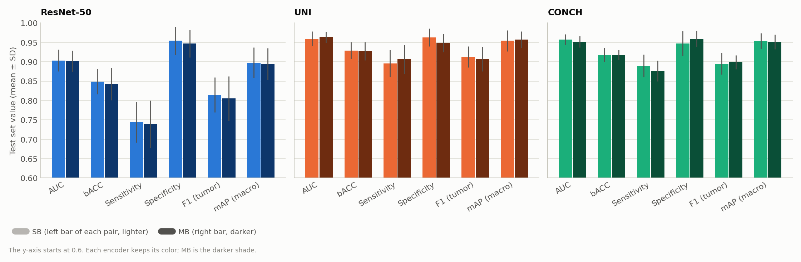
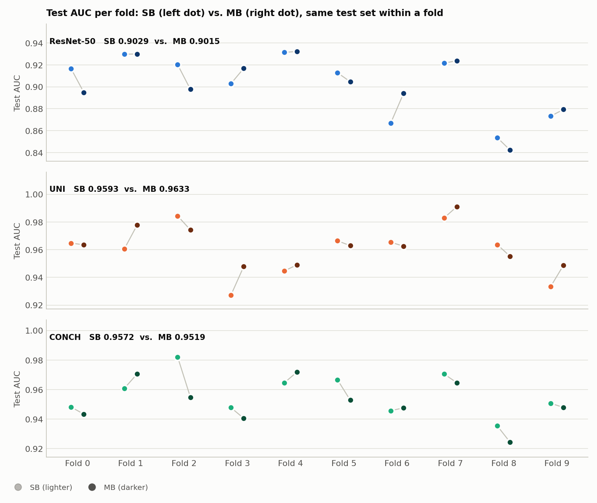
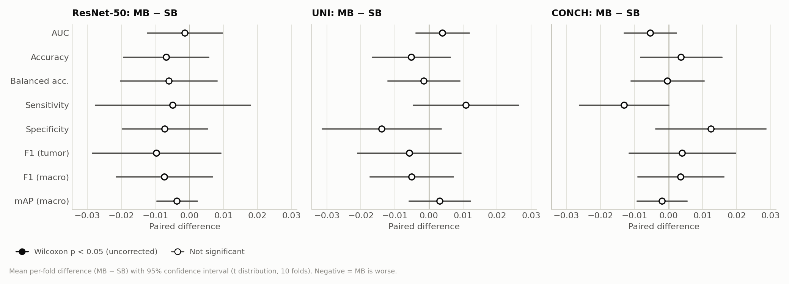
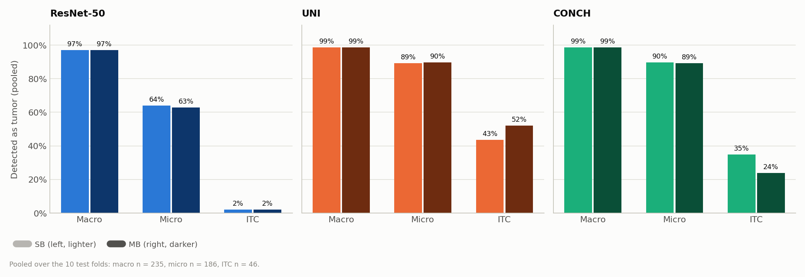
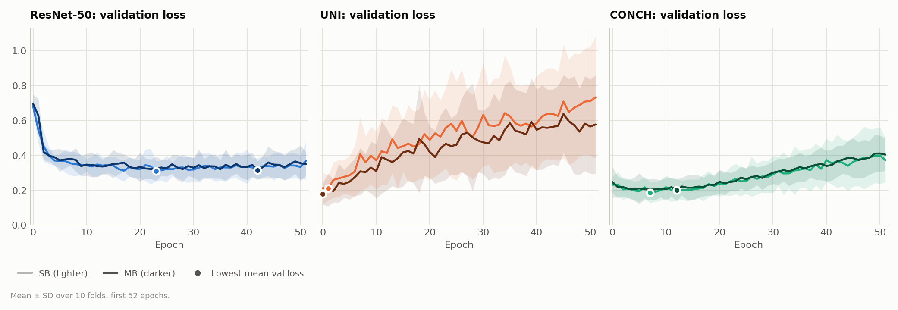

# CLAM on Camelyon+ (2-class): CLAM-MB vs. CLAM-SB for ResNet-50, UNI and CONCH (B = 32, small)

**Runs compared:**

| Encoder | Model | Experiment code | Run date |
|---|---|---|---|
| ResNet-50 | CLAM-SB | `camelyon_plus_2cls_resnet50_CLAM_B32_s1` | 2026-09-29 |
| ResNet-50 | CLAM-MB | `camelyon_plus_2cls_resnet50_CLAM_MB_B32_s1` | 2026-10-06 |
| UNI | CLAM-SB | `camelyon_plus_2cls_uni_CLAM_B32_s1` | 2026-09-30 |
| UNI | CLAM-MB | `camelyon_plus_2cls_uni_CLAM_MB_B32_s1` | 2026-10-06 |
| CONCH | CLAM-SB | `camelyon_plus_2cls_conch_CLAM_B32_s1` | 2026-10-01 |
| CONCH | CLAM-MB | `camelyon_plus_2cls_conch_CLAM_MB_B32_s1` | 2026-10-06 |

The CLAM-SB runs are the ones described in `encoder_comparison_B32_report.md`. The CLAM-MB runs were trained one after another with `run_mb_and_threshold.sh`. All six are our own runs. The threshold analysis that ran in the same script is reported separately in `threshold_analysis_report.md`.

## 1. Summary

| Test AUC (mean ± SD, 10 folds) | CLAM-SB | CLAM-MB | MB − SB (paired) | p |
|---|---|---|---|---|
| ResNet-50 | 0.9029 ± 0.0280 | 0.9015 ± 0.0271 | −0.0013 | 1.0 |
| UNI | 0.9593 ± 0.0190 | 0.9633 ± 0.0142 | +0.0040 | 0.43 |
| CONCH | 0.9572 ± 0.0140 | 0.9519 ± 0.0146 | −0.0054 | 0.19 |

- **CLAM-MB performs the same as CLAM-SB for all three encoders.** No metric differs significantly for any encoder, even without correction for multiple comparisons. The smallest p is 0.078 (CONCH sensitivity). All AUC differences are within ±0.006, and every 95% confidence interval of the paired differences includes zero.
- **The models make nearly the same predictions.** For each encoder, SB and MB predict the same class for 96.9–97.5% of the test predictions.
- **The only visible difference is ITC detection, and it goes in opposite directions.** UNI with MB detects 24 of 46 ITC predictions (SB: 20). CONCH with MB detects 11 (SB: 16). These counts are too small, and the directions too inconsistent, to support a conclusion.
- **Training behavior and cost are unchanged.** MB adds only 257 parameters per model for this 2-class task. It was 0.3–0.6 s slower per epoch.
- **The encoder ranking holds.** With MB, UNI and CONCH beat ResNet-50 on AUC in all 10 folds (p = 0.002). With MB, UNI is ahead of CONCH more consistently than with SB (AUC +0.011, 9 of 10 folds, p = 0.049). This is a single uncorrected test and should be read as a trend (see [Section 9](#9-encoder-comparison-with-clam-mb)).

## 2. Setup

### What is the same in all six runs

| Setting | Value |
|---|---|
| Task | Camelyon+ 2-class (negative vs. tumor), 1350 slides (871 negative, 479 tumor: 251 macro, 174 micro, 54 ITC), 586 cases |
| Splits | `splits/camelyon_plus_2cls_100`: 10-fold Monte Carlo CV, 80 / 10 / 10, patient-stratified. Identical files for all six runs |
| Seed | 1 |
| Model size | `small` (fc 512, attention hidden dim 256), dropout 0.25 |
| Optimizer | Adam, lr 2e-4, weight decay 1e-5 |
| Loss | 0.7 × cross-entropy (bag) + 0.3 × smooth top-1 SVM (instance), B = 32 |
| Class imbalance | `--weighted_sample` |
| Early stopping | Validation loss, patience 20, minimum 50 epochs, maximum 200. The checkpoint with the lowest validation loss is tested |
| Features | Provided Camelyon+ features: ResNet-50 and UNI 1024-d, CONCH 512-d |
| Hardware | 1 × NVIDIA GeForce RTX 3090 (24 GB) |

### What differs: `--model_type`

| | CLAM-SB (`clam_sb`) | CLAM-MB (`clam_mb`) |
|---|---|---|
| Attention branches | 1, shared by both classes | 1 per class (2 here). Each branch produces its own slide representation |
| Bag classifier | One `Linear(512, 2)` on the single slide representation | One `Linear(512, 1)` per class, each on its own class-specific representation |
| Parameters per model, 1024-d input (ResNet-50, UNI) | 790,791 | 791,048 (+257) |
| Parameters per model, 512-d input (CONCH) | 528,647 | 528,904 (+257) |

For two classes, the extra attention branch is only an extra output column in the last attention layer, plus the split bag classifier. That is why the parameter counts differ by just 257.

Training command of the MB runs (from `run_mb_and_threshold.sh`). The SB runs used the same command with `--model_type clam_sb`:

```bash
CUDA_VISIBLE_DEVICES=0 python main.py --drop_out 0.25 --early_stopping --lr 2e-4 --k 10 --weighted_sample \
  --bag_loss ce --inst_loss svm --task camelyon_plus_2cls --model_type clam_mb --model_size small --log_data \
  --data_root_dir /var/tmp/shouteng_data/CLAM_DATA --B 32 \
  --exp_code camelyon_plus_2cls_<encoder>_CLAM_MB_B32 --feature_dir camelyon_plus_<encoder> --embed_dim <1024|512>
```

### Metrics

- The positive class is `tumor`. Threshold-based metrics use argmax, which for two classes is a 0.5 probability threshold.
- All metrics are computed per fold from `split_{k}_results.pkl` and reported as mean ± SD (sample SD, ddof = 1) over the 10 folds.
- All six runs share the same test set in every fold, so SB and MB are compared with paired tests: the two-sided exact Wilcoxon signed-rank test over the 10 folds. Its smallest possible p is 0.002.

## 3. Overall Test Performance

| Metric | ResNet-50 SB | ResNet-50 MB | UNI SB | UNI MB | CONCH SB | CONCH MB |
|---|---|---|---|---|---|---|
| AUC | 0.9029 ± 0.0280 | 0.9015 ± 0.0271 | 0.9593 ± 0.0190 | 0.9633 ± 0.0142 | 0.9572 ± 0.0140 | 0.9519 ± 0.0146 |
| Accuracy | 0.8771 ± 0.0320 | 0.8703 ± 0.0390 | 0.9376 ± 0.0208 | 0.9324 ± 0.0227 | 0.9248 ± 0.0187 | 0.9285 ± 0.0139 |
| Balanced accuracy | 0.8489 ± 0.0325 | 0.8428 ± 0.0417 | 0.9289 ± 0.0214 | 0.9274 ± 0.0236 | 0.9180 ± 0.0178 | 0.9177 ± 0.0127 |
| Sensitivity | 0.7438 ± 0.0524 | 0.7389 ± 0.0612 | 0.8954 ± 0.0347 | 0.9062 ± 0.0370 | 0.8892 ± 0.0288 | 0.8762 ± 0.0268 |
| Specificity | 0.9539 ± 0.0359 | 0.9467 ± 0.0352 | 0.9625 ± 0.0231 | 0.9486 ± 0.0233 | 0.9468 ± 0.0320 | 0.9592 ± 0.0206 |
| Precision (tumor) | 0.9056 ± 0.0695 | 0.8876 ± 0.0714 | 0.9317 ± 0.0409 | 0.9086 ± 0.0453 | 0.9034 ± 0.0586 | 0.9246 ± 0.0389 |
| F1 (tumor) | 0.8148 ± 0.0449 | 0.8052 ± 0.0575 | 0.9125 ± 0.0270 | 0.9067 ± 0.0317 | 0.8950 ± 0.0281 | 0.8990 ± 0.0179 |
| F1 (macro) | 0.8612 ± 0.0343 | 0.8538 ± 0.0432 | 0.9318 ± 0.0219 | 0.9267 ± 0.0246 | 0.9181 ± 0.0209 | 0.9216 ± 0.0143 |
| mAP (macro) | 0.8977 ± 0.0393 | 0.8940 ± 0.0407 | 0.9539 ± 0.0269 | 0.9571 ± 0.0214 | 0.9532 ± 0.0204 | 0.9513 ± 0.0191 |
| Pooled AUC (1284 predictions) | 0.8988 | 0.8953 | 0.9539 | 0.9588 | 0.9563 | 0.9487 |



*Figure 1. Test metrics (mean ± SD over 10 folds) for CLAM-SB (lighter bar) and CLAM-MB (darker bar) for each encoder. The y-axis starts at 0.6. The bars are practically the same height. The small shifts (UNI: MB slightly more sensitive and less specific; CONCH: the reverse) are well within the SD.*

## 4. Per-Fold Test AUC

| Fold | 0 | 1 | 2 | 3 | 4 | 5 | 6 | 7 | 8 | 9 | Folds MB better |
|---|---|---|---|---|---|---|---|---|---|---|---|
| ResNet-50 SB | 0.9166 | 0.9297 | 0.9203 | 0.9028 | 0.9314 | 0.9128 | 0.8670 | 0.9216 | 0.8536 | 0.8732 | |
| ResNet-50 MB | 0.8949 | 0.9300 | 0.8977 | 0.9168 | 0.9322 | 0.9046 | 0.8940 | 0.9238 | 0.8422 | 0.8793 | 6 / 10 |
| UNI SB | 0.9648 | 0.9606 | 0.9844 | 0.9271 | 0.9447 | 0.9664 | 0.9654 | 0.9829 | 0.9636 | 0.9334 | |
| UNI MB | 0.9636 | 0.9778 | 0.9743 | 0.9478 | 0.9490 | 0.9629 | 0.9625 | 0.9911 | 0.9552 | 0.9487 | 5 / 10 |
| CONCH SB | 0.9482 | 0.9608 | 0.9821 | 0.9478 | 0.9645 | 0.9667 | 0.9457 | 0.9706 | 0.9354 | 0.9507 | |
| CONCH MB | 0.9434 | 0.9706 | 0.9548 | 0.9406 | 0.9719 | 0.9528 | 0.9476 | 0.9646 | 0.9244 | 0.9479 | 3 / 10 |



*Figure 2. Test AUC of CLAM-SB (left, lighter) and CLAM-MB (right, darker) in each fold, on the same test set. The changes go in both directions. The largest single-fold changes are about ±0.027 (ResNet-50 fold 6: +0.027, CONCH fold 2: −0.027, ResNet-50 fold 2: −0.023, UNI fold 3: +0.021). That is the same size as the changes seen when switching model_size (see `model_size_big_vs_small_B32_report.md`), which suggests that this is the run-to-run noise level of a single training run per fold.*

## 5. Paired Comparison: MB − SB

Mean ± SD of the per-fold difference (MB − SB), the number of folds where MB is better (with ties), and the Wilcoxon p-value.

| Metric | ResNet-50 | UNI | CONCH |
|---|---|---|---|
| AUC | −0.0013 ± 0.0154, 6/10, p = 1.0 | +0.0040 ± 0.0110, 5/10, p = 0.43 | −0.0054 ± 0.0108, 3/10, p = 0.19 |
| Accuracy | −0.0069 ± 0.0175, 3/10 (2 ties), p = 0.25 | −0.0052 ± 0.0161, 3/10 (1 tie), p = 0.36 | +0.0037 ± 0.0167, 5/10 (1 tie), p = 0.50 |
| Balanced accuracy | −0.0061 ± 0.0198, 4/10 (2 ties), p = 0.64 | −0.0015 ± 0.0148, 4/10, p = 0.92 | −0.0003 ± 0.0151, 5/10, p = 1.0 |
| Sensitivity | −0.0049 ± 0.0319, 2/10 (6 ties), p = 0.63 | +0.0108 ± 0.0216, 4/10 (5 ties), p = 0.31 | −0.0131 ± 0.0184, 1/10 (3 ties), p = 0.078 |
| Specificity | −0.0072 ± 0.0175, 2/10 (2 ties), p = 0.23 | −0.0139 ± 0.0245, 3/10 (1 tie), p = 0.13 | +0.0124 ± 0.0227, 6/10 (1 tie), p = 0.25 |
| F1 (tumor) | −0.0097 ± 0.0264, 3/10 (2 ties), p = 0.40 | −0.0058 ± 0.0213, 3/10, p = 0.43 | +0.0040 ± 0.0219, 5/10, p = 0.70 |
| F1 (macro) | −0.0074 ± 0.0198, 3/10 (2 ties), p = 0.46 | −0.0051 ± 0.0171, 3/10, p = 0.43 | +0.0035 ± 0.0176, 5/10, p = 0.63 |
| mAP (macro) | −0.0036 ± 0.0083, 3/10, p = 0.19 | +0.0031 ± 0.0126, 5/10, p = 0.56 | −0.0019 ± 0.0103, 4/10, p = 0.70 |

No difference reaches p < 0.05. This also holds for precision, positive-class AP and validation AUC, which were tested but are not shown.



*Figure 3. Mean per-fold difference (MB − SB) with its 95% confidence interval, on a shared x-axis. Every interval includes zero.*

### Agreement between SB and MB

| | ResNet-50 | UNI | CONCH |
|---|---|---|---|
| Same predicted class (of 1284) | 1252 (97.5%) | 1244 (96.9%) | 1245 (97.0%) |
| Correlation of tumor probabilities | 0.978 | 0.959 | 0.972 |
| SB negative → MB tumor | 18 | 28 | 11 |
| SB tumor → MB negative | 14 | 12 | 28 |

The flips explain the small shifts in Section 3. For UNI, MB moves 28 predictions toward tumor and only 12 away from it (more sensitive, less specific). For CONCH it is the other way round (11 toward, 28 away).

## 6. Error Analysis

### Pooled confusion matrices (1284 test predictions)

| | ResNet-50 SB | ResNet-50 MB | UNI SB | UNI MB | CONCH SB | CONCH MB |
|---|---|---|---|---|---|---|
| False positives (of 817 negatives) | 37 | 43 | 31 | 42 | 45 | 34 |
| False negatives (of 467 tumors) | 119 | 121 | 49 | 44 | 52 | 58 |

### Sensitivity by metastasis size (pooled)

| Subtype | ResNet-50 SB | ResNet-50 MB | UNI SB | UNI MB | CONCH SB | CONCH MB |
|---|---|---|---|---|---|---|
| Macro (235) | 0.970 (228) | 0.970 (228) | 0.987 (232) | 0.987 (232) | 0.987 (232) | 0.987 (232) |
| Micro (186) | 0.640 (119) | 0.629 (117) | 0.892 (166) | 0.898 (167) | 0.898 (167) | 0.892 (166) |
| ITC (46) | 0.022 (1) | 0.022 (1) | 0.435 (20) | 0.522 (24) | 0.348 (16) | 0.239 (11) |



*Figure 4. Share of tumor slides detected, by metastasis size, pooled over the 10 test folds. Macro- and micro-metastasis detection is unchanged within 2 slides. ITC detection moves by 4–5 slides, up for UNI and down for CONCH. This mirrors the overall sensitivity shift of each encoder (Section 5) and does not show a consistent effect of the class-specific attention.*

The ITC counts come from 46 pooled predictions, with 2–9 per fold, and the pooled predictions include repeated slides. A change of 4–5 detections is therefore within the noise, and the opposite directions for UNI and CONCH argue against a real effect of MB on small lesions.

## 7. Training Dynamics

| | ResNet-50 SB | ResNet-50 MB | UNI SB | UNI MB | CONCH SB | CONCH MB |
|---|---|---|---|---|---|---|
| Best val-loss epoch, mean (range) | 33.8 (17–50) | 37.0 (20–93) | 4.8 (0–22) | 1.8 (0–5) | 8.2 (2–17) | 7.7 (3–15) |
| Total epochs (10 folds) | 588 | 619 | 520 | 520 | 520 | 520 |
| Val loss at last epoch, mean | 0.370 | 0.346 | 0.733 | 0.577 | 0.372 | 0.404 |
| Train loss at last epoch, mean | 0.245 | 0.243 | 0.004 | 0.005 | 0.053 | 0.042 |
| Mean val AUC | 0.9234 | 0.9228 | 0.9763 | 0.9811 | 0.9771 | 0.9733 |
| Correlation of val AUC and test AUC across folds | −0.56 | −0.35 | −0.27 | −0.44 | −0.20 | −0.21 |



*Figure 5. Mean ± SD of the validation loss over 10 folds (first 52 epochs) for CLAM-SB (lighter) and CLAM-MB (darker). The curves follow each other closely. UNI-MB overfits a little less steeply than UNI-SB (mean val loss at the last epoch 0.58 vs. 0.73), but the best checkpoint still comes within the first 5 epochs.*

- The training pattern of each encoder is unchanged: ResNet-50 converges slowly, while UNI and CONCH reach their best validation loss within a few epochs and then overfit.
- ResNet-50 MB fold 0 trained for 114 epochs (best epoch 93), the longest fold in any run so far. Its test AUC (0.8949) is lower than SB's (0.9166), so training longer did not pay off there.

## 8. Computational Cost

| | ResNet-50 SB | ResNet-50 MB | UNI SB | UNI MB | CONCH SB | CONCH MB |
|---|---|---|---|---|---|---|
| Parameters per model | 790,791 | 791,048 | 790,791 | 791,048 | 528,647 | 528,904 |
| Time per epoch | 17.5 s | 18.1 s | 17.7 s | 18.0 s | 11.3 s | 11.9 s |
| Total training time (10 folds) | 2 h 51 min | 3 h 7 min | 2 h 34 min | 2 h 36 min | 1 h 38 min | 1 h 43 min |

MB costs 0.3–0.6 s more per epoch (2–5%). The 16-minute difference for ResNet-50 comes mainly from fold 0, which ran 114 epochs with MB instead of 61 with SB (619 vs. 588 epochs in total).

## 9. Encoder Comparison with CLAM-MB

Paired comparisons among the three MB runs (same splits):

| Metric | ResNet-50 MB − UNI MB | ResNet-50 MB − CONCH MB | UNI MB − CONCH MB |
|---|---|---|---|
| AUC | −0.0617, UNI better 10/10, p = 0.002 | −0.0503, CONCH better 10/10, p = 0.002 | +0.0114, UNI better 9/10, p = 0.049 |
| Balanced accuracy | −0.0846, 10/10, p = 0.002 | −0.0749, 10/10, p = 0.002 | +0.0097, 6/10, p = 0.23 |
| Sensitivity | −0.1673, 10/10, p = 0.002 | −0.1372, 10/10, p = 0.002 | +0.0300, 8/10 (2 ties), p = 0.008 |
| Specificity | −0.0020, p = 0.84 | −0.0125, p = 0.55 | −0.0105, 3/10 (1 tie), p = 0.16 |

- The main conclusion of `encoder_comparison_B32_report.md` holds with MB. Both foundation models beat ResNet-50 in every fold, entirely through sensitivity.
- With MB, UNI pulls slightly ahead of CONCH (AUC +0.011, better in 9 of 10 folds, p = 0.049; sensitivity +0.030, p = 0.008). With SB the two were tied (AUC +0.002, 5 of 10 folds, p = 0.92). This comes partly from UNI gaining a little with MB and CONCH losing a little. Neither change is significant on its own (Section 5). The UNI-vs-CONCH difference under MB would not survive correction for the many comparisons made across these reports, so it is a trend, not evidence that UNI is better.

## 10. Conclusions

1. **CLAM-MB brings no benefit over CLAM-SB on this 2-class task.** For all three encoders, every metric difference is small (AUC within ±0.006) and none is significant. SB is simpler and slightly faster, and it is the configuration used in all earlier reports, so it remains the default.
2. **This is expected for a binary task.** CLAM-MB was designed for multi-class problems, where class-specific attention can focus on different morphology for each class. With only negative vs. tumor, the "negative" branch adds little information. In this setup it amounts to 257 extra parameters and leaves the predictions 97% unchanged. CLAM-MB may be more useful for the 4-class Camelyon+ task (negative / macro / micro / ITC), but this was not tested.
3. **Architecture changes so far (model_size, model_type) all give differences of ±0.005 AUC**, which is about the size of single-fold run-to-run noise. Further gains on this task are more likely to come from training settings (learning rate and regularization for foundation-model features), from the features, or from more seeds to measure the noise level properly.

### Limitations

- One seed per configuration, so run-to-run variance is not measured.
- Only `model_size small` was combined with CLAM-MB.
- The ITC comparison rests on 46 pooled predictions.

### Possible next steps

- Run CLAM-MB on the 4-class Camelyon+ labels, where the class-specific branches have a purpose.
- Repeat one SB configuration with 2–3 additional seeds to estimate the run-to-run noise level against which all of these ±0.005 differences should be judged.

## Figures

All figures are in `results/figures/` (files starting with `mb_`) and are generated by `results/make_report_figures.py`:

```bash
python results/make_report_figures.py
```

To re-evaluate an MB checkpoint, `eval.py` needs `--model_type clam_mb` in addition to `--feature_dir` and `--embed_dim`.
