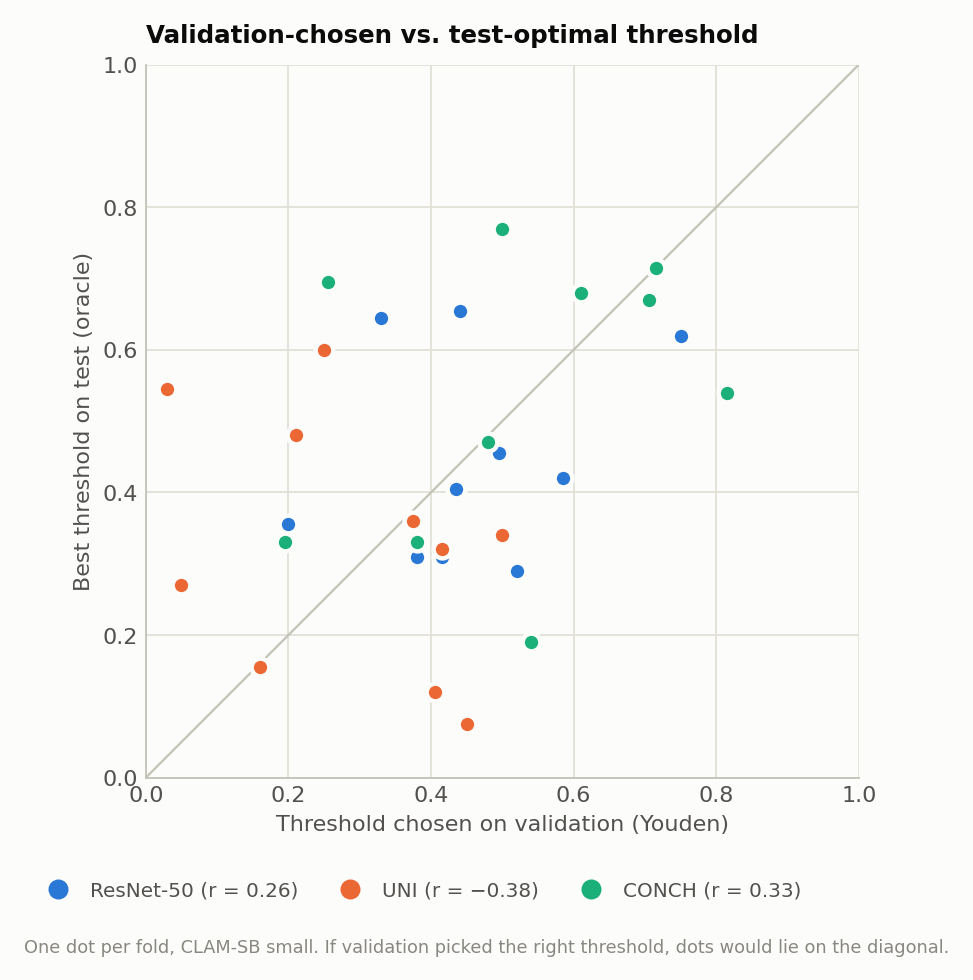
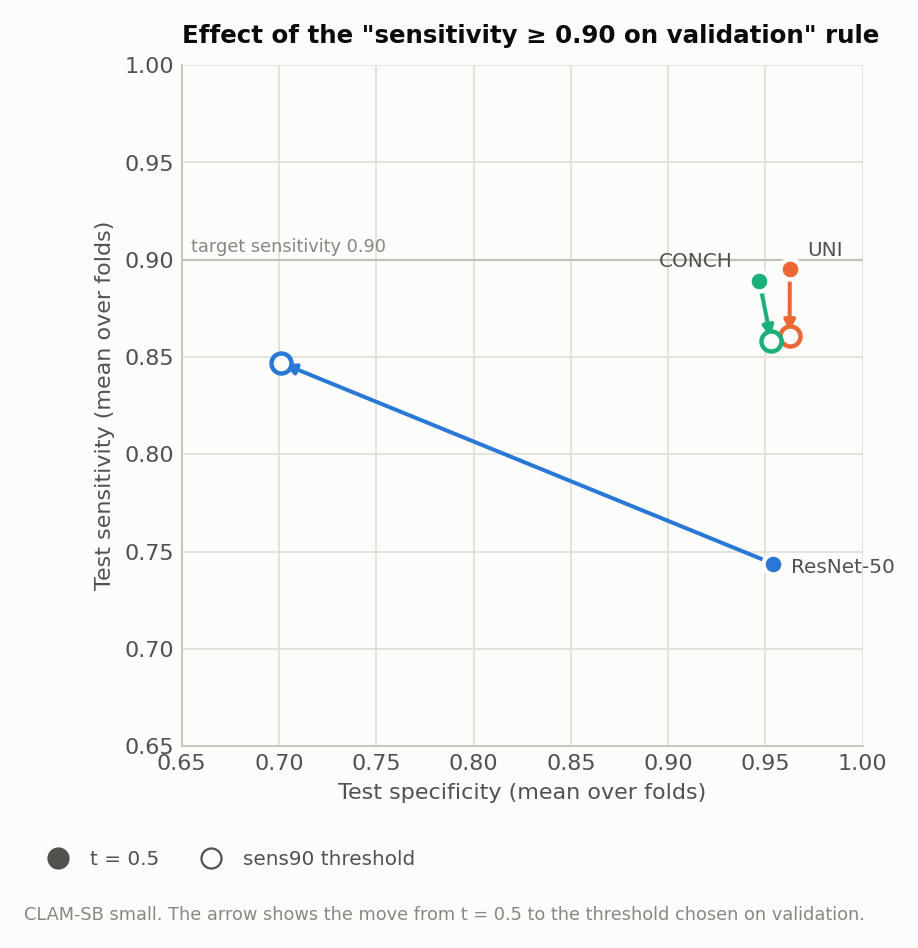

# Decision-Threshold Analysis for CLAM on Camelyon+ (2-class)

**Question:** All earlier reports classify a slide as tumor when P(tumor) > 0.5. Would a different decision threshold give better test performance?

**Runs analyzed** (all existing B = 32 runs, 10-fold Monte Carlo CV, same splits):

| Encoder | CLAM-SB, small | CLAM-SB, big | CLAM-MB, small |
|---|---|---|---|
| ResNet-50 | `camelyon_plus_2cls_resnet50_CLAM_B32_s1` | `camelyon_plus_2cls_resnet50_CLAM_B32_big_s1` | `camelyon_plus_2cls_resnet50_CLAM_MB_B32_s1` |
| UNI | `camelyon_plus_2cls_uni_CLAM_B32_s1` | `camelyon_plus_2cls_uni_CLAM_B32_big_s1` | `camelyon_plus_2cls_uni_CLAM_MB_B32_s1` |
| CONCH | `camelyon_plus_2cls_conch_CLAM_B32_s1` | `camelyon_plus_2cls_conch_CLAM_B32_big_s1` | `camelyon_plus_2cls_conch_CLAM_MB_B32_s1` |

No model was retrained. The analysis ran on 2026-10-06 as the second part of `run_mb_and_threshold.sh`.

## 1. Summary

- **Keep the 0.5 threshold.** A threshold chosen on the validation set did not improve test performance for any of the 9 runs. In 25 of 27 run-and-rule combinations, test balanced accuracy (bACC) was lower than at 0.5, significantly so (p < 0.05) in 7. It was never significantly higher.
- **The validation set cannot locate a better threshold.** The threshold that is best on validation is essentially unrelated to the one that is best on test. Across folds the correlation is between −0.54 and 0.33 for the 9 runs. Each validation set has only 40–52 tumor slides, and for UNI and CONCH the validation AUC is close to 1. Many thresholds therefore look equally good on validation, and which one gets picked is close to random.
- **The headroom is small.** Even the oracle, which picks the best threshold on each test set itself and is not a valid estimate, improves bACC by only 0.006–0.023. The best single fixed threshold for all folds, read off the test curve, improves bACC by at most 0.014 over 0.5. Around 0.5 the bACC curves are flat: between t = 0.3 and 0.65 they stay within about 0.01 of their maximum.
- **Lowering the threshold to reach 90% sensitivity works for ResNet-50 only at a large cost.** The "sensitivity ≥ 0.90 on validation" rule raises ResNet-50 test sensitivity from 0.744 to 0.847 (still below 0.90), but specificity drops from 0.954 to 0.701. For UNI and CONCH the same rule backfires: validation sensitivity is already ≥ 0.90 at high thresholds, so the rule *raises* the threshold, and test sensitivity falls.

## 2. Method

### Choosing thresholds without touching the test set

A threshold picked by looking at test results would inflate the test metrics, which is the same problem as choosing the best folds. The analysis therefore uses each fold's **validation** set to choose the threshold and then applies it unchanged to the fold's **test** set:

1. **Validation predictions.** `main.py` saves only test predictions, so validation predictions were regenerated from the saved checkpoints with `eval.py --split val` into `eval_results/EVAL_<run>_val/fold_{k}.csv`. This is read-only use of `results/` and `splits/`. For all 9 runs and all 10 folds, the regenerated predictions reproduce the validation AUC and accuracy recorded during training exactly (1344 validation predictions per run).
2. **Threshold rules**, each applied per fold on the validation predictions. Thresholds are searched on a grid from 0.01 to 0.99 in steps of 0.01.

| Rule | How the threshold is chosen (on validation) |
|---|---|
| `default` | Fixed at 0.5. This is what all reports so far use |
| `youden` | Maximize sensitivity + specificity − 1, which is the same as maximizing bACC. Ties are broken by the median of the tied thresholds |
| `f1` | Maximize F1 of the tumor class. Ties are broken by the median |
| `sens90` | The highest threshold that still gives sensitivity ≥ 0.90. This is a screening-style rule |
| `oracle_test` | Maximize bACC on the **test** set itself. **Upper bound only**: it uses the test labels and is not a valid performance estimate |

3. **Comparison.** Test metrics are averaged over the 10 folds. Each rule is compared with `default` in a paired test: the per-fold difference and the two-sided exact Wilcoxon signed-rank test (smallest possible p = 0.002).

Code: `threshold_analysis.py`. Outputs: `results/threshold_analysis/` (`summary.md` has the full tables for all 9 runs and 6 metrics, `per_fold.csv` the per-fold values, `curves.csv` the test metrics per fixed threshold).

## 3. Results

### Change in test balanced accuracy versus t = 0.5

Each cell gives the mean per-fold change in test bACC, the number of folds where the rule is better (ties count as not better), and the Wilcoxon p. Bold marks p < 0.05, without correction for multiple comparisons.

| Run | bACC at t = 0.5 | Youden (val) | max F1 (val) | sens ≥ 0.90 (val) | Oracle (test, upper bound) |
|---|---|---|---|---|---|
| ResNet-50, SB small | 0.8489 | −0.0114 (2/10, p = 0.15) | −0.0093 (2/10, p = 0.22) | **−0.0749 (2/10, p = 0.0098)** | **+0.0192 (10/10, p = 0.002)** |
| UNI, SB small | 0.9289 | −0.0058 (2/10, p = 0.31) | −0.0058 (2/10, p = 0.31) | **−0.0173 (0/10, p = 0.016)** | **+0.0092 (7/10, p = 0.016)** |
| CONCH, SB small | 0.9180 | −0.0025 (4/10, p = 0.95) | −0.0012 (4/10, p = 0.81) | −0.0124 (3/10, p = 0.084) | **+0.0125 (8/10, p = 0.0078)** |
| ResNet-50, SB big | 0.8430 | −0.0146 (2/10, p = 0.078) | −0.0146 (2/10, p = 0.078) | **−0.0478 (1/10, p = 0.020)** | **+0.0210 (9/10, p = 0.0039)** |
| UNI, SB big | 0.9195 | +0.0073 (6/10, p = 0.11) | +0.0037 (5/10, p = 0.74) | −0.0079 (5/10, p = 0.43) | **+0.0231 (10/10, p = 0.002)** |
| CONCH, SB big | 0.9186 | −0.0010 (2/10, p = 0.84) | −0.0003 (2/10, p = 0.84) | **−0.0147 (0/10, p = 0.031)** | +0.0070 (5/10, p = 0.062) |
| ResNet-50, MB | 0.8428 | −0.0043 (2/10, p = 0.20) | **−0.0077 (1/10, p = 0.012)** | −0.0740 (2/10, p = 0.13) | **+0.0232 (10/10, p = 0.002)** |
| UNI, MB | 0.9274 | −0.0047 (3/10, p = 0.31) | −0.0051 (2/10, p = 0.22) | −0.0145 (2/10, p = 0.16) | **+0.0105 (8/10, p = 0.0078)** |
| CONCH, MB | 0.9177 | **−0.0116 (1/10, p = 0.020)** | **−0.0116 (1/10, p = 0.020)** | −0.0207 (1/10, p = 0.062) | **+0.0057 (7/10, p = 0.016)** |

*Figure 1. Mean per-fold change in test bACC relative to t = 0.5, with 95% confidence interval, for each run (rows) and rule (panels). Filled markers: Wilcoxon p < 0.05. The three validation-based rules sit at or below zero for almost every run. Only the oracle, which uses the test labels, is reliably above zero.*

### Full metrics for the CLAM-SB small runs

Mean ± SD over 10 folds. The chosen threshold is given as its mean and range over folds.

| Encoder | Rule | Threshold | Accuracy | bACC | Sensitivity | Specificity | F1 (tumor) |
|---|---|---|---|---|---|---|---|
| ResNet-50 | default | 0.50 | 0.8771 ± 0.0320 | 0.8489 ± 0.0325 | 0.7438 ± 0.0524 | 0.9539 ± 0.0359 | 0.8148 ± 0.0449 |
| | youden | 0.46 (0.20–0.75) | 0.8598 ± 0.0462 | 0.8374 ± 0.0404 | 0.7469 ± 0.0758 | 0.9280 ± 0.0734 | 0.7961 ± 0.0564 |
| | f1 | 0.47 (0.20–0.75) | 0.8624 ± 0.0454 | 0.8396 ± 0.0395 | 0.7469 ± 0.0758 | 0.9323 ± 0.0737 | 0.7990 ± 0.0557 |
| | sens90 | 0.18 (0.07–0.36) | 0.7522 ± 0.1011 | 0.7740 ± 0.0673 | 0.8471 ± 0.0817 | 0.7008 ± 0.1967 | 0.7219 ± 0.0772 |
| | oracle_test | 0.45 (0.29–0.66) | 0.8890 ± 0.0259 | 0.8680 ± 0.0277 | 0.7876 ± 0.0527 | 0.9485 ± 0.0289 | 0.8373 ± 0.0369 |
| UNI | default | 0.50 | 0.9376 ± 0.0208 | 0.9289 ± 0.0214 | 0.8954 ± 0.0347 | 0.9625 ± 0.0231 | 0.9125 ± 0.0270 |
| | youden | 0.28 (0.03–0.50) | 0.9279 ± 0.0192 | 0.9232 ± 0.0185 | 0.9059 ± 0.0372 | 0.9404 ± 0.0299 | 0.9019 ± 0.0220 |
| | f1 | 0.28 (0.03–0.50) | 0.9279 ± 0.0192 | 0.9232 ± 0.0185 | 0.9059 ± 0.0372 | 0.9404 ± 0.0299 | 0.9019 ± 0.0220 |
| | sens90 | 0.66 (0.08–0.99) | 0.9231 ± 0.0379 | 0.9117 ± 0.0394 | 0.8609 ± 0.0844 | 0.9625 ± 0.0394 | 0.8904 ± 0.0509 |
| | oracle_test | 0.33 (0.08–0.60) | 0.9439 ± 0.0168 | 0.9382 ± 0.0156 | 0.9150 ± 0.0226 | 0.9613 ± 0.0227 | 0.9222 ± 0.0211 |
| CONCH | default | 0.50 | 0.9248 ± 0.0187 | 0.9180 ± 0.0178 | 0.8892 ± 0.0288 | 0.9468 ± 0.0320 | 0.8950 ± 0.0281 |
| | youden | 0.52 (0.20–0.81) | 0.9225 ± 0.0227 | 0.9155 ± 0.0217 | 0.8827 ± 0.0565 | 0.9484 ± 0.0412 | 0.8922 ± 0.0297 |
| | f1 | 0.55 (0.26–0.81) | 0.9248 ± 0.0233 | 0.9168 ± 0.0225 | 0.8805 ± 0.0546 | 0.9530 ± 0.0386 | 0.8948 ± 0.0305 |
| | sens90 | 0.61 (0.21–0.88) | 0.9174 ± 0.0268 | 0.9056 ± 0.0288 | 0.8581 ± 0.0704 | 0.9531 ± 0.0471 | 0.8824 ± 0.0383 |
| | oracle_test | 0.54 (0.19–0.77) | 0.9393 ± 0.0141 | 0.9305 ± 0.0135 | 0.8958 ± 0.0326 | 0.9652 ± 0.0245 | 0.9146 ± 0.0190 |

The same tables for the big and MB runs are in `results/threshold_analysis/summary.md`.

## 4. Why the Validation Set Does Not Help

### The test metrics hardly depend on the threshold near 0.5

*Figure 2. Mean test bACC, sensitivity and specificity over the 10 folds for each fixed threshold (CLAM-SB small). This plot is descriptive only, because picking a threshold from it would use the test set. Between t = 0.3 and 0.65, bACC stays within about 0.01 of its maximum for all three encoders (ResNet-50 0.843–0.852, UNI 0.921–0.931, CONCH 0.910–0.919).*

| Run | bACC at t = 0.5 | Best fixed threshold (on test, descriptive) | bACC there | Gain | bACC range over t = 0.3–0.7 |
|---|---|---|---|---|---|
| ResNet-50, SB small | 0.8489 | 0.29 | 0.8523 | +0.003 | 0.834–0.852 |
| UNI, SB small | 0.9289 | 0.29 | 0.9318 | +0.003 | 0.918–0.931 |
| CONCH, SB small | 0.9180 | 0.68 | 0.9207 | +0.003 | 0.910–0.921 |
| ResNet-50, SB big | 0.8430 | 0.38 | 0.8455 | +0.003 | 0.832–0.846 |
| UNI, SB big | 0.9195 | 0.36 | 0.9331 | +0.014 | 0.915–0.933 |
| CONCH, SB big | 0.9186 | 0.45 | 0.9205 | +0.002 | 0.911–0.921 |
| ResNet-50, MB | 0.8428 | 0.36 | 0.8510 | +0.008 | 0.831–0.851 |
| UNI, MB | 0.9274 | 0.52 | 0.9286 | +0.001 | 0.923–0.929 |
| CONCH, MB | 0.9177 | 0.49 | 0.9177 | +0.000 | 0.906–0.918 |

Even with full knowledge of the test labels, one fixed threshold for all folds would gain at most 0.014 bACC. In 8 of the 9 runs the gain is under 0.01. The largest gain, +0.014, is for UNI big, which matches the threshold effect noted in `model_size_big_vs_small_B32_report.md`.

### The validation-optimal threshold does not predict the test-optimal one

*Figure 3. For each fold of the CLAM-SB small runs, the threshold chosen on validation (Youden) against the threshold that is best on that fold's test set. The points scatter widely around the diagonal.*

| Correlation across folds between the val-Youden threshold and the test-oracle threshold | SB small | SB big | MB |
|---|---|---|---|
| ResNet-50 | 0.26 | −0.54 | 0.04 |
| UNI | −0.38 | −0.29 | 0.07 |
| CONCH | 0.33 | −0.46 | 0.26 |

Possible reasons, not tested individually:

- **Small validation sets.** Each fold's validation set has 119–151 slides, with 40–52 tumor slides. One slide more or less on either side of the threshold changes sensitivity by about 2 percentage points, so the validation curve is jagged.
- **Near-perfect validation separation for UNI and CONCH.** Mean validation AUC is 0.97–0.98. When validation tumors and negatives barely overlap, a wide range of thresholds is equally optimal, and the chosen value is set by one or two borderline slides. For UNI SB small, the Youden threshold ranges from 0.03 to 0.50 across folds.
- **Early, overfit checkpoints.** UNI and CONCH checkpoints come from the first few epochs, and their probabilities are pushed toward 0 and 1. Only 8–13% of the UNI and 16–17% of the CONCH validation predictions fall between 0.1 and 0.9, compared with 38–40% for ResNet-50. With so few borderline predictions, the threshold position is poorly constrained.

### The oracle headroom is per-fold noise

The oracle beats 0.5 by 0.006–0.023 bACC, but its threshold changes a lot from fold to fold (for example 0.08–0.60 for UNI SB small). Because the best fixed threshold gains much less than the oracle, most of the oracle's gain comes from fitting each test set's particular borderline slides, not from a systematic miscalibration that a better threshold could fix.

## 5. The Screening Rule (sensitivity ≥ 0.90 on validation)

*Figure 4. Mean test sensitivity and specificity at t = 0.5 (filled) and at the sens90 threshold (open), CLAM-SB small. For ResNet-50 the rule trades about 25 points of specificity for 10 points of sensitivity. For UNI and CONCH it lowers sensitivity.*

- **ResNet-50.** The rule lowers the threshold to 0.18 on average (range 0.07–0.36). Test sensitivity rises from 0.744 to 0.847 (better in 10 of 10 folds) but stays below the 0.90 target, and specificity falls from 0.954 to 0.701. bACC drops by 0.075. The same pattern holds for ResNet-50 big and MB. Reaching high sensitivity with ResNet-50 features therefore costs many false positives. This fits the earlier finding that its missed tumors are mostly micro-metastases and ITCs with low tumor scores.
- **UNI and CONCH.** Validation sensitivity is already ≥ 0.90 at fairly high thresholds, so the rule picks a threshold *above* 0.5 in 6–9 of the 10 folds (mean 0.56–0.68), while for ResNet-50 it stays below 0.5 in every fold. On the test set this lowers sensitivity (UNI SB small 0.895 → 0.861) and does not reach the target. With these small validation sets, a sensitivity target cannot be guaranteed on new data.

## 6. Conclusions

1. **Keep t = 0.5 for all reported results.** No validation-based threshold rule improved test performance for any of the 9 runs, and several made it significantly worse. Continuing with 0.5 also keeps all reports comparable.
2. **The models are reasonably calibrated around 0.5 for this task.** The test bACC curves are flat near 0.5, and the best fixed threshold gains at most 0.014. A different threshold does not fix the main weakness, the missed small metastases: it mostly trades errors between the two classes.
3. **Threshold tuning would need a larger, separate calibration set.** If a specific operating point is needed in the future, such as a guaranteed sensitivity for screening, it should be chosen on more data than one 10% validation split. Options are pooling validation predictions across folds or using a dedicated held-out set. A test-set-chosen threshold must never be reported as a result.

### Limitations

- Thresholds were searched on a 0.01 grid. A finer grid would not change the conclusions, given how flat the curves are.
- The oracle is chosen by bACC. Other targets would give other upper bounds.
- One seed per configuration.

## Files

- Analysis code: `threshold_analysis.py`. Run script: `run_mb_and_threshold.sh`.
- Validation predictions: `eval_results/EVAL_<run>_val/fold_{k}.csv`.
- Results: `results/threshold_analysis/summary.md`, `per_fold.csv`, `curves.csv`.
- Figures: `results/figures/thr_*.png`, generated by `results/make_report_figures.py`.
